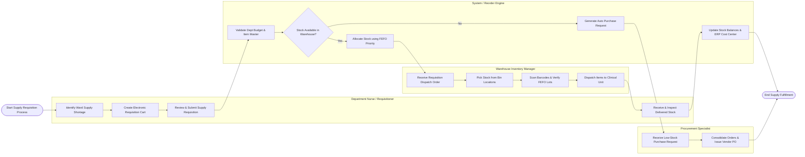

# Swimlane Diagram — Medical Inventory Management System

## Mermaid Code

## Flow Description | Mô tả luồng

| Lane | Actor / Subsystem | Role in Flow |
|------|-------------------|--------------|
| 1 | Department Nurse / Requisitioner | Identifies ward consumable shortages, selects items from catalog, submits digital requisition, and performs final receipt verification upon delivery. |
| 2 | System / Reorder Engine | Validates cost center budget compliance, verifies warehouse stock availability, executes FEFO automated batch allocation, decrements inventory balances, and generates purchasing triggers for out-of-stock items. |
| 3 | Warehouse Inventory Manager | Receives pick tickets, picks items from designated warehouse bins, scans barcodes to confirm FEFO lot compliance, packs supplies, and issues dispatch manifests to ward staff. |
| 4 | Procurement Specialist | Reviews automated purchase requests generated during stockouts, consolidates vendor requests, checks supplier contracts, and issues formal purchase orders for inventory replenishment. |
