# Action Tree — Medical Inventory Management System

## Mermaid Code

```mermaid
graph TD
    Root["Medical Inventory Management System"]

    Root --> M1["Item Catalog Master Data"]
    Root --> M2["Stock Receiving & Inspection"]
    Root --> M3["Batch & FEFO Expiration Tracking"]
    Root --> M4["Department Requisition & Dispatch"]
    Root --> M5["Procurement & Reorder Management"]
    Root --> M6["Stock Audit & Cycle Counting"]
    Root --> M7["Recall & Quarantine Management"]
    Root --> M8["Analytics & Compliance Reporting"]

    M1 --> A11["Register Master Catalog Item"]
    M1 --> A12["Configure Reorder & Par Levels"]
    M1 --> A13["Manage Storage & Temp Rules"]
    M1 --> A14["Set Cost Center Budget Limits"]

    M2 --> A21["Scan Incoming Delivery Manifest"]
    M2 --> A22["Verify PO & Item Quantities"]
    M2 --> A23["Perform Cold Chain Inspection"]
    M2 --> A24["Generate Location Storage Labels"]

    M3 --> A31["Log Batch Lot & Expiry Dates"]
    M3 --> A32["Execute Automated FEFO Allocation"]
    M3 --> A33["Generate Near-Expiry Alerts"]
    M3 --> A34["Enforce Controlled Drug Tracking"]

    M4 --> A41["Submit Ward Supply Requisition"]
    M4 --> A42["Approve Department Order Cart"]
    M4 --> A43["Generate FEFO Picking List"]
    M4 --> A44["Issue Dispatch Token & Manifest"]

    M5 --> A51["Calculate Auto Reorder Triggers"]
    M5 --> A52["Create Purchase Requisition"]
    M5 --> A53["Generate & Transmit Vendor PO"]
    M5 --> A54["Track Supplier Lead Times"]

    M6 --> A61["Schedule Physical Cycle Counts"]
    M6 --> A62["Record Count Variances"]
    M6 --> A63["Log Spoilage & Damaged Stock"]
    M6 --> A64["Approve Inventory Adjustments"]

    M7 --> A71["Initiate FDA/MOH Product Recall"]
    M7 --> A72["Scan Multi-Bin Affected Lots"]
    M7 --> A73["Lock Quarantine Digital Status"]
    M7 --> A74["Generate Vendor Return RMA"]

    M8 --> A81["Generate Stock Valuation Report"]
    M8 --> A82["Analyze Consumption Trends"]
    M8 --> A83["Export Regulatory Audit Logs"]
    M8 --> A84["Sync Cost Data with Hospital ERP"]
```

## Module Description | Mô tả Module

| # | Module | Description | Actions |
|---|--------|-------------|---------|
| 1 | Item Catalog Master Data | Manages master data repository for medical consumables, pharmaceuticals, surgical supplies, and equipment items. | Register Master Catalog Item, Configure Reorder & Par Levels, Manage Storage & Temp Rules, Set Cost Center Budget Limits |
| 2 | Stock Receiving & Inspection | Handles shipment arrival, purchase order matching, physical inspection, cold-chain verification, and barcode labelling. | Scan Incoming Delivery Manifest, Verify PO & Item Quantities, Perform Cold Chain Inspection, Generate Location Storage Labels |
| 3 | Batch & FEFO Expiration Tracking | Tracks lot numbers, manufacturing and expiration dates, enforcing First-Expired, First-Out rule during picking. | Log Batch Lot & Expiry Dates, Execute Automated FEFO Allocation, Generate Near-Expiry Alerts, Enforce Controlled Drug Tracking |
| 4 | Department Requisition & Dispatch | Manages internal ward requests, order approval workflows, picking list generation, and stock dispatch token issuance. | Submit Ward Supply Requisition, Approve Department Order Cart, Generate FEFO Picking List, Issue Dispatch Token & Manifest |
| 5 | Procurement & Reorder Management | Automates stock replenishment calculations, purchase requisition creation, vendor purchase orders, and lead-time tracking. | Calculate Auto Reorder Triggers, Create Purchase Requisition, Generate & Transmit Vendor PO, Track Supplier Lead Times |
| 6 | Stock Audit & Cycle Counting | Manages physical inventory stock counts, discrepancy investigations, spoilage log writing, and inventory adjustments. | Schedule Physical Cycle Counts, Record Count Variances, Log Spoilage & Damaged Stock, Approve Inventory Adjustments |
| 7 | Recall & Quarantine Management | Manages urgent safety recalls from regulatory bodies, locks affected batches, and handles vendor returns. | Initiate FDA/MOH Product Recall, Scan Multi-Bin Affected Lots, Lock Quarantine Digital Status, Generate Vendor Return RMA |
| 8 | Analytics & Compliance Reporting | Provides inventory asset valuation, consumption pattern analysis, controlled substance audit logs, and ERP financial sync. | Generate Stock Valuation Report, Analyze Consumption Trends, Export Regulatory Audit Logs, Sync Cost Data with Hospital ERP |
