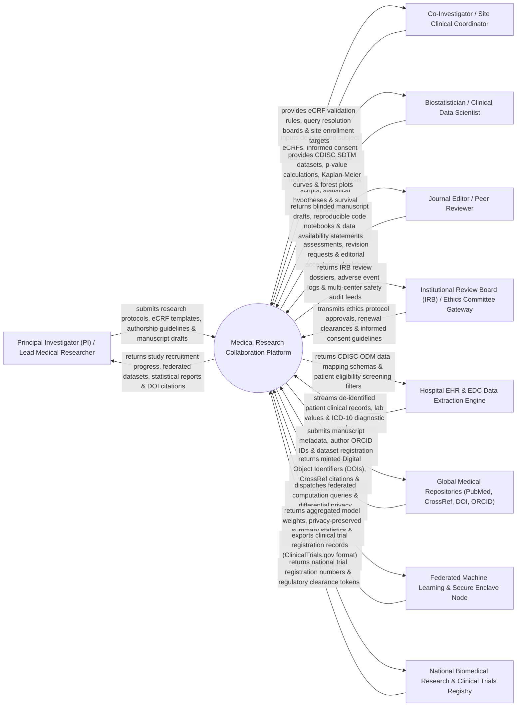

# Context Diagram — Medical Research Collaboration Platform

## Mermaid Code

## Actor & Interaction Table | Bảng Actor & Tương tác

| # | Actor | Actor Type | Data Sent TO System | Data Received FROM System | Notes |
|---|-------|------------|---------------------|---------------------------|-------|
| 1 | Principal Investigator (PI) / Lead Researcher | Primary | Multi-center research protocols, eCRF design templates, ICMJE authorship agreements, manuscript drafts. | Study recruitment progress, aggregated federated datasets, biostatistical reports, minted DOI citations. | Lead medical professor or chief scientist directing multi-center clinical trials or observational studies. |
| 2 | Co-Investigator / Site Clinical Coordinator | Primary | De-identified subject eCRF entries, informed consent dates, trial visit logs, protocol deviation reports. | eCRF data validation rules, data query resolution boards, site recruitment target rosters. | Clinical research coordinator managing subject enrollment and data entry at individual hospital trial sites. |
| 3 | Biostatistician / Clinical Data Scientist | Primary | R/Python statistical analysis scripts, hypothesis testing models, survival analysis code, PRISMA meta-analysis. | CDISC SDTM compliant datasets, p-value calculations, Kaplan-Meier survival curves, Forest plots. | Quantitative statistician conducting data cleaning, hypothesis testing, and statistical modeling. |
| 4 | Journal Editor / Peer Reviewer | Primary | Peer-review evaluation scores, manuscript revision requests, editorial acceptance/rejection decisions. | Blinded manuscript drafts, reproducible R/Python code notebooks, dataset availability statements. | Academic journal editor or independent peer reviewer evaluating submitted medical research manuscripts. |
| 5 | Institutional Review Board (IRB) / Ethics Committee | Supporting System | Ethics protocol approval numbers, annual renewal clearances, informed consent guidelines. | IRB ethics review dossiers, serious adverse event (SAE) logs, multi-center safety audit feeds. | Institutional or national ethics committee governing human medical research safety and consent. |
| 6 | Hospital EHR & EDC Data Extraction Engine | Supporting System | De-identified patient EMR data (labs, medications, ICD-10 codes, procedure timestamps). | CDISC ODM data mapping schemas, patient clinical trial eligibility screening filters. | Hospital EMR integration engine extracting anonymized patient data into electronic Case Report Forms. |
| 7 | Global Medical Repositories | Supporting System | Digital Object Identifiers (DOIs), CrossRef citations, PubMed indexing confirmation, ORCID author profiles. | Manuscript metadata, author ORCID ID tokens, dataset registration payloads, data citation requests. | International academic publishing infrastructure (CrossRef, PubMed, ORCID, DataCite). |
| 8 | Federated Machine Learning & Enclave Node | Supporting System | Aggregated machine learning model weights, privacy-preserved summary statistics, encrypted audit logs. | Federated computation queries, differential privacy epsilon ($\epsilon$) parameters, secure enclave code. | Distributed secure computing nodes running algorithms on local hospital data without sharing raw EMRs. |
| 9 | National Biomedical Research Registry | Regulatory | National clinical trial registration numbers (e.g., NCT / VN-CTR), statutory research clearance tokens. | Mandatory clinical trial registration payloads, study progress summaries, safety monitoring reports. | Government body regulating medical research ethics, clinical trials, and health research data. |

## System Boundary Description | Mô tả Phạm vi Hệ thống

The **Medical Research Collaboration Platform (MRCP)** is an enterprise multi-center biomedical research, Clinical Trial Management System (CTMS), Electronic Data Capture (EDC), federated analytics, and medical manuscript co-authoring platform. Operating across medical universities, research hospitals, pharmaceutical CROs, and ethics committees, it manages multi-center protocol design, IRB approval tracking, CDISC ODM/SDTM eCRF building, federated privacy-preserving data aggregation (differential privacy), biostatistical analysis (R/Python integration, Kaplan-Meier, Forest plots), PRISMA meta-analysis, ICMJE co-authorship workflow, and DOI dataset minting.

**Inside System Scope:**
- Multi-center study protocol creation, study phase classification (Phase I-IV / Observational), and IRB ethics tracking.
- Electronic Data Capture (EDC) & eCRF designer conforming to CDISC ODM (Operational Data Model) standards.
- Multi-site clinical trial coordinator management, subject screening, randomization, and visit tracking.
- Federated privacy-preserving analytics engine using differential privacy ($\epsilon$) and secure multi-party computation.
- Integrated biostatistical analysis environment executing R and Python scripts on CDISC SDTM datasets.
- Interactive statistical visualization: Kaplan-Meier survival curves, Cox proportional hazards, Forest plots, and p-values.
- Collaborative medical manuscript co-authoring suite enforcing ICMJE authorship criteria and version control.
- Digital Object Identifier (DOI) minting via CrossRef/DataCite and ORCID author profile integration.

**Outside System Scope:**
- Physical administration of investigational study drugs to trial subjects in hospital wards (handled by HIS / Trial Pharmacy).
- Commercial corporate financial accounting for pharmaceutical CRO contracts (handled by enterprise ERP).
- General non-research hospital medical record archiving (handled by EMR / EHR).
