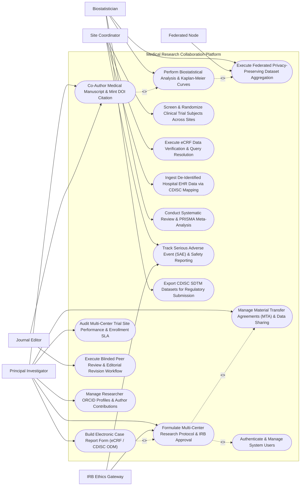

# Use Case Diagram — Medical Research Collaboration Platform

## Mermaid Code

## Actor Table | Bảng Actor

| # | Actor | Actor Type | Role Description | Related Use Cases |
|---|-------|------------|------------------|-------------------|
| 1 | Principal Investigator | Primary | Lead medical researcher creating study protocols, designing eCRFs, managing study sites, and co-authoring publications. | UC01, UC02, UC05, UC11, UC12, UC15 |
| 2 | Site Coordinator | Primary | Clinical research coordinator at participating hospital sites entering de-identified subject eCRFs and resolving data queries. | UC06, UC07, UC08, UC10 |
| 3 | Biostatistician | Primary | Quantitative data scientist running federated computations, executing R/Python analysis scripts, and generating survival curves. | UC03, UC04, UC09, UC14 |
| 4 | Journal Editor | Primary | Academic journal editor or peer reviewer evaluating submitted manuscripts and conducting blinded peer reviews. | UC05, UC13 |
| 5 | IRB Ethics Gateway | Secondary / System | Institutional Review Board system transmitting ethics approval numbers, protocol clearances, and monitoring safety reports. | UC01, UC10 |
| 6 | Federated Node | Secondary / System | Distributed hospital enclave node executing privacy-preserving queries (differential privacy) without transmitting raw patient data. | UC03 |

## Use Case Table | Bảng Use Case

| # | UC ID | Use Case Name | Primary Actor | Secondary Actor | Description | Priority |
|---|-------|---------------|---------------|-----------------|-------------|----------|
| 1 | UC01 | Formulate Multi-Center Research Protocol & IRB Approval | Principal Investigator | IRB Ethics Gateway | Create multi-center research protocols (Phase I-IV / Observational), define primary endpoints, and attach IRB ethics approval certificates. | High |
| 2 | UC02 | Build Electronic Case Report Form (eCRF / CDISC ODM) | Principal Investigator | None | Design standardized electronic Case Report Forms (eCRF) conforming to CDISC ODM standards, setting data validation rules and visit schedules. | High |
| 3 | UC03 | Execute Federated Privacy-Preserving Dataset Aggregation | Biostatistician | Federated Node | Run privacy-preserving federated queries across multi-center hospital nodes using differential privacy ($\epsilon$) to aggregate de-identified datasets. | High |
| 4 | UC04 | Perform Biostatistical Analysis & Kaplan-Meier Curves | Biostatistician | None | Execute integrated R/Python statistical scripts on CDISC SDTM datasets, rendering Kaplan-Meier survival curves, Cox models, and Forest plots. | High |
| 5 | UC05 | Co-Author Medical Manuscript & Mint DOI Citation | Principal Investigator | Journal Editor | Co-author peer-reviewed medical manuscripts adhering to ICMJE authorship guidelines, embedding reproducible code, and minting DOIs. | High |
| 6 | UC06 | Screen & Randomize Clinical Trial Subjects Across Sites | Site Coordinator | None | Screen subjects against protocol eligibility criteria, log informed consent dates, and execute double-blind block randomization. | High |
| 7 | UC07 | Execute eCRF Data Verification & Query Resolution | Site Coordinator | None | Audit eCRF data entry, flag discrepant data values, issue electronic data queries (DCF), and track resolution signatures. | High |
| 8 | UC08 | Ingest De-Identified Hospital EHR Data via CDISC Mapping | Site Coordinator | None | Extract anonymized EMR data (labs, medications, ICD-10 diagnoses) from hospital EHRs, mapping variables into CDISC ODM fields. | High |
| 9 | UC09 | Conduct Systematic Review & PRISMA Meta-Analysis | Biostatistician | None | Execute systematic literature reviews, generate PRISMA study flowcharts, assess Risk of Bias (RoB 2.0), and pool effect sizes. | Medium |
| 10 | UC10 | Track Serious Adverse Event (SAE) & Safety Reporting | Site Coordinator | IRB Ethics Gateway | Record Serious Adverse Events (SAEs), classify trial drug causality, and dispatch expedited 24-hour safety reports to IRB and FDA/MOH. | High |
| 11 | UC11 | Manage Material Transfer Agreements (MTA) & Data Sharing | Principal Investigator | None | Execute legal Material Transfer Agreements (MTA) and Data Transfer Agreements (DTA) governing inter-institutional biospecimen and data sharing. | High |
| 12 | UC12 | Audit Multi-Center Trial Site Performance & Enrollment SLA | Principal Investigator | None | Monitor multi-center trial metrics: target vs actual subject recruitment rate, eCRF completion SLA %, and protocol deviation rates. | Medium |
| 13 | UC13 | Execute Blinded Peer Review & Editorial Revision Workflow | Journal Editor | None | Manage double-blind peer-review workflow, routing manuscripts to reviewers, tracking revision cycles, and logging editorial decisions. | Medium |
| 14 | UC14 | Export CDISC SDTM Datasets for Regulatory Submission | Biostatistician | None | Transform validated research datasets into CDISC SDTM (Study Data Tabulation Model) domain tables (DM, AE, LB, EX) for FDA/EMA submission. | High |
| 15 | UC15 | Manage Researcher ORCID Profiles & Author Contributions | Principal Investigator | None | Link researcher ORCID IDs, define CRediT (Contributor Roles Taxonomy) author roles (Conceptualization, Methodology, Writing), and manage affiliations. | Medium |
| 16 | UC16 | Authenticate & Manage System Users | All Users | None | Enforce multi-factor authentication, role-based access control (PI, Coordinator, Statistician), and cryptographic audit logging. | High |

## Use Case Specification | Đặc tả Use Case

---

### UC01 — Formulate Multi-Center Research Protocol & IRB Approval

| Field | Detail |
|-------|--------|
| **UC ID** | UC01 |
| **Use Case Name** | Formulate Multi-Center Research Protocol & IRB Approval |
| **Actor(s)** | Primary: Principal Investigator   Secondary: IRB Ethics Gateway |
| **Description** | Formulates a multi-center biomedical research study protocol (Phase III Randomized Controlled Trial or Observational Cohort Study), defines primary/secondary clinical endpoints, assigns participating hospital research sites, attaches Institutional Review Board (IRB) ethics approval certificates, and registers the trial in national registries. |
| **Precondition** | 1. The Lead Principal Investigator (PI) is authenticated in MRCP with verified ORCID profile (UC15).   2. The IRB Ethics Committee API gateway is operational. |
| **Main Flow** | 1. The Principal Investigator opens "New Multi-Center Research Protocol" in MRCP.   2. The PI inputs **Study Metadata & Hypothesis**:   &nbsp;&nbsp;&nbsp;&nbsp;- Protocol Title: *Multi-Center Phase III Trial of Targeted Immunotherapy vs Standard Chemotherapy in Advanced Lung Cancer*   &nbsp;&nbsp;&nbsp;&nbsp;- Short Title / Acronym: `LUNG-TARGET-III`   &nbsp;&nbsp;&nbsp;&nbsp;- Study Type: Interventional Phase III Double-Blind Randomized Controlled Trial   &nbsp;&nbsp;&nbsp;&nbsp;- **Primary Clinical Endpoint**: 5-Year Overall Survival (OS) Rate   &nbsp;&nbsp;&nbsp;&nbsp;- **Secondary Endpoints**: Progression-Free Survival (PFS), Objective Response Rate (ORR), CTCAE Grade 3-4 Toxicity Rate   &nbsp;&nbsp;&nbsp;&nbsp;- Target Sample Size: $N = 450\text{ Subjects}$ across 6 Hospital Sites.   3. The PI adds **Participating Research Sites**:   &nbsp;&nbsp;&nbsp;&nbsp;- Site 1: Bach Mai Hospital (Lead Site - PI: Prof. Nguyen Van A)   &nbsp;&nbsp;&nbsp;&nbsp;- Site 2: Cho Ray Hospital (Site PI: Dr. Tran Van B)   &nbsp;&nbsp;&nbsp;&nbsp;- Sites 3-6: Participating Academic Centers.   4. The PI uploads **IRB Ethics Committee Approval**:   &nbsp;&nbsp;&nbsp;&nbsp;- **IRB Approval Number**: `IRB-MOH-2026-ETH-99182` (Approved Oct 10, 2026)   &nbsp;&nbsp;&nbsp;&nbsp;- Expiration Date: Oct 10, 2027.   5. The System dispatches protocol metadata to the National Biomedical Research Registry (UC15), securing **Clinical Trial Registration Number**: `NCT-VN-2026-08192`.   6. The System locks protocol specification `PROT-2026-8812` into "Approved - Ready for eCRF Design" status (UC02). |
| **Alternative Flow** | **AF1** — Multi-Center Observational Biobank Study Protocol: PI creates an observational genomic cohort study protocol (`GEN-COLON-OBS`), defining data collection domains for biobank tissue samples and 10-year longitudinal follow-up.   **AF2** — Sub-Protocol / Protocol Amendment Creation: PI submits Protocol Amendment #02 modifying inclusion criteria (expanding age limit from 65 to 75 years); System routes amendment to IRB for re-approval. |
| **Exception Flow** | **EX1** — Expired / Invalid IRB Approval Certificate: Uploaded IRB certificate expiration date is in the past; System blocks protocol activation with error "IRB Ethics Approval Expired — Valid Approval Required".   **EX2** — Duplicate Protocol Registration Warning: System detects identical protocol title registered by another PI; System alerts "Potential Protocol Duplicate — Review Existing Protocol Registry". |
| **Postcondition** | Protocol PROT-2026-8812 is registered, IRB approval (IRB-MOH-2026-ETH-99182) is attached, NCT trial registration (NCT-VN-2026-08192) is secured, and eCRF design is enabled. |
| **Business Rule** | **BR1**: Multi-center clinical research protocols MUST NOT recruit subjects or accept eCRF data entry without an active, verified Institutional Review Board (IRB) ethics approval certificate.   **BR2**: Clinical trial protocols involving human subjects MUST be registered in an accredited national or international clinical trials registry (e.g., ClinicalTrials.gov / NIIS) prior to first subject enrollment. |

---

### UC02 — Build Electronic Case Report Form (eCRF / CDISC ODM)

| Field | Detail |
|-------|--------|
| **UC ID** | UC02 |
| **Use Case Name** | Build Electronic Case Report Form (eCRF / CDISC ODM) |
| **Actor(s)** | Primary: Principal Investigator |
| **Description** | Designs standardized electronic Case Report Forms (eCRF) for clinical trials conforming to CDISC ODM (Operational Data Model) v1.3.2 standards, configuring visit schedules (Screening, Baseline, Cycle 1-12, End of Study), setting field validation range rules (e.g., Systolic BP 60-250 mmHg), and defining mandatory required fields. |
| **Precondition** | 1. Research study protocol `PROT-2026-8812` (UC01) is approved and active.   2. The eCRF Form Builder module is initialized. |
| **Main Flow** | 1. The Principal Investigator opens "eCRF Form Studio" for Protocol `PROT-2026-8812` (`LUNG-TARGET-III`).   2. The PI configures **CDISC ODM Clinical Domains & Visit Matrix**:   &nbsp;&nbsp;&nbsp;&nbsp;- **Visit 1**: Screening & Informed Consent (Form: `DM` Demographics, `IE` Inclusion/Exclusion)   &nbsp;&nbsp;&nbsp;&nbsp;- **Visit 2**: Baseline Clinical Assessment (Form: `VS` Vitals, `LB` Labs, `EG` ECG, `TU` Tumor Assessment)   &nbsp;&nbsp;&nbsp;&nbsp;- **Visits 3-14**: Treatment Cycles 1-12 (Form: `EX` Exposure, `AE` Adverse Events)   &nbsp;&nbsp;&nbsp;&nbsp;- **Visit 15**: End of Study / Survival Follow-Up (Form: `DS` Disposition).   3. The PI builds the **Demographics Form (`eCRF-DM`)**:   &nbsp;&nbsp;&nbsp;&nbsp;- Subject Code: Text Field (Format `SUB-XXX-NNN` -> Required)   &nbsp;&nbsp;&nbsp;&nbsp;- Date of Birth: Date Field (Age must be >= 18 and <= 75)   &nbsp;&nbsp;&nbsp;&nbsp;- Sex: Coded Item (`M` Male, `F` Female)   &nbsp;&nbsp;&nbsp;&nbsp;- Race/Ethnicity: Coded Item (CDISC Controlled Terminology `C66790`).   4. The PI configures **Field Validation Rules & Range Checks**:   &nbsp;&nbsp;&nbsp;&nbsp;- *Platelet Count Field*: Numeric, Range `10 to 1500 x10^9/L` (If < 100, trigger warning: "Sub-Threshold Platelets")   &nbsp;&nbsp;&nbsp;&nbsp;- *Informed Consent Date*: Date Field (Must be <= Screening Date).   5. The System exports the eCRF schema in **CDISC ODM XML Format** (`odm_schema_v1.3.2.xml`).   6. The PI publishes eCRF Version `v1.0`; the System deploys the eCRF schema across all 6 participating hospital research site portals (UC06). |
| **Alternative Flow** | **AF1** — Standardized CDISC Domain Template Import: PI imports pre-built standardized CDISC SDTM domain templates (`AE` Adverse Events, `CM` Concomitant Medications, `LB` Laboratory) from the global library, reducing design time by 80%.   **AF2** — Conditional Skip Logic Configuration: PI sets skip logic on Pregnancy Form: "If Sex = Male, Skip Pregnancy Assessment Form". |
| **Exception Flow** | **EX1** — CDISC Schema Validation Error: Form includes non-standard field names that violate CDISC ODM naming rules; System flags "CDISC Validation Error — Field Name 'pat_wt' Must Follow CDISC Terminology 'VSSTRESN'".   **EX2** — Post-Enrollment Structural eCRF Editing Block: PI attempts to delete a field from eCRF v1.0 after 50 subjects have entered data; System blocks deletion, requiring a Versioned eCRF Amendment (`v2.0`). |
| **Postcondition** | eCRF schema conforming to CDISC ODM v1.3.2 is created, 15 visit forms are published (v1.0), validation rules are deployed, and data entry is enabled across sites. |
| **Business Rule** | **BR1**: eCRF data field definitions MUST conform to CDISC ODM (Operational Data Model) and CDISC Controlled Terminology standards for seamless regulatory submission.   **BR2**: Modifications to eCRF form structures after study site activation MUST be deployed as major versioned amendments (e.g., v1.0 to v2.0) preserving historical data integrity. |

---

### UC03 — Execute Federated Privacy-Preserving Dataset Aggregation

| Field | Detail |
|-------|--------|
| **UC ID** | UC03 |
| **Use Case Name** | Execute Federated Privacy-Preserving Dataset Aggregation |
| **Actor(s)** | Primary: Biostatistician   Secondary: Federated Node |
| **Description** | Executes privacy-preserving federated machine learning and statistical queries across multi-center hospital enclave nodes without transferring raw patient EMRs, applying Differential Privacy ($\epsilon$-differential privacy noise injection) and Secure Multi-Party Computation (SMPC) to aggregate de-identified study datasets. |
| **Precondition** | 1. Participating hospital research sites (Bach Mai, Cho Ray, etc.) have deployed secure MRCP enclave nodes.   2. Data Transfer Agreements (DTA) (UC11) governing federated analytics are signed. |
| **Main Flow** | 1. The Biostatistician opens "Federated Privacy-Preserving Data Aggregator" for Protocol `PROT-2026-8812`.   2. The Biostatistician formulates a **Federated Aggregation Query**:   &nbsp;&nbsp;&nbsp;&nbsp;- Target Query: Calculate mean overall survival (months), hazard ratios, and biomarker correlations for Stage III Lung Cancer patients across 6 hospital nodes.   &nbsp;&nbsp;&nbsp;&nbsp;- Privacy Budget Setting: **Differential Privacy $\epsilon = 0.5$** (High Privacy Guarantee), **$\delta = 10^{-5}$**.   3. The System dispatches encrypted **Federated Query Payloads** to the 6 hospital enclave nodes (`NODE-BM-01`, `NODE-CR-02`, etc.).   4. Each Hospital Enclave Node executes local computation inside a hardware-isolated Secure Enclave (SGX/SEV):   &nbsp;&nbsp;&nbsp;&nbsp;- Runs local statistical summary on hospital's internal EMR database   &nbsp;&nbsp;&nbsp;&nbsp;- Injects Laplace noise calibrated to Differential Privacy $\epsilon = 0.5$   &nbsp;&nbsp;&nbsp;&nbsp;- Computes encrypted local summary statistics vector.   5. The 6 enclave nodes return encrypted summary vectors to the **Central Secure Aggregator**.   6. The Central Aggregator combines the vectors via **Homomorphic Encryption Aggregation**:   &nbsp;&nbsp;&nbsp;&nbsp;- Total Aggregated Sample Size: $N = 450\text{ De-Identified Subjects}$   &nbsp;&nbsp;&nbsp;&nbsp;- Aggregated Mean Overall Survival: $28.4\text{ Months}$   &nbsp;&nbsp;&nbsp;&nbsp;- Zero raw patient record left hospital premises -> **100% Privacy Preserved**.   7. The System saves the privacy-preserved aggregated dataset `DS-FED-2026-9918` for biostatistical analysis (UC04). |
| **Alternative Flow** | **AF1** — Federated Deep Learning Model Training: Biostatistician trains a multi-center AI diagnostic model (e.g., lung nodule CT classifier) using Federated Averaging (FedAvg), updating global model weights across 6 nodes without centralized image storage.   **AF2** — Cohort Feasibility Query: Biostatistician runs a federated count query: "How many patients across 6 hospitals meet inclusion criteria for a new Phase II trial?" -> System returns aggregated count ($N = 1,240$) with differential noise. |
| **Exception Flow** | **EX1** — Privacy Budget Exhaustion ($\epsilon$ Exhausted): Hospital Node 02 reports privacy budget $\epsilon$ limit for the month is reached; System blocks further queries on Node 02 until budget resets.   **EX2** — Enclave Node Connection Timeout: Node 04 fails to respond within 60 seconds; System executes partial aggregation over 5 nodes and flags "Node 04 Offline". |
| **Postcondition** | Privacy-preserved aggregated dataset DS-FED-2026-9918 ($N=450$) is generated, zero raw EMRs leave hospital nodes, differential privacy ($\epsilon=0.5$) passes, and data is ready for R analysis. |
| **Business Rule** | **BR1**: Federated queries across multi-center hospital nodes MUST enforce Differential Privacy ($\epsilon$) constraints to mathematically guarantee patient re-identification is impossible.   **BR2**: Raw patient-level Protected Health Information (PHI) MUST NEVER be transmitted outside local hospital enclave nodes during federated analytics. |

---

### UC04 — Perform Biostatistical Analysis & Kaplan-Meier Curves

| Field | Detail |
|-------|--------|
| **UC ID** | UC04 |
| **Use Case Name** | Perform Biostatistical Analysis & Kaplan-Meier Curves |
| **Actor(s)** | Primary: Biostatistician |
| **Description** | Executes integrated R and Python statistical analysis scripts on validated CDISC SDTM research datasets, performing hypothesis testing (Log-Rank test, Chi-Square, t-test), multivariable Cox Proportional Hazards regression, and rendering publication-ready statistical visualizations (Kaplan-Meier survival curves, Forest plots, ROC curves). |
| **Precondition** | 1. Aggregated study dataset `DS-FED-2026-9918` (UC03) or CDISC SDTM dataset is loaded.   2. The R / Python Analytics Environment is initialized. |
| **Main Flow** | 1. The Biostatistician opens the "R/Python Statistical Workbench" for Study `LUNG-TARGET-III`.   2. The Biostatistician selects Dataset `DS-FED-2026-9918` ($N = 450\text{ Subjects}$: Arm A Targeted Therapy $N=225$ vs Arm B Standard Chemo $N=225$).   3. The Biostatistician executes an **R Survival Analysis Script**:   &nbsp;&nbsp;&nbsp;&nbsp;- R Package: `survival`, `survminer`   &nbsp;&nbsp;&nbsp;&nbsp;- Code: `fit <- survfit(Surv(os_months, status) ~ treatment_arm, data = sdtm_adtte)`.   4. The System executes the script and outputs **Statistical Hypothesis Results**:   &nbsp;&nbsp;&nbsp;&nbsp;- **Median Overall Survival (OS)**: Arm A (Targeted) = $34.2\text{ Months}$ vs Arm B (Chemo) = $21.8\text{ Months}$   &nbsp;&nbsp;&nbsp;&nbsp;- **Log-Rank Test p-value**: $\mathbf{p < 0.0001}$ (Statistically Significant)   &nbsp;&nbsp;&nbsp;&nbsp;- **Cox Hazard Ratio (HR)**: $\mathbf{HR = 0.58}\ (95\%\text{ CI: } 0.44\text{ to } 0.76,\ \text{p} < 0.001)$ -> $42\%$ Reduction in Risk of Death.   5. The System renders high-resolution **Kaplan-Meier Survival Curves**:   &nbsp;&nbsp;&nbsp;&nbsp;- Displays cumulative survival probability over 60 months with Number-at-Risk table   &nbsp;&nbsp;&nbsp;&nbsp;- Colors: Arm A (Blue) vs Arm B (Red) with 95% Confidence Interval bands.   6. The Biostatistician saves the analysis workspace, generates a **Reproducible R Markdown Report** (`stats_report_v1.0.pdf`), and attaches it to the Manuscript Draft (UC05). |
| **Alternative Flow** | **AF1** — Forest Plot Subgroup Analysis: Biostatistician computes subgroup HRs across age, gender, smoking status, and PD-L1 expression levels, rendering a 300 DPI Forest Plot.   **AF2** — Systematic Review PRISMA Meta-Analysis: Biostatistician pools odds ratios across 12 published trials (UC09), rendering a Meta-Analysis Funnel Plot and Heterogeneity statistic ($I^2 = 24\%$). |
| **Exception Flow** | **EX1** — Non-Proportional Hazards Assumption Violation: Cox model test (`cox.zph()`) reveals non-proportional hazards ($p = 0.01$); System alerts Biostatistician to fit a Time-Varying Coefficient Cox Model.   **EX2** — R Code Execution Syntax Error: Script contains undefined variable; System displays R console error log and highlights line 24. |
| **Postcondition** | Survival analysis (Log-rank $p < 0.0001$, Cox $HR = 0.58$) is executed, high-resolution Kaplan-Meier curves are rendered, and R Markdown report is attached to study dossier. |
| **Business Rule** | **BR1**: Clinical trial primary outcome statistical reports MUST include exact p-values, Hazard Ratios / Odds Ratios, and 95% Confidence Intervals.   **BR2**: Statistical analysis workflows MUST be fully reproducible by saving raw R/Python code scripts, package version locks, and seed parameters alongside output graphics. |

---

### UC05 — Co-Author Medical Manuscript & Mint DOI Dataset Citation

| Field | Detail |
|-------|--------|
| **UC ID** | UC05 |
| **Use Case Name** | Co-Author Medical Manuscript & Mint DOI Dataset Citation |
| **Actor(s)** | Primary: Principal Investigator   Secondary: Journal Editor, Biostatistician |
| **Description** | Co-authors a peer-reviewed medical manuscript using a collaborative real-time editor adhering to ICMJE (International Committee of Medical Journal Editors) authorship guidelines, assigns CRediT contributor roles, embeds reproducible R figures/tables (UC04), attaches Data Availability Statements, mints a permanent Digital Object Identifier (DOI) for the underlying dataset via CrossRef, and submits the manuscript to academic journals. |
| **Precondition** | 1. Statistical analysis and Kaplan-Meier figures (UC04) are finalized.   2. All co-authors are registered with verified ORCID IDs (UC15). |
| **Main Flow** | 1. The Principal Investigator opens "Collaborative Manuscript Studio" for Study `LUNG-TARGET-III`.   2. The PI configures **ICMJE Authorship & CRediT Roles**:   &nbsp;&nbsp;&nbsp;&nbsp;- Author 1 (First Author): Dr. Tran Van B (ORCID: `0000-0002-1820-9918` -> Roles: Writing - Original Draft, Data Curation)   &nbsp;&nbsp;&nbsp;&nbsp;- Author 2 (Statistician): Dr. Le Thi C (ORCID: `0000-0003-4128-0912` -> Roles: Formal Analysis, Software)   &nbsp;&nbsp;&nbsp;&nbsp;- Author 3 (Corresponding Author / PI): Prof. Nguyen Van A (ORCID: `0000-0001-9918-2026` -> Roles: Conceptualization, Supervision, Writing - Review & Editing).   3. The Co-Authors draft the manuscript text collaboratively (Abstract, Intro, Methods, Results, Discussion).   4. The PI embeds live statistical figures from the R Workbench: **Figure 1: Kaplan-Meier Overall Survival Curve (HR 0.58)** and **Table 1: Baseline Demographics ($N=450$)**.   5. The System dispatches a dataset registration payload to **CrossRef / DataCite**:   &nbsp;&nbsp;&nbsp;&nbsp;- Mints Permanent Dataset DOI: **`10.1016/j.medres.2026.08192`**   &nbsp;&nbsp;&nbsp;&nbsp;- Generates Data Availability Statement: *"The de-identified CDISC SDTM dataset supporting this trial is available under DOI 10.1016/j.medres.2026.08192."*   6. All 8 co-authors enter electronic ICMJE conflict of interest disclosures and approve submission.   7. The PI submits the completed manuscript package to the **Journal Editor Portal** (`The Lancet Oncology / New England Journal of Medicine`) for peer review (UC13). |
| **Alternative Flow** | **AF1** — Pre-Print Repository Submission: PI submits pre-print draft to medRxiv server prior to formal journal peer review, generating an instant pre-print DOI (`10.1101/2026.08.19.26281920`).   **AF2** — Open Science Data Repository Export: System exports de-identified dataset, R code notebook, and eCRF blank forms to Zenodo / Harvard Dataverse for open science compliance. |
| **Exception Flow** | **EX1** — ICMJE Authorship Dispute Alert: An author is added without specifying 4 mandatory ICMJE criteria; System flags "ICMJE Compliance Warning — Author Must Fulfill All 4 ICMJE Criteria".   **EX2** — DOI Minting Metadata Validation Error: Dataset metadata lacks mandatory license field; System alerts PI to select a Creative Commons License (CC-BY 4.0). |
| **Postcondition** | Manuscript is co-authored, CRediT roles assigned, Kaplan-Meier figures embedded, dataset DOI (`10.1016/j.medres.2026.08192`) is minted, and manuscript is submitted for peer review. |
| **Business Rule** | **BR1**: Medical manuscript co-authorship MUST strictly conform to ICMJE 4-point authorship criteria and explicitly document CRediT contributor taxonomy roles for every listed author.   **BR2**: Datasets supporting published medical research MUST be registered with a permanent Digital Object Identifier (DOI) and accompanied by a formal Data Availability Statement. |
