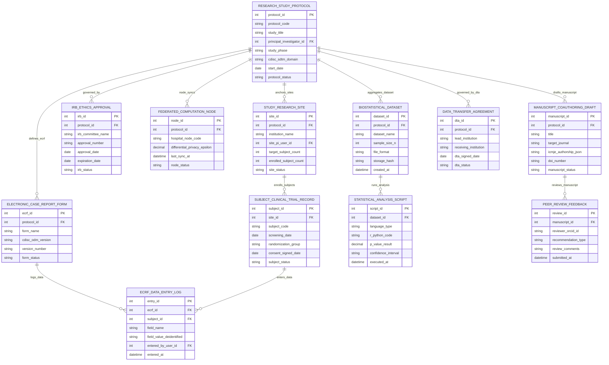

# Conceptual ERD — Medical Research Collaboration Platform

## Mermaid Code

## Entity Description Table | Bảng mô tả Entity

| # | Entity Name | Vietnamese Name | Description | Key Attributes | Main Relationships |
|---|-------------|-----------------|-------------|----------------|-------------------|
| 1 | RESEARCH_STUDY_PROTOCOL | Đề cương Nghiên cứu Master | Master research study protocol record storing protocol code, study title, principal investigator ID, study phase, CDISC domain, start date, and status. | protocol_id, protocol_code, study_title, principal_investigator_id, study_phase, cdisc_sdtm_domain, start_date, protocol_status | Has RESEARCH_SITE, IRB_APPROVAL, ECRF, FEDERATED_NODE, DATASET, MANUSCRIPT, DTA. |
| 2 | STUDY_RESEARCH_SITE | Trung tâm Nghiên cứu Thử nghiệm | Participating hospital research site record storing protocol ID, institution name, site PI user ID, target subjects, enrolled count, and status. | site_id, protocol_id, institution_name, site_pi_user_id, target_subject_count, enrolled_subject_count, site_status | Belongs to RESEARCH_STUDY_PROTOCOL; Has SUBJECT_CLINICAL_TRIAL_RECORD. |
| 3 | IRB_ETHICS_APPROVAL | Giấy Phê duyệt Hội đồng Đạo đức | Institutional Review Board (IRB) ethics approval record tracking protocol ID, IRB committee name, approval number, approval/expiration dates, and status. | irb_id, protocol_id, irb_committee_name, approval_number, approval_date, expiration_date, irb_status | Belongs to RESEARCH_STUDY_PROTOCOL. |
| 4 | ELECTRONIC_CASE_REPORT_FORM | Mẫu Báo cáo Bệnh án eCRF | Electronic Case Report Form (eCRF) schema record storing protocol ID, form name, CDISC ODM version, version number, and form status. | ecrf_id, protocol_id, form_name, cdisc_odm_version, version_number, form_status | Belongs to RESEARCH_STUDY_PROTOCOL; Has ECRF_DATA_ENTRY_LOG. |
| 5 | SUBJECT_CLINICAL_TRIAL_RECORD | Hồ sơ Đối tượng Thử nghiệm | De-identified clinical trial subject record storing site ID, subject code, screening date, randomization group, consent signed date, and status. | subject_id, site_id, subject_code, screening_date, randomization_group, consent_signed_date, subject_status | Belongs to STUDY_RESEARCH_SITE; Has ECRF_DATA_ENTRY_LOG. |
| 6 | ECRF_DATA_ENTRY_LOG | Nhật ký Nhập liệu eCRF | eCRF field-level data entry log record storing eCRF ID, subject ID, field name, de-identified field value, entered by user ID, and timestamp. | entry_id, ecrf_id, subject_id, field_name, field_value_deidentified, entered_by_user_id, entered_at | Belongs to ELECTRONIC_CASE_REPORT_FORM and SUBJECT_CLINICAL_TRIAL_RECORD. |
| 7 | FEDERATED_COMPUTATION_NODE | Nút Tính toán Liên kết | Federated privacy-preserving computation enclave node record tracking protocol ID, hospital node code, differential privacy $\epsilon$, last sync, and status. | node_id, protocol_id, hospital_node_code, differential_privacy_epsilon, last_sync_at, node_status | Belongs to RESEARCH_STUDY_PROTOCOL. |
| 8 | BIOSTATISTICAL_DATASET | Tập Dữ liệu Thống kê Y sinh | Aggregated CDISC SDTM compliant research dataset record storing protocol ID, dataset name, sample size $N$, file format, storage hash, and timestamp. | dataset_id, protocol_id, dataset_name, sample_size_n, file_format, storage_hash, created_at | Belongs to RESEARCH_STUDY_PROTOCOL; Has STATISTICAL_ANALYSIS_SCRIPT. |
| 9 | STATISTICAL_ANALYSIS_SCRIPT | Kịch bản Phân tích R/Python | R / Python statistical analysis script record tracking dataset ID, language type, R/Python code, p-value result, confidence interval, and timestamp. | script_id, dataset_id, language_type, r_python_code, p_value_result, confidence_interval, executed_at | Belongs to BIOSTATISTICAL_DATASET. |
| 10 | MANUSCRIPT_COAUTHORING_DRAFT | Bản thảo Bài báo Y học | Collaborative medical manuscript draft record tracking protocol ID, manuscript title, target journal, ICMJE authorship JSON, minted DOI, and status. | manuscript_id, protocol_id, title, target_journal, icmje_authorship_json, doi_number, manuscript_status | Belongs to RESEARCH_STUDY_PROTOCOL; Has PEER_REVIEW_FEEDBACK. |
| 11 | PEER_REVIEW_FEEDBACK | Nhận xét Phản biện Bài báo | Peer-review feedback record tracking manuscript ID, reviewer ORCID ID, recommendation type (Accept, Revision, Reject), comments, and timestamp. | review_id, manuscript_id, reviewer_orcid_id, recommendation_type, review_comments, submitted_at | Belongs to MANUSCRIPT_COAUTHORING_DRAFT. |
| 12 | DATA_TRANSFER_AGREEMENT | Thỏa thuận Chuyển giao Dữ liệu | Data Transfer Agreement (DTA) and Material Transfer Agreement (MTA) record tracking protocol ID, lead institution, receiving institution, signed date, and status. | dta_id, protocol_id, lead_institution, receiving_institution, dta_signed_date, dta_status | Belongs to RESEARCH_STUDY_PROTOCOL. |

## Relationship Description | Mô tả Quan hệ

| # | From Entity | Cardinality | To Entity | Relationship Label | Business Explanation |
|---|-------------|-------------|-----------|-------------------|----------------------|
| 1 | RESEARCH_STUDY_PROTOCOL | one-to-many | STUDY_RESEARCH_SITE | anchors_sites | One multi-center research protocol anchors multiple participating hospital research sites. |
| 2 | RESEARCH_STUDY_PROTOCOL | one-to-many | IRB_ETHICS_APPROVAL | governed_by | One research protocol is governed by IRB ethics committee approvals and renewals. |
| 3 | RESEARCH_STUDY_PROTOCOL | one-to-many | ELECTRONIC_CASE_REPORT_FORM | defines_ecrf | One research protocol defines multiple standardized eCRF form schemas (CDISC ODM). |
| 4 | RESEARCH_STUDY_PROTOCOL | one-to-many | FEDERATED_COMPUTATION_NODE | node_syncs | One research protocol syncs across multiple federated hospital enclave nodes. |
| 5 | RESEARCH_STUDY_PROTOCOL | one-to-many | BIOSTATISTICAL_DATASET | aggregates_dataset | One research protocol aggregates de-identified research datasets (CDISC SDTM). |
| 6 | RESEARCH_STUDY_PROTOCOL | one-to-many | MANUSCRIPT_COAUTHORING_DRAFT | drafts_manuscript | One research protocol produces peer-reviewed medical manuscript drafts. |
| 7 | RESEARCH_STUDY_PROTOCOL | one-to-many | DATA_TRANSFER_AGREEMENT | governed_by_dta | One research protocol is governed by inter-institutional Data Transfer Agreements (DTA). |
| 8 | STUDY_RESEARCH_SITE | one-to-many | SUBJECT_CLINICAL_TRIAL_RECORD | enrolls_subjects | One participating research site enrolls de-identified clinical trial subjects. |
| 9 | ELECTRONIC_CASE_REPORT_FORM | one-to-many | ECRF_DATA_ENTRY_LOG | logs_data | One eCRF form schema logs field-level data entries for trial subjects. |
| 10 | BIOSTATISTICAL_DATASET | one-to-many | STATISTICAL_ANALYSIS_SCRIPT | runs_analysis | One research dataset runs R and Python statistical analysis scripts. |
| 11 | MANUSCRIPT_COAUTHORING_DRAFT | one-to-many | PEER_REVIEW_FEEDBACK | reviews_manuscript | One manuscript draft receives blinded peer-review feedback from journal reviewers. |
