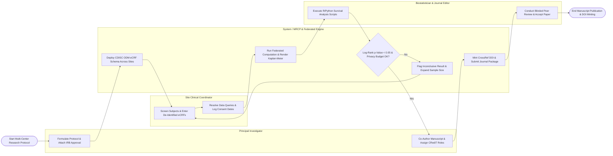

# Swimlane Diagram — Medical Research Collaboration Platform

## Mermaid Code

## Flow Description | Mô tả luồng

| Lane | Actor / Subsystem | Role in Flow |
|------|-------------------|--------------|
| 1 | Principal Investigator | Formulates multi-center research protocols, attaches IRB approvals, assigns research sites, co-authors medical manuscripts, and manages CRediT author roles. |
| 2 | Site Clinical Coordinator | Screens subjects against inclusion criteria, records informed consents, inputs de-identified eCRF data, and resolves electronic data queries (DCF). |
| 3 | System / MRCP & Federated Engine | Deploys CDISC ODM eCRF schemas, executes federated queries with differential privacy ($\epsilon$), aggregates datasets, renders Kaplan-Meier curves, and mints DOIs. |
| 4 | Biostatistician & Journal Editor | Executes R/Python biostatistical analysis scripts, tests log-rank hypotheses, conducts blinded peer-review evaluations, and approves final manuscript publication. |
