# Action Tree — Medical Research Collaboration Platform

## Mermaid Code

```mermaid
graph TD
    Root["Medical Research Collaboration Platform"]

    Root --> M1["Protocol Design & IRB Approval"]
    Root --> M2["Electronic Data Capture & eCRF"]
    Root --> M3["Federated Privacy Analytics Node"]
    Root --> M4["Biostatistics & R Python Studio"]
    Root --> M5["Manuscript Authoring & DOI Minting"]
    Root --> M6["Site Coordination & Recruitment"]
    Root --> M7["Safety & SAE Adverse Event Track"]
    Root --> M8["Data Governance MTA & ORCID"]

    M1 --> A11["Formulate Multi-Center Research Protocols"]
    M1 --> A12["Attach IRB Ethics Committee Approvals"]
    M1 --> A13["Assign Participating Hospital Trial Sites"]
    M1 --> A14["Register Clinical Trial NCT Numbers"]

    M2 --> A21["Design CDISC ODM Compliant eCRF Forms"]
    M2 --> A22["Set Field Data Validation Range Rules"]
    M2 --> A23["Configure Clinical Visit Matrix Schedules"]
    M2 --> A24["Publish Versioned eCRF Schema Releases"]

    M3 --> A31["Dispatch Encrypted Federated Query Payloads"]
    M3 --> A32["Enforce Differential Privacy Epsilon Noise"]
    M3 --> A33["Execute Secure Enclave Local Computations"]
    M3 --> A34["Aggregate Homomorphic Summary Vectors"]

    M4 --> A41["Execute Integrated R Python Analysis Scripts"]
    M4 --> A42["Compute Log-Rank Test & Cox Hazard Ratios"]
    M4 --> A43["Render Kaplan-Meier Survival Curve Plots"]
    M4 --> A44["Generate Reproducible R Markdown Reports"]

    M5 --> A51["Co-Author Collaborative Medical Manuscripts"]
    M5 --> A52["Assign CRediT Author Taxonomy Contribution Roles"]
    M5 --> A53["Mint Permanent CrossRef Dataset DOIs"]
    M5 --> A54["Submit Manuscript Packages to Journal Portals"]

    M6 --> A61["Screen Subjects against Protocol Criteria"]
    M6 --> A62["Execute Double-Blind Block Randomization"]
    M6 --> A63["Verify eCRF Data & Issue Query Resolutions"]
    M6 --> A64["Ingest Hospital EHR via CDISC SDTM Mapping"]

    M7 --> A71["Record Serious Adverse Events SAE Reports"]
    M7 --> A72["Classify Investigational Drug Causality"]
    M7 --> A73["Dispatch 24-Hour Expedited Safety Bulletins"]
    M7 --> A74["Audit Multi-Center Trial Safety Metrics"]

    M8 --> A81["Manage Data Transfer Agreements DTA MTAs"]
    M8 --> A82["Verify Researcher ORCID Author Profiles"]
    M8 --> A83["Enforce CDISC SDTM Regulatory Export Formats"]
    M8 --> A84["Audit Multi-Center Trial Site Enrollment SLAs"]
```

## Module Description | Mô tả Module

| # | Module | Description | Actions |
|---|--------|-------------|---------|
| 1 | Protocol Design & IRB Approval | Formulates multi-center study protocols, attaches IRB ethics approvals, assigns participating hospital sites, and registers NCT numbers. | Formulate Multi-Center Research Protocols, Attach IRB Ethics Committee Approvals, Assign Participating Hospital Trial Sites, Register Clinical Trial NCT Numbers |
| 2 | Electronic Data Capture & eCRF | Designs CDISC ODM compliant eCRF forms, sets field data validation range rules, configures visit schedules, and publishes versioned schemas. | Design CDISC ODM Compliant eCRF Forms, Set Field Data Validation Range Rules, Configure Clinical Visit Matrix Schedules, Publish Versioned eCRF Schema Releases |
| 3 | Federated Privacy Analytics Node | Dispatches encrypted federated query payloads, enforces Differential Privacy ($\epsilon$), executes secure enclave computations, and aggregates vectors. | Dispatch Encrypted Federated Query Payloads, Enforce Differential Privacy Epsilon Noise, Execute Secure Enclave Local Computations, Aggregate Homomorphic Summary Vectors |
| 4 | Biostatistics & R Python Studio | Executes integrated R/Python scripts, computes log-rank tests and Cox hazard ratios, renders Kaplan-Meier curves, and generates R reports. | Execute Integrated R Python Analysis Scripts, Compute Log-Rank Test & Cox Hazard Ratios, Render Kaplan-Meier Survival Curve Plots, Generate Reproducible R Markdown Reports |
| 5 | Manuscript Authoring & DOI Minting | Co-authors medical manuscripts, assigns CRediT author contributor roles, mints permanent CrossRef dataset DOIs, and submits to journals. | Co-Author Collaborative Medical Manuscripts, Assign CRediT Author Taxonomy Contribution Roles, Mint Permanent CrossRef Dataset DOIs, Submit Manuscript Packages to Journal Portals |
| 6 | Site Coordination & Recruitment | Screens subjects against protocol criteria, executes double-blind randomization, verifies eCRF entries, and ingests hospital EHR data. | Screen Subjects against Protocol Criteria, Execute Double-Blind Block Randomization, Verify eCRF Data & Issue Query Resolutions, Ingest Hospital EHR via CDISC SDTM Mapping |
| 7 | Safety & SAE Adverse Event Track | Records Serious Adverse Events (SAEs), classifies drug causality, dispatches 24-hour expedited safety bulletins to IRBs, and audits trial safety. | Record Serious Adverse Events SAE Reports, Classify Investigational Drug Causality, Dispatch 24-Hour Expedited Safety Bulletins, Audit Multi-Center Trial Safety Metrics |
| 8 | Data Governance MTA & ORCID | Manages Data Transfer Agreements (DTA/MTA), verifies ORCID profiles, enforces CDISC SDTM export standards, and audits trial site SLAs. | Manage Data Transfer Agreements DTA MTAs, Verify Researcher ORCID Author Profiles, Enforce CDISC SDTM Regulatory Export Formats, Audit Multi-Center Trial Site Enrollment SLAs |
