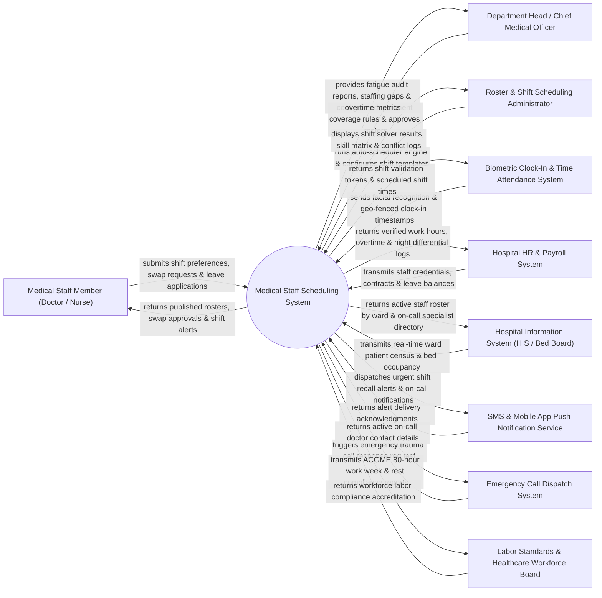

# Context Diagram — Medical Staff Scheduling System

## Mermaid Code

## Actor & Interaction Table | Bảng Actor & Tương tác

| # | Actor | Actor Type | Data Sent TO System | Data Received FROM System | Notes |
|---|-------|------------|---------------------|---------------------------|-------|
| 1 | Medical Staff Member (Doctor / Nurse) | Primary | Shift preferences, peer-to-peer shift swap requests, leave applications, availability blackout dates. | Published shift rosters, swap approval statuses, upcoming shift push notifications, overtime logs. | Inpatient/outpatient physicians, resident doctors, bedside nurses, radiologists, and allied health staff. |
| 2 | Department Head / Chief Medical Officer | Primary | Department coverage rules, minimum staffing par levels, shift roster approvals, fatigue override authorizations. | Department roster master view, fatigue violation alerts, unfulfilled shift gaps, staff overtime analytics. | Clinical department leader overseeing doctor/nurse staffing compliance and clinical operations. |
| 3 | Roster & Shift Scheduling Administrator | Primary | Scheduling constraint parameters, shift type templates, skill requirements matrix, holiday roster policies. | Automated roster solver results, scheduling conflict flags, constraint violation summaries. | Administrative officer responsible for generating, managing, and updating hospital shift schedules. |
| 4 | Hospital HR & Payroll System | Supporting System | Staff employment contracts, specialized medical credentials, accrued leave balances, wage rate tiers. | Verified hours worked, calculated overtime hours, night shift differential logs, payroll export files. | Enterprise human resources software handling staff employment, leave entitlements, and payroll disbursement. |
| 5 | Hospital Information System (HIS / Bed Board) | Supporting System | Ward patient census, ICU bed occupancy rates, surgical operation room schedules. | Active shift staff directory by department, current on-call physician contact roster. | Core hospital software managing inpatient census, surgical suites, and clinical operations. |
| 6 | Biometric Clock-In & Time Attendance System | Supporting System | Facial recognition clock-in/out timestamps, GPS geo-fenced mobile punches, biometric card swipes. | Shift schedule match validations, late arrival warnings, early clock-out alerts. | Physical or mobile time-tracking hardware verifying physical presence during shift start/end. |
| 7 | SMS & Mobile App Push Notification Service | Supporting System | Message delivery status receipts, push alert interaction tokens. | Shift swap request alerts, open shift pick-up calls, urgent emergency recall notices. | Multi-channel messaging gateway sending real-time shift alerts to staff mobile phones. |
| 8 | Emergency Call Dispatch System | Supporting System | Emergency trauma code activation, urgent specialist consult requests. | Active primary and secondary on-call physician contact details, response confirmation tokens. | Hospital emergency department dispatch system routing urgent calls to on-call doctors. |
| 9 | Labor Standards & Healthcare Workforce Board | Regulatory | Mandatory labor law work limits, ACGME resident 80-hour work week rules, mandatory rest period standards. | Work hour compliance audit reports, fatigue risk index summaries, rest violation logs. | Government labor authority enforcing healthcare worker safety, maximum hours, and mandatory rest. |

## System Boundary Description | Mô tả Phạm vi Hệ thống

The **Medical Staff Scheduling System (MSSS)** is an enterprise clinical workforce management platform designed to automate complex shift roster generation, on-call duty scheduling, peer-to-peer shift swaps, leave management, and labor law compliance across hospital departments. It utilizes an intelligent constraint-based scheduling engine that balances clinical coverage rules, skill requirements, staff preferences, and mandatory fatigue prevention standards (such as ACGME 80-hour weekly limits and 11-hour rest periods between shifts).

**Inside System Scope:**
- Automated shift roster generation using constraint-solver algorithms (Linear Programming / Heuristic Solver).
- Peer-to-peer shift swap and trade workflow with automated qualification and overtime rule validation.
- Emergency on-call roster management and automated escalation trees.
- Time-off and leave request tracking integrated with shift coverage auto-replacement logic.
- Real-time time & attendance verification via biometric clock-in and GPS geo-fencing.
- Fatigue risk management auditing, mandatory rest period enforcement, and ACGME compliance tracking.
- Automated payroll data compilation (regular hours, overtime, night shift differentials).

**Outside System Scope:**
- Physical calculation of payroll checks and bank wire disbursements (handled by HR & Payroll System).
- Clinical performance evaluation and annual medical license re-credentialing (handled by HR/Medical Staff Office).
- Direct control of physical building door locks or biometric hardware access control (handled by Security Systems).
- Patient clinical treatment and surgical procedure execution (handled by HIS / Surgical systems).
