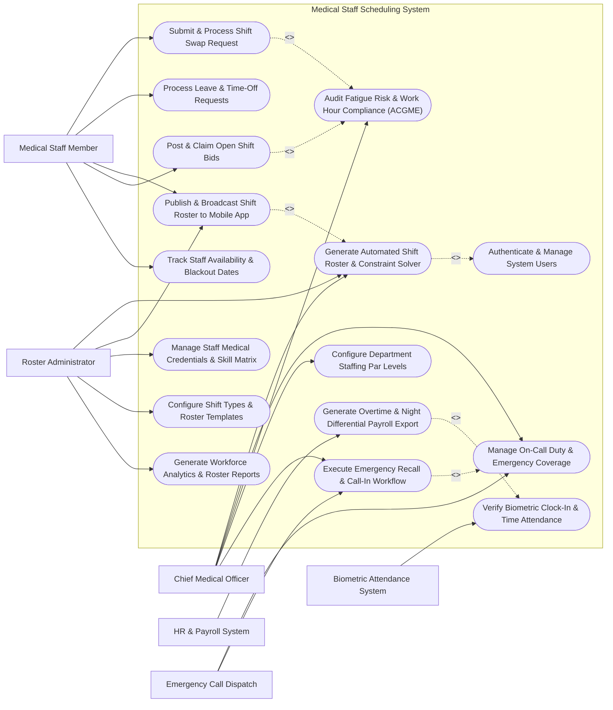

# Use Case Diagram — Medical Staff Scheduling System

## Mermaid Code

## Actor Table | Bảng Actor

| # | Actor | Actor Type | Role Description | Related Use Cases |
|---|-------|------------|------------------|-------------------|
| 1 | Medical Staff Member | Primary | Clinical physician, resident doctor, or nurse submitting shift preferences, swapping shifts, requesting leave, and claiming open shifts. | UC02, UC04, UC07, UC08, UC14 |
| 2 | Chief Medical Officer | Primary | Department head reviewing auto-generated rosters, approving shift swaps, overseeing on-call duty, and managing fatigue risk compliance. | UC01, UC03, UC05, UC09, UC12 |
| 3 | Roster Administrator | Primary | Scheduling specialist setting up shift templates, running the constraint solver engine, updating skill matrices, and publishing schedules. | UC01, UC07, UC10, UC13, UC15 |
| 4 | HR & Payroll System | Secondary / System | External enterprise software receiving verified work hours, overtime logs, and night differential data for payroll calculation. | UC11 |
| 5 | Biometric Attendance System | Secondary / System | Hardware clock-in terminal transmitting facial/fingerprint/GPS timestamps to verify shift attendance. | UC06 |
| 6 | Emergency Call Dispatch | Secondary / System | Hospital emergency system querying active on-call doctor directories during acute trauma or surgical emergencies. | UC03, UC12 |

## Use Case Table | Bảng Use Case

| # | UC ID | Use Case Name | Primary Actor | Secondary Actor | Description | Priority |
|---|-------|---------------|---------------|-----------------|-------------|----------|
| 1 | UC01 | Generate Automated Shift Roster & Constraint Solver | Roster Administrator | Chief Medical Officer | Execute AI/heuristic constraint solver algorithm to generate balanced shift rosters adhering to labor rules and skill requirements. | High |
| 2 | UC02 | Submit & Process Shift Swap Request | Medical Staff Member | Chief Medical Officer | Allow staff to request peer-to-peer shift swaps, automatically validating qualification match and fatigue rules before manager sign-off. | High |
| 3 | UC03 | Manage On-Call Duty & Emergency Coverage | Chief Medical Officer | Emergency Call Dispatch | Assign primary, secondary, and tertiary on-call doctor rosters for emergency department and surgical consults. | High |
| 4 | UC04 | Process Leave & Time-Off Requests | Medical Staff Member | Chief Medical Officer | Submit annual, sick, or educational leave requests, verify leave balances, and automatically identify required shift coverage replacements. | High |
| 5 | UC05 | Audit Fatigue Risk & Work Hour Compliance (ACGME) | Chief Medical Officer | None | Continuously audit work hour limits (ACGME 80-hour weekly rule, 11-hour rest periods), flagging fatigue violations. | High |
| 6 | UC06 | Verify Biometric Clock-In & Time Attendance | Biometric Attendance System | None | Match facial recognition/GPS clock-in punches against scheduled shift start/end times to calculate actual hours worked. | High |
| 7 | UC07 | Publish & Broadcast Shift Roster to Mobile App | Roster Administrator | Medical Staff Member | Publish finalized monthly schedules and push real-time calendar updates to staff mobile apps. | High |
| 8 | UC08 | Post & Claim Open Shift Bids | Medical Staff Member | Roster Administrator | Post unfulfilled shift vacancies for voluntary staff pickup, validating overtime limits before auto-assigning bids. | Medium |
| 9 | UC09 | Configure Department Staffing Par Levels | Chief Medical Officer | None | Define minimum required headcount by role (e.g., 2 Senior ER Doctors, 6 ICU Nurses) for morning, evening, and night shifts. | High |
| 10 | UC10 | Manage Staff Medical Credentials & Skill Matrix | Roster Administrator | None | Track specialized clinical certifications (ACLS, PALS, Trauma), license expiration dates, and role capabilities. | High |
| 11 | UC11 | Generate Overtime & Night Differential Payroll Export | HR & Payroll System | None | Compile verified attendance logs, compute regular hours, overtime multipliers, and night shift differentials for payroll export. | High |
| 12 | UC12 | Execute Emergency Recall & Call-In Workflow | Chief Medical Officer | Emergency Call Dispatch | Broadcast urgent emergency recall alerts during mass casualty events, tracking instant staff availability responses. | High |
| 13 | UC13 | Configure Shift Types & Roster Templates | Roster Administrator | None | Maintain shift definitions (Morning 07-15, Evening 15-23, Night 23-07, 24H Call) and recurring roster templates. | Medium |
| 14 | UC14 | Track Staff Availability & Blackout Dates | Medical Staff Member | None | Allow staff to specify preferred working days, unavailability blackout dates, and maximum desired night shifts per month. | Medium |
| 15 | UC15 | Generate Workforce Analytics & Roster Reports | Roster Administrator | None | Produce roster fairness metrics, unfulfilled shift rates, overtime costs, staff absenteeism, and fatigue compliance reports. | Medium |
| 16 | UC16 | Authenticate & Manage System Users | All Users | None | Enforce single sign-on (SSO), role-based permissions, and electronic signature audit logging. | High |

## Use Case Specification | Đặc tả Use Case

---

### UC01 — Generate Automated Shift Roster & Constraint Solver

| Field | Detail |
|-------|--------|
| **UC ID** | UC01 |
| **Use Case Name** | Generate Automated Shift Roster & Constraint Solver |
| **Actor(s)** | Primary: Roster Administrator   Secondary: Chief Medical Officer |
| **Description** | Executes a constraint-solver scheduling engine (using linear programming or heuristic algorithms) to generate an optimal monthly or bi-weekly shift roster that fulfills department staffing par levels, aligns with staff skills/preferences, and adheres strictly to labor law fatigue constraints. |
| **Precondition** | 1. Department staffing par levels, shift types, and skill requirements are defined.   2. Staff blackout dates, approved leave requests, and preferences are updated for the target period. |
| **Main Flow** | 1. The Roster Admin opens the "Roster Generator" module, selects the target department (e.g., Emergency Department), and sets the scheduling period (e.g., September 1 - September 30).   2. The System loads Hard Constraints: Minimum staffing par levels by shift/role, ACGME 80-hour weekly limit, mandatory 11-hour rest interval between shifts, maximum 6 consecutive work days, active medical license/credential match.   3. The System loads Soft Constraints: Staff shift preferences, equitable distribution of night/weekend shifts, historical overtime fairness.   4. The Roster Admin clicks "Run Constraint Solver Engine".   5. The System executes the optimization algorithm, processing thousands of shift combinations to build the draft roster.   6. The System displays the generated draft grid highlighting fulfillment percentage (e.g., 98.5% coverage), solver execution time, and any soft constraint compromise flags.   7. The Roster Admin reviews the draft, adjusts minor manual assignments if needed, and routes the draft to the Chief Medical Officer for approval. |
| **Alternative Flow** | **AF1** — Multi-Department Joint Roster: The Roster Admin runs a combined solver for shared staff pools (e.g., Anesthesiologists covering both Surgical Operating Rooms and Intensive Care Units).   **AF2** — Emergency Fast-Roster Re-Generation: If sudden epidemic surge or mass illness invalidates an active roster, the System runs a 5-minute emergency re-solver to fill vacant gaps. |
| **Exception Flow** | **EX1** — Unresolvable Hard Constraint Conflict (Gaps Exist): If staffing shortage prevents 100% coverage without breaching labor rest rules, the System flags "Coverage Shortage - Hard Constraint Conflict" on specific dates (e.g., Night Shift Sept 14) and highlights open shift vacancies for bidding (UC08).   **EX2** — Expired Credential Block: If a doctor's ACLS certification expires during the roster period, the System excludes them from ER shift assignments and issues a "Credential Expired" notification. |
| **Postcondition** | An optimized draft shift roster is generated, constraint violations are zero or explicitly flagged, and the schedule is forwarded for manager approval. |
| **Business Rule** | **BR1**: Automated roster generation must enforce zero violations of mandatory labor rest rules (e.g., min 11 hours rest between shifts) unless an explicit emergency waiver is signed by the Chief Medical Officer.   **BR2**: Night shift assignments must be distributed equitably so that no staff member exceeds 4 consecutive night shifts in a single roster period. |

---

### UC02 — Submit & Process Shift Swap Request

| Field | Detail |
|-------|--------|
| **UC ID** | UC02 |
| **Use Case Name** | Submit & Process Shift Swap Request |
| **Actor(s)** | Primary: Medical Staff Member   Secondary: Chief Medical Officer |
| **Description** | Allows a medical staff member to initiate a peer-to-peer shift swap or trade with another qualified colleague, automatically validating skill equivalence, rest period rules, and overtime implications before routing for manager sign-off. |
| **Precondition** | 1. The target shift roster is published and active.   2. Both staff members are active in the system with compatible job roles. |
| **Main Flow** | 1. Staff Member A opens their mobile roster app, selects a scheduled shift (e.g., Night Shift on Oct 12), and clicks "Request Shift Swap".   2. The System displays a list of eligible peer colleagues who have matching clinical credentials (e.g., Senior ER Nurse) and are off duty on Oct 12.   3. Staff Member A selects Staff Member B and picks a reciprocal trade shift (e.g., Staff Member B's Morning Shift on Oct 18) or requests a one-way shift pickup.   4. Staff Member A submits the swap request with an optional note.   5. The System sends a mobile push notification to Staff Member B.   6. Staff Member B opens the app and clicks "Accept Swap Request".   7. The System automatically runs a real-time rule audit: Checks if Staff Member B's new shift creates a back-to-back rest violation (< 11 hours), checks if weekly hours exceed 80 hours, and verifies credential equivalence.   8. If all rule checks pass, the System routes the swap ticket to the Chief Medical Officer with a "Rule Verified" green badge.   9. The Chief Medical Officer clicks "Approve Swap". The System updates the active shift roster, swaps calendar entries on both mobile apps, and dispatches confirmation notifications. |
| **Alternative Flow** | **AF1** — One-Way Shift Drop / Open Market Swap: Staff Member A posts a shift to the department "Swap Board" without specifying a partner, allowing any qualified off-duty colleague to claim it.   **AF2** — Auto-Approval for Pre-Validated Swaps: If the department policy permits, swaps between identical role peers that pass all rule checks are auto-approved by the System without requiring manual manager signature. |
| **Exception Flow** | **EX1** — Peer Rejection: If Staff Member B declines the swap request, the System notifies Staff Member A and closes the swap ticket.   **EX2** — Rest Rule Violation Block: If swapping shifts causes Staff Member B to work a 16-hour continuous shift without mandatory rest, the System hard-blocks submission and displays "Swap Rejected - Mandated Rest Interval Violation". |
| **Postcondition** | Shift schedules are updated for both staff members, time attendance expectations are adjusted, and swap history audit logs are recorded. |
| **Business Rule** | **BR1**: Shift swap requests must be submitted at least 24 hours prior to the start time of the earliest swapped shift.   **BR2**: Peer shift swaps must involve staff with equivalent clinical specialty certifications (e.g., an ICU-certified nurse can only swap with an ICU-certified nurse). |

---

### UC03 — Manage On-Call Duty & Emergency Coverage

| Field | Detail |
|-------|--------|
| **UC ID** | UC03 |
| **Use Case Name** | Manage On-Call Duty & Emergency Coverage |
| **Actor(s)** | Primary: Chief Medical Officer   Secondary: Emergency Call Dispatch |
| **Description** | Configures and manages primary, secondary, and tertiary on-call physician rosters for emergency consultations, surgical trauma calls, and subspecialty coverage, integrating automated escalation call trees for emergency call dispatchers. |
| **Precondition** | 1. Medical staff on-call availability and specialty skill profiles are registered.   2. On-call duty shift types (e.g., 24H Trauma Call, Home Call) are active in the system. |
| **Main Flow** | 1. The Chief Medical Officer opens the "On-Call Roster Manager" for a specialty department (e.g., Neurosurgery).   2. The Chief Doctor assigns primary on-call physicians (First Call), secondary back-up physicians (Second Call), and tertiary department leads for each calendar day.   3. The System verifies that assigned on-call physicians are not scheduled for heavy clinical duties the following morning that breach post-call rest guidelines.   4. The Chief Doctor publishes the On-Call Roster.   5. The System synchronizes the active on-call directory with the Emergency Call Dispatch system and hospital switchboard.   6. When an acute emergency occurs (e.g., Severe Head Trauma in ER), the Emergency Dispatcher triggers an "On-Call Consult Page".   7. The System dispatches a high-priority emergency mobile call alert and SMS to the Primary On-Call Neurosurgeon.   8. The Primary Doctor presses "Acknowledge & En-Route" within 5 minutes, entering estimated arrival time (e.g., 15 minutes).   9. The System logs the response timestamp, updates the emergency room dashboard, and notifies the ER charge nurse. |
| **Alternative Flow** | **AF1** — Automated Call Tree Escalation: If the Primary On-Call Doctor fails to acknowledge the emergency page within 7 minutes, the System automatically escalates the page to the Secondary Back-Up On-Call Doctor and alerts the Chief Doctor.   **AF2** — Remote Tele-Consult Availability: The On-Call Doctor acknowledges the consult and launches a secure tele-consultation video link to review patient CT scans remotely before arriving at the hospital. |
| **Exception Flow** | **EX1** — On-Call Doctor Unavailable / Unreachable: If both Primary and Secondary on-call doctors fail to respond within 12 minutes, the System triggers a "CRITICAL ON-CALL FAILOVER" alert to the Chief Medical Officer's phone and broadcasts a general emergency call.   **EX2** — Post-Call Mandatory Relief Trigger: If an on-call doctor operates continuously through the night (> 6 hours of emergency surgery), the System automatically flags them as "Post-Call Relief Required" and prompts coverage for their next morning clinic. |
| **Postcondition** | On-call duty rosters are published, emergency call escalation pathways are active, and call response latency is logged for quality auditing. |
| **Business Rule** | **BR1**: Primary on-call physicians must acknowledge emergency call pages within 7 minutes of dispatch.   **BR2**: Doctors completing a 24-hour on-call shift must be granted a mandatory minimum 14-hour off-duty rest period before returning to clinical duties. |

---

### UC04 — Process Leave & Time-Off Requests

| Field | Detail |
|-------|--------|
| **UC ID** | UC04 |
| **Use Case Name** | Process Leave & Time-Off Requests |
| **Actor(s)** | Primary: Medical Staff Member   Secondary: Chief Medical Officer |
| **Description** | Enables medical staff to submit digital applications for annual vacation, sick leave, Continuing Medical Education (CME) leave, or parental leave, automatically checking accrued leave balances, evaluating shift coverage impact, and triggering replacement coverage workflows. |
| **Precondition** | 1. Staff leave entitlements and accrued balances are synchronized from the HR & Payroll System.   2. The Staff Member is logged into the mobile or web portal. |
| **Main Flow** | 1. The Staff Member opens "Request Time Off", selects leave category (Annual Leave, Sick Leave, CME Conference, Maternity/Paternity), and selects start/end dates.   2. The System queries HR leave balances and confirms sufficient accrued leave hours exist.   3. The System scans published and draft shift rosters for the requested leave period.   4. If the Staff Member is scheduled for shifts during that period, the System calculates the department staffing impact (e.g., "Leaves 1 open shift on Oct 14 Night").   5. The System checks if department maximum concurrent leave thresholds (e.g., max 15% of department staff on leave simultaneously) are respected.   6. The Staff Member attaches supporting documents (e.g., CME conference registration or doctor's sick note) and submits the application.   7. The System routes the request to the Chief Medical Officer with a summary of coverage impact and suggested off-duty replacements.   8. The Chief Doctor clicks "Approve Leave".   9. The System updates HR leave balances, converts scheduled shifts during the leave period to "Unassigned Open Shifts", and initiates the open shift bidding process (UC08) or assigns standby staff. |
| **Alternative Flow** | **AF1** — Emergency Unplanned Sick Leave: Staff Member submits "Unplanned Sick Leave" 2 hours before shift start. The System automatically marks the shift as "Urgent Vacancy", notifies the Chief Doctor, and dispatches urgent shift recall alerts to off-duty standby staff (UC12).   **AF2** — Partial-Shift CME Leave: Staff Member requests 4 hours of educational leave during a 12-hour shift; the System adjusts schedule entries and partial pay rules accordingly. |
| **Exception Flow** | **EX1** — Insufficient Accrued Leave Balance: If the requested leave hours exceed accrued balance, the System displays "Insufficient Leave Balance" and requires HR unpaid leave authorization.   **EX2** — Blackout Period / High-Demand Denial: If leave is requested during a mandatory holiday blackout period (e.g., New Year's Eve) where department minimum par levels cannot be maintained, the System flags "Blackout Denial Warning" for manager review. |
| **Postcondition** | Leave is approved and deducted from HR balances, scheduled shifts are removed, open shift vacancies are posted for replacement, and staff calendar is updated. |
| **Business Rule** | **BR1**: Planned annual leave requests must be submitted at least 14 days prior to the publishing of the target month's draft roster.   **BR2**: Total concurrent staff leave in a single department must not exceed 20% of total active personnel without Chief Executive Officer approval. |

---

### UC05 — Audit Fatigue Risk & Work Hour Compliance (ACGME)

| Field | Detail |
|-------|--------|
| **UC ID** | UC05 |
| **Use Case Name** | Audit Fatigue Risk & Work Hour Compliance (ACGME) |
| **Actor(s)** | Primary: Chief Medical Officer |
| **Description** | Continuously audits scheduled and actual work hours against national labor laws and medical accreditation fatigue standards (such as ACGME resident 80-hour weekly limits, 24+4 hour max shift lengths, and 11-hour rest intervals), generating fatigue risk scores and breach alerts. |
| **Precondition** | 1. Work hour rules (ACGME, national labor laws) and fatigue thresholds are configured in the system.   2. Real-time clock-in attendance data and shift rosters are active. |
| **Main Flow** | 1. The System background engine runs a continuous compliance audit every 6 hours across all active and draft rosters.   2. The System evaluates 5 core fatigue compliance rules for every staff member: **Rule 1 (Weekly Limit)**: Total hours worked over 4-week rolling average must not exceed 80 hours/week; **Rule 2 (Shift Length)**: Continuous shift length must not exceed 24 hours + 4 hours for transition; **Rule 3 (Rest Interval)**: Minimum 11 hours off-duty rest must separate consecutive shifts (or 14 hours following 24-hour call); **Rule 4 (Consecutive Days)**: Maximum 6 consecutive work days without 1 full 24-hour rest day; **Rule 5 (Night Shift Density)**: Maximum 4 consecutive night shifts.   5. The System calculates an individual "Fatigue Risk Score" (0 to 100) combining actual hours worked, circadian rhythm disruption, and rest intervals.   6. If a staff member breaches a rule or reaches High Fatigue Risk (Score > 75), the System flags a red "Fatigue Violation Banner" on the manager's dashboard and dispatches an alert to the Chief Medical Officer.   7. The Chief Doctor opens the "Fatigue Audit Detail", reviews the cumulative work history, and executes corrective action: Assigning mandatory rest relief, re-assigning upcoming shifts to an off-duty peer, or logging a formal clinical emergency waiver justification. |
| **Alternative Flow** | **AF1** — Pre-Emptive Draft Roster Fatigue Screening: During roster generation (UC01), the System runs pre-emptive fatigue scoring on draft schedules, blocking any draft that causes a predicted fatigue breach.   **AF2** — Bio-Mathematical Fatigue Modeling Integration: The System incorporates bio-mathematical fatigue algorithms (e.g., SAFTE Model) analyzing circadian sleep pressure and peak alertness windows for high-risk surgical procedures. |
| **Exception Flow** | **EX1** — Unjustified ACGME Breach: If an 80-hour weekly breach occurs without an authorized clinical emergency waiver, the System flags the event on the monthly Regulatory Compliance Audit Export (UC15).   **EX2** — Resident Doctor Concealed Overtime Alert: If biometric clock-out timestamps reveal a resident doctor staying 3 hours past shift end without logged clinical justification, the System alerts the Residency Program Director. |
| **Postcondition** | Work hour compliance is audited, fatigue risk scores are computed, labor rule breaches are flagged, and corrective relief actions or regulatory waiver logs are recorded. |
| **Business Rule** | **BR1**: Clinical staff working a 24-hour shift must be granted a mandatory minimum 14-hour continuous off-duty rest period before commencing any subsequent shift.   **BR2**: Rolling 4-week average work hours for medical residents must strictly adhere to the ACGME 80-hour weekly cap without exception. |
