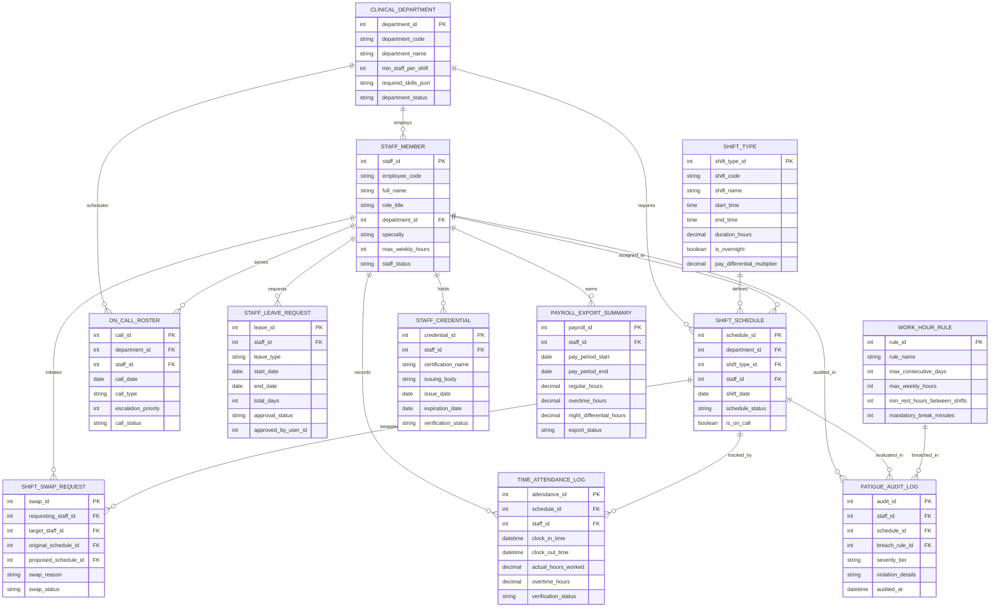

# Conceptual ERD — Medical Staff Scheduling System

## Mermaid Code

## Entity Description Table | Bảng mô tả Entity

| # | Entity Name | Vietnamese Name | Description | Key Attributes | Main Relationships |
|---|-------------|-----------------|-------------|----------------|-------------------|
| 1 | STAFF_MEMBER | Nhân viên Y tế Master | Master medical staff profile storing employee code, role title, clinical specialty, max weekly hours, and status. | staff_id, employee_code, full_name, role_title, department_id, specialty, staff_status | Belongs to CLINICAL_DEPARTMENT; Has many SHIFT_SCHEDULE, SHIFT_SWAP_REQUEST, ON_CALL_ROSTER, etc. |
| 2 | CLINICAL_DEPARTMENT | Khoa Lâm sàng | Hospital clinical department or unit defining minimum staffing par levels and required clinical skills. | department_id, department_code, department_name, min_staff_per_shift, department_status | Has many STAFF_MEMBER, SHIFT_SCHEDULE, and ON_CALL_ROSTER entities. |
| 3 | SHIFT_TYPE | Loại Ca Trực | Shift definition master storing shift code, start/end times, total hours, overnight flags, and pay multipliers. | shift_type_id, shift_code, shift_name, start_time, end_time, duration_hours, is_overnight | Has many SHIFT_SCHEDULE entities. |
| 4 | SHIFT_SCHEDULE | Lịch Phân ca | Active assigned shift roster record tying staff members, shift types, departments, dates, and on-call flags. | schedule_id, department_id, shift_type_id, staff_id, shift_date, schedule_status, is_on_call | Belongs to CLINICAL_DEPARTMENT, SHIFT_TYPE, and STAFF_MEMBER; Has many SHIFT_SWAP_REQUEST, TIME_ATTENDANCE_LOG, and FATIGUE_AUDIT_LOG entities. |
| 5 | SHIFT_SWAP_REQUEST | Yêu cầu Đổi ca | Peer-to-peer shift swap transaction record tracking requesting staff, target partner, original/proposed shift IDs, and approval status. | swap_id, requesting_staff_id, target_staff_id, original_schedule_id, proposed_schedule_id, swap_status | Belongs to STAFF_MEMBER and SHIFT_SCHEDULE. |
| 6 | ON_CALL_ROSTER | Lịch Trực Thường trú (On-Call) | On-call duty schedule tracking primary/secondary/tertiary on-call doctors, call dates, and emergency call priorities. | call_id, department_id, staff_id, call_date, call_type, escalation_priority, call_status | Belongs to CLINICAL_DEPARTMENT and STAFF_MEMBER. |
| 7 | STAFF_LEAVE_REQUEST | Yêu cầu Nghỉ phép | Leave application record capturing leave category (Annual, Sick, CME, Maternity), date ranges, and manager approval status. | leave_id, staff_id, leave_type, start_date, end_date, total_days, approval_status | Belongs to STAFF_MEMBER. |
| 8 | TIME_ATTENDANCE_LOG | Nhật ký Chấm công | Actual shift attendance record capturing biometric/GPS clock-in/out timestamps, hours worked, and overtime. | attendance_id, schedule_id, staff_id, clock_in_time, clock_out_time, actual_hours_worked, overtime_hours | Belongs to SHIFT_SCHEDULE and STAFF_MEMBER. |
| 9 | WORK_HOUR_RULE | Quy tắc Thời giờ Làm việc | Labor law and ACGME rule configuration specifying max weekly hours, min rest intervals, and max consecutive days. | rule_id, rule_name, max_consecutive_days, max_weekly_hours, min_rest_hours_between_shifts | Has many FATIGUE_AUDIT_LOG entities. |
| 10 | FATIGUE_AUDIT_LOG | Nhật ký Kiểm toán Mệt mỏi | Audit record logging labor law work hour breaches, rest interval violations, and calculated fatigue risk scores. | audit_id, staff_id, schedule_id, breach_rule_id, severity_tier, violation_details, audited_at | Belongs to STAFF_MEMBER, SHIFT_SCHEDULE, and WORK_HOUR_RULE. |
| 11 | STAFF_CREDENTIAL | Chứng chỉ Chuyên môn | Specialized medical certification record (ACLS, PALS, Trauma) tracking issuing bodies, issue dates, and expirations. | credential_id, staff_id, certification_name, issuing_body, expiration_date, verification_status | Belongs to STAFF_MEMBER. |
| 12 | PAYROLL_EXPORT_SUMMARY | Tóm tắt Bảng lương | Period summary aggregating regular hours, overtime hours, night shift differentials, and payroll export statuses. | payroll_id, staff_id, pay_period_start, pay_period_end, regular_hours, overtime_hours, export_status | Belongs to STAFF_MEMBER. |

## Relationship Description | Mô tả Quan hệ

| # | From Entity | Cardinality | To Entity | Relationship Label | Business Explanation |
|---|-------------|-------------|-----------|-------------------|----------------------|
| 1 | CLINICAL_DEPARTMENT | one-to-many | STAFF_MEMBER | employs | One clinical department employs multiple medical staff members. |
| 2 | CLINICAL_DEPARTMENT | one-to-many | SHIFT_SCHEDULE | requires | One clinical department requires multiple shift schedule assignments daily. |
| 3 | CLINICAL_DEPARTMENT | one-to-many | ON_CALL_ROSTER | schedules | One department schedules primary and secondary on-call duty rosters. |
| 4 | SHIFT_TYPE | one-to-many | SHIFT_SCHEDULE | defines | One master shift type defines multiple scheduled shift entries. |
| 5 | STAFF_MEMBER | one-to-many | SHIFT_SCHEDULE | assigned_to | One medical staff member is assigned to multiple shift schedules over time. |
| 6 | STAFF_MEMBER | one-to-many | SHIFT_SWAP_REQUEST | initiates | One staff member can initiate or participate in multiple peer shift swap requests. |
| 7 | STAFF_MEMBER | one-to-many | ON_CALL_ROSTER | serves | One medical staff member serves on multiple on-call duty shifts. |
| 8 | STAFF_MEMBER | one-to-many | STAFF_LEAVE_REQUEST | requests | One staff member submits multiple leave and time-off applications. |
| 9 | STAFF_MEMBER | one-to-many | TIME_ATTENDANCE_LOG | records | One staff member records daily clock-in/out attendance logs. |
| 10 | STAFF_MEMBER | one-to-many | FATIGUE_AUDIT_LOG | audited_in | One staff member's work hours are audited in multiple fatigue compliance logs. |
| 11 | STAFF_MEMBER | one-to-many | STAFF_CREDENTIAL | holds | One medical staff member holds multiple specialized clinical credentials and licenses. |
| 12 | STAFF_MEMBER | one-to-many | PAYROLL_EXPORT_SUMMARY | earns | One staff member earns calculated hours exported in periodic payroll summaries. |
| 13 | SHIFT_SCHEDULE | one-to-many | SHIFT_SWAP_REQUEST | swapped_in | One scheduled shift can be involved in peer shift swap requests. |
| 14 | SHIFT_SCHEDULE | one-to-many | TIME_ATTENDANCE_LOG | tracked_by | One scheduled shift is tracked by biometric clock-in/out attendance logs. |
| 15 | SHIFT_SCHEDULE | one-to-many | FATIGUE_AUDIT_LOG | evaluated_in | One scheduled shift is evaluated for potential labor rest and fatigue rule violations. |
| 16 | WORK_HOUR_RULE | one-to-many | FATIGUE_AUDIT_LOG | breached_in | One work hour labor rule can be breached in multiple audit log entries. |
