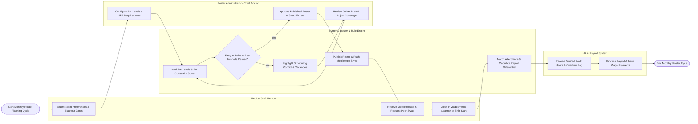

# Swimlane Diagram — Medical Staff Scheduling System

## Mermaid Code

## Flow Description | Mô tả luồng

| Lane | Actor / Subsystem | Role in Flow |
|------|-------------------|--------------|
| 1 | Medical Staff Member | Submits monthly shift preferences and blackout dates, views published rosters on mobile app, initiates peer shift swaps, and completes biometric clock-in at shift start. |
| 2 | System / Roster & Rule Engine | Loads department staffing par levels, runs AI/heuristic constraint solver, audits ACGME fatigue and rest rules, broadcasts roster updates to mobile apps, and calculates overtime/night pay differentials. |
| 3 | Roster Administrator / Chief Doctor | Configures department shift templates and skill matrices, evaluates draft roster solver outputs, resolves staffing vacancy conflicts, and approves published rosters and shift swaps. |
| 4 | HR & Payroll System | Ingests verified work hour logs, overtime hours, and night shift differential summaries from the scheduling system to process monthly staff payroll disbursement. |
