# Action Tree — Medical Staff Scheduling System

## Mermaid Code

```mermaid
graph TD
    Root["Medical Staff Scheduling System"]

    Root --> M1["Shift Template & Par Level Setup"]
    Root --> M2["Automated Roster Solver Engine"]
    Root --> M3["Shift Swap & Trade Workflow"]
    Root --> M4["On-Call Duty & Emergency Call"]
    Root --> M5["Leave & Time-Off Management"]
    Root --> M6["Biometric Attendance & Tracking"]
    Root --> M7["Fatigue Risk & Compliance Audit"]
    Root --> M8["Workforce Analytics & Payroll Sync"]

    M1 --> A11["Define Shift Types & Start/End Times"]
    M1 --> A12["Configure Department Par Headcount"]
    M1 --> A13["Set Skill & Credential Matrix"]
    M1 --> A14["Maintain Recurring Shift Templates"]

    M2 --> A21["Load Staff Preferences & Blackouts"]
    M2 --> A22["Execute Heuristic Constraint Solver"]
    M2 --> A23["Highlight Open Vacancy Shortages"]
    M2 --> A24["Publish Roster to Mobile App"]

    M3 --> A31["Initiate Peer-to-Peer Shift Trade"]
    M3 --> A32["Validate Credential Equivalence"]
    M3 --> A33["Audit Post-Swap Rest Interval"]
    M3 --> A34["Approve & Swap Calendar Entries"]

    M4 --> A41["Assign Primary & Secondary On-Call"]
    M4 --> A42["Sync Directory to ER Dispatch"]
    M4 --> A43["Dispatch Mobile Trauma Consult Page"]
    M4 --> A44["Track On-Call Response Latency"]

    M5 --> A51["Submit Annual & CME Leave Request"]
    M5 --> A52["Check HR Accrued Leave Balance"]
    M5 --> A53["Auto-Post Open Shift Bids"]
    M5 --> A54["Process Emergency Sick Leave"]

    M6 --> A61["Match Facial Recognition Punch"]
    M6 --> A62["Verify GPS Geo-Fenced Mobile Punch"]
    M6 --> A63["Log Overtime & Late Arrivals"]
    M6 --> A64["Approve Actual Hours Worked"]

    M7 --> A71["Audit ACGME 80-Hour Weekly Cap"]
    M7 --> A72["Enforce 11-Hour Rest Between Shifts"]
    M7 --> A73["Limit Consecutive Night Shift Density"]
    M7 --> A74["Log Executive Emergency Waivers"]

    M8 --> A81["Calculate Night Pay Differentials"]
    M8 --> A82["Export Verified Hours to Payroll"]
    M8 --> A83["Analyze Roster Fairness Metrics"]
    M8 --> A84["Generate Staff Absenteeism Reports"]
```

## Module Description | Mô tả Module

| # | Module | Description | Actions |
|---|--------|-------------|---------|
| 1 | Shift Template & Par Level Setup | Configures shift types (Morning, Evening, Night, 24H Call), minimum staffing par levels by role, and skill/credential requirements. | Define Shift Types & Start/End Times, Configure Department Par Headcount, Set Skill & Credential Matrix, Maintain Recurring Shift Templates |
| 2 | Automated Roster Solver Engine | Ingests staff blackout dates and preferences, runs constraint-solver algorithms, highlights unfilled vacancies, and publishes rosters. | Load Staff Preferences & Blackouts, Execute Heuristic Constraint Solver, Highlight Open Vacancy Shortages, Publish Roster to Mobile App |
| 3 | Shift Swap & Trade Workflow | Manages peer-to-peer shift trade requests, verifies clinical credential equivalence, audits rest period rules, and updates calendar entries. | Initiate Peer-to-Peer Shift Trade, Validate Credential Equivalence, Audit Post-Swap Rest Interval, Approve & Swap Calendar Entries |
| 4 | On-Call Duty & Emergency Call | Assigns primary/secondary on-call doctor rosters, syncs directories with emergency dispatch, and dispatches urgent trauma consult pages. | Assign Primary & Secondary On-Call, Sync Directory to ER Dispatch, Dispatch Mobile Trauma Consult Page, Track On-Call Response Latency |
| 5 | Leave & Time-Off Management | Processes annual, sick, and CME leave requests, verifies HR leave balances, and auto-posts open shift bids for vacant coverage. | Submit Annual & CME Leave Request, Check HR Accrued Leave Balance, Auto-Post Open Shift Bids, Process Emergency Sick Leave |
| 6 | Biometric Attendance & Tracking | Matches facial recognition and GPS geo-fenced clock-in timestamps against scheduled shifts, recording actual hours and overtime. | Match Facial Recognition Punch, Verify GPS Geo-Fenced Mobile Punch, Log Overtime & Late Arrivals, Approve Actual Hours Worked |
| 7 | Fatigue Risk & Compliance Audit | Continuously audits ACGME 80-hour weekly caps, 11-hour mandatory rest intervals, and consecutive night shift limits, flagging violations. | Audit ACGME 80-Hour Weekly Cap, Enforce 11-Hour Rest Between Shifts, Limit Consecutive Night Shift Density, Log Executive Emergency Waivers |
| 8 | Workforce Analytics & Payroll Sync | Calculates regular hours, overtime multipliers, and night shift differentials, exporting verified attendance records to HR/Payroll. | Calculate Night Pay Differentials, Export Verified Hours to Payroll, Analyze Roster Fairness Metrics, Generate Staff Absenteeism Reports |
