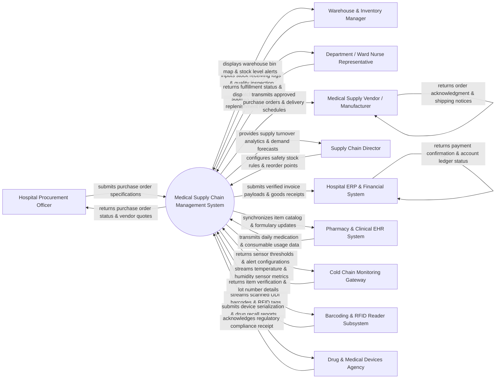

# Context Diagram — Medical Supply Chain Management System

## Mermaid Code

## Actor & Interaction Table | Bảng Actor & Tương tác

| # | Actor | Actor Type | Data Sent TO System | Data Received FROM System | Notes |
|---|-------|------------|---------------------|---------------------------|-------|
| 1 | Hospital Procurement Officer | Primary | Purchase requisitions, vendor selection criteria, purchase orders (PO), price contract terms, supplier performance reviews. | Vendor quotes, pending PO status, contract expiry alerts, item price history, supplier rating scorecards. | Materials management staff managing supplier bidding, purchasing, and order placement. |
| 2 | Warehouse & Inventory Manager | Primary | Goods receiving notes (GRN), stock inspection results, bin location assignments, physical stock audit counts, damaged item write-offs. | Warehouse bin allocation maps, stock reorder warnings, batch lot expiration alerts, pick-and-pack fulfillment lists. | Logistics personnel managing central hospital warehouse storage, receiving, and stock issuance. |
| 3 | Department / Ward Nurse Representative | Primary | Ward supply requisition requests, emergency consumable top-up orders, stock usage logs, returned unused items. | Requisition fulfillment status, expected delivery times, stock availability indicators, ward supply quota limits. | Nursing or clinical staff ordering medical consumables (syringes, gloves, IV sets, PPE) for ward units. |
| 4 | Medical Supply Vendor / Manufacturer | Primary | Electronic order confirmations, advanced shipping notices (ASN), digital invoices, batch certificate of analysis (COA), price updates. | Approved purchase orders, delivery schedules, return authorization requests, contract terms. | External supplier or pharmaceutical manufacturer delivering medical devices, reagents, and consumables. |
| 5 | Supply Chain Director | Primary | Safety stock parameters, reorder point thresholds, inventory budget caps, supplier contract approval rules, audit policies. | Executive supply dashboards, inventory turnover ratios, stockout risk alerts, supplier spend analytics, forecast models. | Hospital leadership overseeing supply chain budget, inventory policy, and strategic procurement. |
| 6 | Hospital ERP & Financial System | Supporting | Payment settlement status, account ledger codes, invoice approval confirmations, financial year-end budgets. | Verified receiving payloads, 3-way invoice match payloads, vendor accounts payable liabilities, inventory asset valuation logs. | Main corporate financial software processing vendor payments and inventory accounting. |
| 7 | Pharmacy & Clinical EHR System | Supporting | Patient medication dispensing logs, surgical supply consumption data, clinical procedure usage counts. | Master item catalog updates, drug formulary changes, item packaging units, item availability status. | Clinical EHR and pharmacy software sending real-time consumption data to trigger auto-replenishment. |
| 8 | Cold Chain Monitoring Gateway | Supporting | Continuous ambient/refrigerator temperature readings, humidity metrics, GPS location data of refrigerated transit containers. | Temperature threshold limits, sampling frequency configs, cold-chain violation alerts. | IoT telemetry gateway monitoring temperature-sensitive vaccines, blood products, and biological reagents. |
| 9 | Barcoding & RFID Reader Subsystem | Supporting | Raw GS1/UDI barcode scans, 2D matrix data, RFID tag signals collected during receiving and picking. | Verified product master details, batch lot numbers, expiration dates, scanning validation feedback. | Hardware barcode scanners, mobile handheld terminals, and fixed RFID portal readers. |
| 10 | Drug & Medical Devices Agency | Supporting / Regulatory | Mandated device tracking rules, national drug code (NDC) updates, official recall advisories, compliance guidelines. | Unique Device Identifier (UDI) tracking logs, serialized drug track-and-trace reports, recalled item quarantine confirmations. | Government regulatory body enforcing medical device safety, serialization, and recall compliance. |

## System Boundary Description | Mô tả Phạm vi Hệ thống

The **Medical Supply Chain Management System (MSCMS)** is an end-to-end healthcare logistics platform engineered to automate procurement, inventory control, warehouse management, cold-chain tracking, and ward supply distribution across hospital networks.

**Inside System Scope:**
- Master medical item catalog management, GS1 UDI barcoding, and supplier contract price tracking.
- Purchase requisition approval workflows, automated Purchase Order (PO) generation, and vendor integration.
- Warehouse receiving, 3-way matching, batch/lot expiration tracking, quarantine management, and bin location optimization.
- Real-time cold-chain IoT temperature sensor ingestion, breach alert escalation, and quality assurance logs.
- Departmental and ward supply replenishment request workflows, stock picking, packing, and internal transfer tracking.
- Supply demand forecasting, automated reorder point calculation, stockout risk prevention, and regulatory recall management.

**Outside System Scope:**
- Physical transport, freight logistics, and delivery vehicle driving (handled by external courier/vendor fleets).
- Direct financial bank disbursement and check issuing (delegated to Hospital ERP & Financial Systems).
- Direct bedside patient administration of medication (handled by Clinical EHR and Nursing Care Systems).
- Physical manufacturing and assembly of medical devices (performed by external medical manufacturers).
