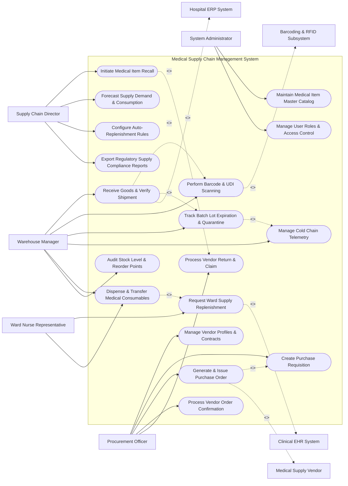

# Use Case Diagram — Medical Supply Chain Management System

## Mermaid Code

## Actor Table | Bảng Actor

| # | Actor | Actor Type | Role Description | Related Use Cases |
|---|-------|------------|------------------|-------------------|
| 1 | Procurement Officer | Primary | Materials management staff managing supplier contracts, purchase requisitions, PO issuance, and vendor returns. | UC01, UC03, UC04, UC05, UC13 |
| 2 | Warehouse Manager | Primary | Logistics manager handling shipment receiving, UDI barcode scanning, batch lot quarantine, cold chain logs, and stock picking. | UC06, UC07, UC08, UC09, UC11, UC14 |
| 3 | Ward Nurse Representative | Primary | Clinical representative ordering consumables and medical supplies for ward inventory top-ups. | UC10, UC11 |
| 4 | Supply Chain Director | Primary | Executive overseeing safety stock policies, demand forecasting, recall alerts, and regulatory reporting. | UC12, UC15, UC17, UC18 |
| 5 | System Administrator | Primary | IT administrator configuring item master catalogs, user roles, security access permissions, and barcode rules. | UC02, UC16 |
| 6 | Medical Supply Vendor | System (Secondary) | External supplier receiving POs, sending shipping notices, and acknowledging order confirmations. | UC04, UC05 |
| 7 | Hospital ERP System | System (Secondary) | Financial system receiving verified goods receipts for accounts payable and 3-way invoice matching. | UC06 |
| 8 | Clinical EHR System | System (Secondary) | Hospital EHR system providing daily clinical supply consumption feeds to drive auto-replenishment. | UC10 |
| 9 | Barcoding & RFID Subsystem | System (Secondary) | Hardware scanning subsystem providing raw UDI barcode data and RFID tag verification. | UC07 |

## Use Case Table | Bảng Use Case

| # | UC ID | Use Case Name | Primary Actor | Secondary Actor | Description | Priority |
|---|-------|---------------|---------------|-----------------|-------------|----------|
| 1 | UC01 | Manage Vendor Profiles & Contracts | Procurement Officer | None | Maintains vendor profiles, contract pricing tiers, SLA agreements, and contact records. | Medium |
| 2 | UC02 | Maintain Medical Item Master Catalog | Admin | None | Configures master catalog items, GS1 barcode mappings, package units, and clinical classifications. | High |
| 3 | UC03 | Create Purchase Requisition | Procurement Officer | Ward Rep | Generates supply purchasing requisitions based on ward requests or automated reorder point alerts. | High |
| 4 | UC04 | Generate & Issue Purchase Order | Procurement Officer | Supply Vendor | Compiles approved requisitions into formal Purchase Orders (POs) and dispatches them to suppliers. | High |
| 5 | UC05 | Process Vendor Order Confirmation | Procurement Officer | Supply Vendor | Records vendor PO acknowledgments, expected delivery dates, and item backorder notifications. | Medium |
| 6 | UC06 | Receive Goods & Verify Shipment | Warehouse Manager | Hospital ERP | Processes incoming shipments, performs 3-way match against PO, and logs goods receipt notes (GRN). | High |
| 7 | UC07 | Perform Barcode & UDI Scanning | Warehouse Manager | Barcoding Subsystem | Scans Unique Device Identifiers (UDI) and 2D matrix barcodes to verify product authenticity. | High |
| 8 | UC08 | Track Batch Lot Expiration & Quarantine | Warehouse Manager | None | Logs batch lot numbers, manufacture/expiration dates, and isolates defective or suspect stock in quarantine. | High |
| 9 | UC09 | Manage Cold Chain Telemetry | Warehouse Manager | Cold Chain GW | Ingests temperature/humidity telemetry for cold-chain supplies and alerts on thermal breaches. | High |
| 10 | UC10 | Request Ward Supply Replenishment | Ward Rep | Clinical EHR | Submits routine or emergency stock replenishment requests for ward supply closets. | High |
| 11 | UC11 | Dispense & Transfer Medical Consumables | Warehouse Manager | Ward Rep | Fulfills ward requisitions, picks items from central warehouse bins, and updates stock transfer logs. | High |
| 12 | UC12 | Initiate Medical Item Recall | Supply Director | None | Dispatches emergency recall notifications, blocks recalled batch lots, and initiates quarantine procedures. | Critical |
| 13 | UC13 | Process Vendor Return & Claim | Procurement Officer | Supply Vendor | Generates return merchandise authorization (RMA) for damaged, expired, or recalled vendor items. | High |
| 14 | UC14 | Audit Stock Level & Reorder Points | Warehouse Manager | None | Performs physical stock cycle counts, reconciles inventory variances, and triggers safety stock alerts. | Medium |
| 15 | UC15 | Forecast Supply Demand & Consumption | Supply Director | None | Uses historical consumption trends and clinical schedule forecasts to project future inventory needs. | Medium |
| 16 | UC16 | Manage User Roles & Access Control | Admin | None | Controls user roles, warehouse access permissions, and procurement financial approval limits. | High |
| 17 | UC17 | Configure Auto-Replenishment Rules | Supply Director | None | Establishes automated min-max reorder thresholds, lead times, and automated PO generation triggers. | High |
| 18 | UC18 | Export Regulatory Supply Compliance Reports | Supply Director | None | Generates medical device serialization, drug track-and-trace, and regulatory compliance reports. | Medium |

## Use Case Specification | Đặc tả Use Case

---

### UC04 — Generate & Issue Purchase Order

| Field | Detail |
|-------|--------|
| **UC ID** | UC04 |
| **Use Case Name** | Generate & Issue Purchase Order |
| **Actor(s)** | Primary: Procurement Officer   Secondary: Medical Supply Vendor |
| **Description** | Compiles approved purchase requisitions, validates contracted vendor pricing, generates a formal Purchase Order (PO), and dispatches it electronically to the designated vendor. |
| **Precondition** | 1. Approved purchase requisition exists in the system.   2. Vendor has an active contract in `SUPPLY_VENDOR` table with valid pricing tiers. |
| **Main Flow** | 1. Procurement Officer opens "Pending Requisitions" queue and selects target items for ordering.   2. System automatically groups selected items by vendor ID and applies contracted unit prices.   3. System generates a draft Purchase Order detailing PO number, line items, quantities, unit prices, delivery location, and payment terms.   4. Procurement Officer reviews PO details, adds shipping instructions, and clicks "Approve & Issue PO".   5. System checks financial approval authorization limits for the Procurement Officer.   6. System changes PO status to `ISSUED`, locks line items, and dispatches electronic PO payload (EDI/Email API) to the Vendor. |
| **Alternative Flow** | **AF1** — Automated Auto-PO Generation: System background job evaluates inventory stock falling below `reorder_point`; System automatically generates and issues PO to primary contracted vendor without manual intervention for standard non-restricted items. |
| **Exception Flow** | **EX1** — Financial Approval Limit Exceeded: If PO total value exceeds Procurement Officer's authorization threshold (e.g., > $50,000), System places PO in `Pending Executive Approval` status and dispatches notification to Supply Chain Director.   **EX2** — Vendor Contract Expired: If target vendor contract has expired, System blocks PO generation and prompts Officer to select an alternative contracted vendor or renew contract. |
| **Postcondition** | Purchase Order is issued, PO line items are registered as `On Order` in inventory forecast, and vendor delivery countdown begins. |
| **Business Rule** | **BR1**: PO line item unit prices must match active contract price lists; any price variance > 0% requires explicit management override. |

---

### UC06 — Receive Goods & Verify Shipment

| Field | Detail |
|-------|--------|
| **UC ID** | UC06 |
| **Use Case Name** | Receive Goods & Verify Shipment |
| **Actor(s)** | Primary: Warehouse & Inventory Manager   Secondary: Hospital ERP & Financial System |
| **Description** | Processes physical delivery of medical supplies at central warehouse receiving docks, performs 3-way matching against open PO and packing slip, and logs Goods Receipt Notes (GRN). |
| **Precondition** | 1. Active Purchase Order with status `ISSUED` or `PARTIALLY_DELIVERED` exists.   2. Physical shipment arrives at warehouse dock with vendor packing slip. |
| **Main Flow** | 1. Warehouse Manager selects PO number on receiving mobile terminal or enters vendor delivery note number.   2. System loads PO line items, expected quantities, and item specifications.   3. Warehouse Manager unpacks shipment, counts physical packages/units, and enters received quantities per line item.   4. Warehouse Manager scans item UDI barcodes (UC07) to record batch lot numbers and expiration dates.   5. Warehouse Manager verifies package integrity and accepts shipment.   6. System generates Goods Receipt Note (GRN), updates PO status to `RECEIVED` (or `PARTIALLY_RECEIVED`), increases warehouse `INVENTORY_STOCK_LEVEL`, and transmits GRN payload to Hospital ERP System for 3-way invoice matching. |
| **Alternative Flow** | **AF1** — Partial Shipment Receiving: Vendor delivers 500 of 1,000 ordered syringes; Warehouse Manager receives 500 units, System updates PO status to `PARTIALLY_RECEIVED`, records remaining 500 as outstanding, and updates stock levels accordingly. |
| **Exception Flow** | **EX1** — Over-Shipment / Quantity Mismatch: Received quantity exceeds PO ordered quantity by > 5%; System flags quantity discrepancy, blocks auto-receiving of excess units, and prompts Manager to reject excess or request Procurement approval.   **EX2** — Damaged Shipment on Arrival: Physical boxes arrive crushed or unsealed; Manager selects "Flag Damaged", enters photo evidence, isolates damaged items in receiving holding area, and initiates Vendor Return (UC13). |
| **Postcondition** | Goods Receipt Note (GRN) is created, warehouse stock levels increase, batch lot records are created, and ERP accounts payable is notified. |
| **Business Rule** | **BR1**: All received medical items must undergo 3-way matching (PO vs. Packing Slip vs. Physical Count) before stock release. |

---

### UC08 — Track Batch Lot Expiration & Quarantine

| Field | Detail |
|-------|--------|
| **UC ID** | UC08 |
| **Use Case Name** | Track Batch Lot Expiration & Quarantine |
| **Actor(s)** | Primary: Warehouse & Inventory Manager   Secondary: None |
| **Description** | Manages batch lot tracking for medical items, enforces First-Expiry-First-Out (FEFO) picking rules, monitors expiration dates, and places expired/substandard lots into quarantine. |
| **Precondition** | 1. Medical supply item has batch lot tracking enabled in item master catalog.   2. Batch lot records exist in `BATCH_LOT_RECORD` table. |
| **Main Flow** | 1. System continuously evaluates expiration dates across all active `BATCH_LOT_RECORD` entries in central warehouse and ward stock closets.   2. System identifies batch lots approaching expiration threshold (e.g., 60 days to expiry).   3. System flags batch lot as `EXPIRING_SOON` and prioritizes these lots for warehouse picking using FEFO (First-Expiry-First-Out) logic.   4. If batch lot reaches expiration date (0 days remaining) or fails quality inspection, System automatically transitions lot status to `EXPIRED` or `QUARANTINED`.   5. System blocks expired/quarantined lot from being selected for ward replenishment picking.   6. System generates a Quarantine Transfer Ticket instructing Warehouse Manager to physically move affected items to designated quarantine storage area. |
| **Alternative Flow** | **AF1** — Manual Quality Quarantine: Warehouse Manager identifies discolored reagent bottles during routine audit; Manager scans lot barcode, selects "Manual Quarantine", enters defect notes, and System immediately locks the entire batch lot hospital-wide. |
| **Exception Flow** | **EX1** — Attempted Dispensing of Quarantined Lot: Ward nurse attempts to scan and dispense a quarantined lot item; System displays prominent red alarm modal "ITEM QUARANTINED - DO NOT DISPENSE" and blocks scan confirmation. |
| **Postcondition** | Expired or defective batch lots are locked from distribution, physically isolated in quarantine, and queued for vendor return or disposal. |
| **Business Rule** | **BR1**: FEFO (First-Expiry-First-Out) rule must strictly govern picking order for all perishable medical consumables and reagents.   **BR2**: Quarantined inventory must be financially segregated from available stock valuation. |

---

### UC10 — Request Ward Supply Replenishment

| Field | Detail |
|-------|--------|
| **UC ID** | UC10 |
| **Use Case Name** | Request Ward Supply Replenishment |
| **Actor(s)** | Primary: Department / Ward Nurse Representative   Secondary: Clinical EHR System |
| **Description** | Enables ward nursing staff or automated system triggers to submit replenishment requests for medical consumables and supplies to maintain ward stock levels. |
| **Precondition** | 1. Ward inventory location is defined in system.   2. Ward Nurse Representative is logged into mobile app or ward portal. |
| **Main Flow** | 1. Ward Nurse opens "Ward Replenishment" screen and selects target ward closet (e.g., Ward 3 West Supply Closet).   2. System displays current ward stock levels against established min-max target thresholds.   3. Nurse selects items requiring top-up (e.g., Surgical Gloves Size M, 10cc Syringes, IV Transfer Sets) and enters requested replenishment quantities.   4. Nurse selects urgency level (`ROUTINE` or `STAT_EMERGENCY`).   5. Nurse clicks "Submit Requisition Request".   6. System validates request against ward monthly quota allocations and generates a `WARD_REQUISITION_ORDER` ticket with status `PENDING_PICKING` sent to warehouse picking queue. |
| **Alternative Flow** | **AF1** — Automated Auto-Replenishment: Clinical EHR System transmits daily patient usage logs; when ward stock drops below min threshold, MSCMS automatically generates a ward replenishment order without manual nurse entry. |
| **Exception Flow** | **EX1** — Stockout at Central Warehouse: Requested item is out of stock at central warehouse; System notifies Ward Nurse "Central Stock Depleted - Expected Restock Date: Tomorrow", suggests approved substitute item, or triggers emergency vendor PO.   **EX2** — Ward Quota Limit Exceeded: Requisition quantity exceeds ward monthly allocation limit by > 20%; System prompts for supervisor approval reason before allowing submission. |
| **Postcondition** | Ward replenishment order is created, queued for central warehouse picking (UC11), and status is trackable by ward staff. |
| **Business Rule** | **BR1**: STAT Emergency requisitions must bypass routine picking queues and trigger immediate warehouse supervisor alert. |

---

### UC12 — Initiate Medical Item Recall

| Field | Detail |
|-------|--------|
| **UC ID** | UC12 |
| **Use Case Name** | Initiate Medical Item Recall |
| **Actor(s)** | Primary: Supply Chain Director   Secondary: None |
| **Description** | Processes urgent manufacturer or regulatory agency recall advisories by locking target batch lots hospital-wide, notifying affected departments, and initiating quarantine/return. |
| **Precondition** | 1. Official recall notice received from manufacturer or Drug & Medical Devices Agency containing item catalog code and specific batch/lot numbers.   2. Supply Chain Director is authenticated with emergency recall privileges. |
| **Main Flow** | 1. Supply Chain Director opens "Emergency Recall Management" screen and clicks "Initiate Recall Notice".   2. Director enters Manufacturer Recall ID, selects affected item from master catalog, and enters affected batch lot numbers.   3. Director specifies recall severity class (Class I - Critical/Life Threatening, Class II - Moderate, Class III - Minor).   4. Director clicks "Execute Global Recall Lockdown".   5. System instantly flags all matching batch lot records hospital-wide (in warehouse bins, ward closets, surgical suites, and transit carts) as `RECALLED_LOCKED`.   6. System blocks all barcode scanning and dispensing of recalled items across all hospital subsystems.   7. System dispatches high-priority alert notifications to all Ward Nurses, Pharmacists, and Warehouse Managers detailing immediate removal instructions.   8. System generates a comprehensive audit report listing all current locations and exact physical quantities of recalled items for immediate quarantine retrieval. |
| **Alternative Flow** | **AF1** — Automated FDA/Regulatory Recall Feed: System receives automated digital recall payload via regulatory API; System pre-populates recall notice form, requiring Director to verify lot numbers and click one-touch execute. |
| **Exception Flow** | **EX1** — Recalled Item Already Dispensed/Used: System audit check reveals recalled batch lot was administered to a patient within last 48 hours; System generates an immediate Clinical Exposure Warning sent to Quality Assurance and Attending Physician for patient follow-up. |
| **Postcondition** | All affected recalled items are locked, alert notices are broadcast, physical quarantine tickets are issued, and exposure audit logs are recorded. |
| **Business Rule** | **BR1**: Class I recalls must execute global system locking within 60 seconds of notice initiation.   **BR2**: Full traceability audit logs must identify every location where recalled lot items were distributed or consumed. |
