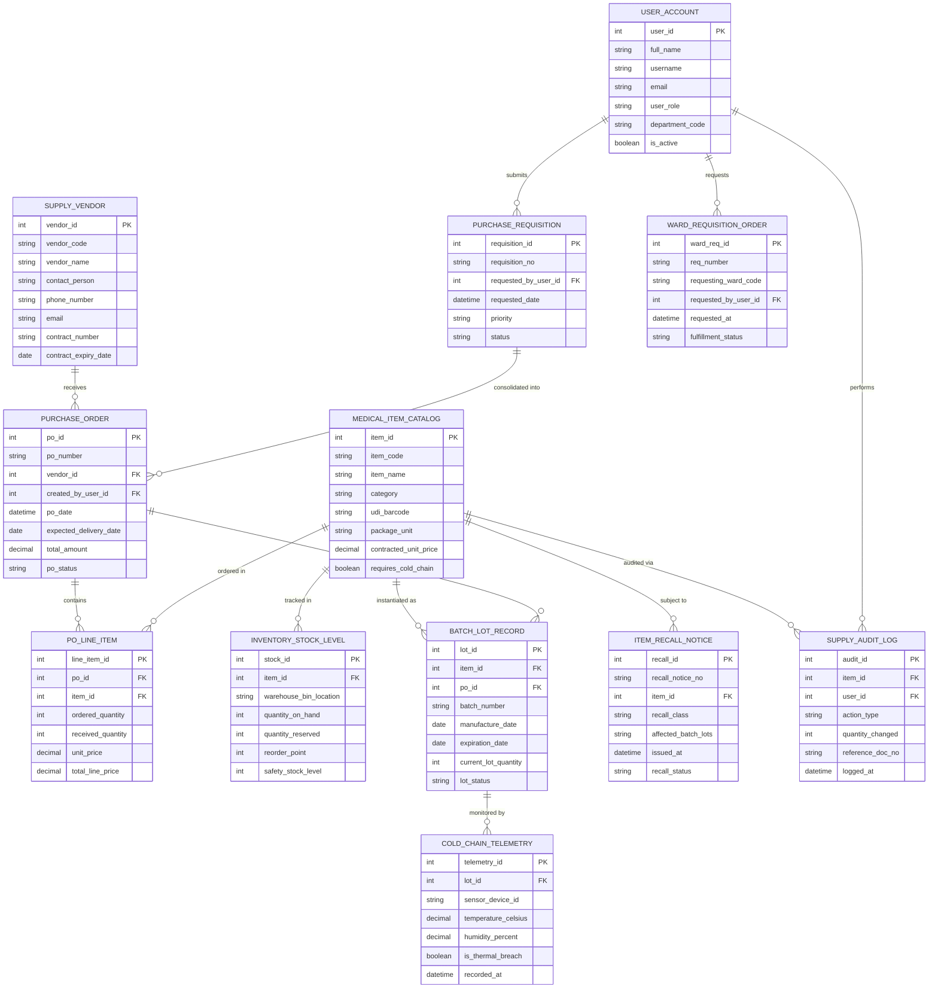

# Conceptual ERD — Medical Supply Chain Management System

## Mermaid Code

## Entity Description Table | Bảng mô tả Entity

| # | Entity Name | Vietnamese Name | Description | Key Attributes | Main Relationships |
|---|-------------|-----------------|-------------|----------------|-------------------|
| 1 | USER_ACCOUNT | Tài khoản Nguời dùng | System user credentials and RBAC roles for procurement officers, warehouse staff, and ward nurses. | `user_id`, `username`, `email`, `user_role`, `department_code` | Submits `PURCHASE_REQUISITION`, requests `WARD_REQUISITION_ORDER`, performs `SUPPLY_AUDIT_LOG`. |
| 2 | SUPPLY_VENDOR | Nhà cung cấp Vật tư | Master vendor profiles, business licenses, contract numbers, and SLA parameters. | `vendor_id`, `vendor_code`, `vendor_name`, `contract_number`, `contract_expiry_date` | Receives many `PURCHASE_ORDER`. |
| 3 | MEDICAL_ITEM_CATALOG | Danh mục Vật tư Y tế | Central catalog of medical consumables, devices, UDI barcodes, package units, and prices. | `item_id`, `item_code`, `item_name`, `udi_barcode`, `contracted_unit_price` | Ordered in `PO_LINE_ITEM`, tracked in `INVENTORY_STOCK_LEVEL`, subject to `ITEM_RECALL_NOTICE`. |
| 4 | PURCHASE_REQUISITION | Yêu cầu Mua sắm | Internal purchasing requests submitted by departments or triggered by auto-reorder points. | `requisition_id`, `requisition_no`, `requested_by_user_id`, `priority`, `status` | Consolidated into `PURCHASE_ORDER`. |
| 5 | PURCHASE_ORDER | Đơn Mua hàng (PO) | Formal contractual purchase order issued to vendors detailing items, quantities, and pricing. | `po_id`, `po_number`, `vendor_id`, `created_by_user_id`, `total_amount`, `po_status` | Belongs to `SUPPLY_VENDOR`, contains many `PO_LINE_ITEM`, delivers `BATCH_LOT_RECORD`. |
| 6 | PO_LINE_ITEM | Chi tiết Đơn Mua hàng | Individual item lines within a purchase order specifying ordered and received quantities. | `line_item_id`, `po_id`, `item_id`, `ordered_quantity`, `received_quantity`, `unit_price` | Relates `PURCHASE_ORDER` to `MEDICAL_ITEM_CATALOG`. |
| 7 | INVENTORY_STOCK_LEVEL | Mức Tồn kho Dụng cụ | Real-time central warehouse inventory stock balances, bin locations, and reorder thresholds. | `stock_id`, `item_id`, `warehouse_bin_location`, `quantity_on_hand`, `reorder_point` | Belongs to `MEDICAL_ITEM_CATALOG`. |
| 8 | BATCH_LOT_RECORD | Hồ sơ Lô Hàng | Specific batch lot instances of items recording manufacture dates, expiration dates, and quarantine status. | `lot_id`, `item_id`, `po_id`, `batch_number`, `expiration_date`, `lot_status` | Belongs to `MEDICAL_ITEM_CATALOG` and `PURCHASE_ORDER`, monitored by `COLD_CHAIN_TELEMETRY`. |
| 9 | COLD_CHAIN_TELEMETRY | Nhật ký Chuỗi Cung ứng Lạnh | IoT sensor telemetry logs tracking ambient temperature and humidity for sensitive supplies. | `telemetry_id`, `lot_id`, `sensor_device_id`, `temperature_celsius`, `is_thermal_breach` | Belongs to `BATCH_LOT_RECORD`. |
| 10 | WARD_REQUISITION_ORDER | Đơn Yêu cầu Cấp Khoa | Internal ward supply replenishment orders requesting stock transfers from central warehouse. | `ward_req_id`, `req_number`, `requesting_ward_code`, `requested_at`, `fulfillment_status` | Submitted by `USER_ACCOUNT`. |
| 11 | ITEM_RECALL_NOTICE | Thông báo Thu hồi | Emergency recall advisories issued by manufacturers or FDA locking specific batch lots. | `recall_id`, `recall_notice_no`, `item_id`, `recall_class`, `affected_batch_lots` | Belongs to `MEDICAL_ITEM_CATALOG`. |
| 12 | SUPPLY_AUDIT_LOG | Nhật ký Kiểm kê & Điều chỉnh | Complete audit trail tracking inventory movements, adjustments, cycle counts, and write-offs. | `audit_id`, `item_id`, `user_id`, `action_type`, `quantity_changed`, `logged_at` | Relates `MEDICAL_ITEM_CATALOG` and `USER_ACCOUNT`. |

## Relationship Description | Mô tả Quan hệ

| # | From Entity | Cardinality | To Entity | Label | Business Explanation |
|---|-------------|-------------|-----------|-------|----------------------|
| 1 | SUPPLY_VENDOR | 1 to 0..N | PURCHASE_ORDER | receives | A supply vendor receives multiple purchase orders. |
| 2 | PURCHASE_ORDER | 1 to 1..N | PO_LINE_ITEM | contains | A purchase order contains one or more line item entries. |
| 3 | MEDICAL_ITEM_CATALOG | 1 to 0..N | PO_LINE_ITEM | ordered in | A medical catalog item can be ordered across multiple purchase order line items. |
| 4 | PURCHASE_REQUISITION | 1 to 0..N | PURCHASE_ORDER | consolidated into | Purchase requisitions are consolidated into formal purchase orders. |
| 5 | MEDICAL_ITEM_CATALOG | 1 to 0..N | INVENTORY_STOCK_LEVEL | tracked in | A medical catalog item has real-time stock levels tracked across warehouse bin locations. |
| 6 | MEDICAL_ITEM_CATALOG | 1 to 0..N | BATCH_LOT_RECORD | instantiated as | A medical catalog item is instantiated as specific manufactured batch lots. |
| 7 | PURCHASE_ORDER | 1 to 0..N | BATCH_LOT_RECORD | delivers | A purchase order delivery yields specific batch lot records upon receiving. |
| 8 | BATCH_LOT_RECORD | 1 to 0..N | COLD_CHAIN_TELEMETRY | monitored by | A cold-chain batch lot is monitored by continuous IoT sensor telemetry logs. |
| 9 | USER_ACCOUNT | 1 to 0..N | PURCHASE_REQUISITION | submits | A procurement user account submits purchase requisitions. |
| 10 | USER_ACCOUNT | 1 to 0..N | WARD_REQUISITION_ORDER | requests | A ward nurse user account requests ward supply replenishment orders. |
| 11 | MEDICAL_ITEM_CATALOG | 1 to 0..N | ITEM_RECALL_NOTICE | subject to | A medical catalog item can be subject to manufacturer or regulatory recall notices. |
| 12 | MEDICAL_ITEM_CATALOG | 1 to 0..N | SUPPLY_AUDIT_LOG | audited via | All stock movements for a catalog item are recorded in supply audit logs. |
| 13 | USER_ACCOUNT | 1 to 0..N | SUPPLY_AUDIT_LOG | performs | A user account performs stock adjustments and inventory audit actions. |
