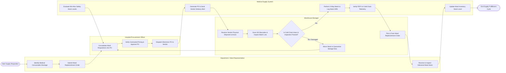

# Swimlane Diagram — Medical Supply Chain Management System

## Mermaid Code

## Flow Description | Mô tả luồng

| Lane | Actor | Role in Flow |
|------|-------|-------------|
| 1 | Department Representative | Identifies consumable shortages in ward closets, submits replenishment requisitions, and inspects delivered stock upon ward closet top-up. |
| 2 | Hospital Procurement Officer | Consolidates departmental requests into formal purchase orders, verifies vendor contract price compliance, approves orders within financial limits, and issues POs to suppliers. |
| 3 | Medical Supply System | Automatically evaluates safety stock reorder thresholds, generates EDI purchase order payloads, executes 3-way matching upon shipment arrival, verifies FEFO picking rules and cold-chain telemetry, and updates stock balances. |
| 4 | Warehouse Manager | Unloads vendor deliveries at receiving dock, scans UDI barcodes, inspects batch lot integrity, moves failed/breached items to quarantine, and picks/packs approved stock for ward distribution. |
