# Action Tree — Medical Supply Chain Management System

## Mermaid Code

```mermaid
graph TD
    Root["Medical Supply Chain Management System"]

    Root --> M1["Vendor & Catalog Administration"]
    Root --> M2["Procurement & Purchase Orders"]
    Root --> M3["Receiving & Cold Chain Inspection"]
    Root --> M4["Inventory & Lot Expiration Control"]
    Root --> M5["Ward Replenishment & Distribution"]
    Root --> M6["Supply Analytics & Recall Management"]

    M1 --> A11["Maintain Master Medical Item Catalog"]
    M1 --> A12["Configure Vendor Profiles & Price Contracts"]
    M1 --> A13["Set GS1 UDI Barcode Mapping Rules"]
    M1 --> A14["Track Vendor SLA Performance Ratings"]

    M2 --> A21["Create & Approve Purchase Requisitions"]
    M2 --> A22["Generate & Issue Purchase Orders (POs)"]
    M2 --> A23["Process Vendor PO Acknowledgments"]
    M2 --> A24["Configure Automated Min-Max Auto-Ordering"]

    M3 --> A31["Process Warehouse Dock Goods Receiving (GRN)"]
    M3 --> A32["Scan UDI Barcodes & 2D Matrix Tags"]
    M3 --> A33["Monitor Cold Chain Temperature Telemetry"]
    M3 --> A34["Perform 3-Way Invoice Matching"]

    M4 --> A41["Track Batch Lot Expiration Dates (FEFO)"]
    M4 --> A42["Isolate Defective Stock into Quarantine"]
    M4 --> A43["Conduct Physical Stock Cycle Counts"]
    M4 --> A44["Optimize Warehouse Bin Allocation Maps"]

    M5 --> A51["Submit Ward Supply Replenishment Requests"]
    M5 --> A52["Pick & Pack Ward Distribution Orders"]
    M5 --> A53["Transfer Consumable Stock to Ward Closets"]
    M5 --> A54["Track Emergency STAT Supply Requisitions"]

    M6 --> A61["Execute Emergency Medical Item Recalls"]
    M6 --> A62["Forecast Supply Demand & Consumption Trends"]
    M6 --> A63["Analyze Inventory Turnover & Stockout Risks"]
    M6 --> A64["Export Regulatory Device Serialization Reports"]
```

## Module Description | Mô tả Module

| # | Module | Description | Actions |
|---|--------|-------------|---------|
| 1 | Vendor & Catalog Administration | Manages central medical item master catalog, GS1 UDI barcode mappings, supplier profiles, contracted price tiers, and vendor SLA scorecards. | Maintain Master Catalog, Configure Vendor Contracts, Set UDI Mappings, Track Vendor Ratings. |
| 2 | Procurement & Purchase Orders | Oversees purchase requisitions, PO generation, financial approval workflows, vendor order acknowledgments, and automated min-max reordering. | Create Purchase Requisitions, Issue Purchase Orders, Process Order Acknowledgments, Configure Auto-Ordering. |
| 3 | Receiving & Cold Chain Inspection | Handles warehouse dock goods receiving (GRN), UDI barcode scanning, 3-way invoice matching, and real-time cold-chain IoT temperature telemetry. | Process Dock Goods Receiving, Scan UDI Barcodes, Monitor Cold Chain Telemetry, Perform 3-Way Invoice Matching. |
| 4 | Inventory & Lot Expiration Control | Controls batch lot tracking, FEFO (First-Expiry-First-Out) picking logic, quarantine isolation, stock cycle counts, and warehouse bin management. | Track Lot Expiration Dates, Isolate Defective Stock, Conduct Cycle Counts, Optimize Bin Allocations. |
| 5 | Ward Replenishment & Distribution | Facilitates ward supply requisitions, central warehouse picking/packing, internal stock transfers, and emergency STAT supply dispatching. | Submit Replenishment Requests, Pick & Pack Orders, Transfer Stock to Wards, Track STAT Requisitions. |
| 6 | Supply Analytics & Recall Management | Executes emergency recall lockdowns, forecasts supply demand, analyzes inventory turnover, and exports regulatory serialization compliance reports. | Execute Medical Recalls, Forecast Supply Demand, Analyze Turnover & Stockouts, Export Regulatory Reports. |
