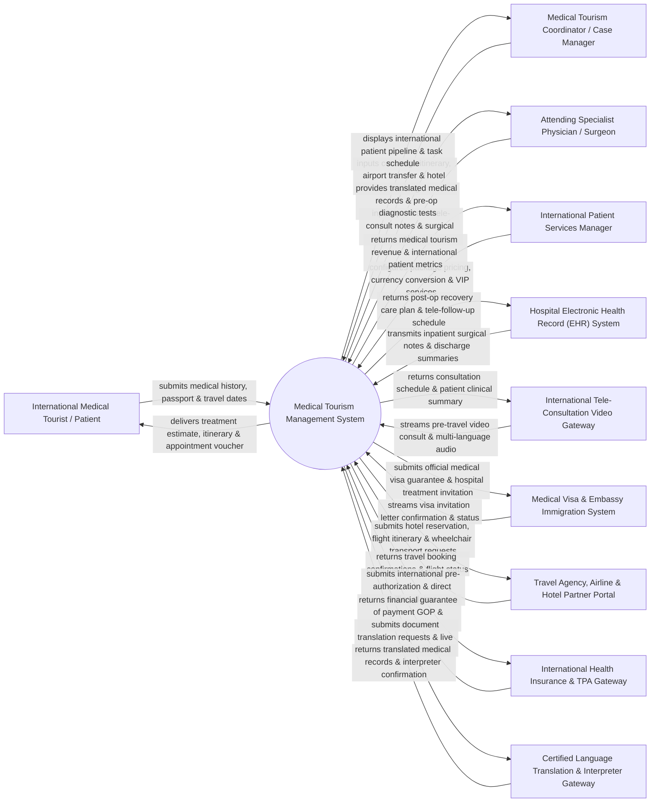

# Context Diagram — Medical Tourism Management System

## Mermaid Code

## Actor & Interaction Table | Bảng Actor & Tương tác

| # | Actor | Actor Type | Data Sent TO System | Data Received FROM System | Notes |
|---|-------|------------|---------------------|---------------------------|-------|
| 1 | International Medical Tourist / Patient | Primary | Foreign medical history, passport scan, travel preferences, flight dates, language preferences, dietary requirements. | Treatment cost estimate, all-inclusive medical package itinerary, appointment voucher, medical visa invitation letter. | Foreign patient seeking elective surgery, dental care, wellness, or specialized medical treatment abroad. |
| 2 | Medical Tourism Coordinator / Case Manager | Primary | Travel itinerary coordination, hotel reservation details, airport pickup dispatch, local companion scheduling. | International patient pipeline dashboard, daily arrival/discharge schedule, task reminder alerts. | Dedicated concierge case manager coordinating end-to-end travel, accommodation, and clinical logistics. |
| 3 | Attending Specialist Physician / Surgeon | Primary | Pre-travel tele-consultation evaluation, surgical treatment plan, expected hospital stay duration, post-op travel clearance. | Certified translated medical records, pre-op diagnostic imaging, patient pre-travel health questionnaire. | Specialist doctor evaluating foreign patient suitability for travel and performing clinical procedures. |
| 4 | International Patient Services Manager | Primary | Medical package pricing matrices, multi-currency conversion rates, partner commission rates, VIP service policies. | International patient volume metrics, revenue reports by country of origin, partner conversion rates. | Department head overseeing international hospital business development and concierge operations. |
| 5 | Hospital Electronic Health Record (EHR) System | Supporting | Inpatient surgical procedure notes, clinical lab results, prescription orders, discharge summaries. | Post-discharge recovery care plan, follow-up tele-consultation schedule, home-country physician handoff. | Hospital EHR supplying clinical documentation to generate international patient medical summaries. |
| 6 | International Tele-Consultation Video Gateway | Supporting | Pre-travel video consultation recordings, multi-language audio streams, chat transcripts. | Tele-consultation appointment schedules, patient clinical summary attachments, virtual waiting room links. | Telehealth platform enabling pre-travel and post-op video consultations between surgeon and foreign patient. |
| 7 | Medical Visa & Embassy Immigration System | Supporting | Medical visa application status, embassy approval codes, entry visa duration limits. | Official medical visa invitation letters, hospital treatment guarantee documents, patient stay extension requests. | Government immigration portal facilitating expedited medical visa issuance for international patients. |
| 8 | Travel Agency, Airline & Hotel Partner Portal | Supporting | Flight itinerary updates, hotel room booking confirmations, wheelchair/ambulance transport dispatch receipts. | Medical package accommodation requests, airport transfer dispatches, special assistance flight manifests. | External travel partners providing hospitality, flight bookings, and local transportation services. |
| 9 | International Health Insurance & TPA Gateway | Supporting | Guarantee of Payment (GOP) letters, international coverage limits, Third-Party Administrator (TPA) claim approvals. | Electronic pre-authorization requests, itemized medical billing claims, international claim attachments. | Foreign health insurance companies and TPAs providing coverage for international medical treatment. |
| 10 | Certified Language Translation & Interpreter Gateway | Supporting | Certified translated medical documents (English, Arabic, Russian, Chinese), live interpreter assignment confirmations. | Source medical record translation requests, live remote interpreting (LRI) session bookings. | Medical translation agency providing certified document translation and live medical interpreters. |

## System Boundary Description | Mô tả Phạm vi Hệ thống

The **Medical Tourism Management System (MTMS)** is an enterprise international patient concierge and care coordination platform designed to manage cross-border medical travel, pre-travel tele-consultations, medical visa logistics, multi-currency billing packages, and post-discharge international care continuity.

**Inside System Scope:**
- International patient lead management, treatment package quoting, and multi-currency billing estimation.
- Pre-travel virtual tele-consultation scheduling, medical record translation, and surgical suitability screening.
- Logistics management for medical visa invitation letters, hotel bookings, airport transfers, and local interpreter assignments.
- Cross-border health insurance pre-authorization handling and Guarantee of Payment (GOP) tracking.
- Post-operative travel clearance issuance, home-country physician handoff summaries, and remote post-op follow-up.

**Outside System Scope:**
- Physical operation of commercial aircraft or airport border control checkpoints (handled by Airlines and Border Police).
- Physical hospitality hotel room cleaning and catering (handled by Partner Hotels).
- Direct underwriting or financial risk bearing of foreign insurance policies (handled by Insurance Underwriters).
