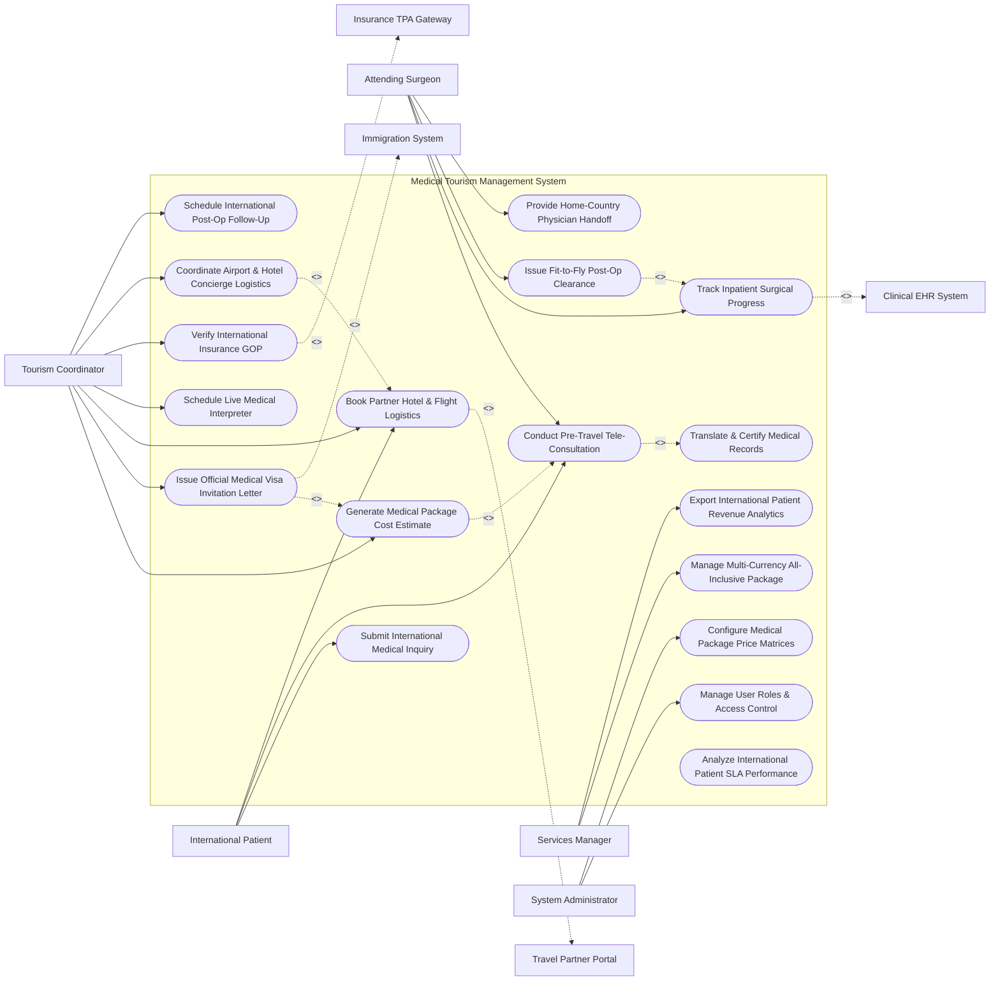

# Use Case Diagram — Medical Tourism Management System

## Mermaid Code

## Actor Table | Bảng Actor

| # | Actor | Actor Type | Role Description | Related Use Cases |
|---|-------|------------|------------------|-------------------|
| 1 | International Patient | Primary | Foreign medical tourist submitting inquiries, attending pre-travel video consults, and selecting packages. | UC01, UC02, UC06 |
| 2 | Tourism Coordinator | Primary | Dedicated concierge manager managing quotes, visa letters, hotel/flight bookings, interpreters, and airport pickups. | UC04, UC05, UC06, UC07, UC09, UC10, UC14 |
| 3 | Attending Surgeon | Primary | Specialist doctor conducting pre-travel evaluations, performing surgery, and issuing fit-to-fly clearance. | UC02, UC11, UC12, UC13 |
| 4 | Services Manager | Primary | Executive managing package pricing matrices, partner contracts, multi-currency revenue, and business growth. | UC08, UC15 |
| 5 | System Administrator | Primary | IT administrator configuring user security roles, currency conversion rates, and translation interfaces. | UC16, UC17 |
| 6 | Clinical EHR System | System (Secondary) | Hospital EHR supplying surgical notes, lab results, and inpatient discharge summaries. | UC11 |
| 7 | Immigration System | System (Secondary) | Government embassy portal issuing medical entry visas based on hospital guarantee letters. | UC05 |
| 8 | Travel Partner Portal | System (Secondary) | External partner portal managing hotel room reservations, flight bookings, and wheelchair transport. | UC06 |
| 9 | Insurance TPA Gateway | System (Secondary) | Foreign health insurance gateway verifying pre-authorizations and issuing Guarantee of Payment (GOP) letters. | UC09 |

## Use Case Table | Bảng Use Case

| # | UC ID | Use Case Name | Primary Actor | Secondary Actor | Description | Priority |
|---|-------|---------------|---------------|-----------------|-------------|----------|
| 1 | UC01 | Submit International Medical Inquiry | Patient | None | Submits medical travel inquiries, foreign medical records, passport scans, and target treatment dates. | High |
| 2 | UC02 | Conduct Pre-Travel Tele-Consultation | Surgeon | Patient | Conducts HD video consultation between surgeon and foreign patient to evaluate surgical candidate suitability. | High |
| 3 | UC03 | Translate & Certify Medical Records | System | None | Translates foreign medical records into English/hospital language via certified medical translation APIs. | High |
| 4 | UC04 | Generate Medical Package Cost Estimate | Coordinator | None | Compiles all-inclusive medical package price quote (Surgery, Inpatient Stay, Hotel, Transfers, Interpreter). | High |
| 5 | UC05 | Issue Official Medical Visa Invitation Letter | Coordinator | Immigration | Auto-generates official embassy medical visa invitation letter and hospital treatment guarantee document. | Critical |
| 6 | UC06 | Book Partner Hotel & Flight Logistics | Coordinator | Travel Partner | Coordinates partner hotel room bookings, special assistance flight arrangements, and companion stay. | High |
| 7 | UC07 | Schedule Live Medical Interpreter | Coordinator | None | Schedules certified live medical interpreters for patient consultations, consent sign-offs, and ward rounds. | High |
| 8 | UC08 | Manage Multi-Currency All-Inclusive Package | Manager | None | Manages multi-currency pricing tiers (USD, EUR, AED, SGD), foreign exchange locks, and refund policies. | High |
| 9 | UC09 | Verify International Insurance GOP | Coordinator | Insurance TPA | Submits pre-treatment clinical records to foreign TPA and verifies electronic Guarantee of Payment (GOP). | High |
| 10 | UC10 | Coordinate Airport & Hotel Concierge Logistics | Coordinator | Travel Partner | Dispatches VIP airport arrival pickup, wheelchair transport, hotel check-in, and hospital escort. | High |
| 11 | UC11 | Track Inpatient Surgical Progress | Surgeon | Clinical EHR | Monitors patient surgical procedure completion, ICU recovery status, and ward discharge readiness. | High |
| 12 | UC12 | Issue Fit-to-Fly Post-Op Clearance | Surgeon | None | Evaluates post-operative recovery metrics (wound healing, DVT risk) to issue official Fit-to-Fly certificate. | Critical |
| 13 | UC13 | Provide Home-Country Physician Handoff | Surgeon | None | Compiles comprehensive medical discharge summary and handoff instructions for patient's home doctor. | High |
| 14 | UC14 | Schedule International Post-Op Follow-Up | Coordinator | None | Schedules post-discharge virtual follow-up video consults 30/90 days post-travel. | Medium |
| 15 | UC15 | Export International Patient Revenue Analytics | Manager | None | Generates international revenue reports broken down by country of origin, specialty, and travel partner. | Medium |
| 16 | UC16 | Manage User Roles & Access Control | Admin | None | Configures user accounts, coordinator patient assignments, and secure passport PII access controls. | High |
| 17 | UC17 | Configure Medical Package Price Matrices | Admin | Manager | Maps surgical procedure bundles, hospital ward room upgrades, and concierge add-on fees. | High |
| 18 | UC18 | Analyze International Patient SLA Performance | System | None | Computes inquiry-to-quote response times, visa approval lead times, and patient satisfaction scores. | Medium |

## Use Case Specification | Đặc tả Use Case

---

### UC02 — Conduct Pre-Travel Tele-Consultation

| Field | Detail |
|-------|--------|
| **UC ID** | UC02 |
| **Use Case Name** | Conduct Pre-Travel Tele-Consultation |
| **Actor(s)** | Primary: Attending Specialist Physician / Surgeon   Secondary: International Patient |
| **Description** | Conducts a secure, high-definition virtual video consultation between attending surgeon and foreign patient to review translated medical records, assess surgical candidacy, and explain treatment plans. |
| **Precondition** | 1. Foreign patient's medical records are translated and certified (UC03).   2. Virtual video consultation session is scheduled in system. |
| **Main Flow** | 1. Surgeon logs into "Pre-Travel Tele-Consultation" portal.   2. System displays patient foreign medical records, diagnostic imaging DICOM files, and certified translation summary.   3. Surgeon initiates secure HD video connection; Patient joins from home country.   4. If language barrier exists, assigned live medical interpreter (UC07) joins video bridge.   5. Surgeon evaluates patient clinical condition, discusses surgical options, expected hospital stay duration, and post-op recovery.   6. Patient asks clarifying questions regarding travel timeline and recovery expectations.   7. Surgeon confirms patient is a suitable candidate for medical travel and signs "Pre-Travel Clinical Acceptance".   8. System saves consultation video recording, chat transcript, and dispatches clinical acceptance notification to Tourism Coordinator (UC04). |
| **Alternative Flow** | **AF1** — Additional Pre-Travel Diagnostics Requested: Surgeon determines foreign MRI is outdated (> 6 months old); Surgeon orders updated local MRI upon patient arrival, adding test to preliminary quote. |
| **Exception Flow** | **EX1** — Clinical Candidate Rejection: Surgeon determines patient's cardiac condition is too unstable for long-haul air travel; Surgeon logs "Unfit for Medical Travel", System generates formal clinical declination letter, and coordinator cancels package quote. |
| **Postcondition** | Pre-travel tele-consultation is completed, surgeon signs clinical acceptance, and all-inclusive package quote is generated. |
| **Business Rule** | **BR1**: Pre-travel clinical acceptance MUST be signed by the attending surgeon before issuing medical visa invitation letters. |

---

### UC05 — Issue Official Medical Visa Invitation Letter

| Field | Detail |
|-------|--------|
| **UC ID** | UC05 |
| **Use Case Name** | Issue Official Medical Visa Invitation Letter |
| **Actor(s)** | Primary: Medical Tourism Coordinator / Case Manager   Secondary: Medical Visa & Embassy Immigration System |
| **Description** | Auto-generates official embassy medical visa invitation letters and hospital treatment financial guarantee documents to facilitate expedited visa processing for foreign patients and companions. |
| **Precondition** | 1. Pre-travel clinical acceptance is signed by attending surgeon (UC02).   2. Patient passport scan and foreign address details are validated in system. |
| **Main Flow** | 1. Coordinator opens "Medical Visa Documentation" module for approved patient.   2. System verifies mandatory visa requirements: Passport Number, Expiry Date (> 6 months validity), Country of Residence, Target Entry Date, Accompanying Companion Names.   3. Coordinator clicks "Generate Medical Visa Package".   4. System auto-populates official embassy template:   &nbsp;&nbsp;&nbsp;&nbsp; a. Official Medical Visa Invitation Letter bearing hospital seal and license number.   &nbsp;&nbsp;&nbsp;&nbsp; b. Attending Surgeon Clinical Confirmation & Expected Treatment Schedule.   &nbsp;&nbsp;&nbsp;&nbsp; c. Hospital Financial Guarantee Statement confirming treatment deposit receipt.   5. Coordinator applies digital hospital seal and cryptographic signature.   6. System dispatches digital visa package directly to Embassy Immigration API Gateway and emails encrypted PDF to patient.   7. System logs visa tracking control number (`VISA-INV-2026-8841`) in patient file. |
| **Alternative Flow** | **AF1** — Urgent Medical Emergency Visa: Patient requires urgent organ transplant or cardiac intervention; System flags "Urgent Medical Priority", generating expedited 24-hour embassy processing voucher. |
| **Exception Flow** | **EX1** — Passport Expiration Warning: Patient passport expires within 4 months; System blocks visa letter generation, displaying error "Passport Expiry < 6 Months - Renewal Required Before Visa Issuance". |
| **Postcondition** | Official medical visa invitation package is issued, transmitted to embassy immigration portal, and delivered to patient. |
| **Business Rule** | **BR1**: Medical visa invitation letters must state the exact expected duration of medical treatment and include a hospital financial guarantee clause. |

---

### UC08 — Manage Multi-Currency All-Inclusive Package

| Field | Detail |
|-------|--------|
| **UC ID** | UC08 |
| **Use Case Name** | Manage Multi-Currency All-Inclusive Package |
| **Actor(s)** | Primary: International Patient Services Manager   Secondary: None |
| **Description** | Configures and manages multi-currency all-inclusive medical tourism package pricing matrices (USD, EUR, AED, GBP, SGD), foreign exchange rate locks, bundled services, and deposit refund rules. |
| **Precondition** | 1. Base clinical procedure price lists are established in hospital fee schedule. |
| **Main Flow** | 1. Services Manager opens "Medical Package Pricing Engine".   2. Manager selects procedure package type (e.g., Total Knee Replacement All-Inclusive Package).   3. System displays bundled package item components:   &nbsp;&nbsp;&nbsp;&nbsp; a. Clinical: Pre-op labs, Surgery fee, Implants, 4 nights Inpatient Private Suite, Medication.   &nbsp;&nbsp;&nbsp;&nbsp; b. Concierge: 5 nights Partner Hotel (Bed & Breakfast), Airport VIP Transfers, Interpreter (20 hrs).   &nbsp;&nbsp;&nbsp;&nbsp; c. Administrative: Medical Visa processing fee, Medical Record Translation.   4. Manager sets multi-currency package prices (e.g., $18,500 USD | €17,200 EUR | 68,000 AED).   5. Manager configures Foreign Exchange (FX) Rate Lock period (e.g., Guaranteed exchange rate for 60 days from quote date).   6. Manager configures deposit refund policy (e.g., 100% deposit refund if visa is rejected by embassy).   7. Manager publishes package pricing tier to active quotation system. |
| **Alternative Flow** | **AF1** — Customized VIP Upgrade: Patient requests Luxury 5-Star Hotel suite and Private Ambulance transfer; Coordinator selects VIP Add-on options, System recalculates package total in real time. |
| **Exception Flow** | **EX1** — Volatile Currency Fluctuation Alert: Target currency fluctuates > 5% within 24 hours; System triggers FX re-hedging warning, prompting manager to update currency lock parameters. |
| **Postcondition** | Multi-currency medical package pricing matrix is configured, FX lock rules are set, and package is published. |
| **Business Rule** | **BR1**: Quoted multi-currency package prices must honor FX rate locks for a minimum of 60 days from quote issuance. |

---

### UC10 — Coordinate Airport & Hotel Concierge Logistics

| Field | Detail |
|-------|--------|
| **UC ID** | UC10 |
| **Use Case Name** | Coordinate Airport & Hotel Concierge Logistics |
| **Actor(s)** | Primary: Medical Tourism Coordinator / Case Manager   Secondary: Travel Agency, Airline & Hotel Partner Portal |
| **Description** | Manages international patient arrival logistics, coordinating tarmac/gate wheelchair assistance, VIP airport pickup, hotel check-in, companion accommodations, and hospital transfer escort. |
| **Precondition** | 1. Foreign patient flight arrival details and travel dates are confirmed.   2. All-inclusive package quote deposit is received. |
| **Main Flow** | 1. Coordinator opens "Arrival Logistics Dispatch" dashboard 48 hours prior to patient flight.   2. System displays patient arrival itinerary: Flight No, Airport, Arrival Time, Special Mobility Needs (e.g., Stretcher / Wheelchair required).   3. Coordinator dispatches logistics requests to Travel Partner Portal:   &nbsp;&nbsp;&nbsp;&nbsp; a. Airport VIP Meet-and-Greet escort at arrival gate.   &nbsp;&nbsp;&nbsp;&nbsp; b. Wheelchair-accessible van or medical ambulance transport from airport to hotel/hospital.   &nbsp;&nbsp;&nbsp;&nbsp; c. Partner Hotel 5-night room booking confirmation for accompanying family members.   4. Travel Partner Portal confirms transport driver name, vehicle license plate, hotel reservation code, and dispatches status to system.   5. System sends digital arrival voucher and driver contact details to Patient mobile app and WhatsApp.   6. Upon arrival, driver confirms pickup timestamp; System updates patient logistics status to `ARRIVED_IN_COUNTRY`. |
| **Alternative Flow** | **AF1** — Flight Delay / Cancellation Rerouting: Flight is delayed 4 hours; Travel Partner Portal streams flight tracking update, System automatically updates driver dispatch time and alerts hotel front desk. |
| **Exception Flow** | **EX1** — Missing Airport Transfer Driver: Patient lands but driver is not at gate; Patient taps "Emergency Concierge Help" button in app, System triggers urgent SMS alert to Coordinator, and dispatches backup hospital vehicle. |
| **Postcondition** | Airport pickup, hotel booking, and hospital escort logistics are executed, and patient arrival status is confirmed. |
| **Business Rule** | **BR1**: Airport arrival transport for post-surgical or mobility-impaired patients must utilize wheelchair-accessible vehicles with trained medical escorts. |

---

### UC12 — Issue Fit-to-Fly Post-Op Clearance

| Field | Detail |
|-------|--------|
| **UC ID** | UC12 |
| **Use Case Name** | Issue Fit-to-Fly Post-Op Clearance |
| **Actor(s)** | Primary: Attending Specialist Physician / Surgeon   Secondary: None |
| **Description** | Evaluates post-operative recovery metrics, surgical wound healing, deep vein thrombosis (DVT) risk factors, and vital signs to issue an official Fit-to-Fly medical clearance certificate for international air travel. |
| **Precondition** | 1. Inpatient surgical procedure is completed and patient is discharged from hospital.   2. Post-op follow-up clinical evaluation is conducted (typically 3-7 days post-surgery). |
| **Main Flow** | 1. Surgeon opens "Post-Op Travel Clearance" module during final post-op clinic visit.   2. System displays post-op clinical evaluation checklist:   &nbsp;&nbsp;&nbsp;&nbsp; a. Surgical Wound Healing Status (No active bleeding or infection).   &nbsp;&nbsp;&nbsp;&nbsp; b. Hemoglobin & Oxygen Saturation Levels ($SpO_2 > 95\%$).   &nbsp;&nbsp;&nbsp;&nbsp; c. DVT Risk Assessment (Enoxaparin / Anticoagulation prophylaxis administered).   &nbsp;&nbsp;&nbsp;&nbsp; d. Pain Control Stability on oral medications.   3. Surgeon performs physical exam and confirms patient meets international airline medical travel guidelines.   4. Surgeon selects flight travel authorization:   &nbsp;&nbsp;&nbsp;&nbsp; a. Fit-to-Fly Standard Commercial Flight.   &nbsp;&nbsp;&nbsp;&nbsp; b. Fit-to-Fly with Special Airline Assistance (In-flight oxygen / Aisle wheelchair / Extra legroom seat).   &nbsp;&nbsp;&nbsp;&nbsp; c. Unfit-to-Fly (Requires extended hotel recovery stay).   5. Surgeon signs certificate with digital signature.   6. System generates official Fit-to-Fly Certificate (IATA MEDIF Form compliant) and dispatches copy to patient, airline partner, and case manager. |
| **Alternative Flow** | **AF1** — Extension of Stay Required: Surgeon identifies minor wound dehiscence; Surgeon denies Fit-to-Fly, extends hotel stay by 4 days, and schedules re-evaluation visit. |
| **Exception Flow** | **EX1** — Acute Post-Op Complication (DVT / Pulmonary Embolism): Ultrasound confirms acute DVT; System immediately blocks Fit-to-Fly issuance, flags "CRITICAL TRAVEL CONTRAINDICATION", and prompts re-admission to hospital ICU. |
| **Postcondition** | Fit-to-Fly certificate is issued, airline medical clearance is verified, and patient is authorized for international return flight. |
| **Business Rule** | **BR1**: Fit-to-Fly clearance MUST comply with IATA Medical Manual guidelines for post-surgical commercial air travel. |
