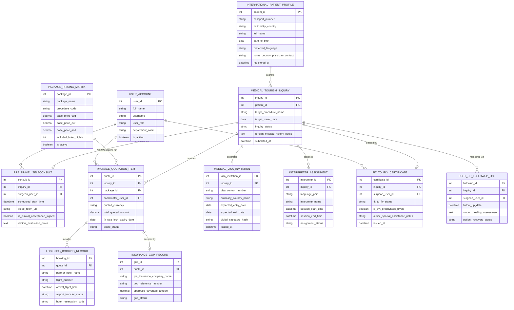

# Conceptual ERD — Medical Tourism Management System

## Mermaid Code

## Entity Description Table | Bảng mô tả Entity

| # | Entity Name | Vietnamese Name | Description | Key Attributes | Main Relationships |
|---|-------------|-----------------|-------------|----------------|-------------------|
| 1 | USER_ACCOUNT | Tài khoản Nguời dùng | Credentials and roles for tourism coordinators, attending surgeons, services managers, and admins. | `user_id`, `username`, `user_role`, `department_code` | Conducts `PRE_TRAVEL_TELECONSULT`, quotes `PACKAGE_QUOTATION_ITEM`, issues `FIT_TO_FLY_CERTIFICATE`. |
| 2 | INTERNATIONAL_PATIENT_PROFILE | Hồ sơ Bệnh nhân Quốc tế | Passport demographics, nationality, preferred language, and home-country physician contacts. | `patient_id`, `passport_number`, `nationality_country`, `full_name`, `preferred_language` | Submits `MEDICAL_TOURISM_INQUIRY`. |
| 3 | MEDICAL_TOURISM_INQUIRY | Yêu cầu Du lịch Y tế | Foreign medical travel inquiries detailing target procedure, travel dates, and medical history notes. | `inquiry_id`, `patient_id`, `target_procedure_name`, `target_travel_date`, `inquiry_status` | Belongs to `INTERNATIONAL_PATIENT_PROFILE`, evaluated via `PRE_TRAVEL_TELECONSULT`, cleared by `FIT_TO_FLY_CERTIFICATE`. |
| 4 | PRE_TRAVEL_TELECONSULT | Khám Từ xa Tiền Du lịch | Pre-travel virtual video consultation logs capturing surgeon clinical evaluation notes and acceptance sign-offs. | `consult_id`, `inquiry_id`, `surgeon_user_id`, `video_room_url`, `is_clinical_acceptance_signed` | Belongs to `MEDICAL_TOURISM_INQUIRY`, conducted by `USER_ACCOUNT`. |
| 5 | PACKAGE_PRICING_MATRIX | Ma trận Giá Gói Y tế | Multi-currency bundled package pricing templates detailing base USD/EUR/AED prices and included services. | `package_id`, `package_name`, `procedure_code`, `base_price_usd`, `base_price_eur`, `included_hotel_nights` | Defines terms for `PACKAGE_QUOTATION_ITEM`. |
| 6 | PACKAGE_QUOTATION_ITEM | Báo giá Gói Y tế | Itemized multi-currency all-inclusive package cost estimates issued to international patients with FX rate locks. | `quote_id`, `inquiry_id`, `package_id`, `coordinator_user_id`, `quoted_currency`, `total_quoted_amount` | Belongs to `MEDICAL_TOURISM_INQUIRY` and `PACKAGE_PRICING_MATRIX`, includes `LOGISTICS_BOOKING_RECORD`. |
| 7 | MEDICAL_VISA_INVITATION | Thư Mời Visa Y tế | Official embassy medical visa invitation letters bearing digital hospital seals and treatment guarantee clauses. | `visa_invitation_id`, `inquiry_id`, `visa_control_number`, `embassy_country_name`, `expected_entry_date` | Belongs to `MEDICAL_TOURISM_INQUIRY`. |
| 8 | LOGISTICS_BOOKING_RECORD | Hồ sơ Logistics Du lịch | Travel partner booking logs capturing hotel room reservations, flight details, and airport transfer dispatches. | `booking_id`, `quote_id`, `partner_hotel_name`, `flight_number`, `airport_transfer_status` | Belongs to `PACKAGE_QUOTATION_ITEM`. |
| 9 | INTERPRETER_ASSIGNMENT | Phân công Phiên dịch | Certified live medical interpreter assignment logs matching patient language pairs and session schedules. | `interpreter_id`, `inquiry_id`, `language_pair`, `interpreter_name`, `session_start_time` | Belongs to `MEDICAL_TOURISM_INQUIRY`. |
| 10 | INSURANCE_GOP_RECORD | Hồ sơ Bảo hiểm Quốc tế (GOP) | Foreign health insurance Guarantee of Payment (GOP) verification records and coverage limits. | `gop_id`, `quote_id`, `tpa_insurance_company_name`, `gop_reference_number`, `approved_coverage_amount` | Belongs to `PACKAGE_QUOTATION_ITEM`. |
| 11 | FIT_TO_FLY_CERTIFICATE | Chứng nhận Đủ điều kiện Bay | Official IATA-compliant Fit-to-Fly medical clearance certificates issued by attending surgeons post-op. | `certificate_id`, `inquiry_id`, `surgeon_user_id`, `fit_to_fly_status`, `is_dvt_prophylaxis_given` | Belongs to `MEDICAL_TOURISM_INQUIRY`, issued by `USER_ACCOUNT`. |
| 12 | POST_OP_FOLLOWUP_LOG | Nhật ký Theo dõi Sau Phẫu thuật | International post-discharge virtual follow-up logs tracking wound healing and recovery 30/90 days post-travel. | `followup_id`, `inquiry_id`, `surgeon_user_id`, `follow_up_date`, `wound_healing_assessment` | Belongs to `MEDICAL_TOURISM_INQUIRY`. |

## Relationship Description | Mô tả Quan hệ

| # | From Entity | Cardinality | To Entity | Label | Business Explanation |
|---|-------------|-------------|-----------|-------|----------------------|
| 1 | INTERNATIONAL_PATIENT_PROFILE | 1 to 0..N | MEDICAL_TOURISM_INQUIRY | submits | An international patient profile submits medical tourism inquiries. |
| 2 | MEDICAL_TOURISM_INQUIRY | 1 to 0..1 | PRE_TRAVEL_TELECONSULT | evaluated via | An inquiry is evaluated via a pre-travel video tele-consultation. |
| 3 | MEDICAL_TOURISM_INQUIRY | 1 to 0..N | PACKAGE_QUOTATION_ITEM | receives | An inquiry receives itemized multi-currency package cost estimates. |
| 4 | PACKAGE_PRICING_MATRIX | 1 to 0..N | PACKAGE_QUOTATION_ITEM | defines terms for | A package pricing matrix defines pricing terms for package quotations. |
| 5 | MEDICAL_TOURISM_INQUIRY | 1 to 0..1 | MEDICAL_VISA_INVITATION | generates | An inquiry generates official medical visa invitation letters. |
| 6 | PACKAGE_QUOTATION_ITEM | 1 to 0..N | LOGISTICS_BOOKING_RECORD | includes | A package quotation includes hotel and airport transport logistics bookings. |
| 7 | MEDICAL_TOURISM_INQUIRY | 1 to 0..N | INTERPRETER_ASSIGNMENT | assigned | An inquiry is assigned live medical interpreters for patient language pairs. |
| 8 | PACKAGE_QUOTATION_ITEM | 1 to 0..1 | INSURANCE_GOP_RECORD | covered by | A package quotation is covered by an international insurance GOP record. |
| 9 | MEDICAL_TOURISM_INQUIRY | 1 to 0..1 | FIT_TO_FLY_CERTIFICATE | cleared by | An inquiry is cleared by an official post-op Fit-to-Fly certificate. |
| 10 | MEDICAL_TOURISM_INQUIRY | 1 to 0..N | POST_OP_FOLLOWUP_LOG | monitored via | An inquiry is monitored via post-discharge virtual follow-up logs. |
| 11 | USER_ACCOUNT | 1 to 0..N | PRE_TRAVEL_TELECONSULT | conducts | A surgeon user account conducts pre-travel video tele-consultations. |
| 12 | USER_ACCOUNT | 1 to 0..N | PACKAGE_QUOTATION_ITEM | quotes | A coordinator user account quotes package cost estimates. |
| 13 | USER_ACCOUNT | 1 to 0..N | FIT_TO_FLY_CERTIFICATE | issues | A surgeon user account issues Fit-to-Fly post-op certificates. |
