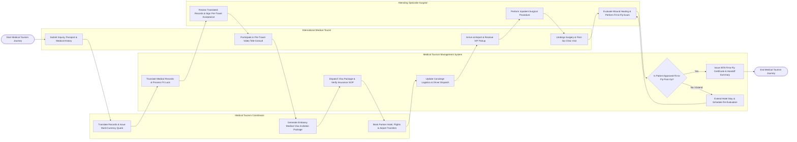

# Swimlane Diagram — Medical Tourism Management System

## Mermaid Code

## Flow Description | Mô tả luồng

| Lane | Actor | Role in Flow |
|------|-------|-------------|
| 1 | International Medical Tourist | Submits medical history, passport scans, participates in pre-travel video consultations, arrives at airport for VIP concierge pickup, undergoes surgery, and attends post-op evaluation visits. |
| 2 | Medical Tourism Coordinator | Translates medical records, generates multi-currency package quotes, issues official embassy medical visa invitation packages, and books partner hotels, flights, and airport transfers. |
| 3 | Medical Tourism Management System | Translates medical records, locks multi-currency foreign exchange rates, transmits visa packages, verifies insurance GOPs, dispatches driver transport, and issues IATA Fit-to-Fly certificates. |
| 4 | Attending Specialist Surgeon | Reviews translated medical records, signs pre-travel clinical acceptance, performs inpatient surgeries, evaluates wound healing, and conducts Fit-to-Fly examinations. |
