# Action Tree — Medical Tourism Management System

## Mermaid Code

```mermaid
graph TD
    Root["Medical Tourism Management System"]

    Root --> M1["International Inquiry & Lead Intake"]
    Root --> M2["Pre-Travel Consultation & Translation"]
    Root --> M3["Multi-Currency Package Quoting & GOP"]
    Root --> M4["Medical Visa & Embassy Immigration"]
    Root --> M5["Travel, Hotel & Concierge Logistics"]
    Root --> M6["Fit-to-Fly Clearance & Handoff Care"]

    M1 --> A11["Submit Foreign Patient Medical Inquiries"]
    M1 --> A12["Ingest Passport Scans & Target Travel Dates"]
    M1 --> A13["Assign Dedicated Tourism Coordinator Managers"]
    M1 --> A14["Track International Inquiry SLA Conversion"]

    M2 --> A21["Schedule HD Pre-Travel Video Tele-Consultations"]
    M2 --> A22["Translate Medical Records into Hospital Language"]
    M2 --> A23["Assign Certified Live Medical Interpreters"]
    M2 --> A24["Sign Surgeon Pre-Travel Clinical Acceptance"]

    M3 --> A31["Configure All-Inclusive Package Pricing Matrices"]
    M3 --> A32["Lock Foreign Exchange Rates (USD, EUR, AED, SGD)"]
    M3 --> A33["Submit Electronic Pre-Authorizations to Foreign TPAs"]
    M3 --> A34["Verify International Health Insurance GOP Letters"]

    M4 --> A41["Generate Embassy Medical Visa Invitation Letters"]
    M4 --> A42["Apply Hospital Seal & Cryptographic Signatures"]
    M4 --> A43["Transmit Visa Packets to Embassy Immigration APIs"]
    M4 --> A44["Track Embassy Medical Visa Approval Statuses"]

    M5 --> A51["Coordinate Partner Hotel Room Reservations"]
    M5 --> A52["Dispatch Wheelchair VIP Airport Pickup Transport"]
    M5 --> A53["Assign Local Patient Companions & Escorts"]
    M5 --> A54["Send Mobile App Concierge Arrival Vouchers"]

    M6 --> A61["Evaluate Post-Op Wound Healing & DVT Risks"]
    M6 --> A62["Issue Official IATA-Compliant Fit-to-Fly Certificates"]
    M6 --> A63["Generate Home-Country Physician Handoff Summaries"]
    M6 --> A64["Schedule 30/90 Day Post-Op Virtual Tele-Follow-Ups"]
```

## Module Description | Mô tả Module

| # | Module | Description | Actions |
|---|--------|-------------|---------|
| 1 | International Inquiry & Lead Intake | Ingests foreign patient inquiries, passport scans, target travel dates, assigns dedicated coordinators, and tracks lead conversions. | Submit Foreign Inquiries, Ingest Passport Scans, Assign Tourism Coordinators, Track Inquiry SLA Conversion. |
| 2 | Pre-Travel Consultation & Translation | Schedules pre-travel video consults, translates foreign medical records, assigns live medical interpreters, and captures surgeon clinical acceptances. | Schedule Pre-Travel Video Consults, Translate Medical Records, Assign Live Interpreters, Sign Clinical Acceptance. |
| 3 | Multi-Currency Package Quoting & GOP | Configures all-inclusive medical package price matrices, locks foreign exchange rates, submits TPA pre-authorizations, and verifies insurance GOPs. | Configure Package Pricing Matrices, Lock Foreign Exchange Rates, Submit TPA Pre-Authorizations, Verify Insurance GOPs. |
| 4 | Medical Visa & Embassy Immigration | Auto-generates official embassy medical visa invitation letters, applies hospital seals, transmits visa packets to immigration, and tracks approvals. | Generate Embassy Visa Letters, Apply Hospital Digital Seals, Transmit Visa Packets, Track Visa Approvals. |
| 5 | Travel, Hotel & Concierge Logistics | Coordinates partner hotel room bookings, dispatches VIP airport wheelchair pickups, assigns escorts, and dispatches concierge arrival vouchers. | Coordinate Hotel Reservations, Dispatch VIP Airport Pickups, Assign Local Escorts, Send Mobile Concierge Vouchers. |
| 6 | Fit-to-Fly Clearance & Handoff Care | Evaluates post-op wound healing and DVT risks, issues IATA Fit-to-Fly certificates, generates home-country handoffs, and schedules follow-ups. | Evaluate Post-Op DVT Risks, Issue IATA Fit-to-Fly Certificates, Generate Handoff Summaries, Schedule Virtual Follow-Ups. |
