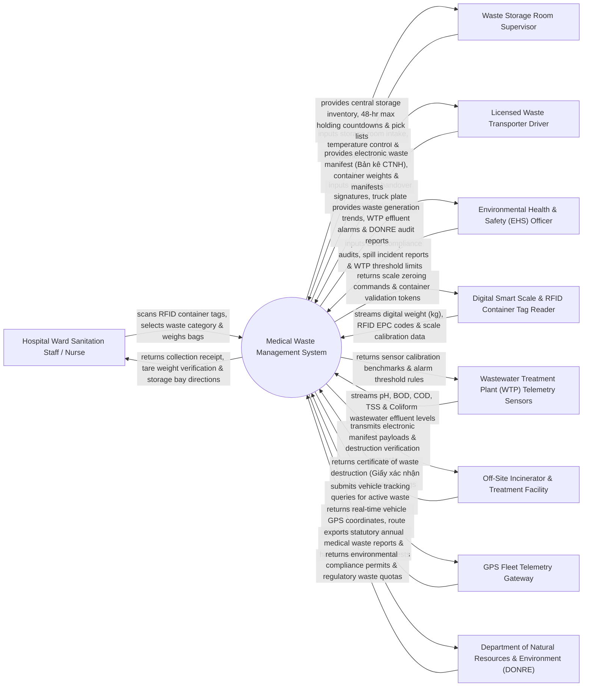

# Context Diagram — Medical Waste Management System

## Mermaid Code

## Actor & Interaction Table | Bảng Actor & Tương tác

| # | Actor | Actor Type | Data Sent TO System | Data Received FROM System | Notes |
|---|-------|------------|---------------------|---------------------------|-------|
| 1 | Hospital Ward Sanitation Staff / Nurse | Primary | RFID container scans, waste category selections (Yellow, Red, Black, Green), bag weight entries. | Collection receipt confirmation, tare weight verification, central storage room directions. | Ward staff or janitorial nurse responsible for collecting waste containers at ward level. |
| 2 | Waste Storage Room Supervisor | Primary | Central storage room intake receipts, storage bay assignments, room temperature/humidity logs. | Real-time central storage inventory, 48-hour maximum holding countdown alerts, pick lists. | Supervisor managing central hospital hazardous waste storage facility prior to off-site transport. |
| 3 | Licensed Waste Transporter Driver | Primary | Electronic manifest digital signatures, truck plate numbers, driver license ID, arrival/departure logs. | Electronic hazardous waste manifest (Bản kê CTNH), container weight summary, manifests. | Driver of licensed hazardous waste transport truck collecting waste from hospital storage. |
| 4 | Environmental Health & Safety (EHS) Officer | Primary | EHS compliance audit checks, chemical/biohazard spill logs, wastewater threshold configurations. | Waste generation analytics, WTP effluent quality alarms, statutory DONRE compliance reports. | Hospital safety officer overseeing environmental protection, biosecurity, and waste compliance. |
| 5 | Digital Smart Scale & RFID Container Tag Reader | Supporting System | Digital weight measurements (kg), RFID EPC tag codes, scale calibration zeroing telemetry. | Scale zeroing validation commands, container RFID verification tokens. | Hardware scale and RFID antenna integrated at ward waste collection stations and central storage. |
| 6 | Wastewater Treatment Plant (WTP) Telemetry Sensors | Supporting System | Real-time liquid effluent metrics: pH, BOD, COD, Total Suspended Solids (TSS), Coliforms. | Sensor calibration benchmarks, automated alarm threshold rules, sampling interval triggers. | Industrial IoT sensors monitoring hospital liquid wastewater treatment plant discharge quality. |
| 7 | Off-Site Incinerator & Treatment Facility | Supporting System | Certificates of Waste Destruction (Giấy xác nhận Xử lý), incineration temperature logs, ash weight. | Electronic waste manifest payloads, container dispatch manifests, destruction requests. | Licensed industrial treatment facility executing high-temperature incineration or autoclaving. |
| 8 | GPS Fleet Telemetry Gateway | Supporting System | Real-time GPS location coordinates (lat/long), vehicle speed, transport route history logs. | Vehicle tracking queries for active waste transport trucks carrying hospital hazardous waste. | External fleet tracking system monitoring waste transport vehicles en route to incinerator. |
| 9 | Department of Natural Resources & Environment (DONRE) | Regulatory | Environmental protection regulations, hazardous waste management quotas, permit renewals. | Statutory annual medical waste reports, hazardous waste manifest audits, WTP compliance data. | Municipal or provincial government agency regulating environmental protection and hazardous waste. |

## System Boundary Description | Mô tả Phạm vi Hệ thống

The **Medical Waste Management System (MWMS)** is an enterprise environmental protection, biosecurity, and regulatory compliance platform operating across hospital wards, central hazardous waste storage facilities, liquid Wastewater Treatment Plants (WTP), licensed transport fleets, and off-site incineration facilities. It automates color-coded waste classification (Yellow Infectious, Red Sharps, Black Cytotoxic, Green General), tracks RFID-tagged waste containers with digital smart scale weighing, manages statutory Hazardous Waste Manifests (Bản kê Quản lý Chất thải Tối nguy hại), tracks GPS transport fleets, monitors liquid WTP effluent telemetry, and exports statutory compliance reports to DONRE (Sở Tài nguyên và Môi trường).

**Inside System Scope:**
- Color-coded waste segregation categorization (Yellow Infectious, Red Pathological/Sharps, Black Cytotoxic/Hazardous, Green General).
- RFID-tagged container tracking, digital smart scale weight logging, and ward collection receipts.
- Central hospital waste storage facility inventory management and 48-hour statutory holding countdown timers.
- Statutory Hazardous Waste Manifest (Bản kê Quản lý Chất thải Tối nguy hại) generation and chain of custody tracking.
- Transporter handover verification, digital signature capture, and GPS fleet transport monitoring.
- Off-site incineration / autoclaving Certificate of Waste Destruction ingestion and reconciliation.
- Liquid Wastewater Treatment Plant (WTP) IoT sensor telemetry monitoring (pH, BOD, COD, Coliforms).
- Biohazard/chemical spill incident logging, sharps container exchange tracking, and DONRE reporting.

**Outside System Scope:**
- Physical operation of autoclave steam chambers or incinerator burners (handled by incinerator hardware).
- Physical execution of janitorial floor sweeping or trash bag tying (performed by sanitation staff).
- Municipal general domestic trash landfill operations (handled by municipal waste company).
- Commercial corporate financial general ledger accounting (handled by enterprise ERP).
