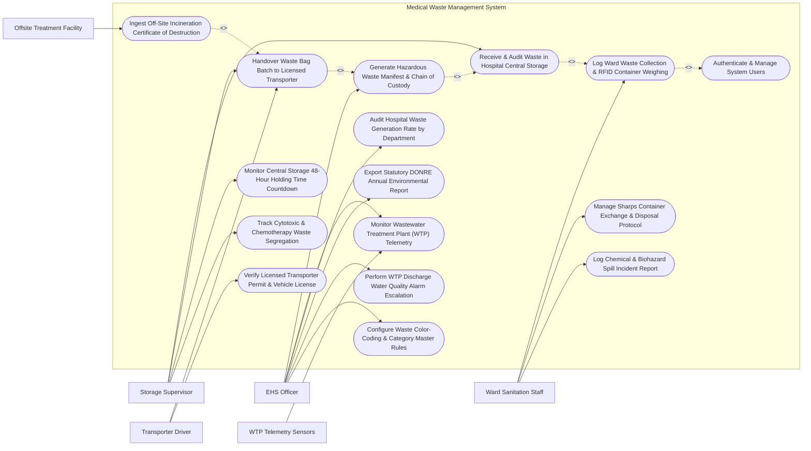

# Use Case Diagram — Medical Waste Management System

## Mermaid Code

## Actor Table | Bảng Actor

| # | Actor | Actor Type | Role Description | Related Use Cases |
|---|-------|------------|------------------|-------------------|
| 1 | Ward Sanitation Staff | Primary | Ward janitor or nurse collecting waste containers, scanning RFID tags, weighing waste bags, and logging spills. | UC01, UC07, UC08 |
| 2 | Storage Supervisor | Primary | Manager overseeing central hospital waste storage facility, auditing intake, managing 48-hour holding, and executing handovers. | UC02, UC04, UC09, UC10 |
| 3 | Transporter Driver | Primary | Driver of licensed hazardous waste transport truck accepting waste manifests, signing handovers, and transporting waste off-site. | UC04, UC12 |
| 4 | EHS Officer | Primary | Environmental Health & Safety officer generating statutory manifests, auditing waste rates, monitoring WTP, and exporting DONRE reports. | UC03, UC05, UC11, UC13, UC14, UC15 |
| 5 | WTP Telemetry Sensors | Secondary / System | Industrial IoT sensors monitoring hospital liquid wastewater treatment plant discharge quality (pH, BOD, COD, Coliforms). | UC05 |
| 6 | Offsite Treatment Facility | Secondary / System | Licensed incineration facility confirming destruction of hazardous medical waste and issuing digital certificates. | UC06 |

## Use Case Table | Bảng Use Case

| # | UC ID | Use Case Name | Primary Actor | Secondary Actor | Description | Priority |
|---|-------|---------------|---------------|-----------------|-------------|----------|
| 1 | UC01 | Log Ward Waste Collection & RFID Container Weighing | Ward Sanitation Staff | None | Scan RFID-tagged waste containers, weigh waste bags on digital scale, select color-coded category, and issue collection receipt. | High |
| 2 | UC02 | Receive & Audit Waste in Hospital Central Storage | Storage Supervisor | None | Audit inbound waste containers from hospital wards, verify gross weights, assign central storage bay locations, and log storage intake. | High |
| 3 | UC03 | Generate Hazardous Waste Manifest & Chain of Custody | EHS Officer | None | Compile official statutory Hazardous Waste Manifest (Bản kê Quản lý CTNH) detailing waste categories, container counts, and weights. | High |
| 4 | UC04 | Handover Waste Bag Batch to Licensed Transporter | Storage Supervisor | Transporter Driver | Execute digital handover of waste batches to licensed transporter, capturing digital signatures, truck plate numbers, and GPS tracking. | High |
| 5 | UC05 | Monitor Wastewater Treatment Plant (WTP) Telemetry | EHS Officer | WTP Telemetry Sensors | Monitor real-time liquid wastewater discharge quality (pH, BOD, COD, TSS, Coliforms) and log daily discharge volumes. | High |
| 6 | UC06 | Ingest Off-Site Incineration Certificate of Destruction | Offsite Treatment Facility | None | Ingest electronic Certificate of Waste Destruction (Giấy xác nhận Xử lý) from off-site incinerator, reconciling weight against manifest. | High |
| 7 | UC07 | Manage Sharps Container Exchange & Disposal Protocol | Ward Sanitation Staff | None | Track rigid puncture-resistant sharps box fill percentage (> 75% full triggers replacement), seal boxes, and log disposal barcodes. | High |
| 8 | UC08 | Log Chemical & Biohazard Spill Incident Report | Ward Sanitation Staff | None | Log accidental biohazard, blood, or cytotoxic chemical spills, triggering EHS containment protocols and decontamination tracking. | High |
| 9 | UC09 | Monitor Central Storage 48-Hour Holding Time Countdown | Storage Supervisor | None | Track statutory 48-hour maximum holding time limits for infectious waste in central storage room, alerting prior to expiration. | High |
| 10 | UC10 | Track Cytotoxic & Chemotherapy Waste Segregation | Storage Supervisor | None | Track high-hazard cytotoxic chemotherapy waste (Black Containers), enforcing specialized lead-lined or sealed storage rules. | Medium |
| 11 | UC11 | Audit Hospital Waste Generation Rate by Department | EHS Officer | None | Calculate waste generation rates (kg per patient-day) across hospital wards (ICU, OR, ER), identifying abnormal generation spikes. | Medium |
| 12 | UC12 | Verify Licensed Transporter Permit & Vehicle License | Transporter Driver | None | Verify validity of transporter's environmental operating permit, hazardous cargo vehicle registration, and driver hazardous transport certificate. | High |
| 13 | UC13 | Export Statutory DONRE Annual Environmental Report | EHS Officer | None | Compile and export official annual environmental protection reports required by DONRE (Sở Tài nguyên và Môi trường). | High |
| 14 | UC14 | Perform WTP Discharge Water Quality Alarm Escalation | EHS Officer | WTP Telemetry Sensors | Trigger automated emergency alerts when wastewater effluent parameters (COD, Coliforms) exceed environmental safety limits. | High |
| 15 | UC15 | Configure Waste Color-Coding & Category Master Rules | EHS Officer | None | Define waste categories (Yellow Infectious, Red Sharps, Black Cytotoxic, Green General), color-coded container rules, and density caps. | Medium |
| 16 | UC16 | Authenticate & Manage System Users | All Users | None | Enforce secure role-based access, RFID badge authentication, and biosecurity audit logging per Ministry of Natural Resources rules. | High |

## Use Case Specification | Đặc tả Use Case

---

### UC01 — Log Ward Waste Collection & RFID Container Weighing

| Field | Detail |
|-------|--------|
| **UC ID** | UC01 |
| **Use Case Name** | Log Ward Waste Collection & RFID Container Weighing |
| **Actor(s)** | Primary: Ward Sanitation Staff |
| **Description** | Logs the collection of medical waste bags from hospital wards (e.g., ICU, Surgical Ward), scanning RFID-tagged waste containers, weighing the waste on a digital smart scale, selecting the color-coded waste category (Yellow Infectious, Red Sharps, Black Cytotoxic, Green General), and generating a collection receipt. |
| **Precondition** | 1. The ward sanitation staff is authenticated via RFID badge scan.   2. The digital smart scale and RFID antenna are calibrated and active. |
| **Main Flow** | 1. The Sanitation Staff places a waste bag inside RFID-tagged Container `CONT-YEL-2026-0412` on the Digital Smart Scale.   2. The RFID reader scans the container's embedded RFID EPC tag (`EPC: E20034119812`).   3. The System identifies Container `CONT-YEL-2026-0412` and loads pre-configured rules: **Yellow Category (Infectious Biohazard Waste)**.   4. The Digital Smart Scale measures and streams the gross weight: `14.85 kg` (Tare weight = 1.20 kg; **Net Waste Weight = 13.65 kg**).   5. The Staff confirms Ward Origin: *Department of Intensive Care Unit (ICU - 3rd Floor)*.   6. The System verifies weight limits: Max container weight = 20.0 kg -> Net weight 13.65 kg is **Within Safe Limit**.   7. The Staff seals the container lid and taps "Confirm Collection".   8. The System generates Collection Record `COLL-2026-99182`, logs timestamp (`Oct 14, 2026 09:15 AM`), dispatches a digital collection receipt to the ICU head nurse, and updates container status to "In-Transit to Central Storage" (UC02). |
| **Alternative Flow** | **AF1** — Red Sharps Box Weighing & Barcode Seal: Staff weighs a rigid Red Puncture-Resistant Sharps Box (UC07); the System logs "Red Category - Sharps Waste", verifying that the safety lock seal is engaged before approving collection.   **AF2** — Black Cytotoxic Chemotherapy Waste Collection: For oncology ward chemotherapy waste, the Staff selects "Black Category - Cytotoxic Waste", and the System mandates dual-person authorization sign-off. |
| **Exception Flow** | **EX1** — Container Overweight Limit Violation (> 20.0 kg): If net weight is 24.5 kg, the System blocks collection, flashing "CONTAINER OVERWEIGHT WARNING — Split Waste into Two Bags to Prevent Tearing".   **EX2** — Mismatched Waste Category RFID Error: Staff places a Red Sharps box into a Yellow Infectious container; the RFID system detects category mismatch and flags "Category Mismatch — Incorrect Container Type". |
| **Postcondition** | Waste collection record with net weight, category code, RFID container ID, and ward origin is saved, and container is queued for Central Storage intake. |
| **Business Rule** | **BR1**: Medical waste MUST be segregated at source into mandatory color-coded categories: Yellow (Infectious), Red (Sharps/Pathological), Black (Cytotoxic/Hazardous), Green (General Domestic).   **BR2**: Every collected waste container MUST be weighed using a calibrated digital scale with verified tare deduction before leaving the originating ward. |

---

### UC02 — Receive & Audit Waste in Hospital Central Storage

| Field | Detail |
|-------|--------|
| **UC ID** | UC02 |
| **Use Case Name** | Receive & Audit Waste in Hospital Central Storage |
| **Actor(s)** | Primary: Storage Supervisor |
| **Description** | Audits and receives inbound waste containers transported from hospital wards into the Central Hazardous Waste Storage Facility, verifying container RFID tags, re-weighing for weight variance audit, assigning designated temperature-controlled storage bays, and initiating the 48-hour maximum holding countdown timer. |
| **Precondition** | 1. Waste containers are transported from wards to Central Storage.   2. The Storage Supervisor is authenticated in MWMS. |
| **Main Flow** | 1. The Storage Supervisor opens "Central Storage Intake Workspace" on a industrial tablet terminal.   2. The Supervisor scans RFID Container `CONT-YEL-2026-0412` at the Central Storage entrance portal antenna.   3. The System retrieves Ward Collection Record `COLL-2026-99182` (Ward Net Weight = 13.65 kg).   4. The Supervisor places the container on the Central Storage Receiving Scale: Measured Net Weight = 13.62 kg (**Weight Variance = -0.03 kg / -0.2%**).   5. The System evaluates Weight Variance Threshold (Allowed Variance ± 2.0%) -> **Weight Audit PASSED**.   6. The System assigns Storage Bay Location: **Yellow Bay #03 (Infectious Cold Storage Room - Temp 4°C)**.   7. The Supervisor places the container in Bay #03 and taps "Confirm Intake".   8. The System updates container status to "In Central Storage", starts the **Statutory 48-Hour Maximum Holding Time Countdown Timer** (UC09), and logs storage intake timestamp (`Oct 14, 2026 09:35 AM`). |
| **Alternative Flow** | **AF1** — Black Cytotoxic Chemical Storage Intake: For Black Category cytotoxic waste, the System assigns **Hazardous Bay #01 (Ventilated Lead-Lined Room)** and logs chemical containment status.   **AF2** — Bulk Weight Batch Intake: Supervisor scans a trolley containing 8 Yellow containers simultaneously using an RFID portal antenna, auditing total batch weight (110.4 kg) in a single transaction. |
| **Exception Flow** | **EX1** — Unacceptable Weight Loss / Leakage Discrepancy (> 5.0% Loss): Measured weight is 11.2 kg vs 13.65 kg recorded at ward (-18% loss); the System triggers a red "POTENTIAL LEAKAGE / SPILL ALERT", blocking intake and notifying the EHS Officer (UC08).   **EX2** — Central Storage Room Temperature Spike (> 8°C): If storage room temperature reaches 14°C, the System alerts "Cold Storage Failure — Infectious Waste Perishability Risk". |
| **Postcondition** | Container intake is confirmed, weight variance audit is logged, storage bay assignment is recorded, and 48-hour holding countdown timer is active. |
| **Business Rule** | **BR1**: Weight variance between ward collection and central storage intake MUST NOT exceed ± 2.0%; discrepancies exceeding 5.0% MUST trigger an immediate biohazard spill investigation.   **BR2**: Infectious yellow category waste stored in central facilities MUST be maintained at temperatures <= 8°C if holding duration exceeds 24 hours. |

---

### UC03 — Generate Hazardous Waste Manifest & Chain of Custody

| Field | Detail |
|-------|--------|
| **UC ID** | UC03 |
| **Use Case Name** | Generate Hazardous Waste Manifest & Chain of Custody |
| **Actor(s)** | Primary: EHS Officer |
| **Description** | Compiles and generates the official statutory Hazardous Waste Manifest (Bản kê Quản lý Chất thải Tối nguy hại) in accordance with Ministry of Natural Resources and Environment (MONRE) regulations, aggregating stored containers by waste code, calculating total gross/net weights, and assigning a unique Manifest Control Number prior to transporter dispatch. |
| **Precondition** | 1. Stored waste containers in Central Storage are ready for off-site transport.   2. The EHS Officer is authenticated with statutory manifest authorization privileges. |
| **Main Flow** | 1. The EHS Officer opens "Create New Hazardous Waste Manifest" in MWMS.   2. The Officer selects Transporter Company: *Phu Ha Environmental Solutions Joint Stock Co.* (License: `MONRE-HW-2024-8812`).   3. The System pulls ready-for-dispatch containers from Central Storage Inventory:   &nbsp;&nbsp;&nbsp;&nbsp;- **Group 1 (Code 12 01 01 - Yellow Infectious)**: 24 Containers, Total Weight = 328.5 kg   &nbsp;&nbsp;&nbsp;&nbsp;- **Group 2 (Code 12 01 02 - Red Sharps)**: 12 Boxes, Total Weight = 86.2 kg   &nbsp;&nbsp;&nbsp;&nbsp;- **Group 3 (Code 12 01 03 - Black Cytotoxic)**: 4 Drums, Total Weight = 42.0 kg.   4. The System calculates **Total Batch Manifest Weight**: `456.7 kg` (Total Containers: 40).   5. The System generates the official statutory **Hazardous Waste Manifest Control Number**: `MNF-DONRE-2026-08192`.   6. The EHS Officer attaches the Off-Site Incineration Facility Destination: *Phu Ha Industrial Waste Incinerator Plant*.   7. The EHS Officer signs the electronic manifest using their PKI digital signature.   8. The System updates Manifest status to "Manifest Issued - Pending Transporter Pick-Up" and locks the 40 selected containers from ward modification. |
| **Alternative Flow** | **AF1** — Radioactive / Isotope Waste Special Manifest: For nuclear medicine radioactive waste (Iodine-131, Technetium-99m), the System generates a specialized Radiation Protection Manifest requiring Atomic Energy Agency clearance.   **AF2** — Emergency Outbreak Surge Manifest: During an epidemic, the System generates an expedited "Epidemic High-Volume Manifest" bypassing standard batch thresholds. |
| **Exception Flow** | **EX1** — Transporter Operating Permit Expired: If the selected transporter's environmental license is expired, the System blocks manifest creation with error "Transporter Permit Expired — Select Licensed Vendor".   **EX2** — Container Holding Time Overdue (> 48 Hours): If 5 containers exceed statutory 48-hour storage limits, the System highlights them in RED and auto-prioritizes them for immediate inclusion in the manifest. |
| **Postcondition** | Official Hazardous Waste Manifest with unique control number is created, total batch weight is locked, digital signature is applied, and manifest is ready for transporter handover. |
| **Business Rule** | **BR1**: Hazardous waste manifests MUST strictly conform to statutory MONRE format requirements, detailing exact waste codes, container counts, and certified net weights.   **BR2**: Waste containers assigned to an active manifest MUST be locked to prevent unauthorized tampering or removal prior to driver pickup. |

---

### UC04 — Handover Waste Bag Batch to Licensed Transporter (GPS Track)

| Field | Detail |
|-------|--------|
| **UC ID** | UC04 |
| **Use Case Name** | Handover Waste Bag Batch to Licensed Transporter |
| **Actor(s)** | Primary: Storage Supervisor   Secondary: Transporter Driver |
| **Description** | Executes the formal electronic physical handover of a hazardous waste batch from the central storage facility to the licensed waste transport truck, scanning container RFID tags, verifying driver identity and vehicle registration, capturing dual digital signatures on the manifest, and activating real-time GPS fleet tracking. |
| **Precondition** | 1. An official Hazardous Waste Manifest (UC03) is issued.   2. The transport truck and driver are present at the Central Storage loading dock. |
| **Main Flow** | 1. The Transporter Driver presents at the loading dock and opens the MWMS Mobile Driver Portal.   2. The Storage Supervisor scans Driver License / RFID Badge (`Driver: Tran Van C, License: FC-991823`).   3. The System verifies Driver Credentials and Vehicle License Plate `51D-882.14` against Manifest `MNF-DONRE-2026-08192` -> **Credentials Verified**.   4. As workers load the 40 containers into the specialized refrigerated hazmat truck, an RFID portal antenna scans each container:   &nbsp;&nbsp;&nbsp;&nbsp;- Scanned Containers: 40 / 40 Matched.   5. The Supervisor and Driver perform final **Total Weight Handover Audit**: Truck Scale Total = 456.5 kg (Manifest Target = 456.7 kg -> Variance -0.2 kg / Passed).   6. Both parties execute **Dual Digital Signatures** on the electronic Manifest terminal.   7. The System updates Manifest status to "In-Transit to Incinerator", releases containers from central storage inventory, and dispatches a digital copy of Manifest Form 1 to DONRE.   8. The System initiates **Real-Time GPS Fleet Tracking** (via GPS Fleet Gateway), tracking truck `51D-882.14` location and speed en route to the incinerator plant. |
| **Alternative Flow** | **AF1** — Driver Rejection of Damaged / Leaking Container: Driver notices a torn yellow bag leaking liquid; the Driver rejects Container #14; the System removes Container #14 from the manifest, updates manifest total weight to 442.1 kg, and flags Container #14 for re-bagging.   **AF2** — Unrefrigerated Truck Warning for Long Distance: System detects truck refrigeration temperature is 18°C for a 4-hour transit route; System alerts "Refrigeration Failure — Maintain Cargo <= 8°C". |
| **Exception Flow** | **EX1** — Vehicle License Plate Mismatch: If the arriving truck plate is `51D-999.99` instead of authorized `51D-882.14`, the System blocks handover until EHS approves vehicle substitution.   **EX2** — Missing Container During Loading Scan: RFID portal scans only 39 out of 40 containers; the System blocks sign-off, displaying "1 Container Missing: CONT-RED-0089 — Locate Container Before Sign-Off". |
| **Postcondition** | Dual digital signatures are captured on manifest, waste containers are transferred to transporter custody, storage inventory is updated, and GPS vehicle tracking is active. |
| **Business Rule** | **BR1**: Hazardous waste handover MUST require dual digital signatures (Hospital Storage Supervisor + Transporter Driver) on the official electronic manifest.   **BR2**: Transporter vehicles carrying medical biohazard waste MUST be equipped with active GPS telemetry and refrigerated cargo compartments (<= 8°C). |

---

### UC05 — Monitor Wastewater Treatment Plant (WTP) Effluent Telemetry

| Field | Detail |
|-------|--------|
| **UC ID** | UC05 |
| **Use Case Name** | Monitor Wastewater Treatment Plant (WTP) Effluent Telemetry |
| **Actor(s)** | Primary: EHS Officer   Secondary: WTP Telemetry Sensors |
| **Description** | Continuously monitors real-time liquid effluent discharge parameters (pH, Biological Oxygen Demand - BOD, Chemical Oxygen Demand - COD, Total Suspended Solids - TSS, Fecal Coliforms) from the hospital's liquid Wastewater Treatment Plant (WTP) via IoT sensors, verifying compliance with National Environmental Technical Regulations (QCVN 28:2010/BTNMT). |
| **Precondition** | 1. IoT telemetry sensors are installed at the hospital WTP final discharge outlet.   2. Environmental safety threshold parameters (QCVN 28 Class A/B limits) are configured in MWMS. |
| **Main Flow** | 1. The **WTP IoT Telemetry Engine** ingests real-time sensor data feeds every 15 minutes from Discharge Outlet #01.   2. The System logs current **Liquid Effluent Quality Metrics**:   &nbsp;&nbsp;&nbsp;&nbsp;- **pH Level**: 7.2 (Permissible Range: 6.5 - 8.5 -> Normal)   &nbsp;&nbsp;&nbsp;&nbsp;- **Biological Oxygen Demand (BOD5)**: 18.5 mg/L (Max Limit QCVN 28 Class A = 30 mg/L -> Normal)   &nbsp;&nbsp;&nbsp;&nbsp;- **Chemical Oxygen Demand (COD)**: 42.0 mg/L (Max Limit = 50 mg/L -> Normal)   &nbsp;&nbsp;&nbsp;&nbsp;- **Total Suspended Solids (TSS)**: 22.1 mg/L (Max Limit = 50 mg/L -> Normal)   &nbsp;&nbsp;&nbsp;&nbsp;- **Fecal Coliforms**: 800 MPN/100mL (Max Limit = 3,000 MPN/100mL -> Normal)   &nbsp;&nbsp;&nbsp;&nbsp;- **Daily Discharge Flow Rate**: 450 m³/day.   3. The System evaluates parameters against National Standard `QCVN 28:2010/BTNMT (Medical Wastewater Standard)` -> **100% Compliance Verified**.   4. The System updates the EHS Environmental Dashboard, displaying 24-hour water quality trend graphs and cumulative daily discharge volume.   5. The System archives telemetry log `WTP-LOG-2026-0819` for statutory DONRE compliance reporting (UC13). |
| **Alternative Flow** | **AF1** — Automated UV Disinfection Dosage Control: If coliform levels trend upwards towards 2,500 MPN, the System dispatches an automated signal to the WTP control panel to increase UV disinfection lamp intensity or chlorine dosing.   **AF2** — Daily Water Sampling Lab Result Attachment: EHS Officer uploads external certified lab test results (heavy metals, residual antibiotics, radioactive isotopes) to complement automated IoT sensor feeds. |
| **Exception Flow** | **EX1** — Critical COD / Coliform Threshold Violation: If COD spikes to 85 mg/L (Exceeds 50 mg/L limit) or Chlorine residual drops to 0, the System triggers an urgent "WTP EFFLUENT VIOLATION ALARM", auto-closing the discharge safety valve and notifying EHS Officer (UC14).   **EX2** — Sensor Communication Offline Failure: If pH sensor stops transmitting for > 1 hour, the System flags "WTP Sensor Offline Alert", prompting technician maintenance. |
| **Postcondition** | Real-time liquid wastewater quality metrics are recorded, QCVN 28 environmental compliance is verified, trend graphs are updated, and data is archived for DONRE audits. |
| **Business Rule** | **BR1**: Hospital liquid wastewater effluent MUST strictly comply with National Technical Regulation QCVN 28:2010/BTNMT for medical wastewater before discharge into municipal sewers.   **BR2**: Any effluent parameter exceeding statutory environmental safety limits MUST trigger an automated emergency discharge valve shutdown and immediate EHS alert escalation within 5 minutes. |
