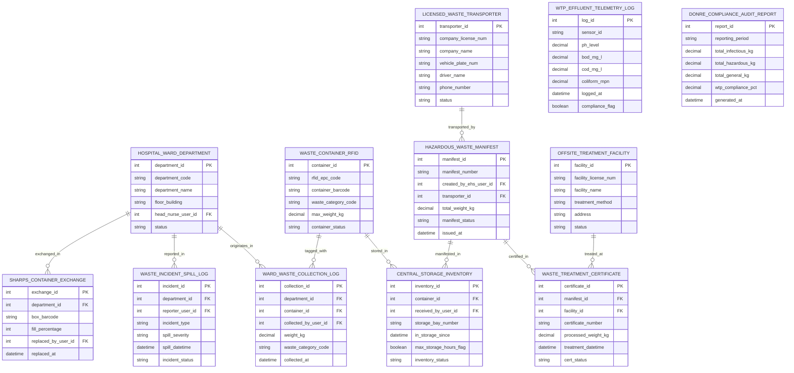

# Conceptual ERD — Medical Waste Management System

## Mermaid Code

## Entity Description Table | Bảng mô tả Entity

| # | Entity Name | Vietnamese Name | Description | Key Attributes | Main Relationships |
|---|-------------|-----------------|-------------|----------------|-------------------|
| 1 | HOSPITAL_WARD_DEPARTMENT | Khoa/Phòng Bệnh viện Origin | Originating hospital ward/department record (ICU, OR, ER, Oncology) storing department code, name, floor building, head nurse ID, and status. | department_id, department_code, department_name, floor_building, head_nurse_user_id, status | Has COLLECTION_LOG, SPILL_LOG, SHARPS_EXCHANGE. |
| 2 | WASTE_CONTAINER_RFID | Thùng/Thùng chứa Thẻ RFID | RFID-tagged waste container master record tracking RFID EPC code, barcode, waste category code (Yellow, Red, Black, Green), max weight, and status. | container_id, rfid_epc_code, container_barcode, waste_category_code, max_weight_kg, container_status | Has COLLECTION_LOG and CENTRAL_STORAGE_INVENTORY. |
| 3 | WARD_WASTE_COLLECTION_LOG | Nhật ký Thu gom Chất thải Khoa | Ward waste collection log recording department ID, container ID, collected user ID, net weight (kg), waste category code, and timestamp. | collection_id, department_id, container_id, collected_by_user_id, weight_kg, waste_category_code, collected_at | Belongs to HOSPITAL_WARD_DEPARTMENT and WASTE_CONTAINER_RFID. |
| 4 | CENTRAL_STORAGE_INVENTORY | Tồn kho Kho Lưu giữ Trung tâm | Hospital central hazardous waste storage inventory record tracking container ID, received user ID, storage bay number, in-storage timestamp, and 48-hr flag. | inventory_id, container_id, received_by_user_id, storage_bay_number, in_storage_since, max_storage_hours_flag, inventory_status | Belongs to WASTE_CONTAINER_RFID; Manifested in HAZARDOUS_WASTE_MANIFEST. |
| 5 | HAZARDOUS_WASTE_MANIFEST | Chứng từ / Bản kê CTNH | Official statutory Hazardous Waste Manifest (Bản kê Quản lý CTNH) tracking manifest number, created EHS user ID, transporter ID, total weight kg, and status. | manifest_id, manifest_number, created_by_ehs_user_id, transporter_id, total_weight_kg, manifest_status, issued_at | Belongs to LICENSED_WASTE_TRANSPORTER; Has CENTRAL_STORAGE_INVENTORY and WASTE_TREATMENT_CERTIFICATE. |
| 6 | LICENSED_WASTE_TRANSPORTER | Đơn vị Vận chuyển CTNH | Licensed hazardous waste transporter record tracking company license number, company name, truck plate number, driver name, phone, and status. | transporter_id, company_license_num, company_name, vehicle_plate_num, driver_name, phone_number, status | Has many HAZARDOUS_WASTE_MANIFEST entities. |
| 7 | OFFSITE_TREATMENT_FACILITY | Cơ sở Xử lý Tập trung | Off-site hazardous waste incineration/autoclaving treatment plant tracking facility license number, facility name, treatment method, address, and status. | facility_id, facility_license_num, facility_name, treatment_method, address, status | Has many WASTE_TREATMENT_CERTIFICATE entities. |
| 8 | WASTE_TREATMENT_CERTIFICATE | Giấy xác nhận Xử lý | Official Certificate of Waste Destruction issued by treatment facility tracking manifest ID, facility ID, certificate number, processed weight, and status. | certificate_id, manifest_id, facility_id, certificate_number, processed_weight_kg, treatment_datetime, cert_status | Belongs to HAZARDOUS_WASTE_MANIFEST and OFFSITE_TREATMENT_FACILITY. |
| 9 | WTP_EFFLUENT_TELEMETRY_LOG | Nhật ký Quan trắc Nước thải | Liquid Wastewater Treatment Plant (WTP) IoT sensor telemetry log recording sensor ID, pH level, BOD mg/L, COD mg/L, Coliform MPN, timestamp, and compliance flag. | log_id, sensor_id, ph_level, bod_mg_l, cod_mg_l, coliform_mpn, logged_at, compliance_flag | Standalone IoT sensor telemetry record. |
| 10 | WASTE_INCIDENT_SPILL_LOG | Nhật ký Sự cố Tràn bẩn | Biohazard, blood, or chemical spill incident log recording department ID, reporter user ID, incident type, spill severity, timestamp, and decontamination status. | incident_id, department_id, reporter_user_id, incident_type, spill_severity, spill_datetime, incident_status | Belongs to HOSPITAL_WARD_DEPARTMENT. |
| 11 | SHARPS_CONTAINER_EXCHANGE | Nhật ký Thay Hộp Kim tiêm | Puncture-resistant sharps box exchange log recording department ID, box barcode, fill percentage (> 75%), replaced user ID, and timestamp. | exchange_id, department_id, box_barcode, fill_percentage, replaced_by_user_id, replaced_at | Belongs to HOSPITAL_WARD_DEPARTMENT. |
| 12 | DONRE_COMPLIANCE_AUDIT_REPORT | Báo cáo Môi trường DONRE | Statutory annual environmental protection compliance report store tracking reporting period, infectious kg, hazardous kg, general kg, WTP compliance %, and date. | report_id, reporting_period, total_infectious_kg, total_hazardous_kg, total_general_kg, wtp_compliance_pct, generated_at | Standalone statutory audit report store. |

## Relationship Description | Mô tả Quan hệ

| # | From Entity | Cardinality | To Entity | Relationship Label | Business Explanation |
|---|-------------|-------------|-----------|-------------------|----------------------|
| 1 | HOSPITAL_WARD_DEPARTMENT | one-to-many | WARD_WASTE_COLLECTION_LOG | originates_in | Waste collection logs originate in hospital ward departments (ICU, OR, ER). |
| 2 | HOSPITAL_WARD_DEPARTMENT | one-to-many | WASTE_INCIDENT_SPILL_LOG | reported_in | Accidental biohazard or chemical spills are reported in ward departments. |
| 3 | HOSPITAL_WARD_DEPARTMENT | one-to-many | SHARPS_CONTAINER_EXCHANGE | exchanged_in | Rigid sharps safety boxes are exchanged and replaced in ward departments. |
| 4 | WASTE_CONTAINER_RFID | one-to-many | WARD_WASTE_COLLECTION_LOG | tagged_with | RFID-tagged waste containers are scanned during ward waste collection logs. |
| 5 | WASTE_CONTAINER_RFID | one-to-many | CENTRAL_STORAGE_INVENTORY | stored_in | RFID-tagged waste containers are received and inventoried in central storage. |
| 6 | HAZARDOUS_WASTE_MANIFEST | one-to-many | CENTRAL_STORAGE_INVENTORY | manifested_in | Official hazardous waste manifests group multiple central storage containers. |
| 7 | LICENSED_WASTE_TRANSPORTER | one-to-many | HAZARDOUS_WASTE_MANIFEST | transported_by | Licensed transporters transport hazardous waste manifests off-site. |
| 8 | HAZARDOUS_WASTE_MANIFEST | one-to-one | WASTE_TREATMENT_CERTIFICATE | certified_in | One hazardous waste manifest receives an off-site Certificate of Destruction. |
| 9 | OFFSITE_TREATMENT_FACILITY | one-to-many | WASTE_TREATMENT_CERTIFICATE | treated_at | Off-site incineration facilities issue treatment certificates for processed manifests. |
