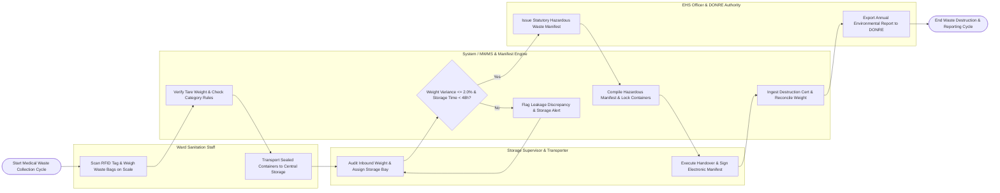

# Swimlane Diagram — Medical Waste Management System

## Mermaid Code

## Flow Description | Mô tả luồng

| Lane | Actor / Subsystem | Role in Flow |
|------|-------------------|--------------|
| 1 | Ward Sanitation Staff | Collects waste from hospital wards, scans RFID-tagged containers, weighs waste bags on digital smart scales, verifies color categories (Yellow, Red, Black), and moves sealed containers to central storage. |
| 2 | Storage Supervisor & Transporter | Receives inbound containers at central storage, audits weight variance, assigns cold storage bays, verifies driver licenses, loads hazardous trucks, and signs electronic manifests. |
| 3 | System / MWMS & Manifest Engine | Validates tare weights, checks container weight limits, monitors 48-hour maximum storage countdowns, compiles statutory MONRE manifests, tracks GPS transport fleets, and reconciles destruction certificates. |
| 4 | EHS Officer & DONRE Authority | Authorizes statutory hazardous waste manifests, monitors liquid WTP effluent sensor telemetry (QCVN 28), investigates biohazard spills, and exports annual environmental reports to DONRE. |
