# Action Tree — Medical Waste Management System

## Mermaid Code

```mermaid
graph TD
    Root["Medical Waste Management System"]

    Root --> M1["Ward Collection & RFID Scale Tracking"]
    Root --> M2["Central Storage Inventory & 48-Hr Holding"]
    Root --> M3["Hazardous Manifest & Chain of Custody"]
    Root --> M4["Transporter Handover & GPS Fleet"]
    Root --> M5["Off-Site Incineration & Destruction Certs"]
    Root --> M6["Liquid WTP Effluent & Telemetry Alarms"]
    Root --> M7["Sharps & Biohazard Spill Response"]
    Root --> M8["EHS Analytics & DONRE Reporting"]

    M1 --> A11["Scan Container RFID Tags & Category Codes"]
    M1 --> A12["Weigh Waste Bags on Digital Smart Scale"]
    M1 --> A13["Verify Container Max Weight Limits"]
    M1 --> A14["Generate Ward Waste Collection Receipt"]

    M2 --> A21["Audit Inbound Ward Container Net Weights"]
    M2 --> A22["Assign Cold Storage Bay Locations"]
    M2 --> A23["Monitor 48-Hour Maximum Storage Timer"]
    M2 --> A24["Track Cytotoxic Chemical Lead Storage"]

    M3 --> A31["Compile MONRE Statutory Waste Manifests"]
    M3 --> A32["Aggregate Waste Containers by MONRE Codes"]
    M3 --> A33["Lock Manifested Containers from Modifications"]
    M3 --> A34["Apply EHS PKI Digital Signatures"]

    M4 --> A41["Verify Transporter Driver & Vehicle License"]
    M4 --> A42["Execute Dual Signature Electronic Handover"]
    M4 --> A43["Scan Truck Loading RFID Container Portals"]
    M4 --> A44["Track Hazmat Transport Truck GPS Route"]

    M5 --> A51["Ingest Off-Site Destruction Certificates"]
    M5 --> A52["Reconcile Incinerator Net Processed Weights"]
    M5 --> A53["Audit Incinerator Temperature & Ash Logs"]
    M5 --> A54["Close Completed Waste Manifest Custody"]

    M6 --> A61["Monitor IoT Sensor pH BOD COD Levels"]
    M6 --> A62["Verify QCVN 28 Medical Wastewater Limits"]
    M6 --> A63["Trigger Discharge Emergency Shut-Off Valve"]
    M6 --> A64["Upload Certified External Water Samples"]

    M7 --> A71["Track Sharps Box 75 Percent Fill Levels"]
    M7 --> A72["Log Sharps Box Replacement Barcode Seals"]
    M7 --> A73["Report Accidental Chemical Biohazard Spills"]
    M7 --> A74["Track Decontamination Clean-Up Actions"]

    M8 --> A81["Calculate Department Waste Generation Rates"]
    M8 --> A82["Identify Hospital Waste Generation Anomalies"]
    M8 --> A83["Export Annual DONRE Environmental Reports"]
    M8 --> A84["Audit Hospital Infection Control Metrics"]
```

## Module Description | Mô tả Module

| # | Module | Description | Actions |
|---|--------|-------------|---------|
| 1 | Ward Collection & RFID Scale Tracking | Scans RFID container tags, weighs waste bags on digital smart scales, verifies container weight limits, and generates collection receipts. | Scan Container RFID Tags & Category Codes, Weigh Waste Bags on Digital Smart Scale, Verify Container Max Weight Limits, Generate Ward Waste Collection Receipt |
| 2 | Central Storage Inventory & 48-Hr Holding | Audits inbound container weights, assigns cold storage bays, monitors 48-hour statutory holding timers, and manages cytotoxic lead storage. | Audit Inbound Ward Container Net Weights, Assign Cold Storage Bay Locations, Monitor 48-Hour Maximum Storage Timer, Track Cytotoxic Chemical Lead Storage |
| 3 | Hazardous Manifest & Chain of Custody | Compiles statutory MONRE hazardous waste manifests, aggregates containers by MONRE codes, locks containers, and applies PKI digital signatures. | Compile MONRE Statutory Waste Manifests, Aggregate Waste Containers by MONRE Codes, Lock Manifested Containers from Modifications, Apply EHS PKI Digital Signatures |
| 4 | Transporter Handover & GPS Fleet | Verifies driver licenses, executes dual-signature electronic handovers, scans truck loading RFID portals, and tracks hazmat truck GPS routes. | Verify Transporter Driver & Vehicle License, Execute Dual Signature Electronic Handover, Scan Truck Loading RFID Container Portals, Track Hazmat Transport Truck GPS Route |
| 5 | Off-Site Incineration & Destruction Certs | Ingests electronic Certificates of Destruction, reconciles processed weights against manifests, audits incinerator logs, and closes manifest custody. | Ingest Off-Site Destruction Certificates, Reconcile Incinerator Net Processed Weights, Audit Incinerator Temperature & Ash Logs, Close Completed Waste Manifest Custody |
| 6 | Liquid WTP Effluent & Telemetry Alarms | Monitors WTP IoT sensors (pH, BOD, COD, Coliforms), verifies QCVN 28 compliance, triggers emergency shut-off valves, and uploads lab samples. | Monitor IoT Sensor pH BOD COD Levels, Verify QCVN 28 Medical Wastewater Limits, Trigger Discharge Emergency Shut-Off Valve, Upload Certified External Water Samples |
| 7 | Sharps & Biohazard Spill Response | Tracks sharps box 75% fill thresholds, logs barcode replacement seals, records accidental biohazard/chemical spills, and tracks decontamination. | Track Sharps Box 75 Percent Fill Levels, Log Sharps Box Replacement Barcode Seals, Report Accidental Chemical Biohazard Spills, Track Decontamination Clean-Up Actions |
| 8 | EHS Analytics & DONRE Reporting | Calculates department waste generation rates (kg/patient-day), identifies anomalies, exports annual DONRE reports, and audits infection control metrics. | Calculate Department Waste Generation Rates, Identify Hospital Waste Generation Anomalies, Export Annual DONRE Environmental Reports, Audit Hospital Infection Control Metrics |
