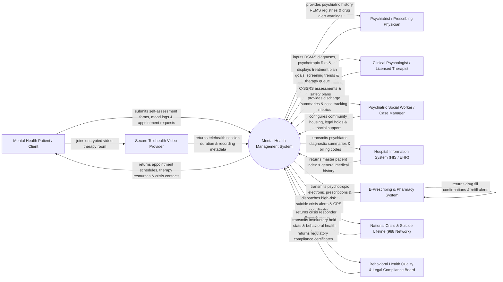

# Context Diagram — Mental Health Management System

## Mermaid Code

## Actor & Interaction Table | Bảng Actor & Tương tác

| # | Actor | Actor Type | Data Sent TO System | Data Received FROM System | Notes |
|---|-------|------------|---------------------|---------------------------|-------|
| 1 | Mental Health Patient / Client | Primary | Self-reported PHQ-9/GAD-7 scores, daily mood logs, therapy goal check-ins, appointment bookings. | Confirmed therapy schedules, psychoeducation materials, 988 lifeline contact cards, safety plan access. | Individual receiving outpatient counseling, psychiatric care, or inpatient behavioral healthcare. |
| 2 | Psychiatrist / Prescribing Physician | Primary | DSM-5-TR diagnostic codes, psychotropic medication prescriptions, metabolic monitoring labs, REMS sign-offs. | Patient psychiatric history, C-SSRS suicide risk alerts, psychotropic drug-drug interaction warnings. | Medical doctor specialized in psychiatry prescribing psychotropic drugs (antidepressants, mood stabilizers). |
| 3 | Clinical Psychologist / Licensed Therapist | Primary | Structured BIRP/SOAP progress notes, C-SSRS suicide risk assessments, Individualized Treatment Plans (ITP). | Patient psychological screening trends, therapy session queue, active treatment goals. | Licensed mental health counselor or psychologist conducting individual/group psychotherapy sessions. |
| 4 | Psychiatric Social Worker / Case Manager | Primary | Community resource linkages, legal involuntary hold documentation (Baker Act/Section 5150), housing placements. | Discharge planning tracking, case management task lists, social determinants of health (SDOH) profiles. | Allied health professional coordinating social support services, legal commitments, and aftercare. |
| 5 | Hospital Information System (HIS / EHR) | Supporting System | Master Patient Index (MPI) data, medical history, laboratory metabolic panel results. | Diagnostic DSM-5 codes, therapy billing codes (CPT 90834/90837), psychiatric discharge summaries. | Enterprise hospital information software holding main patient medical charts. |
| 6 | E-Prescribing & Pharmacy System | Supporting System | Drug fill confirmation tokens, pharmacy pick-up timestamps, psychotropic refill requests. | Electronic psychotropic prescriptions, Clozapine REMS lab verification tokens, controlled drug orders. | Outpatient and hospital pharmacy engine dispensing psychiatric medications. |
| 7 | National Crisis & Suicide Lifeline (988 Network) | Supporting System | Crisis responder dispatch acknowledgments, mobile crisis team status, 988 call resolution tokens. | High-risk suicide crisis alerts, patient safety plan summaries, emergency contact details. | National emergency suicide prevention network (988 Lifeline) providing 24/7 crisis intervention. |
| 8 | Secure Telehealth Video Provider | Supporting System | Session connection timestamps, video call duration, encrypted audio/video stream metrics. | Encrypted room tokens, patient/therapist identity verification payloads. | HIPAA-compliant video conferencing service hosting virtual tele-mental health sessions. |
| 9 | Behavioral Health Quality & Legal Compliance Board | Regulatory | Mandatory psychiatric care standards, involuntary commitment laws, 42 CFR Part 2 privacy rules. | Involuntary psychiatric hold statistics, suicide safety audit logs, behavioral healthcare quality metrics. | Governmental authority regulating mental health facilities, patient rights, and legal commitment laws. |

## System Boundary Description | Mô tả Phạm vi Hệ thống

The **Mental Health Management System (MHMS)** is a specialized behavioral health platform designed to manage psychiatric evaluations, psychotherapy sessions, psychological screening tools, individualized treatment planning, suicide risk prevention, and psychotropic medication management. It enforces enhanced privacy controls compliant with HIPAA and 42 CFR Part 2 for substance use treatment records, supports tele-mental health video sessions, and integrates with 988 emergency crisis lifelines.

**Inside System Scope:**
- Psychiatric intake evaluation charting and DSM-5-TR / ICD-11 diagnostic coding.
- Standardized psychological screening administration (PHQ-9, GAD-7, C-SSRS, PCL-5, BARS).
- Individualized Treatment Plan (ITP) formulation, goal setting, and NOC target tracking.
- Structured psychotherapy progress note documentation (BIRP, SOAP, DAP formats).
- Suicide Risk Assessment (C-SSRS) and Stanley-Brown Safety Planning Intervention (SPI).
- Psychotropic medication management, metabolic monitoring logs, and REMS registry compliance.
- Involuntary legal commitment tracking (Baker Act, 72-hour hold status, court order expiration).

**Outside System Scope:**
- Physical law enforcement dispatch or physical ambulance transport (delegated to emergency services).
- Non-psychiatric general medical surgeries and inpatient physical care (handled by HIS/EHR).
- Commercial pharmaceutical manufacturing and retail pharmacy billing (delegated to Pharmacy/Billing).
- Direct host operating system management of video server infrastructure (handled by Telehealth provider).
