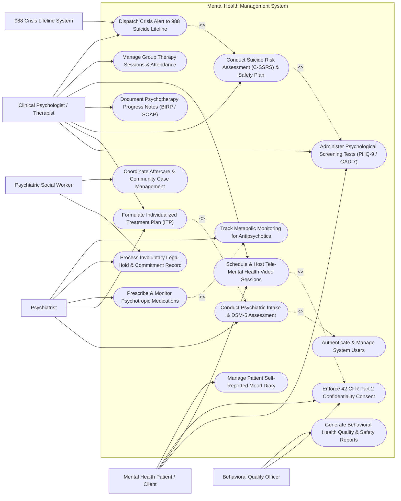

# Use Case Diagram — Mental Health Management System

## Mermaid Code

## Actor Table | Bảng Actor

| # | Actor | Actor Type | Role Description | Related Use Cases |
|---|-------|------------|------------------|-------------------|
| 1 | Mental Health Patient / Client | Primary | Client completing self-assessment questionnaires, participating in therapy sessions, and managing mood logs. | UC02, UC07, UC12, UC13 |
| 2 | Psychiatrist | Primary | Prescribing medical doctor conducting psychiatric evaluations, managing psychotropic drugs, and signing involuntary legal holds. | UC01, UC03, UC05, UC09, UC11 |
| 3 | Clinical Psychologist / Therapist | Primary | Licensed counselor administering screening instruments, developing treatment plans, writing BIRP notes, and creating safety plans. | UC02, UC03, UC04, UC06, UC07, UC08, UC10 |
| 4 | Psychiatric Social Worker | Primary | Case manager managing involuntary commitment hearings, aftercare housing, and community resource linkages. | UC09, UC14 |
| 5 | Behavioral Quality Officer | Primary | Compliance officer overseeing behavioral healthcare quality, 42 CFR Part 2 privacy consent rules, and suicide safety audits. | UC12, UC15 |
| 6 | 988 Crisis Lifeline System | Secondary / System | External emergency crisis network receiving high-risk suicide alerts for active crisis intervention. | UC10 |

## Use Case Table | Bảng Use Case

| # | UC ID | Use Case Name | Primary Actor | Secondary Actor | Description | Priority |
|---|-------|---------------|---------------|-----------------|-------------|----------|
| 1 | UC01 | Conduct Psychiatric Intake & DSM-5 Assessment | Psychiatrist | None | Perform comprehensive psychiatric evaluation, mental status exam (MSE), and assign primary DSM-5-TR diagnostic codes. | High |
| 2 | UC02 | Administer Psychological Screening Tests (PHQ-9 / GAD-7) | Clinical Psychologist / Therapist | Mental Health Patient / Client | Administer standardized screening tools (PHQ-9, GAD-7, PCL-5) to measure depression, anxiety, and PTSD severity. | High |
| 3 | UC03 | Formulate Individualized Treatment Plan (ITP) | Clinical Psychologist / Therapist | Psychiatrist | Create multi-disciplinary treatment plan defining SMART goals, NOC target outcomes, and intervention modalities. | High |
| 4 | UC04 | Conduct Suicide Risk Assessment (C-SSRS) & Safety Plan | Clinical Psychologist / Therapist | None | Administer C-SSRS scale, evaluate suicide intent/ideation, and construct Stanley-Brown Safety Planning Intervention. | High |
| 5 | UC05 | Prescribe & Monitor Psychotropic Medications | Psychiatrist | None | Issue prescriptions for antidepressants, mood stabilizers, and antipsychotics while checking drug interactions and REMS compliance. | High |
| 6 | UC06 | Document Psychotherapy Progress Notes (BIRP / SOAP) | Clinical Psychologist / Therapist | None | Author clinical progress notes following Behavior, Intervention, Response, Plan (BIRP) or SOAP format. | High |
| 7 | UC07 | Schedule & Host Tele-Mental Health Video Sessions | Clinical Psychologist / Therapist | Mental Health Patient / Client | Conduct HIPAA-compliant encrypted video therapy sessions and log session metadata. | High |
| 8 | UC08 | Manage Group Therapy Sessions & Attendance | Clinical Psychologist / Therapist | None | Schedule group CBT/DBT therapy sessions, log group roster attendance, and record group dynamic notes. | Medium |
| 9 | UC09 | Process Involuntary Legal Hold & Commitment Record | Psychiatrist | Psychiatric Social Worker | Record involuntary psychiatric commitment orders (Baker Act/Section 5150), 72-hour hold timers, and court hearing dates. | High |
| 10 | UC10 | Dispatch Crisis Alert to 988 Suicide Lifeline | Clinical Psychologist / Therapist | 988 Crisis Lifeline System | Trigger automated high-risk emergency alerts to 988 Suicide & Crisis Lifeline for imminent self-harm risk. | High |
| 11 | UC11 | Track Metabolic Monitoring for Antipsychotics | Psychiatrist | None | Monitor baseline fasting glucose, lipid panel, weight, and AIMS scale for second-generation antipsychotic therapy. | High |
| 12 | UC12 | Enforce 42 CFR Part 2 Confidentiality Consent | Behavioral Quality Officer | Mental Health Patient / Client | Manage specific patient consent disclosures for substance use and mental health record sharing. | High |
| 13 | UC13 | Manage Patient Self-Reported Mood Diary | Mental Health Patient / Client | None | Enable patients to log daily mood scores, sleep hours, stress triggers, and medication adherence via patient portal. | Medium |
| 14 | UC14 | Coordinate Aftercare & Community Case Management | Psychiatric Social Worker | None | Track community housing placement, outpatient therapy referrals, and social determinants of health (SDOH). | Medium |
| 15 | UC15 | Generate Behavioral Health Quality & Safety Reports | Behavioral Quality Officer | None | Produce C-SSRS suicide safety audits, treatment plan compliance, re-admission rates, and PHQ-9 outcome analytics. | Medium |
| 16 | UC16 | Authenticate & Manage System Users | All Users | None | Enforce multi-factor authentication, role-based access control, and audit logging for sensitive psychiatric charts. | High |

## Use Case Specification | Đặc tả Use Case

---

### UC01 — Conduct Psychiatric Intake & DSM-5 Assessment

| Field | Detail |
|-------|--------|
| **UC ID** | UC01 |
| **Use Case Name** | Conduct Psychiatric Intake & DSM-5 Assessment |
| **Actor(s)** | Primary: Psychiatrist |
| **Description** | Conducts a comprehensive psychiatric intake evaluation, documents the Mental Status Examination (MSE), assesses medical/psychiatric history, and selects official primary and secondary DSM-5-TR (Diagnostic and Statistical Manual of Mental Disorders) codes. |
| **Precondition** | 1. The patient is registered in the system with an active behavioral health chart.   2. The Psychiatrist is authenticated with clinical psychiatric evaluation privileges. |
| **Main Flow** | 1. The Psychiatrist opens the "Psychiatric Intake Module" for the target patient.   2. The Psychiatrist enters the Chief Complaint, History of Present Illness (HPI), past psychiatric hospitalizations, and substance use history.   3. The Psychiatrist completes the structured Mental Status Examination (MSE) checklist evaluating 10 domains: Appearance, Behavior, Speech, Mood/Affect, Thought Process, Thought Content, Perception (hallucinations/delusions), Cognition, Insight, and Judgment.   4. The System loads the DSM-5-TR diagnostic search tree. The Psychiatrist searches and selects primary DSM-5 codes (e.g., F33.2 Major Depressive Disorder, Recurrent, Severe) and secondary specs (e.g., F41.1 Generalized Anxiety Disorder).   5. The System checks for diagnostic rule consistency and prompts for specifiers (e.g., "With Anxious Distress", "In Partial Remission").   6. The Psychiatrist enters the clinical diagnostic summary and signs the intake assessment.   7. The System saves the assessment, updates the patient's master diagnostic profile, and activates baseline treatment plan workflows. |
| **Alternative Flow** | **AF1** — Child & Adolescent Intake Customization: If the patient is under 18 years old, the System loads specialized developmental history fields (gestational, milestone achievement, school performance, family dynamics).   **AF2** — Inpatient Psychiatric Emergency Intake: For involuntary emergency admissions, the Psychiatrist checks "Emergency Intake", enabling expedited assessment focused on immediate danger to self or others (DTS/DTO). |
| **Exception Flow** | **EX1** — Unconfirmed Psychosis Diagnostic Warning: If the Psychiatrist selects a schizophrenia spectrum diagnosis without documented MSE thought disorder indicators, the System prompts a diagnostic confirmation review message.   **EX2** — Missing Substance Use Screening: If past substance abuse is noted without a completed DAST-10/AUDIT screening, the System flags the intake as "Pending Substance Screening". |
| **Postcondition** | Complete psychiatric intake evaluation is recorded, Mental Status Exam is logged, DSM-5-TR diagnostic codes are established, and treatment planning is initiated. |
| **Business Rule** | **BR1**: Psychiatric intake evaluations must be completed and signed by a licensed Psychiatrist within 24 hours of inpatient behavioral health admission.   **BR2**: DSM-5-TR diagnostic entries must specify severity rating (Mild, Moderate, Severe) and longitudinal course specifiers. |

---

### UC02 — Administer Psychological Screening Tests (PHQ-9 / GAD-7)

| Field | Detail |
|-------|--------|
| **UC ID** | UC02 |
| **Use Case Name** | Administer Psychological Screening Tests (PHQ-9 / GAD-7) |
| **Actor(s)** | Primary: Clinical Psychologist / Therapist   Secondary: Mental Health Patient / Client |
| **Description** | Administers standardized, validated psychological screening instruments (PHQ-9 for Depression, GAD-7 for Anxiety, PCL-5 for PTSD) either via therapist-administered interview or patient self-service portal, calculating severity categories and tracking longitudinal progress curves. |
| **Precondition** | 1. The patient profile is active in MHMS.   2. The Therapist triggers a screening request or the patient accesses the self-service portal. |
| **Main Flow** | 1. The Therapist selects "Administer Psychological Assessment" and chooses the tool type (e.g., PHQ-9 Patient Health Questionnaire).   2. The System displays the 9 standardized questions assessing symptoms over the past 2 weeks (e.g., Little interest/pleasure, Feeling down/depressed, Sleep disturbance, Fatigue, Suicidal ideation).   3. The Patient or Therapist inputs responses on a 4-point scale: 0 (Not at all), 1 (Several days), 2 (More than half the days), 3 (Nearly every day).   4. The System calculates total PHQ-9 score (Range: 0 to 27).   5. The System categorizes depression severity: Minimal (0-4), Mild (5-9), Moderate (10-14), Moderately Severe (15-19), or Severe (20-27).   6. The System evaluates Question #9 (Suicidal Ideation): If score > 0, the System instantly flags a red "Suicide Risk Trigger" and launches the C-SSRS workflow (UC04).   7. The Therapist saves the screening result, and the System plots the score on the patient's longitudinal PHQ-9 progress graph comparing past assessments. |
| **Alternative Flow** | **AF1** — GAD-7 Anxiety Assessment: The Therapist selects GAD-7, and the System evaluates 7 anxiety items, categorizing scores into Minimal (0-4), Mild (5-9), Moderate (10-14), and Severe (15-21).   **AF2** — Remote Patient Self-Screening: The Patient completes the PHQ-9 on their smartphone 24 hours prior to a scheduled therapy appointment; the System auto-populates results into the therapist's pre-session dashboard. |
| **Exception Flow** | **EX1** — Severe Depression Spike Alert (`PHQ-9 Score >= 20`): If score breaches 20 or increases by >= 5 points from last session, the System dispatches an urgent alert banner to the treating clinician.   **EX2** — Question #9 Positive Response (`Score >= 1`): If the patient indicates suicidal thoughts on Question #9, the System locks session exit until the C-SSRS suicide risk protocol is executed. |
| **Postcondition** | Psychological screening score is recorded, severity category is assigned, longitudinal trend graph is updated, and suicide safety triggers are activated if indicated. |
| **Business Rule** | **BR1**: PHQ-9 and GAD-7 assessments must be administered to all active psychotherapy clients at least once every 30 days to measure treatment response.   **BR2**: Any positive score (> 0) on PHQ-9 Question #9 mandates immediate administration of the Columbia Suicide Severity Rating Scale (C-SSRS). |

---

### UC03 — Formulate Individualized Treatment Plan (ITP)

| Field | Detail |
|-------|--------|
| **UC ID** | UC03 |
| **Use Case Name** | Formulate Individualized Treatment Plan (ITP) |
| **Actor(s)** | Primary: Clinical Psychologist / Therapist   Secondary: Psychiatrist |
| **Description** | Formulates a multi-disciplinary, collaborative Individualized Treatment Plan (ITP) defining problem statements based on DSM-5 diagnoses, SMART (Specific, Measurable, Achievable, Relevant, Time-bound) treatment goals, target NOC outcomes, and evidence-based therapy interventions. |
| **Precondition** | 1. Completed psychiatric intake evaluation and initial screening scores exist for the patient.   2. The Therapist is assigned as the primary care coordinator. |
| **Main Flow** | 1. The Therapist opens "New Individualized Treatment Plan" and selects active DSM-5 diagnoses.   2. The Therapist selects or types primary problem statements (e.g., Severe Depressive Symptoms impairing occupational functioning).   3. The Therapist formulates SMART treatment goals (e.g., Reduce PHQ-9 score from 18 to <= 9 within 90 days; Practice cognitive restructuring 3 times weekly).   4. The Therapist defines evidence-based intervention modalities: Psychotherapy type (Cognitive Behavioral Therapy - CBT, Dialectical Behavior Therapy - DBT, EMDR), frequency (Weekly 50-min sessions), and Psychotropic medication management.   5. The Therapist sets target completion dates, intermediate milestones, and review intervals (e.g., 90-day review).   6. The Therapist reviews the plan collaboratively with the Patient, obtains patient electronic agreement, and co-signs with the Psychiatrist.   7. The System activates the ITP, publishes goal tracking widgets to the therapist and patient dashboards, and schedules 90-day automated review reminders. |
| **Alternative Flow** | **AF1** — Multi-Disciplinary Care Plan Approval: For complex inpatient cases, the Psychiatrist, Therapist, and Social Worker conduct a joint team conference and apply multi-disciplinary electronic signatures.   **AF2** — Mid-Course Treatment Plan Revision: If patient fails to show progress after 60 days (PHQ-9 static), the Therapist selects "Revise Plan", adding trauma-informed EMDR or adjusting medication protocols. |
| **Exception Flow** | **EX1** — Unsigned Treatment Plan Warning: If the treatment plan remains un-signed after 7 days of admission, the System flags the chart as "Non-Compliant Treatment Plan" and alerts the Quality Officer.   **EX2** — Vague Non-SMART Goal Detection: If a goal description lacks measurable metrics or target dates, the System displays an error "Goal must contain quantitative target outcome". |
| **Postcondition** | Active Individualized Treatment Plan is established, SMART goals are scheduled for tracking, patient agreement is logged, and multi-disciplinary signatures are recorded. |
| **Business Rule** | **BR1**: An Individualized Treatment Plan (ITP) must be finalized and signed within 72 hours of outpatient intake or 24 hours of inpatient admission.   **BR2**: Formal ITP review and progress evaluation must be conducted and documented at least every 90 days. |

---

### UC04 — Conduct Suicide Risk Assessment (C-SSRS) & Safety Plan

| Field | Detail |
|-------|--------|
| **UC ID** | UC04 |
| **Use Case Name** | Conduct Suicide Risk Assessment (C-SSRS) & Safety Plan |
| **Actor(s)** | Primary: Clinical Psychologist / Therapist |
| **Description** | Administers the Columbia-Suicide Severity Rating Scale (C-SSRS) to evaluate suicidal ideation, intensity, and behavior, automatically establishing suicide risk level (Low, Moderate, High) and constructing a Stanley-Brown Safety Planning Intervention (SPI). |
| **Precondition** | 1. Patient triggered a suicide alert (e.g., PHQ-9 Q9 > 0) or clinician initiates routine suicide risk screening.   2. The Therapist is authenticated with clinical risk management privileges. |
| **Main Flow** | 1. The Therapist launches the "C-SSRS Suicide Risk Assessment" module.   2. The System presents the structured C-SSRS lifetime and recent (past 1 month) questionnaire evaluating 5 ideation stages: Wish to be dead, Non-specific active suicidal thoughts, Active suicidal ideation with methods without intent, Active ideation with intent without plan, Active ideation with specific plan and intent.   3. The Therapist evaluates suicidal behavior items: Actual attempts, Interrupted attempts, Aborted attempts, Preparatory acts.   4. The System evaluates protective factors vs risk factors (Access to firearms/lethal means, recent loss, severe agitation).   5. The System calculates the overall Suicide Risk Level: **Low Risk** (Wish to die only), **Moderate Risk** (Active ideation without plan), **High Risk** (Ideation with plan/intent or recent attempt).   6. If Risk Level is Moderate or High, the System automatically launches the 6-step Stanley-Brown Safety Planning Intervention (SPI) form: Step 1: Warning signs; Step 2: Internal coping strategies; Step 3: Social distractions; Step 4: Family/friend support contacts; Step 5: Professional crisis contacts (988 Lifeline, ER); Step 6: Making the environment safe (securing lethal means).   7. The Therapist and Patient populate the Safety Plan, print a pocket card, and save the digital plan to the patient mobile app. |
| **Alternative Flow** | **AF1** — High Risk Crisis Escalation: If C-SSRS confirms High Risk (Stage 4 or 5 ideation with intent), the System automatically triggers an instant Crisis Escalation (UC10), alerts the On-Call Psychiatrist, and initiates voluntary/involuntary inpatient evaluation.   **AF2** — Follow-Up Safety Plan Re-evaluation: During subsequent therapy sessions, the Therapist opens the active Safety Plan, updates coping strategies, and logs safety plan adherence. |
| **Exception Flow** | **EX1** — Incomplete Environmental Safety Step: If Step 6 (Securing Lethal Means - e.g., firearm removal) is left unconfirmed for a High Risk patient, the System blocks assessment completion until lethal means restriction is documented.   **EX2** — High Risk Patient Attempting Walk-Out: If a High Risk patient attempts to leave the clinic against medical advice, the System triggers an immediate security alert and launches legal hold procedures (UC09). |
| **Postcondition** | C-SSRS suicide risk score is recorded, high-risk flags are displayed on the chart header, a Stanley-Brown Safety Plan is activated, and emergency crisis contacts are notified if necessary. |
| **Business Rule** | **BR1**: High-risk C-SSRS scores require mandatory creation or updating of a Stanley-Brown Safety Plan before the patient leaves the clinical facility.   **BR2**: Removal or securing of lethal means (firearms, stockpiled medications) must be explicitly verified with family/support contacts for all High Risk clients. |

---

### UC05 — Prescribe & Monitor Psychotropic Medications

| Field | Detail |
|-------|--------|
| **UC ID** | UC05 |
| **Use Case Name** | Prescribe & Monitor Psychotropic Medications |
| **Actor(s)** | Primary: Psychiatrist |
| **Description** | Handles e-prescribing for psychiatric medications (SSRIs, SNRIs, Antipsychotics, Mood Stabilizers, Anxiolytics), performs automated drug-drug and drug-metabolic interaction checks, and enforces specialized safety monitoring (e.g., Clozapine REMS ANC blood draws, AIMS tardive dyskinesia screens). |
| **Precondition** | 1. The patient has an active psychiatric intake chart and DSM-5 diagnosis.   2. The Psychiatrist is authenticated with e-prescribing credentials and DEA number. |
| **Main Flow** | 1. The Psychiatrist opens the "Psychotropic Medication Manager" and selects "New Prescription".   2. The Psychiatrist searches the psychiatric formulary (e.g., Sertraline, Quetiapine, Lithium, Clozapine) and inputs dosage, route, frequency, and quantity.   3. The System performs real-time decision support checks: Drug-Drug Interactions (e.g., Serotonin Syndrome risk for combined SSRI/MAOI), QTc Prolongation Risk, Black Box Warnings (e.g., Suicidality risk in young adults), and Patient Allergy checks.   4. For Second-Generation Antipsychotics (SGAs), the System prompts for required baseline metabolic monitoring: Fasting Glucose, Lipid Panel, Weight/BMI, and Blood Pressure.   5. For Clozapine (Clozaril) prescriptions, the System queries the FDA Clozapine REMS database, verifies that the latest Absolute Neutrophil Count (ANC) is >= 1500/uL, and attaches the REMS authorization token.   6. The Psychiatrist reviews safety warnings, enters justification notes for any overridden minor warnings, and applies electronic signature.   7. The System transmits the electronic prescription to the patient's preferred pharmacy via Surescripts e-Prescribing network and logs the medication order in the psychiatric chart. |
| **Alternative Flow** | **AF1** — Controlled Substance Psychotropic E-Prescribing (EPCS): For DEA Controlled Substances (e.g., Methylphenidate, Alprazolam), the Psychiatrist completes dual-factor authentication (hard token + biometric) to sign EPCS prescription.   **AF2** — AIMS Tardive Dyskinesia Monitoring Schedule: For long-term antipsychotic therapy, the System automatically schedules 6-month Abnormal Involuntary Movement Scale (AIMS) screening reminders. |
| **Exception Flow** | **EX1** — Clozapine Severe Neutropenia Block (`ANC < 1000/uL`): If Clozapine ANC lab is below 1000/uL (Severe Neutropenia), the System hard-blocks prescription issuance, revokes REMS clearance, and dispatches an urgent hematology warning.   **EX2** — Lethal Serotonin Syndrome Combination: If a combination of drugs creates a severe Category X drug interaction, the System blocks electronic signing until an alternative drug is selected or Pharmacy Director override is granted. |
| **Postcondition** | Electronic psychotropic prescription is transmitted to pharmacy, drug interaction checks are logged, REMS compliance is verified, and metabolic monitoring schedules are activated. |
| **Business Rule** | **BR1**: Second-generation antipsychotic prescriptions require documented baseline BMI, fasting blood glucose, and lipid panel within 30 days of initiation.   **BR2**: Clozapine prescriptions cannot be dispensed without verified REMS ANC lab clearance drawn within the last 7 days (for weekly phase) or 14 days (for bi-weekly phase). |
