# Conceptual ERD — Mental Health Management System

## Mermaid Code

```mermaid
erDiagram
    PATIENT_BEHAVIORAL_PROFILE {
        int patient_id PK
        string mrn_number
        string full_name
        date date_of_birth
        string emergency_contact_phone
        string primary_dsm5_code
        string legal_status
        string patient_status
    }

    PSYCHIATRIC_INTAKE {
        int intake_id PK
        int patient_id FK
        int clinician_user_id
        string chief_complaint
        string mental_status_exam_summary
        string dsm5_diagnosis_code
        datetime intake_date
    }

    PSYCHOLOGICAL_ASSESSMENT {
        int assessment_id PK
        int patient_id FK
        int clinician_user_id
        string assessment_tool_type
        int total_score
        string severity_category
        datetime assessed_at
    }

    TREATMENT_PLAN {
        int plan_id PK
        int patient_id FK
        int clinician_user_id
        string primary_goal
        date target_completion_date
        string plan_status
        datetime created_at
    }

    TREATMENT_OBJECTIVE {
        int objective_id PK
        int plan_id FK
        string objective_description
        string intervention_type
        string target_behavior
        string completion_status
    }

    THERAPY_SESSION {
        int session_id PK
        int patient_id FK
        int therapist_user_id
        string session_type
        string session_format
        datetime session_datetime
        int duration_minutes
        string session_status
    }

    BIRP_PROGRESS_NOTE {
        int note_id PK
        int session_id FK
        int therapist_user_id
        string behavior_summary
        string intervention_notes
        string response_notes
        string plan_notes
        datetime created_at
    }

    SUICIDE_RISK_ASSESSMENT {
        int risk_id PK
        int patient_id FK
        int clinician_user_id
        int cssrs_lifetime_score
        int cssrs_recent_score
        string risk_level
        datetime assessed_at
    }

    PATIENT_SAFETY_PLAN {
        int safety_plan_id PK
        int patient_id FK
        int clinician_user_id
        string warning_signs
        string coping_strategies
        string social_contacts
        string emergency_hotline_info
        datetime updated_at
    }

    PSYCHOTROPIC_PRESCRIPTION {
        int prescription_id PK
        int patient_id FK
        int psychiatrist_user_id
        string medication_name
        decimal dosage_mg
        string frequency
        boolean clozeril_rems_flag
        string prescription_status
    }

    CRISIS_INCIDENT_LOG {
        int incident_id PK
        int patient_id FK
        int reported_by_user_id
        string incident_type
        string emergency_dispatch_status
        datetime incident_timestamp
    }

    LEGAL_COMMITMENT_RECORD {
        int legal_id PK
        int patient_id FK
        string hold_type_code
        date hearing_date
        string court_order_number
        date expiration_date
        string legal_hold_status
    }

    PATIENT_BEHAVIORAL_PROFILE ||--o{ PSYCHIATRIC_INTAKE : "undergoes"
    PATIENT_BEHAVIORAL_PROFILE ||--o{ PSYCHOLOGICAL_ASSESSMENT : "evaluates"
    PATIENT_BEHAVIORAL_PROFILE ||--o{ TREATMENT_PLAN : "formulates"
    PATIENT_BEHAVIORAL_PROFILE ||--o{ THERAPY_SESSION : "attends"
    PATIENT_BEHAVIORAL_PROFILE ||--o{ SUICIDE_RISK_ASSESSMENT : "assessed_for"
    PATIENT_BEHAVIORAL_PROFILE ||--o{ PATIENT_SAFETY_PLAN : "protected_by"
    PATIENT_BEHAVIORAL_PROFILE ||--o{ PSYCHOTROPIC_PRESCRIPTION : "prescribed"
    PATIENT_BEHAVIORAL_PROFILE ||--o{ CRISIS_INCIDENT_LOG : "involved_in"
    PATIENT_BEHAVIORAL_PROFILE ||--o{ LEGAL_COMMITMENT_RECORD : "subject_to"
    TREATMENT_PLAN ||--o{ TREATMENT_OBJECTIVE : "contains"
    THERAPY_SESSION ||--|| BIRP_PROGRESS_NOTE : "documented_in"
```

## Entity Description Table | Bảng mô tả Entity

| # | Entity Name | Vietnamese Name | Description | Key Attributes | Main Relationships |
|---|-------------|-----------------|-------------|----------------|-------------------|
| 1 | PATIENT_BEHAVIORAL_PROFILE | Hồ sơ Tâm thần Master | Behavioral health client record storing MRN, emergency contact, primary DSM-5 diagnosis, and legal status. | patient_id, mrn_number, full_name, primary_dsm5_code, legal_status, patient_status | Has many PSYCHIATRIC_INTAKE, PSYCHOLOGICAL_ASSESSMENT, TREATMENT_PLAN, THERAPY_SESSION, etc. |
| 2 | PSYCHIATRIC_INTAKE | Đánh giá Đầu vào Tâm thần | Initial comprehensive psychiatric evaluation capturing Chief Complaint, Mental Status Exam (MSE), and DSM-5 diagnosis. | intake_id, patient_id, clinician_user_id, chief_complaint, dsm5_diagnosis_code, intake_date | Belongs to PATIENT_BEHAVIORAL_PROFILE. |
| 3 | PSYCHOLOGICAL_ASSESSMENT | Trắc nghiệm Tâm lý | Standardized psychological screening assessment record (PHQ-9, GAD-7, PCL-5) with total score and severity level. | assessment_id, patient_id, clinician_user_id, assessment_tool_type, total_score, severity_category | Belongs to PATIENT_BEHAVIORAL_PROFILE. |
| 4 | TREATMENT_PLAN | Kế hoạch Điều trị (ITP) | Multi-disciplinary Individualized Treatment Plan defining primary treatment goals, target dates, and review schedules. | plan_id, patient_id, clinician_user_id, primary_goal, target_completion_date, plan_status | Belongs to PATIENT_BEHAVIORAL_PROFILE; Has many TREATMENT_OBJECTIVE entities. |
| 5 | TREATMENT_OBJECTIVE | Mục tiêu Can thiệp | Specific SMART intervention objective detailing target behavior change and modality type. | objective_id, plan_id, objective_description, intervention_type, target_behavior, completion_status | Belongs to TREATMENT_PLAN. |
| 6 | THERAPY_SESSION | Buổi Triệu liệu Tâm lý | Individual, family, or group psychotherapy session appointment tracking session type, format (In-person/Telehealth), and duration. | session_id, patient_id, therapist_user_id, session_type, session_format, session_datetime, duration_minutes | Belongs to PATIENT_BEHAVIORAL_PROFILE; Has one BIRP_PROGRESS_NOTE entity. |
| 7 | BIRP_PROGRESS_NOTE | Phiếu Tiến triển BIRP | Clinical therapy progress note structured into Behavior, Intervention, Response, and Plan (BIRP) domains. | note_id, session_id, therapist_user_id, behavior_summary, intervention_notes, response_notes, plan_notes | Belongs to THERAPY_SESSION. |
| 8 | SUICIDE_RISK_ASSESSMENT | Đánh giá Nguy cơ Tự sát | C-SSRS suicide risk assessment record logging ideation intensity, behavior history, and risk rating (Low/Mod/High). | risk_id, patient_id, clinician_user_id, cssrs_lifetime_score, cssrs_recent_score, risk_level, assessed_at | Belongs to PATIENT_BEHAVIORAL_PROFILE. |
| 9 | PATIENT_SAFETY_PLAN | Kế hoạch An toàn Tự sát | Stanley-Brown Safety Planning Intervention record documenting warning signs, internal coping, contacts, and lethal means safety. | safety_plan_id, patient_id, clinician_user_id, warning_signs, coping_strategies, emergency_hotline_info | Belongs to PATIENT_BEHAVIORAL_PROFILE. |
| 10 | PSYCHOTROPIC_PRESCRIPTION | Đơn Thuốc Hướng thần | Psychotropic medication prescription record tracking drug name, dose, REMS clearance, and refill status. | prescription_id, patient_id, psychiatrist_user_id, medication_name, dosage_mg, clozeril_rems_flag | Belongs to PATIENT_BEHAVIORAL_PROFILE. |
| 11 | CRISIS_INCIDENT_LOG | Nhật ký Sự cố Khẩn cấp | Critical incident log recording acute psychiatric crises, 988 emergency dispatches, and self-harm incidents. | incident_id, patient_id, reported_by_user_id, incident_type, emergency_dispatch_status | Belongs to PATIENT_BEHAVIORAL_PROFILE. |
| 12 | LEGAL_COMMITMENT_RECORD | Hồ sơ Giữ Y tế Bắt buộc | Record of involuntary psychiatric legal holds (Baker Act, 72-hour hold), court order numbers, and hearing expiration dates. | legal_id, patient_id, hold_type_code, hearing_date, court_order_number, expiration_date | Belongs to PATIENT_BEHAVIORAL_PROFILE. |

## Relationship Description | Mô tả Quan hệ

| # | From Entity | Cardinality | To Entity | Relationship Label | Business Explanation |
|---|-------------|-------------|-----------|-------------------|----------------------|
| 1 | PATIENT_BEHAVIORAL_PROFILE | one-to-many | PSYCHIATRIC_INTAKE | undergoes | One mental health patient undergoes one or more comprehensive psychiatric intake evaluations. |
| 2 | PATIENT_BEHAVIORAL_PROFILE | one-to-many | PSYCHOLOGICAL_ASSESSMENT | evaluates | One mental health patient takes multiple psychological screening assessments (PHQ-9, GAD-7) over time. |
| 3 | PATIENT_BEHAVIORAL_PROFILE | one-to-many | TREATMENT_PLAN | formulates | One patient is managed under active Individualized Treatment Plans (ITP). |
| 4 | PATIENT_BEHAVIORAL_PROFILE | one-to-many | THERAPY_SESSION | attends | One patient attends multiple psychotherapy sessions (individual, family, or group). |
| 5 | PATIENT_BEHAVIORAL_PROFILE | one-to-many | SUICIDE_RISK_ASSESSMENT | assessed_for | One patient undergoes periodic C-SSRS suicide risk evaluations. |
| 6 | PATIENT_BEHAVIORAL_PROFILE | one-to-many | PATIENT_SAFETY_PLAN | protected_by | One patient is protected by a personalized Stanley-Brown Safety Plan. |
| 7 | PATIENT_BEHAVIORAL_PROFILE | one-to-many | PSYCHOTROPIC_PRESCRIPTION | prescribed | One patient receives prescriptions for psychotropic medications. |
| 8 | PATIENT_BEHAVIORAL_PROFILE | one-to-many | CRISIS_INCIDENT_LOG | involved_in | One patient can be involved in critical behavioral health crisis incidents. |
| 9 | PATIENT_BEHAVIORAL_PROFILE | one-to-many | LEGAL_COMMITMENT_RECORD | subject_to | One patient can be subject to involuntary legal psychiatric holds or court commitment orders. |
| 10 | TREATMENT_PLAN | one-to-many | TREATMENT_OBJECTIVE | contains | One treatment plan contains multiple specific SMART intervention objectives. |
| 11 | THERAPY_SESSION | one-to-one | BIRP_PROGRESS_NOTE | documented_in | One therapy session is documented in exactly one BIRP or SOAP progress note. |
