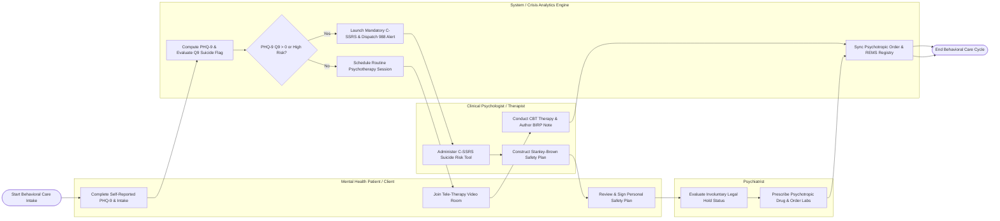

# Swimlane Diagram — Mental Health Management System

## Mermaid Code

## Flow Description | Mô tả luồng

| Lane | Actor / Subsystem | Role in Flow |
|------|-------------------|--------------|
| 1 | Mental Health Patient / Client | Completes self-reported PHQ-9/GAD-7 intake questionnaires, participates in encrypted tele-health video sessions, and co-signs personal suicide safety plans. |
| 2 | System / Crisis Analytics Engine | Computes psychological screening scores, evaluates suicidal ideation flags (PHQ-9 Question 9), triggers mandatory C-SSRS workflows, dispatches emergency 988 alerts, and syncs e-prescriptions with REMS registries. |
| 3 | Clinical Psychologist / Therapist | Conducts structured C-SSRS suicide risk assessments, formulates Stanley-Brown Safety Planning Interventions, conducts CBT/DBT psychotherapy sessions, and documents BIRP progress notes. |
| 4 | Psychiatrist | Evaluates acute psychiatric emergencies, processes involuntary legal commitment orders (Baker Act/Section 5150), prescribes psychotropic medications, and orders metabolic lab monitoring. |
