# Action Tree — Mental Health Management System

## Mermaid Code

```mermaid
graph TD
    Root["Mental Health Management System"]

    Root --> M1["Psychiatric Intake & Assessment"]
    Root --> M2["Psychological Screening & Testing"]
    Root --> M3["Individualized Treatment Planning"]
    Root --> M4["Suicide Risk & Safety Planning"]
    Root --> M5["Psychotropic Medication Management"]
    Root --> M6["Psychotherapy & BIRP Documentation"]
    Root --> M7["Legal Hold & Crisis Intervention"]
    Root --> M8["Privacy Controls & Quality Analytics"]

    M1 --> A11["Conduct Mental Status Exam (MSE)"]
    M1 --> A12["Assign Primary DSM-5-TR Diagnosis"]
    M1 --> A13["Record Psychiatric History & HPI"]
    M1 --> A14["Document Substance Abuse Baseline"]

    M2 --> A21["Administer PHQ-9 Depression Scale"]
    M2 --> A22["Evaluate GAD-7 Anxiety Severity"]
    M2 --> A23["Score PCL-5 PTSD Questionnaire"]
    M2 --> A24["Plot Longitudinal Screening Trends"]

    M3 --> A31["Define SMART Treatment Goals"]
    M3 --> A32["Select NOC Target Outcome Metrics"]
    M3 --> A33["Assign Evidence-Based CBT/DBT"]
    M3 --> A34["Schedule 90-Day Plan Review"]

    M4 --> A41["Administer C-SSRS Suicide Risk Tool"]
    M4 --> A42["Evaluate Ideation & Intent Stage"]
    M4 --> A43["Formulate Stanley-Brown Safety Plan"]
    M4 --> A44["Verify Lethal Means Restriction"]

    M5 --> A51["Prescribe Psychotropic Medication"]
    M5 --> A52["Check Serotonin & QTc Interactions"]
    M5 --> A53["Verify Clozapine REMS ANC Labs"]
    M5 --> A54["Schedule Antipsychotic Metabolic Panel"]

    M6 --> A61["Author BIRP Therapy Progress Note"]
    M6 --> A62["Host Encrypted Video Telehealth Session"]
    M6 --> A63["Log Group Therapy Roster Attendance"]
    M6 --> A64["Track Patient Daily Mood Diary"]

    M7 --> A71["Process Baker Act 72-Hour Legal Hold"]
    M7 --> A72["Dispatch Emergency 988 Crisis Alert"]
    M7 --> A73["Log Court Hearing Expiration Date"]
    M7 --> A74["Coordinate Community Case Aftercare"]

    M8 --> A81["Enforce 42 CFR Part 2 Consent Rules"]
    M8 --> A82["Audit Suicide Risk Compliance Rate"]
    M8 --> A83["Calculate Treatment Plan Completion"]
    M8 --> A84["Export Psychiatric Quality Metrics"]
```

## Module Description | Mô tả Module

| # | Module | Description | Actions |
|---|--------|-------------|---------|
| 1 | Psychiatric Intake & Assessment | Handles psychiatric evaluation, Mental Status Examination (MSE), DSM-5-TR diagnostic coding, and past psychiatric history charting. | Conduct Mental Status Exam (MSE), Assign Primary DSM-5-TR Diagnosis, Record Psychiatric History & HPI, Document Substance Abuse Baseline |
| 2 | Psychological Screening & Testing | Administers standardized tools (PHQ-9, GAD-7, PCL-5), calculates severity scores, and plots longitudinal progress graphs. | Administer PHQ-9 Depression Scale, Evaluate GAD-7 Anxiety Severity, Score PCL-5 PTSD Questionnaire, Plot Longitudinal Screening Trends |
| 3 | Individualized Treatment Planning | Formulates multi-disciplinary treatment plans defining SMART goals, NOC target outcomes, CBT/DBT modalities, and review schedules. | Define SMART Treatment Goals, Select NOC Target Outcome Metrics, Assign Evidence-Based CBT/DBT, Schedule 90-Day Plan Review |
| 4 | Suicide Risk & Safety Planning | Administers C-SSRS suicide risk assessments, establishes risk levels (Low/Mod/High), constructs Stanley-Brown Safety Plans, and restricts lethal means. | Administer C-SSRS Suicide Risk Tool, Evaluate Ideation & Intent Stage, Formulate Stanley-Brown Safety Plan, Verify Lethal Means Restriction |
| 5 | Psychotropic Medication Management | Manages psychotropic e-prescribing, drug-drug interaction alerts, Clozapine REMS lab verification, and SGA metabolic monitoring. | Prescribe Psychotropic Medication, Check Serotonin & QTc Interactions, Verify Clozapine REMS ANC Labs, Schedule Antipsychotic Metabolic Panel |
| 6 | Psychotherapy & BIRP Documentation | Captures BIRP progress notes, hosts encrypted video telehealth sessions, manages group therapy rosters, and tracks mood diaries. | Author BIRP Therapy Progress Note, Host Encrypted Video Telehealth Session, Log Group Therapy Roster Attendance, Track Patient Daily Mood Diary |
| 7 | Legal Hold & Crisis Intervention | Processes involuntary legal commitment holds (Baker Act/5150), dispatches emergency alerts to 988 lifeline, and tracks court expiration dates. | Process Baker Act 72-Hour Legal Hold, Dispatch Emergency 988 Crisis Alert, Log Court Hearing Expiration Date, Coordinate Community Case Aftercare |
| 8 | Privacy Controls & Quality Analytics | Enforces HIPAA/42 CFR Part 2 privacy disclosure consent, audits suicide safety compliance, and exports behavioral health quality metrics. | Enforce 42 CFR Part 2 Consent Rules, Audit Suicide Risk Compliance Rate, Calculate Treatment Plan Completion, Export Psychiatric Quality Metrics |
