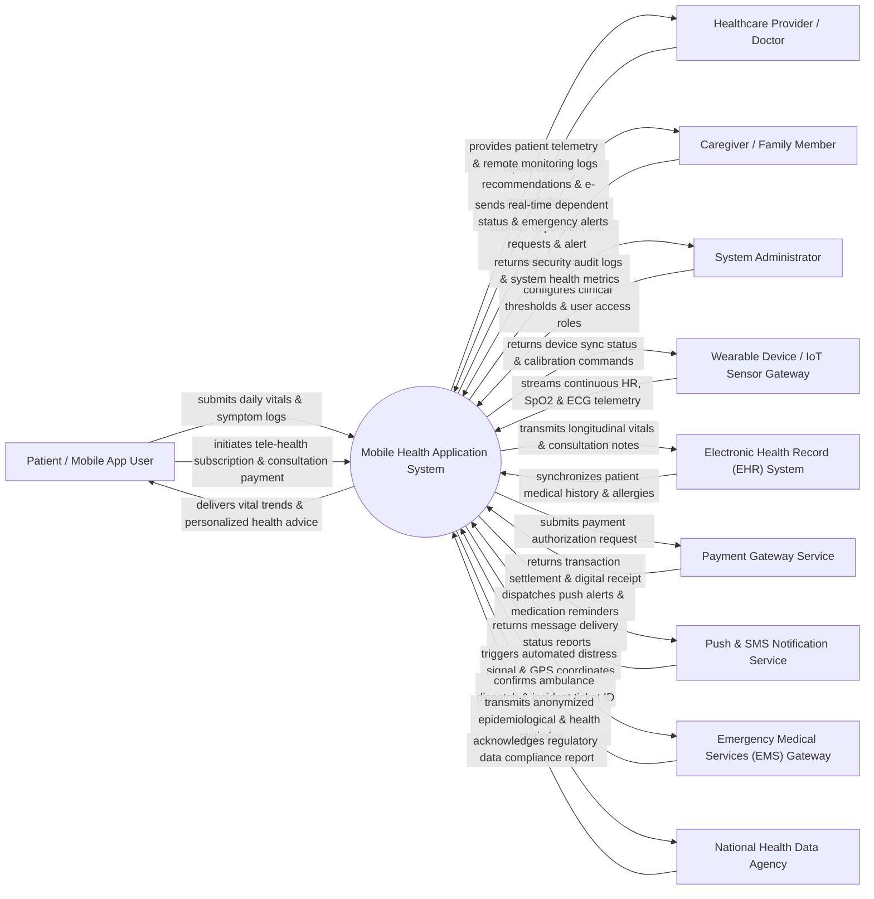

# Context Diagram — Mobile Health (mHealth) Application System

## Mermaid Code

## Actor & Interaction Table | Bảng Actor & Tương tác

| # | Actor | Actor Type | Data Sent TO System | Data Received FROM System | Notes |
|---|-------|------------|---------------------|---------------------------|-------|
| 1 | Patient / Mobile App User | Primary | Daily biometric inputs (blood pressure, glucose, weight), symptom self-assessments, medication compliance entries, appointment requests, payment credentials. | Real-time vital status visualizer, personalized wellness insights, medication reminders, tele-consultation video streams, digital e-prescriptions. | End-user tracking personal health indicators and consulting healthcare professionals via mobile app. |
| 2 | Healthcare Provider / Doctor | Primary | Clinical advice notes, medication updates, e-prescriptions, remote care plan adjustments, consultation availability schedules. | Patient continuous vital sign telemetry, automated anomaly alerts, historical trend graphs, shared EHR medical history, diagnostic images. | Certified physician or nurse providing remote care monitoring and virtual telehealth consultations. |
| 3 | Caregiver / Family Member | Primary | Dependent tracking authorization requests, custom notification thresholds, emergency contact updates. | Real-time dependent health dashboards, push notifications for missed medications, critical vital sign breach alerts, fall detection notifications. | Authorized family member or caregiver keeping track of elderly or chronic care patients. |
| 4 | System Administrator | Primary | User role configurations, clinical alert threshold rule sets, security policy parameters, wearable device driver profiles. | System diagnostic logs, user activity audit trails, security incident reports, infrastructure performance metrics. | IT administrator responsible for platform security, compliance, user access, and system reliability. |
| 5 | Wearable Device / IoT Sensor Gateway | Supporting | Continuous raw sensor data (heart rate, blood oxygen SpO2, body temperature, ECG waveforms, step counts, sleep stages). | Device sync acknowledgments, battery/firmware status checks, sample rate configurations. | Smartwatches, continuous glucose monitors (CGM), Bluetooth blood pressure cuffs, and smart scales. |
| 6 | Electronic Health Record (EHR) System | Supporting | Central patient demographics, allergy lists, past diagnosis records, laboratory results, hospital discharge summaries. | Exported patient mobile vitals history, remote tele-consultation summary notes, patient-reported outcome measures (PROMs). | Enterprise hospital EHR system integrated via HL7 FHIR APIs for bi-directional data exchange. |
| 7 | Payment Gateway Service | Supporting | Payment authorization tokens, transaction execution status, digital payment receipts, refund status notifications. | Billing transaction payloads, subscription plan amounts, merchant account identifiers. | External payment processing engine (credit card, digital wallets, bank transfers) for paid tele-health visits. |
| 8 | Push & SMS Notification Service | Supporting | Message delivery status updates, push token validation responses, failure error codes. | Structured notification payloads, target user device tokens, high-priority alert contents (medication reminders, OTPs). | Cloud communication service (APNs, FCM, SMS API) for delivering timely mobile notifications. |
| 9 | Emergency Medical Services (EMS) Gateway | Supporting | Incident ticket confirmations, estimated arrival times (ETA), emergency responder contact details. | High-priority distress payloads including patient identity, real-time GPS location, blood type, and critical vital breach details. | Regional emergency dispatch system notified automatically when panic buttons or severe fall/vital alerts occur. |
| 10 | National Health Data Agency | Supporting / Regulatory | Regulatory data reporting standards, disease surveillance guidelines, compliance confirmation receipts. | Anonymized population health data, chronic disease prevalence statistics, epidemic surge indicators. | Government public health organization receiving aggregated data for national healthcare planning and monitoring. |

## System Boundary Description | Mô tả Phạm vi Hệ thống

The **Mobile Health (mHealth) Application System** is a patient-centric, mobile-first healthcare platform engineered to provide continuous remote health monitoring, AI-driven vital anomaly detection, personalized health management, and integrated telehealth consultations.

**Inside System Scope:**
- Mobile user authentication, biometric logins, HIPAA/GDPR health consent management, and granular caregiver data-sharing controls.
- Real-time ingestion and synchronization of biometric data from wearable IoT devices via Bluetooth Low Energy (BLE) and cloud gateways.
- In-app daily vital sign logging (blood pressure, blood glucose, temperature, oxygen saturation), symptom tracking, and medication adherence logging.
- AI-driven vital anomaly detection algorithms that evaluate metrics against medical thresholds to generate automated warnings and emergency SOS alerts.
- Virtual care module facilitating secure video tele-consultations, scheduling, e-prescription generation, and clinical progress monitoring.
- Patient health analytics dashboards, trend visualization, exportable health summaries (PDF/FHIR), and automated notification scheduling.

**Outside System Scope:**
- Physical hardware sensing and lower-level firmware algorithms on wearable devices (handled by device manufacturers).
- Direct credit card processing and bank financial clearing (delegated to external Payment Gateway APIs).
- Direct dispatch of physical ambulances or emergency personnel (handled by external EMS Gateway platforms).
- Primary enterprise medical record storage (delegated to hospital EHR/EMR systems via HL7 FHIR integration).
