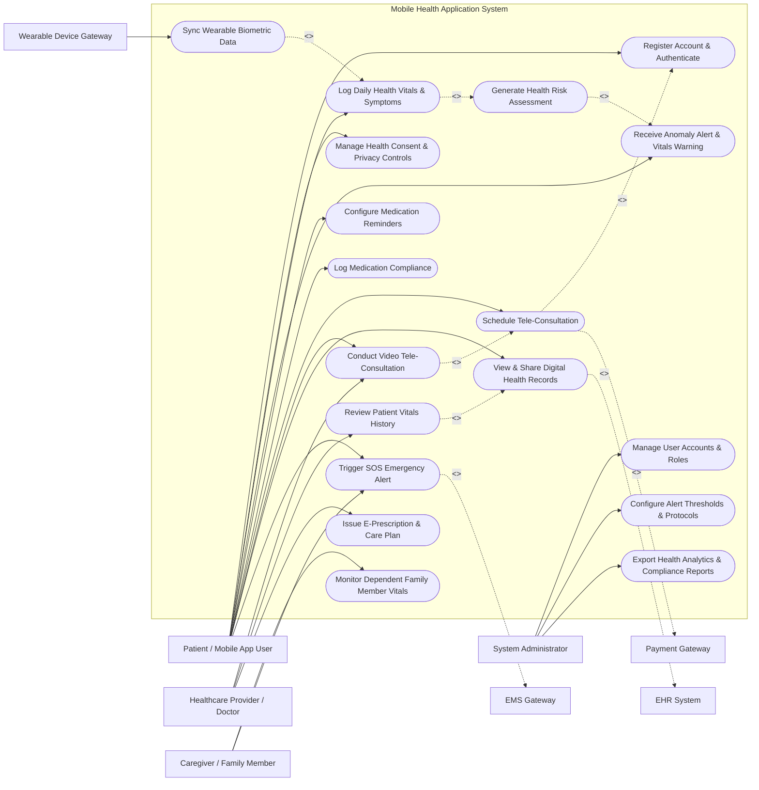

# Use Case Diagram — Mobile Health (mHealth) Application System

## Mermaid Code

## Actor Table | Bảng Actor

| # | Actor | Actor Type | Role Description | Related Use Cases |
|---|-------|------------|------------------|-------------------|
| 1 | Patient / Mobile App User | Primary | Individual tracking personal health, logging vitals, receiving medication reminders, and consulting doctors via mobile app. | UC01, UC02, UC04, UC06, UC07, UC08, UC09, UC10, UC11, UC14 |
| 2 | Healthcare Provider / Doctor | Primary | Medical professional reviewing remote patient vitals, conducting virtual telehealth visits, and prescribing treatments. | UC09, UC10, UC11, UC12, UC13 |
| 3 | Caregiver / Family Member | Primary | Designated family member or home caregiver monitoring dependent patient health status and receiving emergency alerts. | UC14, UC15 |
| 4 | System Administrator | Primary | IT administrative role managing user accounts, security roles, system configuration, and clinical alert threshold parameters. | UC16, UC17, UC18 |
| 5 | Wearable Device Gateway | System (Secondary) | IoT integration subsystem capturing real-time biometric telemetry (heart rate, SpO2, glucose, steps) via BLE. | UC03, UC04 |
| 6 | EHR System | System (Secondary) | Hospital Electronic Health Record system providing historical clinical data and storing mobile consultation summaries. | UC11, UC12 |
| 7 | Payment Gateway | System (Secondary) | Financial service provider processing appointment booking fees and subscription payments. | UC09 |
| 8 | EMS Gateway | System (Secondary) | Emergency dispatch system receiving automatic panic distress signals and dispatching emergency response. | UC14 |

## Use Case Table | Bảng Use Case

| # | UC ID | Use Case Name | Primary Actor | Secondary Actor | Description | Priority |
|---|-------|---------------|---------------|-----------------|-------------|----------|
| 1 | UC01 | Register Account & Authenticate | Patient / User | None | Allows users to create mobile accounts, perform identity verification, and log in securely via MFA/biometrics. | High |
| 2 | UC02 | Manage Health Consent & Privacy Controls | Patient | EHR System | Enables patients to grant, modify, or revoke caregiver access permissions and HIPAA consent agreements. | High |
| 3 | UC03 | Sync Wearable Biometric Data | Wearable Gateway | Patient | Automatically syncs continuous vital signs from paired Bluetooth smartwatches and IoT health sensors. | High |
| 4 | UC04 | Log Daily Health Vitals & Symptoms | Patient | Wearable Gateway | Allows patients to manually log or auto-capture vital signs (BP, glucose, temp) and recorded symptoms. | High |
| 5 | UC05 | Generate Health Risk Assessment | System | Patient | Analyzes patient vitals against medical risk models to compute dynamic health scores and risk indicators. | Medium |
| 6 | UC06 | Receive Anomaly Alert & Vitals Warning | Patient | Caregiver | Sends immediate push notifications and sound alarms when vital signs breach configured safety thresholds. | High |
| 7 | UC07 | Configure Medication Reminders | Patient | None | Enables patients to schedule drug regimens, dosages, intake times, and custom alarm alerts. | High |
| 8 | UC08 | Log Medication Compliance | Patient | Caregiver | Captures user confirmations when medication doses are taken, skipped, or snoozed for adherence tracking. | High |
| 9 | UC09 | Schedule Tele-Consultation | Patient | Payment Gateway | Allows patients to select a physician, choose consultation time slots, and complete payment booking. | High |
| 10 | UC10 | Conduct Video Tele-Consultation | Patient | Doctor | Facilitates encrypted HD video consultation between patient and doctor with screen/record sharing. | High |
| 11 | UC11 | View & Share Digital Health Records | Patient | EHR System | Provides access to digital health records, trend charts, lab reports, and allows exporting FHIR/PDF summaries. | Medium |
| 12 | UC12 | Review Patient Vitals History | Doctor | EHR System | Enables physicians to analyze longitudinal vital sign graphs, symptom trends, and patient-reported data. | High |
| 13 | UC13 | Issue E-Prescription & Care Plan | Doctor | EHR System | Allows doctors to generate digital prescriptions, adjust medication schedules, and issue remote care guidance. | High |
| 14 | UC14 | Trigger SOS Emergency Alert | Patient / Caregiver | EMS Gateway | Triggers an immediate panic button or automated severe fall distress signal sent to emergency dispatch and caregivers. | Critical |
| 15 | UC15 | Monitor Dependent Family Member Vitals | Caregiver | Patient | Enables authorized caregivers to view real-time vital dashboards and adherence records of linked family members. | High |
| 16 | UC16 | Manage User Accounts & Roles | Admin | None | Administrative control of user accounts, credential resets, role assignments (Patient, Doctor, Admin, Caregiver). | Medium |
| 17 | UC17 | Configure Alert Thresholds & Protocols | Admin | Doctor | Allows admins and clinical directors to set default vital sign safety bounds, escalation rules, and warning protocols. | High |
| 18 | UC18 | Export Health Analytics & Compliance Reports | Admin | EHR System | Generates system-wide usage metrics, data security audit logs, population health summaries, and compliance reports. | Medium |

## Use Case Specification | Đặc tả Use Case

---

### UC03 — Sync Wearable Biometric Data

| Field | Detail |
|-------|--------|
| **UC ID** | UC03 |
| **Use Case Name** | Sync Wearable Biometric Data |
| **Actor(s)** | Primary: Wearable Device Gateway   Secondary: Patient / Mobile App User |
| **Description** | Ingests, validates, and stores continuous biometric streams (heart rate, SpO2, blood glucose, body temperature, ECG, step count) received from paired Bluetooth Low Energy (BLE) health devices. |
| **Precondition** | 1. The mobile application is installed and active on the patient's smartphone.   2. The Bluetooth sensor device is paired, powered on, and authorized within app settings. |
| **Main Flow** | 1. The Wearable Device Gateway detects active BLE connection with the paired health sensor.   2. The Wearable Device Gateway transmits raw biometric data packets to the mHealth app backend API.   3. The System parses data packets, extracts timestamped sensor metrics, and performs noise filtering.   4. The System validates data against acceptable physical ranges (e.g., HR between 30 and 220 bpm).   5. The System persists valid biometric logs into the `VITAL_SIGN_LOG` database table associated with the patient profile.   6. The System sends a telemetry sync acknowledgment to the Wearable Device Gateway and updates the mobile app UI status indicator. |
| **Alternative Flow** | **AF1** — Bulk Offline Batch Sync: If the mobile app was offline, the wearable gateway buffers up to 24 hours of biometric readings locally. Upon reconnecting, the Wearable Gateway uploads the buffered batch array; the System processes and deduplicates records by timestamp.   **AF2** — Manual Data Re-Sync Request: If automatic sync stalls, the Patient taps "Sync Now" in the app. The System sends a refresh handshake signal to the Wearable Gateway and forces telemetry data fetch. |
| **Exception Flow** | **EX1** — BLE Connection Drop: If Bluetooth connection fails mid-transmission, the System logs a telemetry interruption event, notifies the Patient via app status badge "Device Disconnected", and attempts auto-reconnection every 30 seconds.   **EX2** — Corrupted Data Payload: If the incoming packet fails checksum validation or contains out-of-bounds telemetry values, the System discards the corrupted frame, requests packet retransmission, and logs an anomaly diagnostic event. |
| **Postcondition** | Biometric data is recorded in the patient's health log, real-time vital graphs are refreshed, and data is queued for automated risk assessment (UC05). |
| **Business Rule** | **BR1**: Biometric timestamps must align with UTC server clock within +/- 5 seconds drift tolerance.   **BR2**: High-rate telemetry (e.g., ECG streams) must be compressed and encrypted using AES-256 in transit. |

---

### UC04 — Log Daily Health Vitals & Symptoms

| Field | Detail |
|-------|--------|
| **UC ID** | UC04 |
| **Use Case Name** | Log Daily Health Vitals & Symptoms |
| **Actor(s)** | Primary: Patient / Mobile App User   Secondary: Wearable Device Gateway |
| **Description** | Allows the patient to manually input or verify vital sign measurements (systolic/diastolic blood pressure, fasting glucose, body weight) along with qualitative symptom logs (pain score, dizziness, fatigue). |
| **Precondition** | 1. Patient is logged into the mHealth mobile application with an active account.   2. Patient has valid health measurement equipment (e.g., manual blood pressure cuff or glucose test strips). |
| **Main Flow** | 1. Patient opens the "Daily Vitals Log" section in the mobile app and selects the target metric type (e.g., Blood Pressure).   2. Patient enters numeric measurement values (e.g., 120/80 mmHg), measurement context (e.g., Resting, Post-Exercise), and optional notes/symptoms.   3. System validates input data types, required fields, and range boundaries.   4. System prompts the Patient to confirm entry details.   5. Patient clicks "Save Log Entry".   6. System saves the entry into the database, updates daily health charts, and displays a successful save confirmation toast message. |
| **Alternative Flow** | **AF1** — Bluetooth Auto-Fill: If a smart blood pressure monitor or smart scale is connected via BLE, the System automatically populates input fields with sensor readings upon measurement completion, requiring only patient tap to confirm.   **AF2** — Historical Retrospective Entry: Patient selects a previous date/time picker to record a missed morning measurement; System marks entry as "Backdated Log". |
| **Exception Flow** | **EX1** — Invalid Numerical Range: If Patient enters an impossible value (e.g., Systolic BP = 400 mmHg), System displays an inline red validation error: "Value out of physiologically plausible range. Please re-check measurement." and prevents form submission.   **EX2** — Network Connection Lost during Submission: If network disconnects upon tapping Save, System stores the entry in local SQLite device cache and triggers background auto-upload when network connectivity is restored. |
| **Postcondition** | Manual vital sign record is permanently saved, updated on patient trend graphs, and made accessible to the attending physician. |
| **Business Rule** | **BR1**: Manual entries must be clearly flagged as `Source = Manual` in database records to differentiate from auto-synced IoT sensor feeds.   **BR2**: Blood pressure logs must require both Systolic and Diastolic values. |

---

### UC06 — Receive Anomaly Alert & Vitals Warning

| Field | Detail |
|-------|--------|
| **UC ID** | UC06 |
| **Use Case Name** | Receive Anomaly Alert & Vitals Warning |
| **Actor(s)** | Primary: Patient / Mobile App User   Secondary: Caregiver / Family Member |
| **Description** | Automatically detects critical vital sign threshold breaches (e.g., SpO2 < 90%, HR > 140 bpm resting) and dispatches immediate high-priority alerts to the patient and linked caregivers. |
| **Precondition** | 1. New vital sign log (manual or wearable) is stored in the system.   2. Clinical alert thresholds are configured for the patient profile. |
| **Main Flow** | 1. System automatically triggers the anomaly evaluation engine upon receipt of a new `VITAL_SIGN_LOG` record.   2. System compares vital values against configured medical threshold rules (e.g., SpO2 safety lower bound = 92%).   3. System identifies a threshold breach (e.g., SpO2 reading = 88% detected).   4. System flags the vital sign record as `risk_flag = CRITICAL`.   5. System dispatches a high-priority push notification and audible siren alert to the Patient's mobile device with emergency instructions.   6. System simultaneously dispatches SMS and push notification alerts to linked Caregivers and attending Physicians. |
| **Alternative Flow** | **AF1** — Warning Level Threshold (Non-Critical): If vital value falls into moderate warning range (e.g., Heart Rate 105 bpm resting), System sends a yellow warning banner to Patient advising rest and hydration, without escalating to Caregiver SMS.   **AF2** — False Alarm Cancellation: Patient taps "I am Okay / False Reading" within 30 seconds count-down timer; System prompts for re-measurement verification and cancels pending escalation to emergency services. |
| **Exception Flow** | **EX1** — Push Notification Delivery Failure: If push notification delivery fails (device offline), System immediately falls back to sending direct SMS and automated Voice Call alerts to Patient and Caregiver phone numbers.   **EX2** — No Caregiver Response Acknowledgment: If Caregiver does not acknowledge critical alert within 5 minutes, System escalates alert notification to secondary emergency contact list and system triage queue. |
| **Postcondition** | Emergency notification is logged in audit database, alert history dashboard is updated, and emergency response countdown is initiated. |
| **Business Rule** | **BR1**: Critical alert notifications must bypass mobile device Silent/Do-Not-Disturb modes using critical alert permissions.   **BR2**: All anomaly alert triggers and delivery acknowledgments must be recorded in system audit logs for medical legal compliance. |

---

### UC07 — Configure Medication Reminders

| Field | Detail |
|-------|--------|
| **UC ID** | UC07 |
| **Use Case Name** | Configure Medication Reminders |
| **Actor(s)** | Primary: Patient / Mobile App User   Secondary: None |
| **Description** | Enables patients to set up, edit, and manage personalized medication schedules, dosage instructions, recurring alarm times, and refill reminders. |
| **Precondition** | 1. Patient is logged into the mHealth app.   2. Patient has valid prescription details or over-the-counter medication instructions. |
| **Main Flow** | 1. Patient navigates to "Medication Management" screen and taps "Add New Medication".   2. Patient enters medication name (or selects from drug database lookup), form (tablet, capsule, liquid), and dosage strength (e.g., 500mg).   3. Patient sets intake frequency (e.g., twice daily), schedule times (e.g., 08:00 AM, 08:00 PM), and duration dates.   4. Patient configures food relation options (e.g., Take with meals) and refill threshold reminders (e.g., Remind when 5 pills remain).   5. System validates schedule inputs and checks for duplicate active reminders.   6. System saves schedule into `MEDICATION_SCHEDULE` table and registers local OS notification alarms on the mobile device. |
| **Alternative Flow** | **AF1** — Auto-Populate from E-Prescription: Patient selects an active e-prescription issued by their Doctor (UC13); System automatically populates drug name, dosage, and frequency fields, requiring only patient confirmation.   **AF2** — Scan Pill Bottle Barcode: Patient scans the barcode/QR code on pharmacy prescription bottle; System queries drug database and populates medication name and dosage info. |
| **Exception Flow** | **EX1** — Drug Interaction Warning: If newly added medication has a known severe interaction with an existing active medication in patient schedule, System displays a prominent warning modal detailing interaction risk and recommending doctor consultation.   **EX2** — Alarm Registration Permission Denied: If mobile OS denies exact notification alarm permissions, System displays an alert guiding user to device Settings to enable notification permissions. |
| **Postcondition** | Medication schedule is saved, local notification alarms are scheduled, and adherence tracking calendar is initialized. |
| **Business Rule** | **BR1**: Medication schedule times must not allow negative intervals or invalid clock times.   **BR2**: Severe drug interaction checks must be executed automatically using an updated clinical drug database. |

---

### UC10 — Conduct Video Tele-Consultation

| Field | Detail |
|-------|--------|
| **UC ID** | UC10 |
| **Use Case Name** | Conduct Video Tele-Consultation |
| **Actor(s)** | Primary: Patient / Mobile App User, Healthcare Provider / Doctor   Secondary: None |
| **Description** | Connects patient and physician in a real-time, WebRTC-encrypted HD video and audio session for remote clinical consultation, vitals review, and treatment guidance. |
| **Precondition** | 1. Tele-consultation appointment is scheduled and confirmed for the current time slot (UC09).   2. Both Patient and Doctor are logged into their respective mobile/web app portals. |
| **Main Flow** | 1. Doctor initiates consultation session from clinical queue; System sends "Room Ready" push notification to Patient.   2. Patient taps "Join Video Room" from appointment card.   3. System checks camera/microphone hardware permissions and establishes encrypted peer-to-peer WebRTC video channel.   4. Doctor views patient live video stream alongside side-panel showing real-time mobile vitals history and shared health records (UC12).   5. Doctor and Patient communicate, discuss symptoms, and conduct virtual examination.   6. Doctor completes consultation notes, issues e-prescription (UC13) if required, and taps "End Call".   7. System closes WebRTC session, calculates session duration, updates appointment status to `COMPLETED`, and prompts Patient for consultation rating/feedback. |
| **Alternative Flow** | **AF1** — In-Call Text Chat & File Attachment: If audio quality degrades, Patient or Doctor switches to integrated text chat and shares medical photos/documents directly within the video call room interface.   **AF2** — Low Bandwidth Audio-Only Fallback: If network bandwidth drops below 200 kbps, System automatically disables video transmission and downgrades session to high-clarity VoIP audio call to prevent call drop. |
| **Exception Flow** | **EX1** — Call Disconnection: If video call drops unexpectedly due to signal loss, System attempts auto-reconnection for 60 seconds; if unsuccessful, System prompts Doctor to initiate reconnect call or convert to telephone fallback.   **EX2** — No-Show Timeout: If Patient does not join video room within 10 minutes of appointment start time, System alerts Doctor, records appointment status as `PATIENT_NO_SHOW`, and issues partial refund according to cancellation policy. |
| **Postcondition** | Video session is terminated, consultation summary is saved to patient file, e-prescription is delivered, and billing settlement is finalized. |
| **Business Rule** | **BR1**: Video stream data must be encrypted end-to-end (E2EE) using WebRTC DTLS-SRTP standards in compliance with HIPAA security rules.   **BR2**: Video consultation streams must not be recorded unless explicit digital consent is granted by both Patient and Doctor. |
