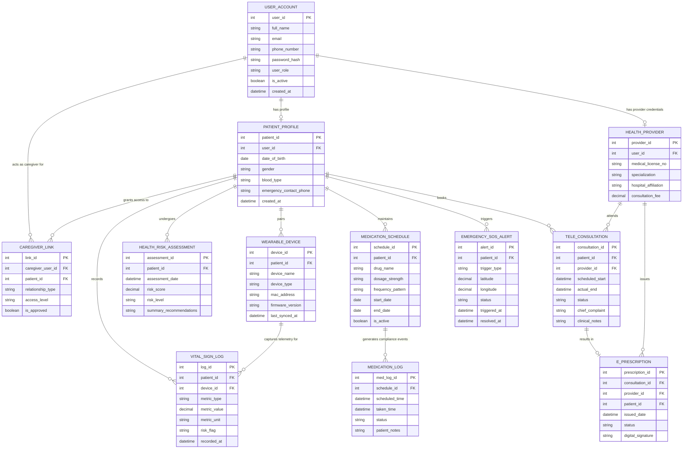

# Conceptual ERD — Mobile Health (mHealth) Application System

## Mermaid Code

## Entity Description Table | Bảng mô tả Entity

| # | Entity Name | Vietnamese Name | Description | Key Attributes | Main Relationships |
|---|-------------|-----------------|-------------|----------------|-------------------|
| 1 | USER_ACCOUNT | Tài khoản Nguời dùng | Core system authentication entity storing login credentials, profile baseline, and access permissions. | `user_id`, `email`, `phone_number`, `password_hash`, `user_role` | Has one `PATIENT_PROFILE`, has one `HEALTH_PROVIDER`, has many `CAREGIVER_LINK`. |
| 2 | PATIENT_PROFILE | Hồ sơ Bệnh nhân | Extended health demographics and biological information for mobile app patients. | `patient_id`, `user_id`, `date_of_birth`, `gender`, `blood_type`, `emergency_contact_phone` | Belongs to `USER_ACCOUNT`, has many `VITAL_SIGN_LOG`, `WEARABLE_DEVICE`, `MEDICATION_SCHEDULE`. |
| 3 | HEALTH_PROVIDER | Bác sĩ / Chuyên gia Y tế | Verified medical practitioner profile detailing license numbers, clinical specialties, and fees. | `provider_id`, `user_id`, `medical_license_no`, `specialization`, `consultation_fee` | Belongs to `USER_ACCOUNT`, attends many `TELE_CONSULTATION`, issues many `E_PRESCRIPTION`. |
| 4 | CAREGIVER_LINK | Liên kết Người chăm sóc | Authorization mapping linking family members/caregivers to dependent patient records. | `link_id`, `caregiver_user_id`, `patient_id`, `relationship_type`, `access_level` | Relates `USER_ACCOUNT` (Caregiver) to `PATIENT_PROFILE`. |
| 5 | WEARABLE_DEVICE | Thiết bị Đeo Y tế | Registered IoT health sensors paired with patient mobile application. | `device_id`, `patient_id`, `device_name`, `mac_address`, `firmware_version` | Belongs to `PATIENT_PROFILE`, generates many `VITAL_SIGN_LOG`. |
| 6 | VITAL_SIGN_LOG | Nhật ký Chỉ số Sinh tồn | Time-series vital sign readings and sensor metrics collected manually or auto-synced. | `log_id`, `patient_id`, `device_id`, `metric_type`, `metric_value`, `risk_flag` | Belongs to `PATIENT_PROFILE` and `WEARABLE_DEVICE`. |
| 7 | HEALTH_RISK_ASSESSMENT | Đánh giá Rủi ro Sức khỏe | Algorithmic and AI assessment summaries calculating patient overall health risk scores. | `assessment_id`, `patient_id`, `assessment_date`, `risk_score`, `risk_level` | Belongs to `PATIENT_PROFILE`. |
| 8 | MEDICATION_SCHEDULE | Lịch Trình Dùng Thuốc | Prescribed or user-configured medication regimens, dosages, and daily reminder times. | `schedule_id`, `patient_id`, `drug_name`, `dosage_strength`, `frequency_pattern` | Belongs to `PATIENT_PROFILE`, generates many `MEDICATION_LOG`. |
| 9 | MEDICATION_LOG | Nhật ký Tuân thủ Thuốc | Individual dose tracking records capturing taken, skipped, or snoozed medication events. | `med_log_id`, `schedule_id`, `scheduled_time`, `taken_time`, `status` | Belongs to `MEDICATION_SCHEDULE`. |
| 10 | TELE_CONSULTATION | Buổi Khám bệnh Từ xa | Remote telehealth appointment records connecting patients with attending physicians. | `consultation_id`, `patient_id`, `provider_id`, `scheduled_start`, `status` | Belongs to `PATIENT_PROFILE` and `HEALTH_PROVIDER`, yields `E_PRESCRIPTION`. |
| 11 | E_PRESCRIPTION | Đơn thuốc Điện tử | Digital prescription issued by doctor containing ordered medications and dosage guidelines. | `prescription_id`, `consultation_id`, `provider_id`, `patient_id`, `issued_date` | Belongs to `TELE_CONSULTATION` and `HEALTH_PROVIDER`. |
| 12 | EMERGENCY_SOS_ALERT | Cảnh báo Cấp cứu SOS | High-priority panic button or automatic fall/vital breach emergency incident record. | `alert_id`, `patient_id`, `trigger_type`, `latitude`, `longitude`, `status` | Belongs to `PATIENT_PROFILE`. |

## Relationship Description | Mô tả Quan hệ

| # | From Entity | Cardinality | To Entity | Label | Business Explanation |
|---|-------------|-------------|-----------|-------|----------------------|
| 1 | USER_ACCOUNT | 1 to 0..1 | PATIENT_PROFILE | has profile | A user account can be associated with at most one patient profile. |
| 2 | USER_ACCOUNT | 1 to 0..1 | HEALTH_PROVIDER | has provider credentials | A user account can be assigned a doctor credentials profile. |
| 3 | USER_ACCOUNT | 1 to 0..N | CAREGIVER_LINK | acts as caregiver for | A user account can act as an authorized caregiver for multiple patient profiles. |
| 4 | PATIENT_PROFILE | 1 to 0..N | CAREGIVER_LINK | grants access to | A patient profile can authorize multiple caregiver link relationships. |
| 5 | PATIENT_PROFILE | 1 to 0..N | WEARABLE_DEVICE | pairs | A patient can register and pair multiple wearable IoT devices (smartwatch, scale, BP monitor). |
| 6 | PATIENT_PROFILE | 1 to 0..N | VITAL_SIGN_LOG | records | A patient profile maintains a continuous time-series history of vital sign logs. |
| 7 | WEARABLE_DEVICE | 1 to 0..N | VITAL_SIGN_LOG | captures telemetry for | A wearable device streams multiple vital sign data points into the vital log store. |
| 8 | PATIENT_PROFILE | 1 to 0..N | HEALTH_RISK_ASSESSMENT | undergoes | A patient receives periodic AI-generated health risk score evaluations over time. |
| 9 | PATIENT_PROFILE | 1 to 0..N | MEDICATION_SCHEDULE | maintains | A patient configures one or more active medication reminder schedules. |
| 10 | MEDICATION_SCHEDULE | 1 to 0..N | MEDICATION_LOG | generates compliance events | Each medication schedule generates daily scheduled dose logs for adherence tracking. |
| 11 | PATIENT_PROFILE | 1 to 0..N | TELE_CONSULTATION | books | A patient can book multiple remote tele-consultation video visits. |
| 12 | HEALTH_PROVIDER | 1 to 0..N | TELE_CONSULTATION | attends | A doctor conducts multiple video telehealth sessions with registered patients. |
| 13 | TELE_CONSULTATION | 1 to 0..1 | E_PRESCRIPTION | results in | A completed tele-consultation session may result in issuing one digital e-prescription. |
| 14 | HEALTH_PROVIDER | 1 to 0..N | E_PRESCRIPTION | issues | A physician issues and digitally signs electronic prescriptions. |
| 15 | PATIENT_PROFILE | 1 to 0..N | EMERGENCY_SOS_ALERT | triggers | A patient profile can trigger manual SOS button presses or automatic emergency distress alerts. |
