# Swimlane Diagram — Mobile Health (mHealth) Application System

## Mermaid Code

```mermaid
flowchart LR
    Start(["Start Continuous Monitoring"])

    subgraph Lane_Device["Wearable IoT Device"]
        D1["Capture Biometric Sensors HR/SpO2/ECG"]
        D2["Buffer Telemetry Packets"]
        D3["Transmit via BLE Gateway"]
    end

    subgraph Lane_Patient["Patient / Mobile App User"]
        P1["Wear Paired Sensor Device"]
        P2["Review Real-time Vital Dashboard"]
        P3{"Experience Acute Symptoms?"}
        P4["Press Emergency SOS Panic Button"]
        P5["Perform Manual Re-check / Rest"]
    end

    subgraph Lane_Backend["mHealth System Backend"]
        B1["Ingest & Filter Biometric Stream"]
        B2["Evaluate Clinical Threshold Rules"]
        B3{"Is Vital Reading Abnormal?"}
        B4["Flag Vital Record as Critical"]
        B5["Generate High-Priority Alarm Payload"]
        B6["Log Normal Vital Metric"]
    end

    subgraph Lane_Emergency["Emergency Response & Caregiver"]
        E1["Receive Priority Push Alarm & SMS"]
        E2{"Is Incident Confirmed Critical?"}
        E3["Dispatch EMS Ambulance Service"]
        E4["Contact Patient via Emergency Call"]
    end

    Finish(["End Monitoring Cycle"])

    Start --> P1 --> D1 --> D2 --> D3
    D3 --> B1 --> B2 --> B3
    B3 -->|"No"| B6 --> P2 --> P3
    P3 -->|"No"| Finish
    P3 -->|"Yes"| P4 --> B5
    B3 -->|"Yes"| B4 --> B5
    B5 --> E1 --> E2
    E2 -->|"Critical Breach / Unresponsive"| E3 --> Finish
    E2 -->|"False Alarm / Moderate Warning"| E4 --> P5 --> Finish
```

## Flow Description | Mô tả luồng

| Lane | Actor | Role in Flow |
|------|-------|-------------|
| 1 | Wearable IoT Device | Continuously monitors patient biological parameters (heart rate, blood oxygen, ECG), buffers telemetry packets locally, and streams raw sensor data to the smartphone via Bluetooth Low Energy (BLE). |
| 2 | Patient / Mobile App User | Wears connected health sensors, monitors daily vitals visualizer on mobile app UI, self-assesses symptoms, and can manually trigger the emergency SOS panic button during acute distress. |
| 3 | mHealth System Backend | Ingests live biometric data streams, applies noise filtering, evaluates sensor values against personalized clinical alert rules, flags anomalies, and dispatches automated high-priority alert payloads. |
| 4 | Emergency Response & Caregiver | Receives real-time push alarms, SMS alerts, and voice notifications; evaluates emergency severity; contacts patient; and dispatches regional EMS emergency services if critical breach or fall occurs. |
