# Action Tree — Mobile Health (mHealth) Application System

## Mermaid Code

```mermaid
graph TD
    Root["Mobile Health Application System"]

    Root --> M1["User Account & Privacy Management"]
    Root --> M2["Vitals & Wearable Integration"]
    Root --> M3["Health Risk & AI Analytics"]
    Root --> M4["Medication & Care Adherence"]
    Root --> M5["Tele-Consultation & Virtual Care"]
    Root --> M6["Emergency & Safety Services"]

    M1 --> A11["Register Patient & Doctor Account"]
    M1 --> A12["Authenticate via Biometrics / MFA"]
    M1 --> A13["Manage HIPAA / GDPR Health Consents"]
    M1 --> A14["Authorize Caregiver Access Permissions"]

    M2 --> A21["Pair Bluetooth Wearable Devices"]
    M2 --> A22["Sync Continuous Biometric Data Stream"]
    M2 --> A23["Log Manual Vital Signs & Symptoms"]
    M2 --> A24["View Historical Vitals Trend Graphs"]

    M3 --> A31["Calculate Dynamic Health Risk Score"]
    M3 --> A32["Detect Vital Sign Threshold Anomalies"]
    M3 --> A33["Generate Personalized Wellness Insights"]
    M3 --> A34["Export Longitudinal Health Report (FHIR/PDF)"]

    M4 --> A41["Configure Medication Reminder Schedules"]
    M4 --> A42["Receive Medication Dose Alarm Alerts"]
    M4 --> A43["Log Dose Compliance (Taken/Skipped/Snoozed)"]
    M4 --> A44["Track Prescription Pill Refill Alerts"]

    M5 --> A51["Search & Select Available Physicians"]
    M5 --> A52["Schedule & Pay for Tele-Consultation"]
    M5 --> A53["Join WebRTC HD Video Consultation Call"]
    M5 --> A54["Issue & Download Digital E-Prescriptions"]

    M6 --> A61["Trigger Manual SOS Emergency Panic Button"]
    M6 --> A62["Detect Severe Fall / Crash Events"]
    M6 --> A63["Dispatch Automated GPS & Vital Data to EMS"]
    M6 --> A64["Send Urgent SMS / Push Alerts to Caregivers"]
```

## Module Description | Mô tả Module

| # | Module | Description | Actions |
|---|--------|-------------|---------|
| 1 | User Account & Privacy Management | Manages registration, biometric authentication, user roles, security settings, HIPAA privacy consents, and caregiver data sharing authorization. | Register Account, Authenticate via MFA/Biometrics, Manage Health Consents, Authorize Caregiver Access. |
| 2 | Vitals & Wearable Integration | Handles pairing with Bluetooth medical devices, continuous sensor data ingestion, manual vital logging, and real-time visualization of health trends. | Pair Bluetooth Devices, Sync Biometric Telemetry, Log Manual Vitals & Symptoms, View Historical Vitals Graphs. |
| 3 | Health Risk & AI Analytics | Evaluates time-series biometric data using clinical risk models to compute risk scores, detect anomalies, generate health insights, and export health files. | Calculate Health Risk Score, Detect Vital Anomalies, Generate Wellness Insights, Export Longitudinal Health Reports. |
| 4 | Medication & Care Adherence | Oversees personalized medication scheduling, intake alarm notifications, dosage compliance tracking, and prescription pill refill reminders. | Configure Reminder Schedules, Receive Medication Alarms, Log Dose Compliance, Track Pill Refill Alerts. |
| 5 | Tele-Consultation & Virtual Care | Enables patients to schedule video appointments, complete payments, conduct encrypted telehealth video calls, and access digital e-prescriptions. | Search & Select Physicians, Schedule & Pay Consultation, Join WebRTC Video Call, Issue & Download E-Prescriptions. |
| 6 | Emergency & Safety Services | Provides instant panic button SOS capability, automated fall detection, real-time caregiver distress alerts, and emergency medical service (EMS) dispatch integration. | Trigger SOS Panic Button, Detect Severe Fall Events, Dispatch GPS/Vitals to EMS, Send Urgent Alerts to Caregivers. |
