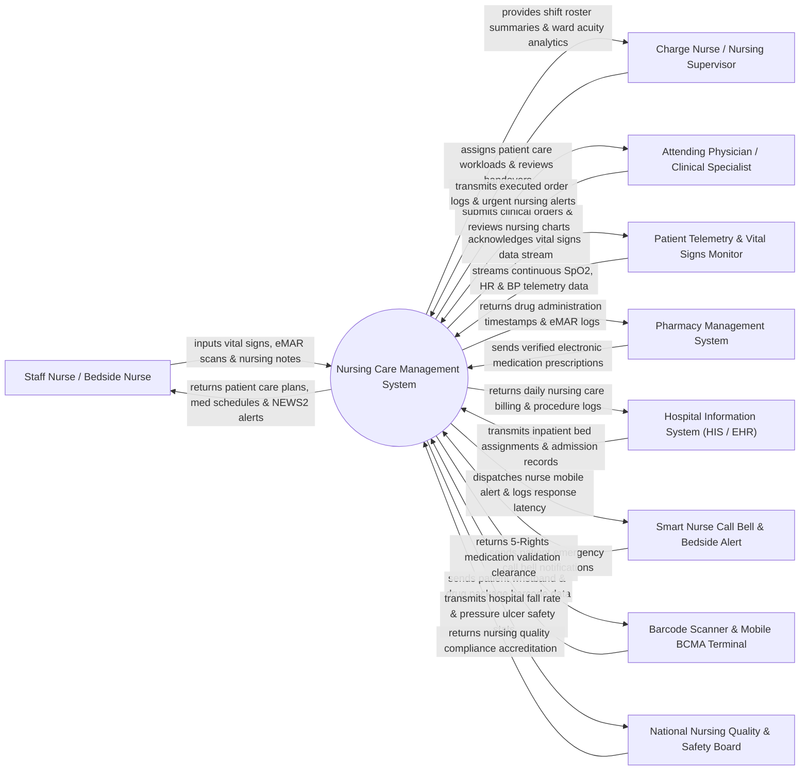

# Context Diagram — Nursing Care Management System

## Mermaid Code

## Actor & Interaction Table | Bảng Actor & Tương tác

| # | Actor | Actor Type | Data Sent TO System | Data Received FROM System | Notes |
|---|-------|------------|---------------------|---------------------------|-------|
| 1 | Staff Nurse / Bedside Nurse | Primary | Vital signs entries, eMAR barcode scans, nursing assessments (Morse/Braden), fluid intake/output, SBAR handover notes. | Patient care plans, shift task checklists, medication administration schedules, NEWS2 warning alerts. | Registered nurse delivering direct bedside clinical care, administering medication, and charting patient progress. |
| 2 | Charge Nurse / Nursing Supervisor | Primary | Nurse-patient shift assignments, ward acuity ratings, incident reports, care plan overrides. | Ward overview dashboard, staffing workload balance metrics, shift handover summaries, compliance reports. | Senior nurse manager supervising ward operations, shift handovers, and nursing staff allocation. |
| 3 | Attending Physician / Clinical Specialist | Primary | Electronic doctor orders, clinical treatment plans, medication orders, dietary orders. | Executed order status, nursing progress notes (DAR/SOAP), critical patient deterioration alerts. | Medical doctor directing inpatient diagnosis and medical treatment plans. |
| 4 | Hospital Information System (HIS / EHR) | Supporting System | Patient admission demographics, room/bed transfers, master patient index (MPI), insurance coverage data. | Completed nursing care billing entries, clinical nursing charts, discharge summaries. | Enterprise hospital database maintaining central patient records and inpatient stay logistics. |
| 5 | Pharmacy Management System | Supporting System | Verified e-prescriptions, medication dispense tokens, drug interaction warnings, formulary updates. | eMAR drug administration logs, missed dose alerts, medication return logs. | Hospital pharmacy system dispensing unit-dose medications for inpatient administration. |
| 6 | Patient Telemetry & Vital Signs Monitor | Supporting System | Continuous automated vital signs telemetry (Heart rate, SpO2, NIBP, body temperature, ECG rhythm). | Device sync confirmation, alarm threshold parameters. | Medical monitors attached to patients streaming real-time vital sign data directly to nursing charts. |
| 7 | Smart Nurse Call Bell & Bedside Alert | Supporting System | Patient call bell button triggers, emergency code blue alerts, bathroom assistance triggers. | Nurse mobile phone push notifications, alert acknowledgment tokens, escalation triggers. | Bedside hardware enabling patients to signal nurses for immediate clinical assistance. |
| 8 | Barcode Scanner & Mobile BCMA Terminal | Supporting System | Scanned patient ID wristband 2D barcodes, scanned medication unit-dose package GTIN barcodes. | Real-time 5-Rights validation (Right Patient, Drug, Dose, Route, Time) visual & audio feedback. | Mobile handheld device used at bedside during Barcode Medication Administration (BCMA). |
| 9 | National Nursing Quality & Safety Board | Regulatory | Mandatory nursing practice standards, hospital safety audit benchmarks, sentinel event reporting schemas. | Inpatient fall rates, hospital-acquired pressure injury (HAPI) metrics, medication error statistics. | Regulatory body setting standards for nursing practice, patient safety, and hospital accreditation. |

## System Boundary Description | Mô tả Phạm vi Hệ thống

The **Nursing Care Management System (NCMS)** is a specialized clinical software solution designed to digitize and optimize nursing workflows in hospital inpatient wards, intensive care units (ICUs), and surgical departments. It manages nursing assessment tools (Morse Fall Scale, Braden Pressure Ulcer Scale, Pain Scale), NANDA-I based Nursing Care Plans (NCP), Barcode Medication Administration (BCMA) via eMAR, automated National Early Warning Score (NEWS2) calculation, fluid intake and output (I&O) tracking, structured SBAR shift handovers, and progress note documentation (DAR/SOAP).

**Inside System Scope:**
- Initial and ongoing patient nursing assessments and risk scoring engines.
- Generation, execution, and updating of Nursing Care Plans (NCP).
- eMAR display, Barcode Medication Administration (BCMA) 5-Rights verification, and missed dose tracking.
- Vital signs charting, automated NEWS2 score calculation, and clinical deterioration alerts.
- Shift-to-shift SBAR (Situation, Background, Assessment, Recommendation) handover reporting.
- Fluid intake and output (I&O) balance calculations and IV drip rate logging.
- Nurse call bell notification routing and response time tracking.

**Outside System Scope:**
- Physician e-prescribing and pharmacy drug compounding/dispensing (delegated to Pharmacy System).
- Long-term central financial accounting, insurance claims, and cashiering (handled by HIS / Billing).
- Diagnostic imaging interpretation and laboratory specimen processing (handled by RIS and LIS).
- Physical hardware manufacturing of telemetry monitors and call bell buttons (handled by hardware vendors).
