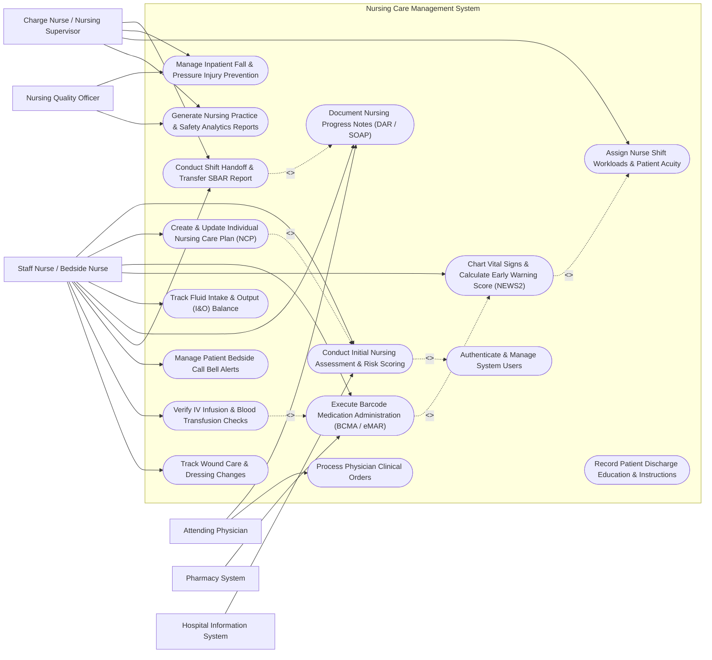

# Use Case Diagram — Nursing Care Management System

## Mermaid Code

## Actor Table | Bảng Actor

| # | Actor | Actor Type | Role Description | Related Use Cases |
|---|-------|------------|------------------|-------------------|
| 1 | Staff Nurse / Bedside Nurse | Primary | Registered bedside nurse performing direct care, medication administration, assessments, vital signs charting, and SBAR handovers. | UC01, UC02, UC03, UC04, UC05, UC06, UC07, UC09, UC12, UC14, UC16 |
| 2 | Charge Nurse / Nursing Supervisor | Primary | Nursing administrator managing ward staffing assignments, patient acuity ratings, quality audits, and shift handovers. | UC07, UC10, UC11, UC15 |
| 3 | Attending Physician | Secondary | Medical doctor reviewing nursing notes, issuing order updates, and monitoring executed clinical care logs. | UC06, UC08 |
| 4 | Nursing Quality Officer | Primary | Quality assurance specialist inspecting clinical safety indicators, fall rates, pressure ulcers, and BCMA compliance. | UC10, UC15 |
| 5 | Pharmacy System | Secondary / System | Inpatient pharmacy software supplying verified eMAR drug schedules and receiving administration records. | UC03 |
| 6 | Hospital Information System | Secondary / System | Core enterprise software providing inpatient admission data and receiving nursing billing entries. | UC01 |

## Use Case Table | Bảng Use Case

| # | UC ID | Use Case Name | Primary Actor | Secondary Actor | Description | Priority |
|---|-------|---------------|---------------|-----------------|-------------|----------|
| 1 | UC01 | Conduct Initial Nursing Assessment & Risk Scoring | Staff Nurse / Bedside Nurse | Hospital Information System | Perform comprehensive admission assessment, calculate Morse Fall and Braden Pressure Ulcer risk scores. | High |
| 2 | UC02 | Create & Update Individual Nursing Care Plan (NCP) | Staff Nurse / Bedside Nurse | None | Formulate evidence-based nursing care plans using NANDA-I diagnoses, NOC outcomes, and NIC interventions. | High |
| 3 | UC03 | Execute Barcode Medication Administration (BCMA / eMAR) | Staff Nurse / Bedside Nurse | Pharmacy System | Scan patient wristband and drug package barcodes at bedside to validate 5-Rights prior to drug administration. | High |
| 4 | UC04 | Chart Vital Signs & Calculate Early Warning Score (NEWS2) | Staff Nurse / Bedside Nurse | None | Record BP, HR, SpO2, Temp, RR to auto-compute NEWS2 score and trigger clinical escalation for high scores. | High |
| 5 | UC05 | Track Fluid Intake & Output (I&O) Balance | Staff Nurse / Bedside Nurse | None | Log oral/IV fluid intake and urine/drainage output to maintain 24-hour fluid balance calculations. | Medium |
| 6 | UC06 | Document Nursing Progress Notes (DAR / SOAP) | Staff Nurse / Bedside Nurse | Attending Physician | Record structured clinical notes using Data-Action-Response (DAR) or SOAP formats. | High |
| 7 | UC07 | Conduct Shift Handoff & Transfer SBAR Report | Staff Nurse / Bedside Nurse | Charge Nurse / Nursing Supervisor | Generate and verbally transfer SBAR (Situation, Background, Assessment, Recommendation) shift reports. | High |
| 8 | UC08 | Process Physician Clinical Orders | Attending Physician | Staff Nurse / Bedside Nurse | Receive, review, and confirm execution of doctor orders for nursing interventions and diagnostics. | High |
| 9 | UC09 | Manage Patient Bedside Call Bell Alerts | Staff Nurse / Bedside Nurse | None | Receive mobile call bell notifications, acknowledge patient requests, and log response latency. | Medium |
| 10 | UC10 | Manage Inpatient Fall & Pressure Injury Prevention | Charge Nurse / Nursing Supervisor | Nursing Quality Officer | Implement targeted safety bundles (yellow fall wristbands, Q2H turning schedules) for high-risk patients. | High |
| 11 | UC11 | Assign Nurse Shift Workloads & Patient Acuity | Charge Nurse / Nursing Supervisor | None | Calculate patient acuity levels to equitably distribute nursing assignments across shift staff. | Medium |
| 12 | UC12 | Verify IV Infusion & Blood Transfusion Checks | Staff Nurse / Bedside Nurse | None | Perform dual-nurse independent verification scans for IV drip rates and blood bag transfusion safety. | High |
| 13 | UC13 | Record Patient Discharge Education & Instructions | Staff Nurse / Bedside Nurse | None | Provide and document patient/family education on post-discharge medication, wound care, and follow-up. | Medium |
| 14 | UC14 | Track Wound Care & Dressing Changes | Staff Nurse / Bedside Nurse | None | Photograph, measure, and record wound staging, exudate, and dressing change schedules. | Medium |
| 15 | UC15 | Generate Nursing Practice & Safety Analytics Reports | Nursing Quality Officer | Charge Nurse / Nursing Supervisor | Analyze ward BCMA compliance rates, fall incidence, pressure injury rates, and nurse response times. | Medium |
| 16 | UC16 | Authenticate & Manage System Users | All Users | None | Authenticate user identity, enforce role permissions, and maintain electronic signature logs. | High |

## Use Case Specification | Đặc tả Use Case

---

### UC01 — Conduct Initial Nursing Assessment & Risk Scoring

| Field | Detail |
|-------|--------|
| **UC ID** | UC01 |
| **Use Case Name** | Conduct Initial Nursing Assessment & Risk Scoring |
| **Actor(s)** | Primary: Staff Nurse / Bedside Nurse   Secondary: Hospital Information System |
| **Description** | Conducts a comprehensive clinical nursing admission assessment within 2 hours of inpatient admission, evaluating body systems, medical history, pain scale, and calculating validated risk scores for patient falls (Morse Scale) and pressure ulcers (Braden Scale). |
| **Precondition** | 1. The patient is admitted to an inpatient bed in HIS.   2. The Nurse is logged into NCMS with clinical charting privileges. |
| **Main Flow** | 1. The Nurse selects the newly admitted patient from the ward bed board.   2. The System retrieves patient demographic data, admission diagnosis, and allergy history from HIS.   3. The Nurse conducts physical assessment and enters findings across body systems (Neurological, Cardiovascular, Respiratory, Gastrointestinal, Skin, Musculoskeletal).   4. The Nurse completes the Morse Fall Scale questionnaire (History of falling, Secondary diagnosis, Ambulatory aid, IV therapy, Gait, Mental status).   5. The System calculates the Morse score and classifies fall risk: Low (0-24), Medium (25-44), or High (>=45).   6. The Nurse completes the Braden Scale questionnaire (Sensory perception, Moisture, Activity, Mobility, Nutrition, Friction/Shear).   7. The System calculates the Braden score and classifies pressure ulcer risk: Mild (15-18), Moderate (13-14), High (10-12), or Severe (<=9).   8. The Nurse submits the assessment. The System saves the assessment, updates the patient's ward safety profile, and automatically recommends safety bundles (e.g., Fall Risk yellow wristband, Q2H repositioning protocol). |
| **Alternative Flow** | **AF1** — Pediatric Assessment Adaptation: If the patient is under 16 years old, the System automatically switches to the Humpty Dumpty Fall Scale and Braden Q Pressure Ulcer Scale.   **AF2** — Re-Assessment Schedule Trigger: The System automatically sets next re-assessment timers for 24 hours or immediately following any change in patient condition. |
| **Exception Flow** | **EX1** — Unconscious Patient Assessment: If the patient is uncommunicative/unconscious, the Nurse checks the "Unable to Assess Verbally" option, and the System prompts for surrogate history source (family/EMS).   **EX2** — High Risk Score Threshold Warning: If the Morse score is >=45 or Braden score <=12, the System triggers an instant high-risk alert banner on the patient's room door display and nurse mobile app. |
| **Postcondition** | Initial nursing assessment is saved, Morse and Braden risk scores are calculated, safety alerts are activated, and baseline data is available for Care Plan generation. |
| **Business Rule** | **BR1**: Initial nursing assessment must be completed within 120 minutes of inpatient room placement.   **BR2**: A Morse Fall score >=45 mandates physical placement of a yellow fall risk wristband and bed exit alarm activation. |

---

### UC02 — Create & Update Individual Nursing Care Plan (NCP)

| Field | Detail |
|-------|--------|
| **UC ID** | UC02 |
| **Use Case Name** | Create & Update Individual Nursing Care Plan (NCP) |
| **Actor(s)** | Primary: Staff Nurse / Bedside Nurse |
| **Description** | Formulates, updates, and evaluates an individualized, evidence-based Nursing Care Plan (NCP) using standardized NANDA-I nursing diagnoses, NOC (Nursing Outcomes Classification) targets, and NIC (Nursing Interventions Classification) actions. |
| **Precondition** | 1. The patient has a completed initial nursing assessment in the system.   2. The Nurse is assigned to the patient for the active shift. |
| **Main Flow** | 1. The Nurse opens the "Care Plan Manager" for the target patient.   2. The System analyzes recent assessment data and suggests relevant NANDA-I diagnoses (e.g., Impaired Gas Exchange, Risk for Falls, Acute Pain).   3. The Nurse confirms or selects NANDA-I nursing diagnoses and defines specific measurable NOC target outcomes (e.g., SpO2 >= 95% on room air within 24 hours, Pain score <= 3/10).   4. The Nurse selects standardized NIC interventions (e.g., Administer O2 per nasal cannula at 2L/min, Position in High-Fowler's position, Assess lung sounds Q4H).   5. The Nurse sets execution schedules and assigns interventions to shift task lists.   6. The Nurse clicks "Activate Care Plan".   7. The System publishes active intervention tasks to all shift nurses assigned to this patient and logs the care plan creation timestamp. |
| **Alternative Flow** | **AF1** — Mid-Shift Care Plan Resolution: When a target NOC outcome is achieved, the Nurse selects "Goal Met", and the System archives the resolved nursing diagnosis while keeping active diagnoses open.   **AF2** — Clinical Deterioration Revision: If a patient's condition worsens (e.g., NEWS2 score increases), the System prompts an immediate mandatory Care Plan review workflow. |
| **Exception Flow** | **EX1** — Duplicate Diagnosis Entry: If the Nurse attempts to add a NANDA diagnosis already active for the patient, the System blocks entry and prompts the Nurse to update existing interventions instead.   **EX2** — Unmet Goal Expiration: If a NOC target outcome deadline passes without resolution, the System flags the goal as "Goal Unmet - Review Required" and notifies the Charge Nurse. |
| **Postcondition** | An active, standardized Nursing Care Plan is established, intervention tasks are scheduled on the shift task board, and care goals are tracked for evaluation. |
| **Business Rule** | **BR1**: Nursing Care Plans must be reviewed and updated at least once every 24 hours or immediately following a shift handover.   **BR2**: Interventions involving controlled clinical protocols (e.g., Restraints) require dual sign-off from the Charge Nurse. |

---

### UC03 — Execute Barcode Medication Administration (BCMA / eMAR)

| Field | Detail |
|-------|--------|
| **UC ID** | UC03 |
| **Use Case Name** | Execute Barcode Medication Administration (BCMA / eMAR) |
| **Actor(s)** | Primary: Staff Nurse / Bedside Nurse   Secondary: Pharmacy System |
| **Description** | Implements Barcode Medication Administration (BCMA) at the bedside using a handheld mobile scanner to verify the 5 Rights of Medication Safety (Right Patient, Right Drug, Right Dose, Right Route, Right Time) against the electronic Medication Administration Record (eMAR). |
| **Precondition** | 1. The patient has active, verified medication orders on the eMAR from Pharmacy.   2. The Nurse is equipped with a mobile BCMA scanner terminal connected to NCMS. |
| **Main Flow** | 1. The Nurse accesses the eMAR schedule on the mobile terminal for the assigned patient and identifies medications due for administration.   2. The Nurse enters the patient room, explains the medication, and scans the 2D barcode on the patient's ID wristband.   3. The System validates the wristband barcode against the active patient profile and displays a green "Patient Confirmed" green banner.   4. The Nurse scans the GTIN barcode on the unit-dose medication package.   5. The System verifies the 5 Rights: Right Patient (matches scanned wristband), Right Drug (matches eMAR order), Right Dose (matches prescribed strength), Right Route (matches oral/IV/IM order), Right Time (within +/- 30-minute window).   6. If all 5 Rights match, the System displays a green "Clearance Approved" message and prompts for administration confirmation.   7. The Nurse administers the medication, clicks "Confirm Given", and the System records the administration timestamp, nurse ID, and updates eMAR status to "Administered". |
| **Alternative Flow** | **AF1** — Partial Dose / Waste Documentation: For controlled substances where only a partial ampoule is given (e.g., 5mg of 10mg Morphine), the System prompts for a second witness nurse barcode scan to log wasted drug quantity.   **AF2** — Patient Refusal Handling: If the patient refuses medication, the Nurse selects "Refused", selects a refusal reason code, and the System alerts the attending physician and logs the event on eMAR. |
| **Exception Flow** | **EX1** — Wrong Patient or Wrong Drug Warning: If the scanned barcode does not match the eMAR order or scanned patient, the System flashes a red "CRITICAL SAFETY MISMATCH" alert, sounds an audible alarm, and locks administration.   **EX2** — Early / Late Administration Alert: If the scan occurs outside the allowed +/- 30-minute window, the System requires the Nurse to enter a mandatory variance reason code before proceeding. |
| **Postcondition** | Medication administration is logged in eMAR, 5-Rights verification audit trail is recorded, inventory balances in pharmacy are updated, and administration timestamp is registered. |
| **Business Rule** | **BR1**: 100% of inpatient medication administrations must perform physical barcode scanning of both patient wristband and medication package prior to drug delivery.   **BR2**: Administration of high-alert medications (Insulin, Heparin, Chemotherapy) requires mandatory dual-nurse barcode scanning. |

---

### UC04 — Chart Vital Signs & Calculate Early Warning Score (NEWS2)

| Field | Detail |
|-------|--------|
| **UC ID** | UC04 |
| **Use Case Name** | Chart Vital Signs & Calculate Early Warning Score (NEWS2) |
| **Actor(s)** | Primary: Staff Nurse / Bedside Nurse |
| **Description** | Records physical or telemetry-captured vital signs (Systolic/Diastolic BP, Heart Rate, Respiratory Rate, SpO2, Temperature, Consciousness Level - ACVPU), automatically computes the National Early Warning Score (NEWS2), and triggers clinical escalation protocols if physiological deterioration is detected. |
| **Precondition** | 1. The patient is checked into a ward bed in NCMS.   2. The Nurse has access to vital signs charting features. |
| **Main Flow** | 1. The Nurse opens the "Vital Signs Flowsheet" for the target patient or connects a Bluetooth telemetry monitor.   2. The Nurse inputs or confirms captured values: Respiration Rate (bpm), Oxygen Saturation SpO2 (%), Air or Oxygen scale (Room air vs Supplemental O2), Systolic BP (mmHg), Pulse Rate (bpm), Consciousness level (Alert, Confusion, Voice, Pain, Unresponsive), Temperature (°C).   3. The System analyzes individual physiological parameters against NEWS2 weighting rules (0 to 3 points per parameter).   4. The System calculates the aggregate NEWS2 score (Range: 0 to 20).   5. The System categorizes risk level: Low (0-4), Low-Medium (Single score of 3), Medium (5-6), or High (>=7).   6. The Nurse clicks "Save Vital Signs Entry".   7. The System plots the values on the graphical vital signs trend chart, sets the next required vital signs monitoring interval (e.g., Q12H for score 0, Q1H for score 5-6, Continuous for >=7), and dispatches escalation alerts if required. |
| **Alternative Flow** | **AF1** — Automated Telemetry Ingestion: Vital signs parameters stream automatically from connected bedside telemetry monitors, and the System updates NEWS2 scores in real-time every 15 minutes.   **AF2** — COPD Scale Selection: For patients with documented hypercapnic respiratory failure (COPD), the System switches to NEWS2 SpO2 Scale 2 (Target Range: 88-92%). |
| **Exception Flow** | **EX1** — Extreme Vital Sign Outlier: If a recorded value is physiologically extreme (e.g., HR > 180 or Temp > 42°C), the System prompts "Confirm Value - Extreme Outlier" to prevent typing errors before saving.   **EX2** — High NEWS2 Score (>=7) Escalation: If NEWS2 score is >= 7, the System automatically triggers an instant Emergency Medical Team (EMT) / Rapid Response Team (RRT) alert notification and locks monitoring interval to continuous. |
| **Postcondition** | Vital signs are logged and graphed, NEWS2 score is calculated, monitoring frequency is updated, and escalation alerts are dispatched if threshold is breached. |
| **Business Rule** | **BR1**: A NEWS2 score of 5 or 6 requires mandatory urgent nurse assessment and physician notification within 15 minutes.   **BR2**: A NEWS2 score of 7 or higher mandates immediate activation of the hospital Rapid Response Team (RRT). |

---

### UC07 — Conduct Shift Handoff & Transfer SBAR Report

| Field | Detail |
|-------|--------|
| **UC ID** | UC07 |
| **Use Case Name** | Conduct Shift Handoff & Transfer SBAR Report |
| **Actor(s)** | Primary: Staff Nurse / Bedside Nurse   Secondary: Charge Nurse / Nursing Supervisor |
| **Description** | Facilitates the structured verbal and digital shift-to-shift handoff between outgoing and incoming nurses using the standardized SBAR (Situation, Background, Assessment, Recommendation) framework to ensure patient safety and continuity of care. |
| **Precondition** | 1. Outgoing and incoming nurses are authenticated in NCMS at shift change (e.g., 07:00 or 19:00).   2. Active patient care charts, eMAR logs, and vital signs entries are up to date for the shift. |
| **Main Flow** | 1. The outgoing Nurse opens the "Shift Handoff Manager" and selects assigned ward patients.   2. The System auto-populates current patient data into the SBAR template: **S (Situation)**: Room/bed, patient name, age, code status, primary diagnosis, attending doctor; **B (Background)**: Admission date, surgical history, allergies, current IV access, isolation status; **A (Assessment)**: Latest vital signs, NEWS2 score, Morse/Braden scores, recent lab/rad results, pain level; **R (Recommendation)**: Pending lab tests, scheduled procedures, medication due times, discharge plans.   3. The outgoing Nurse reviews and adds qualitative shift notes or special nursing concerns to each SBAR section.   4. The outgoing and incoming Nurses meet at bedside for joint physical handover.   5. The incoming Nurse reviews the SBAR summary on a mobile tablet, inspects patient lines/drips, and clicks "Accept Handoff".   6. Both Nurses enter their credentials to electronically co-sign the shift transfer.   7. The System transfers active patient responsibility to the incoming Nurse, updates the ward assignment board, and logs the handoff completion timestamp. |
| **Alternative Flow** | **AF1** — Charge Nurse Ward Overview Handoff: The Charge Nurse reviews consolidated SBAR summaries for all 30 ward beds to evaluate shift acuity and balance upcoming shift nurse-to-patient staffing ratios.   **AF2** — Patient Transfer Between Wards: When a patient is transferred from Ward A to ICU, the System adapts the SBAR tool to an "Inter-Unit Transfer Handoff" requiring receiving ICU nurse signature. |
| **Exception Flow** | **EX1** — Unsigned Handoff Warning: If the incoming nurse fails to co-sign the handoff within 30 minutes of shift end, the System flags the handoff as "Unconfirmed Transfer" and alerts the Charge Nurse.   **EX2** — Critical Incomplete Task Flag: If pending high-priority doctor orders remain unexecuted during handoff, the System forces the outgoing nurse to document explicit handover instructions for the item. |
| **Postcondition** | Patient care responsibility is transferred, electronic SBAR co-signatures are logged, ward assignment board is updated, and handoff audit trail is recorded. |
| **Business Rule** | **BR1**: Bedside shift handoffs must be conducted jointly in the presence of the patient unless the patient is sleeping in ICU.   **BR2**: Both outgoing and incoming nurses must apply digital signatures to complete formal handoff transfer. |
