# Conceptual ERD — Nursing Care Management System

## Mermaid Code

```mermaid
erDiagram
    PATIENT_WARD_PROFILE {
        int patient_id PK
        string mrn_number
        string full_name
        string room_number
        string bed_number
        string primary_diagnosis
        datetime admission_datetime
        string patient_status
    }

    NURSING_ASSESSMENT {
        int assessment_id PK
        int patient_id FK
        int nurse_user_id
        int morse_fall_score
        int braden_ulcer_score
        int pain_scale_score
        string allergy_notes
        datetime assessed_at
    }

    NURSING_CARE_PLAN {
        int care_plan_id PK
        int patient_id FK
        int nurse_user_id
        string nanda_diagnosis_code
        string target_outcome
        string intervention_goal
        string care_plan_status
        datetime created_at
    }

    CARE_INTERVENTION {
        int intervention_id PK
        int care_plan_id FK
        string nic_intervention_code
        string intervention_description
        string scheduled_frequency
        int assigned_nurse_id
        string execution_status
    }

    VITAL_SIGNS_LOG {
        int vital_id PK
        int patient_id FK
        int nurse_user_id
        int systolic_bp
        int diastolic_bp
        int heart_rate
        decimal spo2_percent
        decimal temperature_celsius
        int respiratory_rate
        int news2_score
        datetime logged_at
    }

    EMAR_MEDICATION_ORDER {
        int emar_id PK
        int patient_id FK
        int prescription_id FK
        string medication_name
        string dose_amount
        string administration_route
        datetime scheduled_time
        string administration_status
    }

    BCMA_SCAN_LOG {
        int scan_id PK
        int emar_id FK
        int nurse_user_id
        boolean patient_barcodes_matched
        boolean drug_barcodes_matched
        string scan_result_status
        datetime scan_timestamp
    }

    FLUID_INTAKE_OUTPUT {
        int io_id PK
        int patient_id FK
        int nurse_user_id
        int intake_volume_ml
        string intake_type
        int output_volume_ml
        string output_type
        int net_balance_ml
        datetime logged_at
    }

    SHIFT_HANDOVER_SBAR {
        int handover_id PK
        int patient_id FK
        int outgoing_nurse_id
        int incoming_nurse_id
        string situation_notes
        string background_notes
        string assessment_notes
        string recommendation_notes
        datetime handover_at
    }

    NURSING_NOTE {
        int note_id PK
        int patient_id FK
        int nurse_user_id
        string format_type
        string dar_focus
        string dar_action
        string dar_response
        datetime created_at
    }

    CALL_BELL_ALERT {
        int alert_id PK
        int patient_id FK
        string bed_number
        string alert_type
        string priority_level
        datetime triggered_at
        datetime resolved_at
    }

    PHYSICIAN_ORDER_EXECUTION {
        int execution_id PK
        int patient_id FK
        int physician_order_id
        int nurse_user_id
        string order_type
        string execution_status
        datetime executed_at
    }

    PATIENT_WARD_PROFILE ||--o{ NURSING_ASSESSMENT : "assessed_in"
    PATIENT_WARD_PROFILE ||--o{ NURSING_CARE_PLAN : "managed_by"
    PATIENT_WARD_PROFILE ||--o{ VITAL_SIGNS_LOG : "charts"
    PATIENT_WARD_PROFILE ||--o{ EMAR_MEDICATION_ORDER : "receives"
    PATIENT_WARD_PROFILE ||--o{ FLUID_INTAKE_OUTPUT : "monitored_for"
    PATIENT_WARD_PROFILE ||--o{ SHIFT_HANDOVER_SBAR : "transferred_in"
    PATIENT_WARD_PROFILE ||--o{ NURSING_NOTE : "documented_in"
    PATIENT_WARD_PROFILE ||--o{ CALL_BELL_ALERT : "triggers"
    PATIENT_WARD_PROFILE ||--o{ PHYSICIAN_ORDER_EXECUTION : "subject_to"
    NURSING_CARE_PLAN ||--o{ CARE_INTERVENTION : "contains"
    EMAR_MEDICATION_ORDER ||--o{ BCMA_SCAN_LOG : "verified_by"
```

## Entity Description Table | Bảng mô tả Entity

| # | Entity Name | Vietnamese Name | Description | Key Attributes | Main Relationships |
|---|-------------|-----------------|-------------|----------------|-------------------|
| 1 | PATIENT_WARD_PROFILE | Hồ sơ Bệnh nhân Nội trú | Master inpatient profile recording room/bed assignment, primary admission diagnosis, and clinical status. | patient_id, mrn_number, full_name, room_number, bed_number, patient_status | Has many NURSING_ASSESSMENT, NURSING_CARE_PLAN, VITAL_SIGNS_LOG, EMAR_MEDICATION_ORDER, etc. |
| 2 | NURSING_ASSESSMENT | Đánh giá Điều dưỡng | Clinical admission assessment storing Morse Fall Scale, Braden Pressure Ulcer Scale, pain scale, and allergy notes. | assessment_id, patient_id, nurse_user_id, morse_fall_score, braden_ulcer_score, pain_scale_score | Belongs to PATIENT_WARD_PROFILE. |
| 3 | NURSING_CARE_PLAN | Kế hoạch Chăm sóc (NCP) | Evidence-based care plan formulating NANDA-I diagnoses, NOC outcomes, and intervention goals. | care_plan_id, patient_id, nurse_user_id, nanda_diagnosis_code, target_outcome, care_plan_status | Belongs to PATIENT_WARD_PROFILE; Has many CARE_INTERVENTION entities. |
| 4 | CARE_INTERVENTION | Can thiệp Điều dưỡng | Specific NIC nursing care action item scheduled for nurse execution during a shift. | intervention_id, care_plan_id, nic_intervention_code, intervention_description, execution_status | Belongs to NURSING_CARE_PLAN. |
| 5 | VITAL_SIGNS_LOG | Nhật ký Dấu hiệu Sinh tồn | Vital signs flowsheet entry recording BP, HR, SpO2, Temp, RR, and auto-computed NEWS2 early warning score. | vital_id, patient_id, nurse_user_id, systolic_bp, heart_rate, spo2_percent, news2_score | Belongs to PATIENT_WARD_PROFILE. |
| 6 | EMAR_MEDICATION_ORDER | Lịch Dùng thuốc eMAR | Electronic Medication Administration Record scheduling drug name, dose, route, and time window. | emar_id, patient_id, prescription_id, medication_name, dose_amount, administration_status | Belongs to PATIENT_WARD_PROFILE; Has many BCMA_SCAN_LOG entities. |
| 7 | BCMA_SCAN_LOG | Nhật ký Quét Barcode BCMA | Bedside barcode verification audit record confirming wristband and drug package 5-Rights clearance. | scan_id, emar_id, nurse_user_id, patient_barcodes_matched, drug_barcodes_matched, scan_result_status | Belongs to EMAR_MEDICATION_ORDER. |
| 8 | FLUID_INTAKE_OUTPUT | Theo dõi Vào/Ra (I&O) | Clinical fluid monitoring record calculating 24-hour cumulative fluid intake, output, and net balance. | io_id, patient_id, nurse_user_id, intake_volume_ml, output_volume_ml, net_balance_ml | Belongs to PATIENT_WARD_PROFILE. |
| 9 | SHIFT_HANDOVER_SBAR | Báo cáo Giao ca SBAR | Structured shift handover document transferring clinical responsibility using SBAR framework. | handover_id, patient_id, outgoing_nurse_id, incoming_nurse_id, situation_notes, recommendation_notes | Belongs to PATIENT_WARD_PROFILE. |
| 10 | NURSING_NOTE | Phiếu Chăm sóc (DAR/SOAP) | Narrative clinical progress note written by bedside nurses in Data-Action-Response (DAR) format. | note_id, patient_id, nurse_user_id, format_type, dar_focus, dar_action, dar_response | Belongs to PATIENT_WARD_PROFILE. |
| 11 | CALL_BELL_ALERT | Cảnh báo Chuông Gọi y tá | Alert log recording patient call bell button triggers, priority levels, and nurse response latency. | alert_id, patient_id, bed_number, alert_type, priority_level, triggered_at, resolved_at | Belongs to PATIENT_WARD_PROFILE. |
| 12 | PHYSICIAN_ORDER_EXECUTION | Thực hiện Y lệnh Bác sĩ | Execution record verifying nurse fulfillment of clinical doctor treatment orders and diagnostics. | execution_id, patient_id, physician_order_id, nurse_user_id, order_type, execution_status | Belongs to PATIENT_WARD_PROFILE. |

## Relationship Description | Mô tả Quan hệ

| # | From Entity | Cardinality | To Entity | Relationship Label | Business Explanation |
|---|-------------|-------------|-----------|-------------------|----------------------|
| 1 | PATIENT_WARD_PROFILE | one-to-many | NURSING_ASSESSMENT | assessed_in | One inpatient ward profile undergoes initial and periodic nursing risk assessments. |
| 2 | PATIENT_WARD_PROFILE | one-to-many | NURSING_CARE_PLAN | managed_by | One inpatient is managed by one or more active NANDA-I nursing care plans. |
| 3 | PATIENT_WARD_PROFILE | one-to-many | VITAL_SIGNS_LOG | charts | One inpatient has multiple vital signs and NEWS2 score entries recorded over time. |
| 4 | PATIENT_WARD_PROFILE | one-to-many | EMAR_MEDICATION_ORDER | receives | One inpatient receives multiple scheduled eMAR medication administration orders. |
| 5 | PATIENT_WARD_PROFILE | one-to-many | FLUID_INTAKE_OUTPUT | monitored_for | One inpatient undergoes continuous 24-hour fluid intake and output balance monitoring. |
| 6 | PATIENT_WARD_PROFILE | one-to-many | SHIFT_HANDOVER_SBAR | transferred_in | One inpatient is transferred across multiple nursing shift handovers using SBAR. |
| 7 | PATIENT_WARD_PROFILE | one-to-many | NURSING_NOTE | documented_in | One inpatient care progress is documented in multiple DAR/SOAP nursing notes. |
| 8 | PATIENT_WARD_PROFILE | one-to-many | CALL_BELL_ALERT | triggers | One inpatient can trigger multiple bedside call bell alerts during their stay. |
| 9 | PATIENT_WARD_PROFILE | one-to-many | PHYSICIAN_ORDER_EXECUTION | subject_to | One inpatient is subject to multiple physician order execution verifications. |
| 10 | NURSING_CARE_PLAN | one-to-many | CARE_INTERVENTION | contains | One nursing care plan contains multiple specific NIC nursing care intervention items. |
| 11 | EMAR_MEDICATION_ORDER | one-to-many | BCMA_SCAN_LOG | verified_by | One eMAR medication order is verified by barcode scanning logs prior to administration. |
