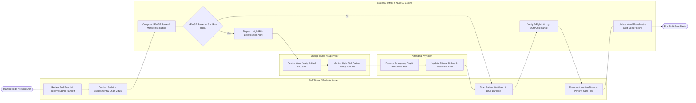

# Swimlane Diagram — Nursing Care Management System

## Mermaid Code

## Flow Description | Mô tả luồng

| Lane | Actor / Subsystem | Role in Flow |
|------|-------------------|--------------|
| 1 | Staff Nurse / Bedside Nurse | Receives SBAR shift handoff, performs physical bedside assessments, charts vital signs, executes Barcode Medication Administration (BCMA), and documents nursing progress notes. |
| 2 | System / eMAR & NEWS2 Engine | Computes NEWS2 early warning scores, evaluates Morse/Braden risk ratings, verifies 5-Rights barcode safety clearance, dispatches deterioration alerts, and updates electronic flowsheets. |
| 3 | Charge Nurse / Supervisor | Reviews overall ward patient acuity, balances nurse-to-patient shift workloads, and monitors high-risk safety bundle compliance (e.g., fall wristbands, pressure injury prevention). |
| 4 | Attending Physician | Receives rapid response deterioration alerts triggered by high NEWS2 scores, evaluates patient clinical status, and updates medical orders or treatment plans accordingly. |
