# Action Tree — Nursing Care Management System

## Mermaid Code

```mermaid
graph TD
    Root["Nursing Care Management System"]

    Root --> M1["Admission & Nursing Assessment"]
    Root --> M2["Nursing Care Plan Management"]
    Root --> M3["BCMA & eMAR Medication Safety"]
    Root --> M4["Vital Signs & NEWS2 Tracking"]
    Root --> M5["Fluid Balance & Intake/Output"]
    Root --> M6["Shift Handoff & SBAR Reporting"]
    Root --> M7["Call Bell & Emergency Alerting"]
    Root --> M8["Nursing Quality & Safety Analytics"]

    M1 --> A11["Conduct Physical Body System Audit"]
    M1 --> A12["Calculate Morse Fall Risk Scale"]
    M1 --> A13["Compute Braden Pressure Ulcer Score"]
    M1 --> A14["Document Pain & Allergy Baseline"]

    M2 --> A21["Select NANDA-I Nursing Diagnoses"]
    M2 --> A22["Define NOC Target Outcome Goals"]
    M2 --> A23["Assign NIC Nursing Interventions"]
    M2 --> A24["Evaluate Mid-Shift Goal Resolution"]

    M3 --> A31["Scan Patient Wristband 2D Barcode"]
    M3 --> A32["Scan Unit-Dose GTIN Drug Package"]
    M3 --> A33["Validate 5-Rights Safety Clearance"]
    M3 --> A34["Log Controlled Drug Partial Waste"]

    M4 --> A41["Chart Physiological Vital Parameters"]
    M4 --> A42["Auto-Compute NEWS2 Early Warning"]
    M4 --> A43["Trigger Rapid Response Team Alert"]
    M4 --> A44["Plot Graphical Vital Trends Chart"]

    M5 --> A51["Record Oral & IV Drip Fluid Intake"]
    M5 --> A52["Log Urine & Surgical Drain Output"]
    M5 --> A53["Calculate 24-Hour Net Fluid Balance"]
    M5 --> A54["Flag Fluid Overload Thresholds"]

    M6 --> A61["Generate Automated SBAR Draft"]
    M6 --> A62["Review Bedside Handoff Summary"]
    M6 --> A63["Co-Sign Electronic Handoff Token"]
    M6 --> A64["Reassign Shift Patient Load Board"]

    M7 --> A71["Receive Bedside Call Bell Push Alert"]
    M7 --> A72["Log Nurse Mobile Response Latency"]
    M7 --> A73["Escalate Unacknowledged Call Bells"]
    M7 --> A74["Trigger Code Blue Emergency Alert"]

    M8 --> A81["Analyze Ward BCMA Compliance Rate"]
    M8 --> A82["Track Hospital-Acquired Fall Rates"]
    M8 --> A83["Monitor Pressure Ulcer Incidence"]
    M8 --> A84["Calculate Nurse Workload Acuity Index"]
```

## Module Description | Mô tả Module

| # | Module | Description | Actions |
|---|--------|-------------|---------|
| 1 | Admission & Nursing Assessment | Conducts clinical admission assessments, Morse Fall Scale risk calculations, Braden Pressure Ulcer scoring, and allergy baseline charting. | Conduct Physical Body System Audit, Calculate Morse Fall Risk Scale, Compute Braden Pressure Ulcer Score, Document Pain & Allergy Baseline |
| 2 | Nursing Care Plan Management | Formulates, updates, and evaluates standardized NANDA-I nursing diagnoses, NOC target outcomes, and NIC intervention schedules. | Select NANDA-I Nursing Diagnoses, Define NOC Target Outcome Goals, Assign NIC Nursing Interventions, Evaluate Mid-Shift Goal Resolution |
| 3 | BCMA & eMAR Medication Safety | Verifies the 5 Rights of Medication Administration via 2D wristband and drug package scanning at bedside, logging eMAR administration. | Scan Patient Wristband 2D Barcode, Scan Unit-Dose GTIN Drug Package, Validate 5-Rights Safety Clearance, Log Controlled Drug Partial Waste |
| 4 | Vital Signs & NEWS2 Tracking | Charts vital parameters, automatically computes NEWS2 early warning scores, plots graphical trends, and triggers rapid response alerts. | Chart Physiological Vital Parameters, Auto-Compute NEWS2 Early Warning, Trigger Rapid Response Team Alert, Plot Graphical Vital Trends Chart |
| 5 | Fluid Balance & Intake/Output | Tracks oral/IV fluid intake and urine/drain output to calculate 24-hour cumulative net fluid balance and flag fluid overload. | Record Oral & IV Drip Fluid Intake, Log Urine & Surgical Drain Output, Calculate 24-Hour Net Fluid Balance, Flag Fluid Overload Thresholds |
| 6 | Shift Handoff & SBAR Reporting | Facilitates structured shift-to-shift handovers using the SBAR framework with mandatory dual electronic co-signatures. | Generate Automated SBAR Draft, Review Bedside Handoff Summary, Co-Sign Electronic Handoff Token, Reassign Shift Patient Load Board |
| 7 | Call Bell & Emergency Alerting | Receives bedside patient call bell notifications on nurse mobile devices, logs response times, and escalates emergency code alerts. | Receive Bedside Call Bell Push Alert, Log Nurse Mobile Response Latency, Escalate Unacknowledged Call Bells, Trigger Code Blue Emergency Alert |
| 8 | Nursing Quality & Safety Analytics | Analyzes ward BCMA compliance rates, inpatient fall rates, pressure ulcer incidence, nurse response times, and workload acuity indices. | Analyze Ward BCMA Compliance Rate, Track Hospital-Acquired Fall Rates, Monitor Pressure Ulcer Incidence, Calculate Nurse Workload Acuity Index |
