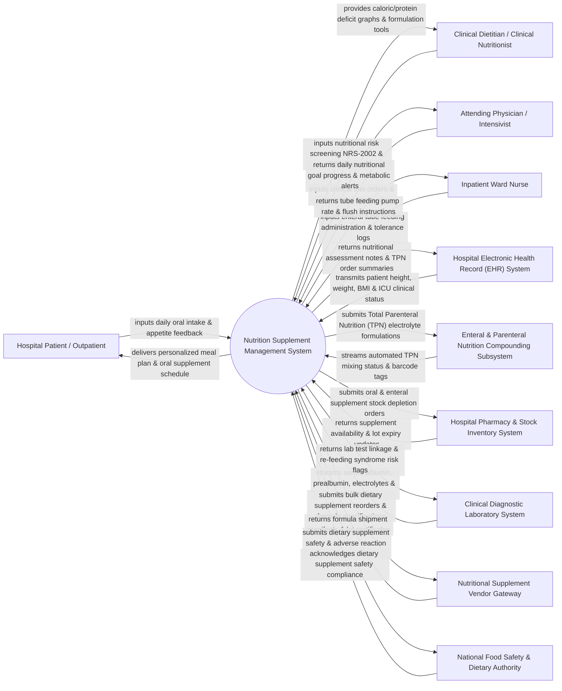

# Context Diagram — Nutrition Supplement Management System

## Mermaid Code

## Actor & Interaction Table | Bảng Actor & Tương tác

| # | Actor | Actor Type | Data Sent TO System | Data Received FROM System | Notes |
|---|-------|------------|---------------------|---------------------------|-------|
| 1 | Hospital Patient / Outpatient | Primary | Daily oral food intake, appetite rating scores, gastrointestinal tolerance feedback, taste preferences. | Personalized meal plans, oral nutritional supplement schedule, dietary education guidelines. | Inpatient or outpatient receiving clinical nutrition therapy, oral supplements, or enteral feeding support. |
| 2 | Clinical Dietitian / Clinical Nutritionist | Primary | Nutritional Risk Screening (NRS-2002 / MUST scores), Indirect Calorimetry targets, customized Enteral/TPN formulas, macro/micronutrient orders. | Caloric and protein deficit trend graphs, automated TPN osmolarity/stability calculators, re-feeding syndrome alerts. | Specialist healthcare professional designing, calculating, and monitoring clinical nutrition regimens. |
| 3 | Attending Physician / Intensivist | Primary | Clinical nutrition order authorizations, Parenteral Nutrition (TPN) approvals, fluid restriction limits. | Daily nutritional goal achievement %, metabolic lab trend alerts, re-feeding syndrome risk warnings. | Attending physician or ICU specialist authorizing complex parenteral nutrition and medical nutrition therapy. |
| 4 | Inpatient Ward Nurse | Primary | Enteral tube feeding infusion logs (mL/hr), gastric residual volume (GRV) checks, GI tolerance notes (nausea, diarrhea), water flushes. | Tube feeding pump rate guidelines, water flush schedules, enteral formula administration warnings. | Ward nurse administering oral supplements, tube feedings, and monitoring patient GI tolerance. |
| 5 | Hospital Electronic Health Record (EHR) System | Supporting | Patient height, weight, BMI, body surface area (BSA), active diagnoses, ICU admission status, NPO status. | Nutritional assessment notes, diet orders, TPN formulation summaries, daily caloric intake logs. | Main hospital EHR integrated via HL7 Nutrition/Order interfaces to exchange clinical patient data. |
| 6 | Enteral & Parenteral Nutrition Compounding Subsystem | Supporting | Automated compounding device (ACD) mixing status, barcode validation tags, final bag weight verification. | Total Parenteral Nutrition (TPN) multi-chamber electrolyte and amino acid formulations, compounding queue. | Central pharmacy automated compounding machine preparing sterile TPN bags and enteral formula mixes. |
| 7 | Hospital Pharmacy & Stock Inventory System | Supporting | Oral supplement stock levels, commercial enteral formula inventory, TPN amino acid/lipid emulsion stock, lot expiry dates. | Automated supplement depletion alerts, stock reorder requisitions, expired formula disposal logs. | Pharmacy software managing clinical nutrition products, commercial formulas, and parenteral components. |
| 8 | Clinical Diagnostic Laboratory System | Supporting | Serum albumin, prealbumin, transferrin, electrolytes (K, Mg, Phosphate), liver function tests, blood glucose. | Lab test linkage codes, priority lab re-test requests, re-feeding syndrome laboratory alert triggers. | Laboratory system streaming biochemical markers of nutritional status and metabolic tolerance. |
| 9 | Nutritional Supplement Vendor Gateway | Supporting | Special formula availability notes, bulk formula shipment manifests, certificate of analysis (COA) lot files. | Special formula purchase orders, customized enteral formula specifications, stock demand forecasts. | External commercial nutrition manufacturer (Abbott, Nestlé Health Science, Fresenius Kabi) supply gateway. |
| 10 | National Food Safety & Dietary Authority | Supporting / Regulatory | Mandated dietary supplement safety guidelines, special medical purpose food (FSMP) regulations, recall alerts. | Adverse dietary supplement reaction reports, medical food compliance audits, supplement safety logs. | Government regulatory agency monitoring food safety, special medical purpose foods (FSMP), and dietary supplements. |

## System Boundary Description | Mô tả Phạm vi Hệ thống

The **Nutrition Supplement Management System (NSMS)** is a specialized clinical nutrition and dietary management platform designed to perform nutritional risk screening, calculate caloric/protein requirements, formulate Enteral and Total Parenteral Nutrition (TPN), and track supplement dispensation.

**Inside System Scope:**
- Automated Nutritional Risk Screening (NRS-2002, MUST, Subjective Global Assessment - SGA).
- Predictive energy expenditure calculation (Mifflin-St Jeor, Harris-Benedict, Penn State equations) and Indirect Calorimetry data ingestion.
- Formulation and stability checking for Total Parenteral Nutrition (TPN) amino acids, dextrose, lipid emulsions, and electrolytes.
- Enteral feeding schedule design, gastric residual volume (GRV) tracking, and water flush management.
- Re-feeding Syndrome risk stratification (hypophosphatemia, hypokalemia alerts) and hospital supplement inventory integration.

**Outside System Scope:**
- Physical mechanical pumping of fluids through enteral feeding tubes or IV lines (handled by Infusion Pump hardware).
- Physical preparation of hot kitchen food meals (managed by Hospital Food Service Catering Systems).
- Direct chemical compounding of amino acid raw powders (performed by pharmaceutical manufacturers).
