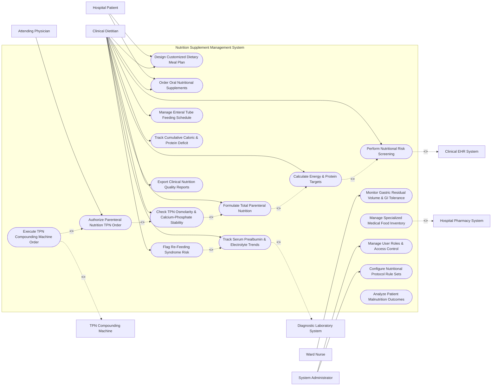

# Use Case Diagram — Nutrition Supplement Management System

## Mermaid Code

## Actor Table | Bảng Actor

| # | Actor | Actor Type | Role Description | Related Use Cases |
|---|-------|------------|------------------|-------------------|
| 1 | Hospital Patient | Primary | Inpatient or outpatient consuming oral meals, supplements, and self-reporting appetite. | UC03, UC04 |
| 2 | Clinical Dietitian | Primary | Nutrition specialist executing risk screening, calculating energy targets, formulating TPN/enteral orders, and tracking deficits. | UC01, UC02, UC03, UC04, UC05, UC06, UC07, UC09, UC10, UC13, UC15 |
| 3 | Attending Physician | Primary | Attending doctor or ICU intensivist reviewing and authorizing TPN parenteral nutrition orders. | UC11 |
| 4 | Ward Nurse | Primary | Bedside nurse administering enteral tube feedings and monitoring gastric residual volume (GRV). | UC08 |
| 5 | System Administrator | Primary | IT administrative user managing security roles, nutritional protocol rule sets, and system access. | UC16, UC17 |
| 6 | Clinical EHR System | System (Secondary) | Hospital EHR supplying patient height, weight, BMI, body surface area, and ICU status. | UC01 |
| 7 | TPN Compounding Machine | System (Secondary) | Automated compounding device (ACD) receiving electronic TPN electrolyte formulations for sterile mixing. | UC12 |
| 8 | Diagnostic Laboratory System | System (Secondary) | Clinical lab streaming serum prealbumin, albumin, potassium, phosphate, and liver enzymes. | UC13 |
| 9 | Hospital Pharmacy System | System (Secondary) | Pharmacy inventory platform managing oral supplements, commercial enteral formulas, and TPN stock. | UC14 |

## Use Case Table | Bảng Use Case

| # | UC ID | Use Case Name | Primary Actor | Secondary Actor | Description | Priority |
|---|-------|---------------|---------------|-----------------|-------------|----------|
| 1 | UC01 | Perform Nutritional Risk Screening | Dietitian | Clinical EHR | Screen inpatients using validated tools (NRS-2002, MUST, SGA) within 24 hours of admission. | High |
| 2 | UC02 | Calculate Energy & Protein Targets | Dietitian | None | Calculates baseline energy expenditure (kcal/day) and protein goals (g/kg/day) using predictive equations. | High |
| 3 | UC03 | Design Customized Dietary Meal Plan | Dietitian | Patient | Builds therapeutic meal plans (Low-Sodium, Renal, Diabetic, Dysphagia Puree) tailored to patient needs. | High |
| 4 | UC04 | Order Oral Nutritional Supplements | Dietitian | Patient | Prescribes targeted oral nutritional supplements (high-protein shakes, immunonutrition) between meals. | High |
| 5 | UC05 | Formulate Total Parenteral Nutrition | Dietitian | None | Calculates custom 2-in-1 or 3-in-1 Total Parenteral Nutrition (TPN) amino acids, dextrose, and lipid emulsions. | Critical |
| 6 | UC06 | Check TPN Osmolarity & Calcium-Phosphate Stability | Dietitian | None | Runs automated chemical stability algorithms to prevent calcium-phosphate precipitation and verify osmolarity. | Critical |
| 7 | UC07 | Manage Enteral Tube Feeding Schedule | Dietitian | None | Establishes enteral tube feeding regimens (continuous, cyclic, bolus), target pump rates (mL/hr), and flushes. | High |
| 8 | UC08 | Monitor Gastric Residual Volume & GI Tolerance | Nurse | None | Logs gastric residual volume (GRV) checks, abdominal distension, and gastrointestinal tolerance. | High |
| 9 | UC09 | Track Cumulative Caloric & Protein Deficit | Dietitian | None | Compares actual delivered calories/protein against prescribed targets to track cumulative energy deficit. | High |
| 10 | UC10 | Flag Re-Feeding Syndrome Risk | Dietitian | Diagnostic Lab | Analyzes serum phosphate, potassium, and magnesium drops to flag life-threatening Re-Feeding Syndrome risk. | Critical |
| 11 | UC11 | Authorize Parenteral Nutrition TPN Order | Physician | None | Physician review and cryptographic digital authorization of custom TPN orders before compounding. | High |
| 12 | UC12 | Execute TPN Compounding Machine Order | Dietitian | Compounding | Transmits electronic TPN formulation files to automated compounding machines for sterile mixing. | High |
| 13 | UC13 | Track Serum Prealbumin & Electrolyte Trends | Dietitian | Diagnostic Lab | Monitors laboratory nutritional biomarkers (Prealbumin, Albumin, Transferrin, Electrolytes) over time. | High |
| 14 | UC14 | Manage Specialized Medical Food Inventory | Dietitian | Pharmacy | Tracks commercial enteral formula stock, special medical purpose foods (FSMP), and lot expiration dates. | Medium |
| 15 | UC15 | Export Clinical Nutrition Quality Reports | Dietitian | None | Generates clinical quality indicator reports (malnutrition prevalence, time-to-nutrition start, TPN complications). | Medium |
| 16 | UC16 | Manage User Roles & Access Control | Admin | None | Configures user roles, dietitian credentials, and authorization levels for TPN prescribing. | High |
| 17 | UC17 | Configure Nutritional Protocol Rule Sets | Admin | Dietitian | Configures predictive energy equations, TPN electrolyte limits, and re-feeding risk rule parameters. | High |
| 18 | UC18 | Analyze Patient Malnutrition Outcomes | System | None | Evaluates length-of-stay and wound healing outcomes for patients receiving targeted nutrition therapy. | Medium |

## Use Case Specification | Đặc tả Use Case

---

### UC02 — Calculate Energy & Protein Targets

| Field | Detail |
|-------|--------|
| **UC ID** | UC02 |
| **Use Case Name** | Calculate Energy & Protein Targets |
| **Actor(s)** | Primary: Clinical Dietitian   Secondary: None |
| **Description** | Calculates patient resting energy expenditure (REE kcal/day) and daily protein requirements (g/kg/day) using validated predictive equations (Mifflin-St Jeor, Harris-Benedict, Penn State) or Indirect Calorimetry data. |
| **Precondition** | 1. Patient height, weight, age, and clinical diagnosis are imported from EHR (UC01). |
| **Main Flow** | 1. Dietitian opens "Energy & Protein Target Calculator" for target patient.   2. System retrieves patient parameters: Height 175 cm, Weight 70 kg, BMI 22.9 $kg/m^2$, Age 58, Gender Male, ICU Mechanical Ventilation = Yes.   3. Dietitian selects calculation methodology:   &nbsp;&nbsp;&nbsp;&nbsp; a. Predictive Equation (e.g., Penn State 2003 for ventilated ICU patients).   &nbsp;&nbsp;&nbsp;&nbsp; b. Weight-Based Method (e.g., 25-30 kcal/kg/day).   &nbsp;&nbsp;&nbsp;&nbsp; c. Indirect Calorimetry Measured REE (if metabolic cart data available).   4. Dietitian inputs Stress Factor (e.g., 1.3 for Severe Sepsis / Surgery).   5. System computes Energy Target: `2,150 kcal/day` (30.7 kcal/kg/day).   6. Dietitian specifies Protein Goal (e.g., 1.5 g/kg/day for critical illness); System computes Protein Target: `105 g protein/day`.   7. Dietitian confirms targets; System saves values into `NUTRITIONAL_TARGET_PROFILE`. |
| **Alternative Flow** | **AF1** — Obese Patient Hypocaloric High-Protein Target: Patient BMI is 38.5 $kg/m^2$; System automatically applies ASPEN Obese Critical Care Guidelines (11-14 kcal/kg actual weight or 22-25 kcal/kg ideal body weight, protein 2.0-2.5 g/kg IBW/day). |
| **Exception Flow** | **EX1** — Severe Renal Impairment / Dialysis Adjustment: Patient has Stage 5 CKD non-dialysis; System alerts "Renal Protein Restriction Recommended (0.6-0.8 g/kg/day)" and flags protein target override requirement. |
| **Postcondition** | Daily energy and protein target goals are calculated, saved, and used to evaluate feeding adequacy (UC09). |
| **Business Rule** | **BR1**: Energy target calculations for ICU ventilated patients must default to Penn State equations unless Indirect Calorimetry data is ingested. |

---

### UC05 — Formulate Total Parenteral Nutrition (TPN)

| Field | Detail |
|-------|--------|
| **UC ID** | UC05 |
| **Use Case Name** | Formulate Total Parenteral Nutrition (TPN) |
| **Actor(s)** | Primary: Clinical Dietitian   Secondary: None |
| **Description** | Calculates custom 2-in-1 or 3-in-1 Total Parenteral Nutrition (TPN) formulations detailing amino acid volume, dextrose concentration, lipid emulsions, electrolytes, trace elements, and vitamins. |
| **Precondition** | 1. Patient has an active indication for parenteral nutrition (NPO > 7 days or enteral failure).   2. Energy and protein target goals are calculated (UC02). |
| **Main Flow** | 1. Dietitian selects "Formulate Custom TPN" for target patient.   2. Dietitian selects Parenteral Bag Type: 3-in-1 Total Nutrition Admixture (TNA containing Amino Acids, Dextrose, Lipids) or 2-in-1 Bag + Separate Lipid.   3. Dietitian specifies Macronutrient Breakdown:   &nbsp;&nbsp;&nbsp;&nbsp; a. Amino Acids: 10% Amino Acid solution -> 105 g protein (1,050 mL).   &nbsp;&nbsp;&nbsp;&nbsp; b. Dextrose: 50% Dextrose solution -> 250 g dextrose (500 mL, 850 kcal, GIR = 2.4 mg/kg/min).   &nbsp;&nbsp;&nbsp;&nbsp; c. Lipid Emulsion: 20% Smooth Lipid Emulsion -> 50 g lipid (250 mL, 500 kcal).   4. Dietitian specifies Electrolytes per bag: Sodium, Potassium, Calcium, Magnesium, Phosphate, Chloride, Acetate.   5. Dietitian adds MVI (Multi-Vitamins), Trace Elements (Zinc, Copper, Selenium), and Insulin (if needed).   6. System calculates Total Fluid Volume (1,800 mL/day), Total Calories (1,920 kcal/day), Non-Protein Calorie-to-Nitrogen Ratio ($NPC:N = 115:1$), and Glucose Infusion Rate ($GIR = 2.4 \text{ mg/kg/min}$).   7. System automatically executes TPN Osmolarity & Calcium-Phosphate Stability Check (UC06).   8. Dietitian submits TPN formulation for Physician Authorization (UC11). |
| **Alternative Flow** | **AF1** — Peripheral Parenteral Nutrition (PPN): Infusion is via peripheral IV line; System caps maximum osmolarity at 900 mOsm/L and alerts if dextrose concentration exceeds 10%. |
| **Exception Flow** | **EX1** — Excessive Glucose Infusion Rate (GIR > 5 mg/kg/min): GIR exceeds 5.0 mg/kg/min, risking hepatic steatosis; System blocks formulation submit, displaying error "GIR Exceeds Max Limit (5.0 mg/kg/min) - Reduce Dextrose Concentration". |
| **Postcondition** | Custom TPN formulation is calculated, verified for chemical stability, and routed for physician authorization. |
| **Business Rule** | **BR1**: TPN dextrose infusion rates must maintain GIR $< 4.0 \text{ mg/kg/min}$ in critically ill patients to prevent hyperglycemia and fatty liver. |

---

### UC07 — Manage Enteral Tube Feeding Schedule

| Field | Detail |
|-------|--------|
| **UC ID** | UC07 |
| **Use Case Name** | Manage Enteral Tube Feeding Schedule |
| **Actor(s)** | Primary: Clinical Dietitian   Secondary: None |
| **Description** | Designs customized enteral tube feeding regimens (Continuous, Cyclic, Nocturnal, Bolus), selects commercial enteral formulas, calculates pump infusion rates (mL/hr), and defines water flush schedules. |
| **Precondition** | 1. Patient has a functional gastrointestinal tract and an active enteral access tube (NG-tube, NJ-tube, PEG, J-tube). |
| **Main Flow** | 1. Dietitian opens "Enteral Feeding Manager" module.   2. Dietitian selects Enteral Access Type (e.g., Nasogastric NG-Tube).   3. Dietitian selects Commercial Enteral Formula from formulary (e.g., High-Protein Calorie-Dense Formula: 1.5 kcal/mL, 63 g protein/L).   4. Dietitian selects Infusion Mode: Continuous 24-Hour Infusion.   5. System calculates target infusion rate to meet energy target (2,150 kcal):   &nbsp;&nbsp;&nbsp;&nbsp; `Target Volume = 2,150 kcal / 1.5 kcal/mL = 1,433 mL/day`.   &nbsp;&nbsp;&nbsp;&nbsp; `Target Infusion Rate = 1,433 mL / 24 hours = 60 mL/hr`.   6. Dietitian specifies Water Flush Schedule: 50 mL sterile water flush every 4 hours to maintain tube patency and meet fluid requirements.   7. Dietitian sets Initiation Progression Protocol: Start at 20 mL/hr, advance by 10 mL/hr every 6 hours as tolerated to target 60 mL/hr.   8. System generates Enteral Feeding Administration Order and dispatches order to Ward Nurse MAR (UC08). |
| **Alternative Flow** | **AF1** — Intermittent Bolus Feeding: Patient has mature PEG tube; Dietitian specifies Bolus Feeding: 250 mL formula via gravity syringe 5 times daily at 08:00, 11:00, 14:00, 17:00, 20:00. |
| **Exception Flow** | **EX1** — Post-Pyloric Jejunal Feeding Restriction: Tube is placed in Jejunum (J-tube); System blocks Bolus Feeding selection, alerting "Jejunal Tubes Require Continuous Pump Infusion Only - Bolus Feeding Prohibited". |
| **Postcondition** | Enteral tube feeding schedule is established, pump infusion rates are calculated, and nurse administration instructions are dispatched. |
| **Business Rule** | **BR1**: Post-pyloric jejunal feeding MUST be administered via continuous pump infusion to prevent dumping syndrome. |

---

### UC10 — Flag Re-Feeding Syndrome Risk

| Field | Detail |
|-------|--------|
| **UC ID** | UC10 |
| **Use Case Name** | Flag Re-Feeding Syndrome Risk |
| **Actor(s)** | Primary: Clinical Dietitian   Secondary: Diagnostic Laboratory System |
| **Description** | Analyzes patient nutritional baseline, prolonged starvation status, and incoming laboratory electrolyte trends (phosphate, potassium, magnesium) to flag life-threatening Re-Feeding Syndrome risk. |
| **Precondition** | 1. Patient has severe malnutrition, chronic alcoholism, anorexia nervosa, or NPO status $> 7$ days.   2. Laboratory electrolyte results are ingested continuously (UC13). |
| **Main Flow** | 1. System background surveillance engine scans newly ingested lab values for patients initiating nutrition therapy.   2. System evaluates Re-Feeding Risk Criteria (NICE Guidelines):   &nbsp;&nbsp;&nbsp;&nbsp; a. BMI $< 16.0 \text{ kg/m}^2$ OR unintended weight loss $> 15\%$ in 3-6 months.   &nbsp;&nbsp;&nbsp;&nbsp; b. Very little or no nutritional intake for $> 10$ days.   &nbsp;&nbsp;&nbsp;&nbsp; c. Low baseline serum phosphate, potassium, or magnesium prior to feeding.   3. System detects a rapid drop in serum phosphate (e.g., Phosphate drops from 1.1 mmol/L down to 0.45 mmol/L within 24 hours of starting TPN/Enteral feeding).   4. System flags high-priority alert `HIGH_RISK_REFEEDING_SYNDROME` on Dietitian and Physician dashboards.   5. System displays Clinical Intervention Protocol:   &nbsp;&nbsp;&nbsp;&nbsp; a. Reduce caloric intake to 10 kcal/kg/day immediately.   &nbsp;&nbsp;&nbsp;&nbsp; b. Administer IV Thiamine (200-300 mg daily) and High-Dose B-Complex.   &nbsp;&nbsp;&nbsp;&nbsp; c. Order urgent IV Phosphate & Potassium replacement.   6. Dietitian adjusts feeding rate down and orders electrolyte re-replacement protocol. |
| **Alternative Flow** | **AF1** — Prophylactic Re-Feeding Screening: Prior to starting feeding, System identifies high-risk patient, prompts pre-feeding IV Thiamine administration, and caps initial caloric intake at 50% target for 48 hours. |
| **Exception Flow** | **EX1** — Critical Hypophosphatemia ($< 0.3 \text{ mmol/L}$): Serum phosphate drops below critical threshold $0.3 \text{ mmol/L}$; System sounds audible alert, dispatches SMS to ICU Intensivist, and halts TPN dextrose infusion until IV phosphate is repleted. |
| **Postcondition** | Re-feeding syndrome risk is flagged, feeding rates are safely reduced, IV thiamine/electrolyte replacement is initiated, and patient safety is preserved. |
| **Business Rule** | **BR1**: Patients identified at high risk for re-feeding syndrome MUST receive prophylactic IV Thiamine BEFORE initiating caloric feeding. |

---

### UC12 — Execute TPN Compounding Machine Order

| Field | Detail |
|-------|--------|
| **UC ID** | UC12 |
| **Use Case Name** | Execute TPN Compounding Machine Order |
| **Actor(s)** | Primary: Clinical Dietitian   Secondary: TPN Compounding Machine |
| **Description** | Transmits authorized electronic Total Parenteral Nutrition (TPN) formulation files to central pharmacy automated compounding devices (ACD) for precise, sterile multi-chamber mixing. |
| **Precondition** | 1. Custom TPN formulation is verified for stability (UC06).   2. Order is digitally authorized by attending physician (UC11). |
| **Main Flow** | 1. System receives digital authorization token from Physician (UC11).   2. System updates TPN order status to `AUTHORIZED_FOR_COMPOUNDING`.   3. System formats TPN formulation payload into standardized automated compounder XML/HL7 file:   &nbsp;&nbsp;&nbsp;&nbsp; a. Amino acid volume, Dextrose volume, Lipid volume.   &nbsp;&nbsp;&nbsp;&nbsp; b. Exact milliequivalents (mEq) of Sodium, Potassium, Calcium, Magnesium, Phosphate.   &nbsp;&nbsp;&nbsp;&nbsp; c. Micro-additives (Trace elements, MVI, Insulin).   &nbsp;&nbsp;&nbsp;&nbsp; d. Patient Name, MRN, Ward Location, Expiration Timestamp.   4. System transmits compounding payload to TPN Compounding Machine Gateway.   5. Automated Compounder ingests file, verifies barcode lot numbers on chemical source containers, and executes micro-pumping sterile mixing into sterile TPN bag.   6. Compounder weighs final bag against target calculated weight (+/- 3% tolerance). Weight check passes.   7. Compounder prints 2D barcode label and returns compounding completion receipt (`COMPOUNDING_SUCCESS_200`) back to system. |
| **Alternative Flow** | **AF1** — Commercial Multi-Chamber Bag (MCB) Selection: Patient requires standard TPN; System selects pre-mixed commercial 3-in-1 bag, dispatches pick ticket to pharmacy, and bypasses automated compounder mixing. |
| **Exception Flow** | **EX1** — Gravimetric Weight Verification Error: Final TPN bag weight deviates by $> 3.5\%$ from calculated mass; Compounder halts process, flags "Compounding Weight Error - Potential Pumping Discrepancy", discards bag, and alerts pharmacy supervisor. |
| **Postcondition** | TPN bag is compounded, gravimetric weight is verified, 2D barcode label is printed, and sterile bag is dispatched to inpatient ward. |
| **Business Rule** | **BR1**: Automated TPN compounding MUST enforce gravimetric weight verification (+/- 3% tolerance) for every compounded parenteral nutrition bag. |
