# Conceptual ERD — Nutrition Supplement Management System

## Mermaid Code

```mermaid
erDiagram
    USER_ACCOUNT {
        int user_id PK
        string full_name
        string username
        string user_role
        string medical_license_no
        boolean is_active
    }

    PATIENT_NUTRITIONAL_PROFILE {
        int profile_id PK
        string patient_mrn
        string full_name
        decimal height_cm
        decimal weight_kg
        decimal bmi_value
        string npo_status
        datetime assessed_at
    }

    NUTRITIONAL_RISK_SCREENING {
        int screening_id PK
        int profile_id FK
        int dietitian_user_id FK
        string screening_tool_used
        int total_risk_score
        string malnutrition_risk_category
        datetime screened_at
    }

    NUTRITIONAL_TARGET_PROFILE {
        int target_id PK
        int profile_id FK
        int dietitian_user_id FK
        string calculation_method
        int target_energy_kcal_day
        decimal target_protein_g_day
        decimal protein_g_kg_day
        datetime calculated_at
    }

    THERAPEUTIC_MEAL_PLAN {
        int meal_plan_id PK
        int profile_id FK
        string diet_texture_type
        string dietary_restrictions
        text meal_schedule_instructions
        datetime prescribed_at
    }

    ORAL_SUPPLEMENT_ORDER {
        int supplement_order_id PK
        int profile_id FK
        string product_name
        string dose_volume_ml
        string administration_frequency
        datetime ordered_at
    }

    TPN_FORMULATION_RECORD {
        int tpn_id PK
        int profile_id FK
        int dietitian_user_id FK
        int physician_authorizer_id FK
        string bag_admixture_type
        int amino_acid_volume_ml
        int dextrose_volume_ml
        int lipid_volume_ml
        decimal calculated_osmolarity_mOsm_L
        boolean is_calcium_phosphate_stable
        string tpn_order_status
        datetime formulated_at
    }

    ENTERAL_FEEDING_SCHEDULE {
        int enteral_id PK
        int profile_id FK
        string tube_access_type
        string formula_product_name
        string infusion_mode
        int target_rate_ml_hr
        int water_flush_volume_ml
        datetime scheduled_at
    }

    GI_TOLERANCE_GRV_LOG {
        int grv_log_id PK
        int enteral_id FK
        int nurse_user_id FK
        int residual_volume_ml
        boolean is_abdominal_distension
        string gi_symptom_notes
        datetime recorded_at
    }

    REFEEDING_RISK_ALERT {
        int alert_id PK
        int profile_id FK
        decimal baseline_serum_phosphate
        decimal current_serum_phosphate
        string risk_severity_level
        boolean is_thiamine_prescribed
        datetime flagged_at
    }

    LABORATORY_BIOMARKER_LOG {
        int lab_log_id PK
        int profile_id FK
        decimal serum_prealbumin_mg_dL
        decimal serum_albumin_g_dL
        decimal serum_potassium_mmol_L
        decimal serum_phosphate_mmol_L
        decimal serum_magnesium_mmol_L
        datetime sampled_at
    }

    TPN_COMPOUNDING_JOB {
        int job_id PK
        int tpn_id FK
        string compounding_machine_code
        decimal target_bag_weight_grams
        decimal actual_bag_weight_grams
        string gravimetric_verification_status
        datetime compounded_at
    }

    PATIENT_NUTRITIONAL_PROFILE ||--o{ NUTRITIONAL_RISK_SCREENING : "screened via"
    PATIENT_NUTRITIONAL_PROFILE ||--o| NUTRITIONAL_TARGET_PROFILE : "assigned goals"
    PATIENT_NUTRITIONAL_PROFILE ||--o{ THERAPEUTIC_MEAL_PLAN : "prescribed"
    PATIENT_NUTRITIONAL_PROFILE ||--o{ ORAL_SUPPLEMENT_ORDER : "receives"
    PATIENT_NUTRITIONAL_PROFILE ||--o{ TPN_FORMULATION_RECORD : "formulated for"
    PATIENT_NUTRITIONAL_PROFILE ||--o{ ENTERAL_FEEDING_SCHEDULE : "fed via"
    PATIENT_NUTRITIONAL_PROFILE ||--o{ REFEEDING_RISK_ALERT : "evaluated for"
    PATIENT_NUTRITIONAL_PROFILE ||--o{ LABORATORY_BIOMARKER_LOG : "monitored by"
    ENTERAL_FEEDING_SCHEDULE ||--o{ GI_TOLERANCE_GRV_LOG : "monitored via"
    TPN_FORMULATION_RECORD ||--o| TPN_COMPOUNDING_JOB : "compounded in"
    USER_ACCOUNT ||--o{ NUTRITIONAL_RISK_SCREENING : "conducts"
    USER_ACCOUNT ||--o{ NUTRITIONAL_TARGET_PROFILE : "calculates"
    USER_ACCOUNT ||--o{ TPN_FORMULATION_RECORD : "formulates or authorizes"
    USER_ACCOUNT ||--o{ GI_TOLERANCE_GRV_LOG : "logs"
```

## Entity Description Table | Bảng mô tả Entity

| # | Entity Name | Vietnamese Name | Description | Key Attributes | Main Relationships |
|---|-------------|-----------------|-------------|----------------|-------------------|
| 1 | USER_ACCOUNT | Tài khoản Nguời dùng | Credentials and access roles for dietitians, physicians, nurses, and admins. | `user_id`, `username`, `user_role`, `medical_license_no` | Conducts `NUTRITIONAL_RISK_SCREENING`, calculates `NUTRITIONAL_TARGET_PROFILE`, formulates `TPN_FORMULATION_RECORD`. |
| 2 | PATIENT_NUTRITIONAL_PROFILE | Hồ sơ Dinh dưỡng Bệnh nhân | Height, weight, BMI, body surface area, NPO status, and clinical nutritional baseline data. | `profile_id`, `patient_mrn`, `full_name`, `height_cm`, `weight_kg`, `bmi_value` | Screened via `NUTRITIONAL_RISK_SCREENING`, assigned goals `NUTRITIONAL_TARGET_PROFILE`, formulated for `TPN_FORMULATION_RECORD`. |
| 3 | NUTRITIONAL_RISK_SCREENING | Đánh giá Rủi ro Dinh dưỡng | Standardized nutritional risk screening results (NRS-2002, MUST, SGA scores). | `screening_id`, `profile_id`, `dietitian_user_id`, `screening_tool_used`, `total_risk_score` | Belongs to `PATIENT_NUTRITIONAL_PROFILE`, conducted by `USER_ACCOUNT`. |
| 4 | NUTRITIONAL_TARGET_PROFILE | Mục tiêu Năng lượng & Protein | Calculated energy expenditure targets (kcal/day) and protein goals (g/day and g/kg/day). | `target_id`, `profile_id`, `dietitian_user_id`, `calculation_method`, `target_energy_kcal_day`, `target_protein_g_day` | Belongs to `PATIENT_NUTRITIONAL_PROFILE`, calculated by `USER_ACCOUNT`. |
| 5 | THERAPEUTIC_MEAL_PLAN | Kế hoạch Bữa ăn Điều trị | Therapeutic hospital meal plans (Diabetic, Renal, Low-Sodium, Dysphagia Puree) and texture rules. | `meal_plan_id`, `profile_id`, `diet_texture_type`, `dietary_restrictions`, `prescribed_at` | Belongs to `PATIENT_NUTRITIONAL_PROFILE`. |
| 6 | ORAL_SUPPLEMENT_ORDER | Đơn Bổ sung Dinh dưỡng Uống | Orders for oral nutritional supplements (high-protein shakes, immunonutrition drinks). | `supplement_order_id`, `profile_id`, `product_name`, `dose_volume_ml`, `ordered_at` | Belongs to `PATIENT_NUTRITIONAL_PROFILE`. |
| 7 | TPN_FORMULATION_RECORD | Đơn Dinh dưỡng Tĩnh mạch (TPN) | Customized Total Parenteral Nutrition (TPN) formulations detailing amino acid/dextrose/lipid volumes and stability. | `tpn_id`, `profile_id`, `dietitian_user_id`, `physician_authorizer_id`, `calculated_osmolarity_mOsm_L`, `tpn_order_status` | Belongs to `PATIENT_NUTRITIONAL_PROFILE`, compounded in `TPN_COMPOUNDING_JOB`, authorized by `USER_ACCOUNT`. |
| 8 | ENTERAL_FEEDING_SCHEDULE | Lịch Bơm Dinh dưỡng Tĩnh mạch | Enteral tube feeding regimens detailing tube type, formula product, infusion mode, and mL/hr rate. | `enteral_id`, `profile_id`, `tube_access_type`, `formula_product_name`, `target_rate_ml_hr` | Belongs to `PATIENT_NUTRITIONAL_PROFILE`, monitored via `GI_TOLERANCE_GRV_LOG`. |
| 9 | GI_TOLERANCE_GRV_LOG | Nhật ký Dịch Tồn vị dạ dày (GRV) | Bedside nurse logs of gastric residual volume (GRV), abdominal distension, and GI tolerance symptoms. | `grv_log_id`, `enteral_id`, `nurse_user_id`, `residual_volume_ml`, `is_abdominal_distension` | Belongs to `ENTERAL_FEEDING_SCHEDULE`, logged by `USER_ACCOUNT`. |
| 10 | REFEEDING_RISK_ALERT | Cảnh báo Hội chứng Re-Feeding | Surveillance alerts flagging rapid serum phosphate/potassium drops and re-feeding syndrome risk. | `alert_id`, `profile_id`, `baseline_serum_phosphate`, `current_serum_phosphate`, `risk_severity_level` | Belongs to `PATIENT_NUTRITIONAL_PROFILE`. |
| 11 | LABORATORY_BIOMARKER_LOG | Nhật ký Sinh hóa Dinh dưỡng | Laboratory values tracking serum prealbumin, albumin, potassium, phosphate, and magnesium over time. | `lab_log_id`, `profile_id`, `serum_prealbumin_mg_dL`, `serum_albumin_g_dL`, `serum_phosphate_mmol_L` | Belongs to `PATIENT_NUTRITIONAL_PROFILE`. |
| 12 | TPN_COMPOUNDING_JOB | Ca Pha chế TPN Tự động | Automated compounding device (ACD) execution logs tracking target vs actual TPN bag weight verification. | `job_id`, `tpn_id`, `compounding_machine_code`, `target_bag_weight_grams`, `gravimetric_verification_status` | Belongs to `TPN_FORMULATION_RECORD`. |

## Relationship Description | Mô tả Quan hệ

| # | From Entity | Cardinality | To Entity | Label | Business Explanation |
|---|-------------|-------------|-----------|-------|----------------------|
| 1 | PATIENT_NUTRITIONAL_PROFILE | 1 to 0..N | NUTRITIONAL_RISK_SCREENING | screened via | A patient nutritional profile is screened via nutritional risk screening tools. |
| 2 | PATIENT_NUTRITIONAL_PROFILE | 1 to 0..1 | NUTRITIONAL_TARGET_PROFILE | assigned goals | A patient nutritional profile is assigned energy and protein target goals. |
| 3 | PATIENT_NUTRITIONAL_PROFILE | 1 to 0..N | THERAPEUTIC_MEAL_PLAN | prescribed | A patient nutritional profile is prescribed therapeutic meal plans. |
| 4 | PATIENT_NUTRITIONAL_PROFILE | 1 to 0..N | ORAL_SUPPLEMENT_ORDER | receives | A patient nutritional profile receives oral nutritional supplement orders. |
| 5 | PATIENT_NUTRITIONAL_PROFILE | 1 to 0..N | TPN_FORMULATION_RECORD | formulated for | A patient nutritional profile has custom TPN formulations formulated. |
| 6 | PATIENT_NUTRITIONAL_PROFILE | 1 to 0..N | ENTERAL_FEEDING_SCHEDULE | fed via | A patient nutritional profile is fed via enteral tube feeding schedules. |
| 7 | PATIENT_NUTRITIONAL_PROFILE | 1 to 0..N | REFEEDING_RISK_ALERT | evaluated for | A patient nutritional profile is evaluated for re-feeding syndrome alerts. |
| 8 | PATIENT_NUTRITIONAL_PROFILE | 1 to 0..N | LABORATORY_BIOMARKER_LOG | monitored by | A patient nutritional profile is monitored by laboratory nutritional biomarkers. |
| 9 | ENTERAL_FEEDING_SCHEDULE | 1 to 0..N | GI_TOLERANCE_GRV_LOG | monitored via | An enteral feeding schedule is monitored via gastric residual volume (GRV) logs. |
| 10 | TPN_FORMULATION_RECORD | 1 to 0..1 | TPN_COMPOUNDING_JOB | compounded in | A TPN formulation record is compounded in automated compounding jobs. |
| 11 | USER_ACCOUNT | 1 to 0..N | NUTRITIONAL_RISK_SCREENING | conducts | A dietitian user account conducts nutritional risk screenings. |
| 12 | USER_ACCOUNT | 1 to 0..N | NUTRITIONAL_TARGET_PROFILE | calculates | A dietitian user account calculates energy and protein target goals. |
| 13 | USER_ACCOUNT | 1 to 0..N | TPN_FORMULATION_RECORD | formulates or authorizes | A dietitian formulates or a physician authorizes custom TPN orders. |
| 14 | USER_ACCOUNT | 1 to 0..N | GI_TOLERANCE_GRV_LOG | logs | A nurse user account logs gastric residual volume (GRV) checks. |
