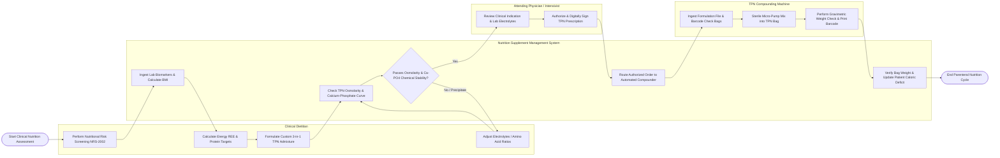

# Swimlane Diagram — Nutrition Supplement Management System

## Mermaid Code

## Flow Description | Mô tả luồng

| Lane | Actor | Role in Flow |
|------|-------|-------------|
| 1 | Clinical Dietitian | Conducts nutritional risk screenings (NRS-2002), calculates resting energy expenditure (REE) and protein targets, formulates custom TPN admixtures, and adjusts electrolyte ratios. |
| 2 | Nutrition Supplement Management System | Ingests laboratory biomarkers, calculates BMI, checks TPN osmolarity and calcium-phosphate solubility stability curves, routes authorized orders, and tracks cumulative energy deficits. |
| 3 | Attending Physician / Intensivist | Reviews clinical indications for parenteral nutrition, evaluates serum lab electrolytes, and authorizes custom TPN prescriptions with digital signatures. |
| 4 | TPN Compounding Machine | Ingests electronic formulation files, validates raw container barcodes, executes micro-pump sterile mixing into TPN bags, and verifies gravimetric bag weight. |
