# Action Tree — Nutrition Supplement Management System

## Mermaid Code

```mermaid
graph TD
    Root["Nutrition Supplement Management System"]

    Root --> M1["Nutritional Screening & Target Calculation"]
    Root --> M2["Total Parenteral Nutrition (TPN) Formulation"]
    Root --> M3["Enteral Tube Feeding & GI Tolerance"]
    Root --> M4["Metabolic Surveillance & Re-Feeding Risk"]
    Root --> M5["TPN Compounding & Pharmacy Inventory"]
    Root --> M6["Quality Analytics & Clinical Outcomes"]

    M1 --> A11["Perform NRS-2002, MUST & SGA Risk Screenings"]
    M1 --> A12["Calculate Energy REE via Penn State & Mifflin Equations"]
    M1 --> A13["Set Stress-Adjusted Daily Protein Goals (g/kg/day)"]
    M1 --> A14["Ingest Indirect Calorimetry Measured REE Data"]

    M2 --> A21["Formulate Custom 2-in-1 & 3-in-1 TPN Admixtures"]
    M2 --> A22["Check Calcium-Phosphate Chemical Solubility Curves"]
    M2 --> A23["Verify Peripheral IV Osmolarity Limits (900 mOsm/L)"]
    M2 --> A24["Obtain Digital Physician Authorization Sign-Offs"]

    M3 --> A31["Select Commercial Enteral Formulas from Formulary"]
    M3 --> A32["Calculate Enteral Pump Infusion Rates (mL/hr)"]
    M3 --> A33["Schedule Water Flush Volume & Frequency"]
    M3 --> A34["Log Bedside Gastric Residual Volume (GRV) Checks"]

    M4 --> A41["Monitor Serum Phosphate, Potassium & Magnesium"]
    M4 --> A42["Flag Life-Threatening Re-Feeding Syndrome Risk"]
    M4 --> A43["Enforce Prophylactic IV Thiamine Administration"]
    M4 --> A44["Track Cumulative Caloric & Protein Energy Deficits"]

    M5 --> A51["Transmit Formulation Files to Automated Compounders"]
    M5 --> A52["Verify Gravimetric Final TPN Bag Weights (+/- 3%)"]
    M5 --> A53["Manage Special Medical Purpose Foods (FSMP) Stock"]
    M5 --> A54["Track Oral Nutritional Supplement Expiration Dates"]

    M6 --> A61["Export Hospital Malnutrition Prevalence Indicators"]
    M6 --> A62["Analyze ICU Length of Stay vs Nutrition Support"]
    M6 --> A63["Audit TPN Central-Line Complication Rates"]
    M6 --> A64["Generate Clinical Nutrition Department Quality Reports"]
```

## Module Description | Mô tả Module

| # | Module | Description | Actions |
|---|--------|-------------|---------|
| 1 | Nutritional Screening & Target Calculation | Executes risk screenings (NRS-2002, MUST, SGA), calculates energy expenditure targets (kcal/day), protein goals, and ingests metabolic cart data. | Perform Risk Screenings, Calculate Energy REE, Set Protein Goals, Ingest Indirect Calorimetry Data. |
| 2 | Total Parenteral Nutrition (TPN) Formulation | Formulates 2-in-1 and 3-in-1 TPN mixtures, evaluates calcium-phosphate solubility curves, verifies osmolarity limits, and gets physician sign-offs. | Formulate Custom TPN Admixtures, Check Solubility Curves, Verify Osmolarity Limits, Obtain Physician Sign-Offs. |
| 3 | Enteral Tube Feeding & GI Tolerance | Selects commercial enteral formulas, calculates pump infusion rates (mL/hr), schedules water flushes, and logs gastric residual volumes (GRV). | Select Enteral Formulas, Calculate Pump Infusion Rates, Schedule Water Flushes, Log Gastric Residual Volumes. |
| 4 | Metabolic Surveillance & Re-Feeding Risk | Tracks serum electrolytes (phosphate, potassium, magnesium), flags Re-Feeding Syndrome risk, enforces IV Thiamine, and calculates energy deficits. | Monitor Serum Electrolytes, Flag Re-Feeding Syndrome Risk, Enforce IV Thiamine, Track Energy Deficits. |
| 5 | TPN Compounding & Pharmacy Inventory | Transmits electronic formulation files to automated compounders, verifies gravimetric bag weights (+/- 3%), and manages specialized medical foods. | Transmit Files to Compounders, Verify Bag Weights, Manage FSMP Stock, Track Supplement Expirations. |
| 6 | Quality Analytics & Clinical Outcomes | Aggregates hospital malnutrition prevalence metrics, evaluates ICU length of stay outcomes, audits TPN complication rates, and exports reports. | Export Malnutrition Indicators, Analyze ICU Length of Stay, Audit TPN Complications, Generate Quality Reports. |
