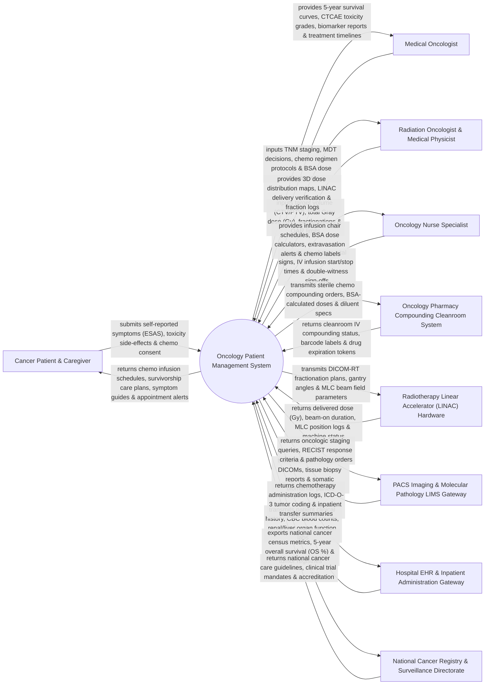

# Context Diagram — Oncology Patient Management System

## Mermaid Code

## Actor & Interaction Table | Bảng Actor & Tương tác

| # | Actor | Actor Type | Data Sent TO System | Data Received FROM System | Notes |
|---|-------|------------|---------------------|---------------------------|-------|
| 1 | Cancer Patient & Caregiver | Primary | Edmonton Symptom Assessment System (ESAS) scores, adverse event self-reports, chemotherapy consents. | Chemotherapy infusion calendar, survivorship care plan, symptom management guides, appointment reminders. | Patient diagnosed with solid tumors or hematologic malignancies receiving cancer therapy. |
| 2 | Medical Oncologist | Primary | TNM staging (AJCC 8th ed), MDT tumor board decisions, chemotherapy regimen protocols (FOLFOX, AC-T), BSA dose modifications. | 5-Year Kaplan-Meier survival curves, CTCAE adverse event logs, biomarker reports, treatment timelines. | Specialist physician managing systemic cancer therapy, chemotherapy regimens, and immunotherapy. |
| 3 | Radiation Oncologist & Medical Physicist | Primary | Target Volume (CTV/PTV), total prescribed Gray dose (Gy), fractionation schedules, Organ-at-Risk (OAR) constraints. | 3D Dose Distribution maps, LINAC delivery verification, cumulative fraction logs, DVH histograms. | Specialist physician and physicist planning and delivering external beam radiotherapy or brachytherapy. |
| 4 | Oncology Nurse Specialist | Primary | Pre-chemo baseline vitals, IV infusion start/stop timestamps, double-witness safety checks, extravasation logs. | Infusion chair assignment roster, BSA dose calculator, extravasation emergency protocols, IV labels. | Nurse specialized in safe intravenous chemotherapy administration, central line maintenance, and symptom care. |
| 5 | Oncology Pharmacy Compounding Cleanroom System | Supporting System | IV compounding verification status, sterile IV bag barcodes, chemotherapy drug lot expiration tokens. | Sterile IV compounding orders, BSA-calculated drug doses (mg), diluent volume specs (NS/D5W). | Automated cleanroom isolator/robot system compounding cytotoxic chemotherapy intravenous infusions. |
| 6 | Radiotherapy LINAC Hardware | Supporting System | Delivered radiation dose (Gy), beam-on duration, Multi-Leaf Collimator (MLC) position logs, machine status. | DICOM-RT fractionation treatment plans, gantry rotation angles, MLC beam field parameters. | Medical linear accelerator hardware (Varian, Elekta) delivering high-energy photon beam radiotherapy. |
| 7 | PACS Imaging & Molecular Pathology LIMS Gateway | Supporting System | PET-CT / MRI DICOM scans, histopathology biopsy reports, somatic biomarker panels (EGFR, ALK, PD-L1). | Oncologic staging queries, RECIST 1.1 tumor response criteria evaluation, molecular pathology orders. | Enterprise PACS and LIMS providing diagnostic imaging and molecular biomarker testing for oncology. |
| 8 | Hospital EHR & Inpatient Administration Gateway | Supporting System | Patient clinical histories, Complete Blood Count (CBC / ANC), renal/hepatic lab function panels (CrCl, ALT/AST). | Chemotherapy administration logs, ICD-O-3 tumor classification coding, inpatient transfer summaries. | Hospital information system linking lab medicine, inpatient oncology wards, and outpatient clinics. |
| 9 | National Cancer Registry & Surveillance Directorate | Regulatory | National cancer treatment guidelines, clinical trial enrollment mandates, quality benchmarks. | National cancer census statistics, 5-year overall survival (OS %), incidence rates by primary site. | Government health authority tracking national cancer epidemiology and treatment outcomes. |

## System Boundary Description | Mô tả Phạm vi Hệ thống

The **Oncology Patient Management System (OPMS)** is an enterprise clinical oncology, cancer registry, Multidisciplinary Tumor Board (MDT), chemotherapy infusion, and radiotherapy planning platform. Operating across cancer hospitals, oncology departments, infusion suites, and radiation therapy centers, it manages AJCC 8th edition TNM staging, MDT consensus decisions, chemotherapy protocol building (FOLFOX, AC-T, KEYNOTE), Body Surface Area (BSA m²) dose calculations, double-witness IV infusion verification, linear accelerator (LINAC) radiotherapy DICOM-RT fractionation tracking, somatic biomarker matching (EGFR, ALK, PD-L1), CTCAE toxicity monitoring, and cancer survivorship plans.

**Inside System Scope:**
- AJCC 8th edition TNM staging, ICD-O-3 morphology coding, and ECOG Performance Status (0-4) tracking.
- Multidisciplinary Tumor Board (MDT) meeting management, case presentations, and consensus treatment plan logging.
- Chemotherapy regimen protocol library (Standardized protocols e.g., FOLFOX, AC-T, TCH, KEYNOTE) with BSA (Mosteller formula) dose calculations.
- Dose reduction rules based on Absolute Neutrophil Count (ANC < 1.5 x 10⁹/L), Platelets, and renal/hepatic impairment.
- Outpatient infusion chair scheduling, double-witness nurse verification, and IV bag barcode scanning.
- DICOM-RT radiotherapy plan management (Target volume CTV/PTV, total Gy dose, fraction count, OAR constraints, and LINAC delivery tracking).
- Somatic biomarker profile matching (EGFR, ALK, BRAF, HER2, PD-L1 TPS %) for targeted therapies and immunotherapies.
- CTCAE v5.0 adverse event toxicity grading (Grade 1-5) and Edmonton Symptom Assessment (ESAS).
- Cancer survivorship care plan generation, recurrence risk tracking, and National Cancer Registry export.

**Outside System Scope:**
- Physical manufacturing of chemotherapy raw chemical active ingredients (handled by pharmaceutical manufacturers).
- Physical mechanical maintenance of linear accelerator gantries or vacuum pumps (handled by LINAC vendors).
- General non-cancer routine outpatient consultations (handled by General OPD).
- Commercial corporate financial general ledger accounting (handled by enterprise ERP).
