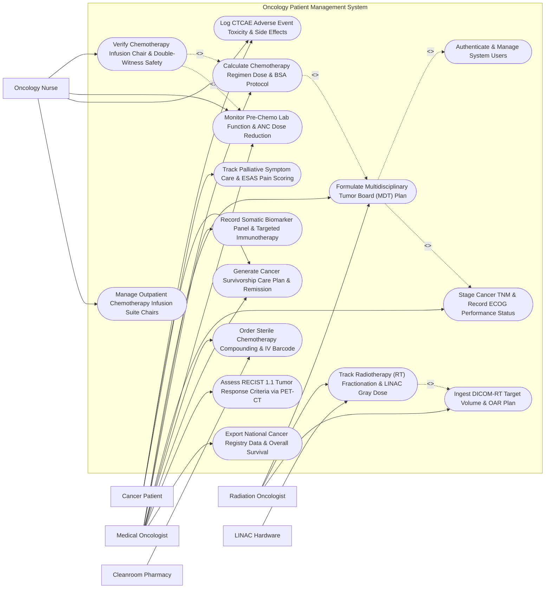

# Use Case Diagram — Oncology Patient Management System

## Mermaid Code

## Actor Table | Bảng Actor

| # | Actor | Actor Type | Role Description | Related Use Cases |
|---|-------|------------|------------------|-------------------|
| 1 | Cancer Patient | Primary | Patient undergoing cancer therapy, reporting symptoms, viewing survivorship care plans, and attending infusion visits. | UC08, UC11, UC14 |
| 2 | Medical Oncologist | Primary | Specialist physician leading tumor boards, staging cancer, prescribing chemotherapy regimens, and matching targeted therapies. | UC01, UC02, UC05, UC06, UC07, UC10, UC11, UC12, UC15 |
| 3 | Radiation Oncologist | Primary | Specialist physician planning radiotherapy target volumes (CTV/PTV), prescribing Gray doses, and verifying LINAC fractions. | UC01, UC04, UC09 |
| 4 | Oncology Nurse | Primary | Nurse specialized in chemotherapy safety, conducting double-witness verification, managing infusion chairs, and logging toxicity. | UC03, UC07, UC08, UC13 |
| 5 | LINAC Hardware | Secondary / System | Medical linear accelerator hardware streaming delivered radiation doses (Gy) and Multi-Leaf Collimator (MLC) positions. | UC04 |
| 6 | Cleanroom Pharmacy | Secondary / System | Automated IV compounding isolator system preparing sterile cytotoxic chemotherapy bags and printing barcode labels. | UC10 |

## Use Case Table | Bảng Use Case

| # | UC ID | Use Case Name | Primary Actor | Secondary Actor | Description | Priority |
|---|-------|---------------|---------------|-----------------|-------------|----------|
| 1 | UC01 | Formulate Multidisciplinary Tumor Board (MDT) Plan | Medical Oncologist | Radiation Oncologist | Conduct MDT tumor board meeting, present case imaging/pathology, and log consensus multimodal treatment plan (Surgery + Chemo + RT). | High |
| 2 | UC02 | Calculate Chemotherapy Regimen Dose & BSA Protocol | Medical Oncologist | None | Select standardized chemotherapy protocol (FOLFOX, AC-T, KEYNOTE), calculate BSA (Mosteller formula), and adjust doses for organ impairment. | High |
| 3 | UC03 | Verify Chemotherapy Infusion Chair & Double-Witness Safety | Oncology Nurse | None | Execute mandatory double-witness nurse verification (patient ID, drug, dose, IV line), scan IV bag barcode, and manage infusion chair. | High |
| 4 | UC04 | Track Radiotherapy (RT) Fractionation & LINAC Gray Dose | Radiation Oncologist | LINAC Hardware | Ingest DICOM-RT plan, track daily radiation fractionations (e.g., 2.0 Gy/fraction x 30 = 60 Gy Total), and log LINAC machine delivery metrics. | High |
| 5 | UC05 | Record Somatic Biomarker Panel & Targeted Immunotherapy | Medical Oncologist | None | Record somatic biomarker test results (EGFR mutation, ALK fusion, PD-L1 TPS %), matching patient to targeted inhibitors or immunotherapy. | High |
| 6 | UC06 | Stage Cancer TNM & Record ECOG Performance Status | Medical Oncologist | None | Record AJCC 8th edition TNM staging (T1-T4, N0-N3, M0-M1), ICD-O-3 histology, and evaluate ECOG Performance Status (Grade 0 to 4). | High |
| 7 | UC07 | Monitor Pre-Chemo Lab Function & ANC Dose Reduction | Oncology Nurse | Medical Oncologist | Verify pre-chemo blood counts (Absolute Neutrophil Count ANC >= 1.5, Platelets >= 100), triggering auto-dose reduction if ANC < 1.5. | High |
| 8 | UC08 | Log CTCAE Adverse Event Toxicity & Side Effects | Oncology Nurse | Cancer Patient | Document chemotherapy and radiotherapy toxicity using NCI CTCAE v5.0 grading scale (Grade 1 Mild to Grade 5 Death), adjusting care. | High |
| 9 | UC09 | Ingest DICOM-RT Target Volume & OAR Plan | Radiation Oncologist | None | Import DICOM-RT structural sets, target volumes (GTV/CTV/PTV), Organ-at-Risk (OAR) constraints, and Dose-Volume Histograms (DVH). | Medium |
| 10 | UC10 | Order Sterile Chemotherapy Compounding & IV Barcode | Medical Oncologist | Cleanroom Pharmacy | Transmit approved chemotherapy drug orders to the cleanroom pharmacy isolator, generating IV bag barcodes with expiration times. | High |
| 11 | UC11 | Generate Cancer Survivorship Care Plan & Remission | Medical Oncologist | Cancer Patient | Render comprehensive post-treatment Survivorship Care Plan detailing treatment summary, potential late toxicities, and surveillance schedule. | Medium |
| 12 | UC12 | Assess RECIST 1.1 Tumor Response Criteria via PET-CT | Medical Oncologist | None | Evaluate radiologic treatment response using RECIST 1.1 criteria (Complete Response CR, Partial Response PR, Stable Disease SD, Progressive Disease PD). | Medium |
| 13 | UC13 | Manage Outpatient Chemotherapy Infusion Suite Chairs | Oncology Nurse | None | Schedule and monitor outpatient chemotherapy infusion suite chairs, tracking chair occupancy, infusion durations, and turnover. | Medium |
| 14 | UC14 | Track Palliative Symptom Care & ESAS Pain Scoring | Cancer Patient | Oncology Nurse | Capture Edmonton Symptom Assessment System (ESAS) 0-10 scores (Pain, Fatigue, Nausea, Depression), managing palliative care interventions. | Medium |
| 15 | UC15 | Export National Cancer Registry Data & Overall Survival | Medical Oncologist | None | Export de-identified cancer epidemiology data, treatment regimens, and 5-year Overall Survival (OS %) to the National Cancer Registry. | Medium |
| 16 | UC16 | Authenticate & Manage System Users | All Users | None | Enforce secure multi-factor authentication, role-based access control (Oncologist, Nurse, Physicist), and strict HIPAA privacy controls. | High |

## Use Case Specification | Đặc tả Use Case

---

### UC01 — Formulate Multidisciplinary Tumor Board (MDT) Plan

| Field | Detail |
|-------|--------|
| **UC ID** | UC01 |
| **Use Case Name** | Formulate Multidisciplinary Tumor Board (MDT) Plan |
| **Actor(s)** | Primary: Medical Oncologist   Secondary: Radiation Oncologist, Surgical Oncologist, Radiologist, Pathologist |
| **Description** | Conducts a Multidisciplinary Tumor Board (MDT) case review meeting, presenting patient diagnostic imaging (PET-CT/MRI), biopsy histopathology, TNM staging, and molecular biomarkers, formulating a consensus multimodal treatment plan (Neoadjuvant Chemotherapy -> Surgical Resection -> Adjuvant Radiotherapy + Immunotherapy). |
| **Precondition** | 1. Cancer patient profile, histopathology biopsy report, and PET-CT staging imaging are ingested in OPMS.   2. Multidisciplinary Tumor Board members are logged into the MDT module. |
| **Main Flow** | 1. The Lead Medical Oncologist presents Case `ONC-2026-08192` (Patient: Le Van T, Age 58, Male) at the Weekly Thoracic MDT Board.   2. The Radiologist reviews PET-CT Imaging: 3.8 cm primary mass in Right Upper Lobe + ipsilateral mediastinal lymph node involvement (N2) -> **T2a N2 M0**.   3. The Pathologist presents Biopsy Findings: Invasive Lung Adenocarcinoma, TTF-1 positive.   4. The System computes **AJCC 8th Edition Staging**: **Stage IIIA Non-Small Cell Lung Cancer (NSCLC)**.   5. The MDT Board evaluates Biomarker Status (UC05): *EGFR Exon 19 Deletion Positive*, *PD-L1 TPS = 45%*.   6. The Board formulates the **Consensus Multimodal Treatment Plan**:   &nbsp;&nbsp;&nbsp;&nbsp;- **Phase 1**: Neoadjuvant Targeted Therapy (*Osimertinib 80mg PO Daily* x 12 Weeks)   &nbsp;&nbsp;&nbsp;&nbsp;- **Phase 2**: Surgical Resection (Right Upper Lobectomy + Mediastinal Lymph Node Dissection)   &nbsp;&nbsp;&nbsp;&nbsp;- **Phase 3**: Adjuvant Radiotherapy (50.4 Gy / 28 Fractions) + Maintenance Targeted Therapy.   7. The Lead Oncologist signs the MDT Decision Record `MDT-2026-99182`; the System auto-populates treatment orders in the patient's master oncology chart. |
| **Alternative Flow** | **AF1** — Metastatic Palliative MDT Consensus: For Stage IV Metastatic Colorectal Cancer (T4 N2 M1b - Liver/Lung Met), MDT consensus orders Palliative Chemotherapy (FOLFOX + Bevacizumab) + Symptom Management (UC14).   **AF2** — Clinical Trial Enrollment Recommendation: MDT Board identifies eligibility for Phase III Targeted Immunotherapy Trial; System flags "Trial Eligible — Consent Pending". |
| **Exception Flow** | **EX1** — Discrepant Pathology / Radiology Staging Conflict: Radiologist calls M0 (No distant met) but MRI Brain shows suspicious 4mm cerebellar lesion; Board requests Contrast Brain MRI and defers final decision for 7 days.   **EX2** — Poor ECOG Performance Status (ECOG 3-4): Patient ECOG score is 3 (Bedridden > 50% of day); System flags "High Toxicity Risk — Systemic Chemo Contraindicated; Best Supportive Care Recommended". |
| **Postcondition** | MDT Decision MDT-2026-99182 is signed, AJCC Stage IIIA is locked, multimodal treatment plan phases (Targeted -> Surgery -> RT) are populated in master chart. |
| **Business Rule** | **BR1**: Multidisciplinary Tumor Board (MDT) treatment plans MUST be documented with consensus signatures from at least 3 core specialties (Medical Oncology, Surgical Oncology, Radiation Oncology).   **BR2**: Systemic chemotherapy or radical radiotherapy MUST NOT be initiated for complex Stage III/IV cancers without a recorded MDT consensus decision. |

---

### UC02 — Calculate Chemotherapy Regimen Dose & BSA Protocol

| Field | Detail |
|-------|--------|
| **UC ID** | UC02 |
| **Use Case Name** | Calculate Chemotherapy Regimen Dose & BSA Protocol |
| **Actor(s)** | Primary: Medical Oncologist |
| **Description** | Selects a standardized chemotherapy protocol from the oncology library (e.g., FOLFOX6, AC-T, TCH, KEYNOTE-042), automatically calculates Body Surface Area (BSA m²) using Mosteller/DuBois formulas, computes precise individual drug dosages (mg or mg/m²), and applies organ impairment dose reduction rules (Creatinine Clearance CrCl, Total Bilirubin). |
| **Precondition** | 1. MDT treatment plan (UC01) specifies systemic chemotherapy.   2. Current patient height (cm), weight (kg), and baseline renal/hepatic lab counts are recorded. |
| **Main Flow** | 1. The Medical Oncologist opens "Chemotherapy Regimen Builder" for Patient `ONC-2026-0412` (Stage III Colon Cancer).   2. The System ingests Current Physical Vitals: Height = 168 cm, Weight = 64 kg.   3. The System calculates **Body Surface Area (BSA)** via Mosteller Formula:   &nbsp;&nbsp;&nbsp;&nbsp;- $\text{BSA} = \sqrt{\frac{168 \times 64}{3600}} = \mathbf{1.73\text{ m}^2}$.   4. The Oncologist selects Standard Protocol: **mFOLFOX6 (Cycle 1 of 12, 14-Day Cycle)**.   5. The System auto-computes **Dosing Breakdown**:   &nbsp;&nbsp;&nbsp;&nbsp;- **Oxaliplatin**: $85\text{ mg/m}^2 \times 1.73\text{ m}^2 = \mathbf{147.0\text{ mg}}$ IV in D5W over 2 hours   &nbsp;&nbsp;&nbsp;&nbsp;- **Leucovorin (Folnic Acid)**: $400\text{ mg/m}^2 \times 1.73\text{ m}^2 = \mathbf{692.0\text{ mg}}$ IV over 2 hours   &nbsp;&nbsp;&nbsp;&nbsp;- **5-Fluorouracil (5-FU) Bolus**: $400\text{ mg/m}^2 \times 1.73\text{ m}^2 = \mathbf{692.0\text{ mg}}$ IV Push   &nbsp;&nbsp;&nbsp;&nbsp;- **5-FU Continuous Infusion**: $2400\text{ mg/m}^2 \times 1.73\text{ m}^2 = \mathbf{4152.0\text{ mg}}$ IV Infusion via CADD Pump over 46 hours.   6. The System checks **Organ Function Safety Rules**:   &nbsp;&nbsp;&nbsp;&nbsp;- Serum Creatinine = 0.9 mg/dL ($\text{CrCl} = 88\text{ mL/min} \to \text{Normal}$)   &nbsp;&nbsp;&nbsp;&nbsp;- Total Bilirubin = 0.8 mg/dL ($\text{Normal}$)   &nbsp;&nbsp;&nbsp;&nbsp;- Absolute Neutrophil Count ($\text{ANC} = 2.4 \times 10^9/\text{L} \to \text{PASSED}$).   7. The Oncologist signs Chemo Order `ORD-CHEMO-2026-9918`, routing order to Cleanroom Pharmacy (UC10) and Infusion Suite (UC03). |
| **Alternative Flow** | **AF1** — Renal Impairment Dose Reduction: Patient CrCl is 32 mL/min (Moderate Renal Impairment); System auto-applies a 25% dose reduction on Carboplatin (calculating Calvert Formula AUC 5).   **AF2** — Carboplatin Calvert Formula AUC Dosing: Oncologist prescribes Carboplatin; System computes Dose (mg) = $\text{Target AUC (5)} \times (\text{GFR} + 25) = 5 \times (65 + 25) = 450\text{ mg}$. |
| **Exception Flow** | **EX1** — Capped BSA Safety Override Warning: Patient weight is 135 kg (BSA = 2.48 m²); System flags "BSA > 2.0 m² Safety Cap Alert — Confirm Full Dose vs Cap at 2.0 m²".   **EX2** — Severe Neutropenia Chemo Hold (ANC < 1.0): ANC is 0.8 x 10⁹/L; System blocks chemo ordering with error "CRITICAL NEUTROPENIA — Chemo Cycle Held; Administer G-CSF Filgrastim". |
| **Postcondition** | BSA (1.73 m²) and mFOLFOX6 drug doses (Oxaliplatin 147mg, 5-FU 4152mg/46h) are calculated, organ safety checks pass, and chemo order is dispatched. |
| **Business Rule** | **BR1**: Chemotherapy drug calculations MUST be derived from validated Body Surface Area (BSA) or Calvert AUC formulas and verified against current patient body weight (< 7 days old).   **BR2**: Absolute Neutrophil Count (ANC) < 1.5 x 10⁹/L or Platelets < 100 x 10⁹/L MUST trigger an automated chemotherapy hold or protocol-defined dose reduction. |

---

### UC03 — Verify Chemotherapy Infusion Chair & Double-Witness Safety

| Field | Detail |
|-------|--------|
| **UC ID** | UC03 |
| **Use Case Name** | Verify Chemotherapy Infusion Chair & Double-Witness Safety |
| **Actor(s)** | Primary: Oncology Nurse |
| **Description** | Conducts mandatory independent double-witness safety verification (Primary Nurse + Witness Nurse) prior to chemotherapy administration—verifying patient identity, signed consent, pre-chemo lab clearance (ANC/Platelets), IV bag barcode, drug name, calculated dose (mg), IV route, infusion rate, and managing infusion chair assignments. |
| **Precondition** | 1. Chemotherapy order `ORD-CHEMO-2026-9918` is compounded by pharmacy (UC10) and delivered to infusion suite.   2. The Patient is seated in Outpatient Infusion Chair #04 with central line (Port-a-Cath) accessed. |
| **Main Flow** | 1. Primary Oncology Nurse opens "Chemotherapy Double-Witness Safety Checklist" for Patient `ONC-2026-0412` (Chair #04).   2. Primary Nurse scans Patient Wristband 2D Barcode (`PAT-2026-0412`).   3. Primary Nurse scans Compounded IV Chemotherapy Bag Barcode (`BAG-OXALI-99182`).   4. The System prompts **Independent Double-Witness Verification**:   &nbsp;&nbsp;&nbsp;&nbsp;- Witness Nurse scans badge (`NUR-WITNESS-0918`) to initiate co-verification.   5. Both Nurses cross-verify 7 Safety Checks on the dual-screen interface:   &nbsp;&nbsp;&nbsp;&nbsp;- 1. Patient Name & DOB: Le Van T (May 12, 1968) -> **Matched**   &nbsp;&nbsp;&nbsp;&nbsp;- 2. Drug Name: Oxaliplatin in 250mL D5W -> **Matched**   &nbsp;&nbsp;&nbsp;&nbsp;- 3. Dose: 147.0 mg -> **Matched**   &nbsp;&nbsp;&nbsp;&nbsp;- 4. Route: Intravenous (Central Line / Port-a-Cath) -> **Matched**   &nbsp;&nbsp;&nbsp;&nbsp;- 5. Infusion Rate: 125 mL/hr over 2 Hours -> **Matched**   &nbsp;&nbsp;&nbsp;&nbsp;- 6. Pre-Medication Administered: Ondansetron 8mg IV + Dexamethasone 10mg IV (Administered at 08:30 AM) -> **Verified**   &nbsp;&nbsp;&nbsp;&nbsp;- 7. Pre-Chemo Blood Clearance: ANC = 2.4, Platelets = 210 -> **Cleared**.   6. Primary Nurse and Witness Nurse enter digital PIN signatures.   7. The System unlocks the Infusion Pump Smart Interface, logs Start Time (09:00 AM), and monitors for extravasation or hypersensitivity reactions. |
| **Alternative Flow** | **AF1** — Continuous 5-FU Ambulatory CADD Pump Setup: Nurse sets up a 46-hour continuous elastomeric 5-FU infusion pump, verifying flow rate (2.0 mL/hr), educating patient on home pump management, and scheduling disconnect visit.   **AF2** — Hypersensitivity / Anaphylaxis Emergency Interruption: Patient develops acute flushing, shortness of breath, and rigors 10 minutes into Paclitaxel infusion; Nurse stops pump, taps "EMERGENCY CHEMO STOP", administers IV Diphenhydramine + Hydrocortisone, and alerts doctor. |
| **Exception Flow** | **EX1** — Barcode Mismatch / Wrong Patient Alert: Nurse accidentally scans IV bag intended for Chair #05; System flashes a RED Full-Screen Alert "CRITICAL SAFETY MISMATCH — IV Bag Barcode Does Not Match Patient".   **EX2** — Pre-Medication Skipped Block: Nurse attempts to start Oxaliplatin without logging pre-chemo antiemetic; System blocks pump unlock with error "Pre-Medication Antiemetic Required Prior to Infusion". |
| **Postcondition** | Double-witness verification (Primary + Witness Nurse) is signed, 7 safety checks pass, IV pump is unlocked, infusion start time (09:00 AM) is logged, and chair #04 is active. |
| **Business Rule** | **BR1**: High-alert cytotoxic chemotherapy administration MUST strictly mandate independent double-witness verification by two qualified oncology nurses prior to IV line connection.   **BR2**: Intravenous chemotherapy bags MUST be verified using barcode scanners matching patient wristband IDs against pharmacy compounding barcodes. |

---

### UC04 — Track Radiotherapy (RT) Fractionation & LINAC Gray Dose

| Field | Detail |
|-------|--------|
| **UC ID** | UC04 |
| **Use Case Name** | Track Radiotherapy (RT) Fractionation & LINAC Gray Dose |
| **Actor(s)** | Primary: Radiation Oncologist   Secondary: LINAC Hardware, Medical Physicist |
| **Description** | Ingests DICOM-RT treatment plans, tracks daily radiation fractionations (e.g., 2.0 Gy per fraction x 30 fractions = 60.0 Gy Total), verifies Multi-Leaf Collimator (MLC) beam alignment, logs linear accelerator (LINAC) machine dose delivery, and monitors cumulative Organ-at-Risk (OAR) dose limits. |
| **Precondition** | 1. DICOM-RT plan (UC09) with target volume (PTV) and OAR constraints is approved by Medical Physicist.   2. Patient is positioned on the LINAC treatment couch with thermoplastic immobilization mask. |
| **Main Flow** | 1. The Radiotherapy Technologist selects Patient `ONC-2026-08192` on the LINAC Control Console (`LINAC-VARIAN-01`).   2. The System ingests **Approved DICOM-RT Plan Parameters**:   &nbsp;&nbsp;&nbsp;&nbsp;- Target Volume: Right Upper Lobe PTV   &nbsp;&nbsp;&nbsp;&nbsp;- Total Prescribed Dose: **50.4 Gy** in 28 Fractions (1.8 Gy / Fraction)   &nbsp;&nbsp;&nbsp;&nbsp;- Current Session: **Fraction #12 of 28**   &nbsp;&nbsp;&nbsp;&nbsp;- Cumulative Delivered Dose to Date: **19.8 Gy**.   3. The Technologist executes **Cone-Beam CT (CBCT) Image Guidance (IGRT)**:   &nbsp;&nbsp;&nbsp;&nbsp;- Aligns 3D CBCT scan with planning CT -> Position correction offset = 1.2 mm -> **Couch Position Shift Applied**.   4. The LINAC Hardware delivers Fraction #12:   &nbsp;&nbsp;&nbsp;&nbsp;- Multi-Leaf Collimator (MLC) Shapes Beam Fields (Intensity-Modulated Radiation Therapy IMRT)   &nbsp;&nbsp;&nbsp;&nbsp;- Delivered Dose: **1.80 Gy** (Beam-On Time = 92 Seconds).   5. The LINAC streams dose delivery confirmation telemetry to OPMS.   6. The System updates cumulative dose to **21.6 Gy**, increments fraction count to 12/28, verifies Organ-at-Risk cumulative dose (Spinal Cord = 8.2 Gy < 45 Gy Limit -> **Safe**), and schedules Fraction #13. |
| **Alternative Flow** | **AF1** — Stereotactic Body Radiotherapy (SBRT) High-Dose Fractionation: For an isolated lung oligometastasis, Radiation Oncologist delivers SBRT 12.0 Gy / fraction x 4 fractions = 48.0 Gy Total using respiratory gating.   **AF2** — Brachytherapy High-Dose Rate (HDR) Tracking: For Cervical Cancer, Oncologist logs HDR Iridium-192 brachytherapy applicator dwell times and dose (7.0 Gy / fraction). |
| **Exception Flow** | **EX1** — Interrupted Beam Delivery / Machine Fault: LINAC experiences RF interlock fault at 1.1 Gy (0.7 Gy remaining); System logs "Partial Fraction Interrupted", enabling technologist to resume remaining 0.7 Gy after clearing fault.   **EX2** — Cumulative Spinal Cord OAR Limit Exceeded: Cumulative dose calculation predicts spinal cord will receive 47.2 Gy (> 45 Gy Limit); System blocks fraction delivery with error "OAR SPINAL CORD DOSE OVERLIMIT". |
| **Postcondition** | Fraction #12 (1.80 Gy) delivery is confirmed by LINAC telemetry, cumulative dose is updated to 21.6 Gy, OAR spinal cord dose is verified safe, and Fraction #13 is scheduled. |
| **Business Rule** | **BR1**: Daily radiotherapy fraction delivery MUST enforce Image-Guided Radiotherapy (IGRT / CBCT) position alignment verification prior to beam activation.   **BR2**: Cumulative radiation doses to Organs-at-Risk (OAR) (Spinal cord, Heart, Lungs) MUST be continuously recalculated and checked against radiobiological tolerance limits. |

---

### UC05 — Record Somatic Biomarker Panel & Targeted Immunotherapy

| Field | Detail |
|-------|--------|
| **UC ID** | UC05 |
| **Use Case Name** | Record Somatic Biomarker Panel & Targeted Immunotherapy |
| **Actor(s)** | Primary: Medical Oncologist |
| **Description** | Ingests Next-Generation Sequencing (NGS) somatic tumor biomarker panel results (EGFR, ALK, KRAS, BRAF, ROS1, BRCA1/2, HER2/neu, MSI-High, TMB), records Programmed Death-Ligand 1 (PD-L1) Tumor Proportion Score (TPS %), matches actionable genomic alterations to FDA-approved targeted kinase inhibitors or immune checkpoint inhibitors, and tracks treatment response. |
| **Precondition** | 1. Molecular pathology tissue or liquid biopsy sequencing report is completed.   2. The Medical Oncologist opens the Biomarker & Precision Oncology module. |
| **Main Flow** | 1. The Medical Oncologist opens "Somatic Biomarker & Precision Oncology Profile" for Patient `ONC-2026-08192` (Stage IIIA Lung Adenocarcinoma).   2. The System ingests **NGS Genomic Panel Results**:   &nbsp;&nbsp;&nbsp;&nbsp;- Test Platform: FoundationOne CDx (324 Gene Panel)   &nbsp;&nbsp;&nbsp;&nbsp;- Primary Alteration: **EGFR Exon 19 Deletion (p.L747_P753del)** -> *Actionable Somatic Driver Mutation*   &nbsp;&nbsp;&nbsp;&nbsp;- ALK Fusion: Negative   &nbsp;&nbsp;&nbsp;&nbsp;- ROS1 Rearrangement: Negative   &nbsp;&nbsp;&nbsp;&nbsp;- KRAS: Wild-Type   &nbsp;&nbsp;&nbsp;&nbsp;- **PD-L1 Immunohistochemistry (IHC 22C3)**: **TPS = 65%** (High Expression >= 50%)   &nbsp;&nbsp;&nbsp;&nbsp;- Tumor Mutational Burden (TMB): 4.2 Muts/Mb (Low)   &nbsp;&nbsp;&nbsp;&nbsp;- Microsatellite Instability (MSI): Stable (MSS).   3. The **Precision Oncology Matching Engine** cross-references clinical NCCN guidelines:   &nbsp;&nbsp;&nbsp;&nbsp;- **Match 1 (First-Line Targeted Therapy)**: 3rd Generation EGFR TKI — **Osimertinib (Tagrisso) 80mg PO Daily** (Level 1A Evidence)   &nbsp;&nbsp;&nbsp;&nbsp;- **Match 2 (Immune Checkpoint Inhibitor)**: Anti-PD-1 Monoclonal Antibody — **Pembrolizumab (Keytruda)** (TPS > 50% Match).   4. The Oncologist selects **Osimertinib 80mg PO Daily** as First-Line Targeted Therapy based on EGFR Exon 19 Deletion.   5. The System populates the prescription, schedules 4-week liver function (ALT/AST) and QTc ECG monitoring, and flags the biomarker profile in the master oncology record. |
| **Alternative Flow** | **AF1** — MSI-High / Mismatch Repair Deficient (dMMR) Agnostic Match: Biomarker shows MSI-High in Gastric Cancer; System matches Pembrolizumab immunotherapy under tissue-agnostic FDA approval.   **AF2** — HER2/neu Positive Breast Cancer Targeted Therapy: IHC 3+ HER2 positive breast cancer; System matches Dual HER2 Targeted Blockade (Trastuzumab + Pertuzumab + Docetaxel). |
| **Exception Flow** | **EX1** — Resistance Mutation Detection (EGFR T790M or C797S): Patient progresses after 18 months on 1st Gen TKI; NGS reveals T790M resistance mutation; System recommends switching to 3rd Gen TKI.   **EX2** — VUS (Variant of Uncertain Significance) Classification: NGS reports a VUS in TP53; System flags "VUS — No Approved Targeted Therapy Available; Standard Chemotherapy Indicated". |
| **Postcondition** | Somatic biomarker profile (EGFR Exon 19 Del, PD-L1 65%) is recorded, 1st Line Targeted Therapy (Osimertinib 80mg) is matched, and targeted prescription is issued. |
| **Business Rule** | **BR1**: Targeted kinase inhibitors or immune checkpoint inhibitors MUST NOT be ordered without a confirmed, accredited somatic biomarker laboratory report.   **BR2**: Clinical decision support MUST display NCCN/ESMO evidence level ratings (Level 1A to Level 2B) alongside matched targeted drug recommendations. |
