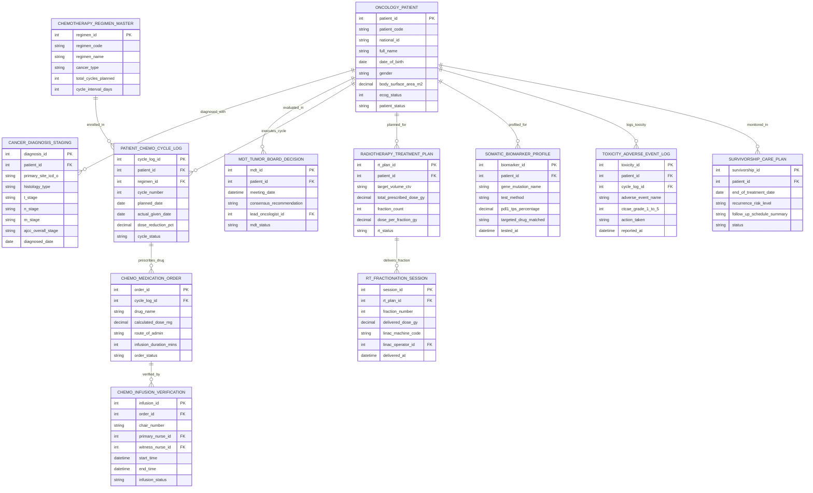

# Conceptual ERD — Oncology Patient Management System

## Mermaid Code

## Entity Description Table | Bảng mô tả Entity

| # | Entity Name | Vietnamese Name | Description | Key Attributes | Main Relationships |
|---|-------------|-----------------|-------------|----------------|-------------------|
| 1 | ONCOLOGY_PATIENT | Bệnh nhân Ung thư Master | Master oncology patient record storing patient code, national ID, full name, DOB, gender, BSA m², ECOG status (0-4), and status. | patient_id, patient_code, national_id, full_name, dob, gender, body_surface_area_m2, ecog_status, patient_status | Has DIAGNOSIS, MDT, CHEMO_CYCLE, RT_PLAN, BIOMARKER, TOXICITY, SURVIVORSHIP. |
| 2 | CANCER_DIAGNOSIS_STAGING | Chẩn đoán & Phân loại TNM | Cancer diagnosis and staging record storing primary site ICD-O-3, histology type, T stage, N stage, M stage, AJCC overall stage, and date. | diagnosis_id, patient_id, primary_site_icd_o, histology_type, t_stage, n_stage, m_stage, ajcc_overall_stage, diagnosed_date | Belongs to ONCOLOGY_PATIENT. |
| 3 | MDT_TUMOR_BOARD_DECISION | Quyết định Hội chẩn MDT | Multidisciplinary Tumor Board meeting decision record tracking meeting date, consensus recommendation, lead oncologist ID, and status. | mdt_id, patient_id, meeting_date, consensus_recommendation, lead_oncologist_id, mdt_status | Belongs to ONCOLOGY_PATIENT. |
| 4 | CHEMOTHERAPY_REGIMEN_MASTER | Danh mục Phác đồ Hóa trị | Chemotherapy protocol master record storing regimen code, regimen name (FOLFOX, AC-T), cancer type, total cycles planned, and cycle interval. | regimen_id, regimen_code, regimen_name, cancer_type, total_cycles_planned, cycle_interval_days | Has PATIENT_CHEMO_CYCLE_LOG. |
| 5 | PATIENT_CHEMO_CYCLE_LOG | Chu kỳ Hóa trị Bệnh nhân | Patient chemotherapy cycle log tracking patient ID, regimen ID, cycle number, planned date, actual date, dose reduction %, and status. | cycle_log_id, patient_id, regimen_id, cycle_number, planned_date, actual_given_date, dose_reduction_pct, cycle_status | Belongs to ONCOLOGY_PATIENT and CHEMOTHERAPY_REGIMEN_MASTER; Has CHEMO_MEDICATION_ORDER. |
| 6 | CHEMO_MEDICATION_ORDER | Chỉ định Thuốc Hóa trị | Specific chemotherapy drug order tracking cycle log ID, drug name (Oxaliplatin, 5-FU), BSA-calculated dose mg, route, duration mins, and status. | order_id, cycle_log_id, drug_name, calculated_dose_mg, route_of_admin, infusion_duration_mins, order_status | Belongs to PATIENT_CHEMO_CYCLE_LOG; Has CHEMO_INFUSION_VERIFICATION. |
| 7 | CHEMO_INFUSION_VERIFICATION | Xác nhận An toàn Truyền Hóa chất | Independent double-witness IV infusion verification record tracking chair number, primary nurse ID, witness nurse ID, start/end times, and status. | infusion_id, order_id, chair_number, primary_nurse_id, witness_nurse_id, start_time, end_time, infusion_status | Belongs to CHEMO_MEDICATION_ORDER. |
| 8 | RADIOTHERAPY_TREATMENT_PLAN | Kế hoạch Xạ trị (RT Plan) | Radiotherapy treatment plan record tracking target volume CTV/PTV, total prescribed Gray dose (Gy), fraction count, dose/fraction, and status. | rt_plan_id, patient_id, target_volume_ctv, total_prescribed_dose_gy, fraction_count, dose_per_fraction_gy, rt_status | Belongs to ONCOLOGY_PATIENT; Has RT_FRACTIONATION_SESSION. |
| 9 | RT_FRACTIONATION_SESSION | Buổi Phân liều Xạ trị (LINAC) | Linear accelerator radiation fraction session record tracking fraction number, delivered dose Gy, LINAC machine code, operator ID, and timestamp. | session_id, rt_plan_id, fraction_number, delivered_dose_gy, linac_machine_code, linac_operator_id, delivered_at | Belongs to RADIOTHERAPY_TREATMENT_PLAN. |
| 10 | SOMATIC_BIOMARKER_PROFILE | Chỉ dấu Sinh học Phân tử (NGS) | Somatic tumor biomarker profile record tracking gene mutation (EGFR, ALK, BRAF), test method, PD-L1 TPS %, matched targeted drug, and date. | biomarker_id, patient_id, gene_mutation_name, test_method, pdl1_tps_percentage, targeted_drug_matched, tested_at | Belongs to ONCOLOGY_PATIENT. |
| 11 | TOXICITY_ADVERSE_EVENT_LOG | Nhật ký Độc tính CTCAE | Chemotherapy and radiotherapy adverse event log tracking event name (Neutropenia, Mucositis), NCI CTCAE grade 1-5, action taken, and timestamp. | toxicity_id, patient_id, cycle_log_id, adverse_event_name, ctcae_grade_1_to_5, action_taken, reported_at | Belongs to ONCOLOGY_PATIENT and PATIENT_CHEMO_CYCLE_LOG. |
| 12 | SURVIVORSHIP_CARE_PLAN | Kế hoạch Theo dõi Tái phát | Post-treatment survivorship care plan record tracking end of treatment date, recurrence risk level, follow-up schedule summary, and status. | survivorship_id, patient_id, end_of_treatment_date, recurrence_risk_level, follow_up_schedule_summary, status | Belongs to ONCOLOGY_PATIENT. |

## Relationship Description | Mô tả Quan hệ

| # | From Entity | Cardinality | To Entity | Relationship Label | Business Explanation |
|---|-------------|-------------|-----------|-------------------|----------------------|
| 1 | ONCOLOGY_PATIENT | one-to-many | CANCER_DIAGNOSIS_STAGING | diagnosed_with | One oncology patient is diagnosed with primary cancer sites and AJCC TNM stages. |
| 2 | ONCOLOGY_PATIENT | one-to-many | MDT_TUMOR_BOARD_DECISION | evaluated_in | One oncology patient is evaluated in Multidisciplinary Tumor Board (MDT) reviews. |
| 3 | ONCOLOGY_PATIENT | one-to-many | PATIENT_CHEMO_CYCLE_LOG | executes_cycle | One oncology patient executes multiple chemotherapy treatment cycles over time. |
| 4 | ONCOLOGY_PATIENT | one-to-many | RADIOTHERAPY_TREATMENT_PLAN | planned_for | One oncology patient has planned radiotherapy treatment courses (external beam RT). |
| 5 | ONCOLOGY_PATIENT | one-to-many | SOMATIC_BIOMARKER_PROFILE | profiled_for | One oncology patient is profiled for somatic genomic mutations and PD-L1 expression. |
| 6 | ONCOLOGY_PATIENT | one-to-many | TOXICITY_ADVERSE_EVENT_LOG | logs_toxicity | One oncology patient logs NCI CTCAE v5.0 treatment toxicity and adverse events. |
| 7 | ONCOLOGY_PATIENT | one-to-one | SURVIVORSHIP_CARE_PLAN | monitored_in | One oncology patient is monitored in a post-treatment Survivorship Care Plan. |
| 8 | CHEMOTHERAPY_REGIMEN_MASTER | one-to-many | PATIENT_CHEMO_CYCLE_LOG | enrolled_in | One chemotherapy master protocol (FOLFOX, AC-T) enrolls multiple patient chemo cycles. |
| 9 | PATIENT_CHEMO_CYCLE_LOG | one-to-many | CHEMO_MEDICATION_ORDER | prescribes_drug | One chemo cycle log prescribes specific BSA-calculated IV chemotherapy drug orders. |
| 10 | CHEMO_MEDICATION_ORDER | one-to-one | CHEMO_INFUSION_VERIFICATION | verified_by | One chemotherapy drug order is verified by independent double-witness oncology nurses. |
| 11 | RADIOTHERAPY_TREATMENT_PLAN | one-to-many | RT_FRACTIONATION_SESSION | delivers_fraction | One radiotherapy plan delivers multiple daily radiation fraction sessions on LINAC. |
